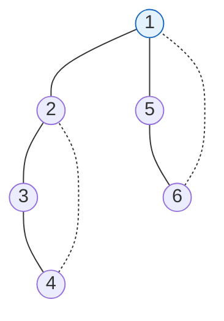

**Depth-first search** (DFS) from a vertex $s$ explores a graph by advancing from the current vertex to an undiscovered neighbor whenever one exists, and backtracking to the previous vertex on the current path when none does. The edges along which it discovers vertices form a **DFS tree**, a spanning tree of the connected component of $s$.

The DFS tree contains every vertex that DFS reaches, and its edges are a subset of the graph's edges. Its principal structural property is that every non-tree edge of an undirected graph joins a vertex to one of its ancestors in the tree.

## Core idea

Unlike the [[algorithms/BFS|BFS]] tree, a DFS tree has no minimum-depth guarantee, and the depth of a vertex in it does not equal its distance from the root. In a DFS tree, no edge of the graph connects two vertices of which neither is an ancestor of the other; every non-tree edge joins a vertex to one of its ancestors. Each non-tree edge therefore closes a cycle with the tree path between its endpoints, which is the basis of cycle detection by DFS.

**Lemma**: Let $T = (V_t, E_t)$ be a DFS tree of graph $G = (V, E)$. For every edge $e = (x, y) \in E$ with $e \notin E_t$, one of $x$ or $y$ is an ancestor of the other in $T$.

**Proof**: Without loss of generality, assume $x$ is discovered first. When $dfs(x)$ is called, $y$ is still undiscovered. The call $dfs(x)$ does not return until every neighbor of $x$ has been discovered, since it visits each neighbor and recurses on the undiscovered ones. So $y$ is discovered during $dfs(x)$, which places $y$ somewhere in the subtree rooted at $x$, making $x$ an ancestor of $y$. $\blacksquare$

In the following example, a DFS from vertex 1 visits 1, 2, 3 and 4, backtracks, and then visits 5 and 6. Solid edges are tree edges and dashed edges are the non-tree edges of $G$.



Both dashed edges join a vertex to one of its ancestors. No edge joins the subtree of 2 to the subtree of 5, and the lemma excludes any such edge.

> [!tip] Where non-tree edges can go
> BFS and DFS trees constrain non-tree edges in complementary ways. In a [[algorithms/BFS|BFS]] tree, a non-tree edge joins vertices in the same level or in adjacent levels, and it may join unrelated subtrees. In a DFS tree, a non-tree edge may span many levels, and it joins a vertex to an ancestor.

## Implementation

```python
def dfs_recursive(G, src, vis=None, f=print):
    if vis is None:
        vis = set()
    if src in vis:
        return
    vis.add(src)
    f(src)
    for v in G[src]:
        dfs_recursive(G, v, vis, f)

def dfs_iterative(G, src, f=print):
    vis = set()
    stack = [src]
    while stack:
        curr = stack.pop()
        if curr in vis:
            continue
        vis.add(curr)
        f(curr)
        for v in G[curr]:
            stack.append(v)
```

> [!warning] Recursion depth
> `dfs_recursive` adds a stack frame for every vertex on the current path, so a long path graph exceeds Python's default recursion limit of 1000 and raises `RecursionError`. Use `dfs_iterative` when the input can be deep.

## Properties of DFS Spanning Trees

DFS visits every vertex in the starting vertex's connected component, so it finds [[algorithms/connected-components|connected components]], as BFS does.

The ancestor property distinguishes DFS trees from BFS trees. Since every non-tree edge joins a vertex to an ancestor or descendant, each non-tree edge closes a cycle, which makes DFS a direct method of cycle detection. The property also underlies algorithms on [[algorithms/DAGs|directed acyclic graphs]] such as topological sorting.

## Related notes

- [[algorithms/graphs-intro|Graph fundamentals]]
- [[algorithms/BFS|breadth-first search]]
- [[algorithms/DAGs|directed acyclic graphs]]
