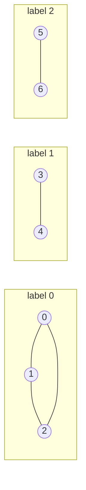

A **connected component** of an undirected graph $G = (V, E)$ is a maximal set $C \subseteq V$ such that every two vertices of $C$ are joined by a path in $G$. The connected components $C_1, C_2, \ldots$ partition $V$.

[[algorithms/BFS|Breadth-first search (BFS)]] or [[algorithms/DFS|depth-first search (DFS)]] computes this partition in $O(|V| + |E|)$ time. The result is a labeling, built once from $G$, that answers whether a path exists between two vertices $u, v \in V$ in $O(1)$ time and $O(|V|)$ space, since two vertices are connected if and only if they carry the same component label.

## Algorithm

The algorithm scans the vertices in order. Each vertex that has no label when the scan reaches it begins a new component; a BFS (or DFS) from that vertex assigns the current label to every vertex it reaches, and the label is then incremented. Each traversal remains within one component because BFS follows only edges, and it labels the whole component because BFS reaches every vertex connected to its source. The labels are stored in an array (if vertices are numbered) or a hash map.

On the following graph, the scan starts traversals at vertices 0, 3 and 5, and each traversal labels one component.



```python
from collections import deque, defaultdict

def connected_components(graph):
    a = [None] * len(graph)

    def bfs(label, src):
        q = deque([src])
        a[src] = label
        while q:
            curr = q.popleft()
            for v in graph[curr]:
                if a[v] is None:
                    a[v] = label
                    q.append(v)

    curr_label = 0
    for v in range(len(graph)):
        if a[v] is None:
            bfs(curr_label, v)
            curr_label += 1
    return a

def component_sets(G):
    comp = connected_components(G)
    component_dict = defaultdict(set)
    for v, c in enumerate(comp):
        component_dict[c].add(v)
    return list(component_dict.values())
```

The label array also serves as the visited set, so every vertex enters the queue at most once and the total work over all traversals is $O(|V| + |E|)$.

> [!warning] Undirected graphs only
> The labeling argument relies on connectivity being symmetric. In a directed graph reachability is not symmetric, and a scan that follows only outgoing edges produces labels that depend on the scan order. The scan computes weakly connected components when every edge is traversed in both directions. Strongly connected components require Tarjan's or Kosaraju's algorithm.

## Strategy for Unconnected Graphs

When the solution of a graph problem decomposes over connected components, it suffices to solve the problem for connected graphs and to apply that solution separately to each connected component.

## Related notes

- [[algorithms/BFS|breadth-first search]]
- [[algorithms/DFS|depth-first search]]
- [[algorithms/graphs-intro|graph fundamentals]]
- [[reference/cheatsheets/algorithms/graphs|graph theory cheatsheet]]
