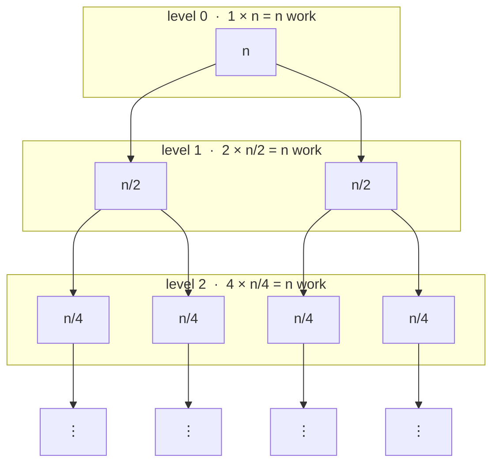

**Divide and conquer** is an algorithm design technique that reduces a problem to one or more subproblems of the same form, solves each recursively, and combines their solutions into a solution of the original problem.

An algorithm designed by [[algorithms/induction|induction]] typically reduces the problem by one element at each step. Divide and conquer reduces it to subproblems whose size is a constant fraction of the original, and this difference accounts for its lower running time ([[#Why Balanced Partitioning?]]). Merge sort, binary search and Strassen's algorithm have this structure.

## Why Balanced Partitioning?

Suppose the merge step costs $O(n)$ and the brute force algorithm costs $O(n^2)$. Reducing the problem by one element at each step gives

$$
T(n) = T(n - 1) + O(n) = O(n^2)
$$

which is no improvement over brute force. Splitting the input into two halves and solving each half by brute force costs

$$
2 \cdot \left(\frac{n}{2}\right)^2 + n = \frac{n^2}{2} + n
$$

One level of splitting reduces the work by roughly a factor of 2. A second level reduces it by roughly a factor of 4, and a third by almost 8. Recursing until the subproblems reach constant size gives

$$
T(n) = 2T\left(\frac{n}{2}\right) + O(n) = O(n \log n)
$$

In the recursion tree, subproblem sizes decrease geometrically while their number doubles at each level, so the total merge work is the same at every level.



Halving continues for $\log_2 n$ levels before subproblems reach constant size, and each level sums to $n$, giving the $O(n \log n)$ total.

The iterative brute force algorithm incurs no recursive-call overhead and can be faster on small inputs, so an implementation may stop the recursion at a cutoff size and solve the remaining subproblems by brute force. Quick sort with random splitters is implemented this way.

## Finding the Root of a Function

Given a continuous function $f$ and two points $a < b$ such that $f(a) \le 0$ and $f(b) \ge 0$, find an approximate root: a point $c$ such that some $r$ with $f(r) = 0$ satisfies $|r - c| \le \epsilon$. Such an $r$ exists by the intermediate value theorem.

### Naive Approach

Divide $\lbrack a, b\rbrack$ into $n = \frac{b - a}{\epsilon}$ intervals and check each one for a sign change. This runs in $O(n) = O(\frac{b - a}{\epsilon})$.

### Bisection

Check the midpoint and recurse into the half that still has a sign change.

```python
def bisection(f, a, b, eps):
    if (b - a) < eps:
        return a

    m = (a + b) / 2
    if f(m) < 0:
        return bisection(f, m, b, eps)
    else:
        return bisection(f, a, m, eps)
```

Let $n = \frac{b - a}{\epsilon}$. Each step halves the interval, so

$$
T(n) = T\left(\frac{n}{2}\right) + O(1) = O(\log n) = O\left(\log \frac{b - a}{\epsilon}\right)
$$

### Correctness

$P(n)$: for all $a < b$ with $f(a) \le 0$, $f(b) \ge 0$, and $\frac{b - a}{\epsilon} = n$, `bisection` returns a value $c$ such that $\exists r$ with $f(r) = 0$ and $|r - c| \le \epsilon$.

**Base case** $P(1)$: by the intermediate value theorem, $\exists r \in [a, b]$ with $f(r) = 0$. We output $a$, and $|a - r| \le |b - a| \le \epsilon$.

**Inductive hypothesis**: assume $P(n)$.

**Inductive step** $P(2n)$: given arbitrary $a < b$ with $\frac{b - a}{\epsilon} = 2n$, $f(a) \le 0$, and $f(b) \ge 0$, let $m = \frac{a + b}{2}$.

Case 1: $f(m) \ge 0$. Then $a, m$ satisfy the premises of $P(n)$, since $\frac{m - a}{\epsilon} = n$, $f(a) \le 0$, and $f(m) \ge 0$.

Case 2: $f(m) < 0$. Then $m, b$ satisfy the premises of $P(n)$ by the same reasoning.

Either way the recursive call returns a valid answer by the inductive hypothesis. $\blacksquare$

## Closest Pair of Points

Given $n$ points in the plane, find the pair with the smallest Euclidean distance between them. Checking every pair takes $O(n^2)$ time. A packing argument in the plane eliminates all but $O(n)$ of the comparisons between the two halves at each level of the recursion.

### 1 Dimensional Version

Given $n$ points on the real line, sort them and compare each consecutive pair. The closest pair must be consecutive in sorted order.

### 2 Dimensional Version

- *Divide*: draw a vertical line $L$ with $\approx \frac{n}{2}$ points on each side.
- *Conquer*: find the closest pair on each side recursively.

Let $\delta$ be the smaller of the two one-side minimum distances. The only remaining candidates are pairs that straddle $L$, and both endpoints of such a pair must lie within $\delta$ of $L$.

Partition each side of the strip into $\frac{\delta}{2} \times \frac{\delta}{2}$ squares. Each square holds at most one point, since two points in the same square would be at distance at most $\frac{\delta}{\sqrt{2}} < \delta$ on the same side of $L$, contradicting the minimality of $\delta$ on that side.

The points in the strip $x \in [L - \delta, L + \delta]$, sorted by $y$-coordinate, are $s_1, s_2, \ldots$.

**Claim**: $\forall s_i, s_j$, if $|i - j| > 11$, then $d(s_i, s_j) > \delta$.

**Proof**: The strip is $2\delta$ wide, so each row of squares in the strip contains 4 squares, each holding at most one point. Any point more than two rows away from $s_i$ has vertical distance greater than $\delta$ from $s_i$. Within two rows of $s_i$ there are at most 3 other points in its own row and 8 in the two rows above (or below), so any point more than $8 + 3 = 11$ positions away in $y$-sorted order is more than two rows away, and thus at distance greater than $\delta$. $\blacksquare$

The merge step therefore compares each strip point only with its 11 neighbors in $y$-sorted order, which keeps the merge linear after sorting and gives $T(n) = 2T(\frac{n}{2}) + O(n \log n)$, which is $O(n \log^2 n)$. Presorting by $y$ tightens this to $O(n \log n)$.

> [!tip] The constant 11 comes from the packing argument
> The neighbor bound is a consequence of the packing argument and holds for every input. A window smaller than the proven bound has no correctness guarantee from this argument, although finer packing arguments prove smaller constants, so 11 is sufficient but not the least possible. Enlarging the window adds comparisons without changing the result. The implementation in [[#Implementation]] checks indices $i - 11$ through $i + 11$, as the claim requires. It also switches to brute force at $n \le 10$, the small-input cutoff discussed under [[#Why Balanced Partitioning?|balanced partitioning]].

### Implementation

```python
def bounding_indices(P, low, high, key=lambda x: x[0]):
    n = len(P)
    l, r = 0, n - 1

    while l <= r:
        mid = (l + r) // 2
        if low <= key(P[mid]):
            r = mid - 1
        else:
            l = mid + 1
    smallest_index = l

    l, r = 0, n - 1
    while l <= r:
        mid = (l + r) // 2
        if high >= key(P[mid]):
            l = mid + 1
        else:
            r = mid - 1
    highest_index = r

    return smallest_index, highest_index

def d(p1, p2):
    if p1 is None or p2 is None:
        return float('inf')
    return ((p1[0] - p2[0]) ** 2 + (p1[1] - p2[1]) ** 2) ** .5

def cp_brute_force(P):
    n = len(P)
    ans = P[:2]
    min_d = d(P[0], P[1])
    for i in range(n):
        for j in range(i):
            curr_d = d(P[i], P[j])
            if curr_d < min_d:
                min_d = curr_d
                ans = [P[i], P[j]]
    return ans

def cp_recursive(P):
    n = len(P)
    if n < 2:
        return None, None

    if n <= 10:
        return cp_brute_force(P)

    l1, l2 = cp_recursive(P[:n//2])
    r1, r2 = cp_recursive(P[n//2:])

    m1, m2 = (l1, l2) if d(l1, l2) < d(r1, r2) else (r1, r2)

    delta = d(m1, m2)
    L = (P[n//2 - 1][0] + P[n//2][0]) / 2

    l, h = bounding_indices(P, L - delta, L + delta)

    middle = sorted(P[l:h + 1], key=lambda x: x[1])
    k = len(middle)
    for i in range(k):
        for j in range(max(0, i - 11), min(k, i + 12)):
            if i == j:
                continue
            curr_dist = d(middle[i], middle[j])
            if curr_dist < delta:
                delta = curr_dist
                m1, m2 = middle[i], middle[j]

    return m1, m2

def closest_points(P):
    return cp_recursive(sorted(P, key=lambda x: x[0]))
```

## Related notes

- [[reference/cheatsheets/algorithms/divide-and-conquer|divide and conquer cheatsheet]]
- [[algorithms/practice/4|problem set 4]]
- [[algorithms/induction|induction]]
- [[algorithms/runtime|runtime analysis]]
- [[algorithms/dynamic-programming|dynamic programming]]
