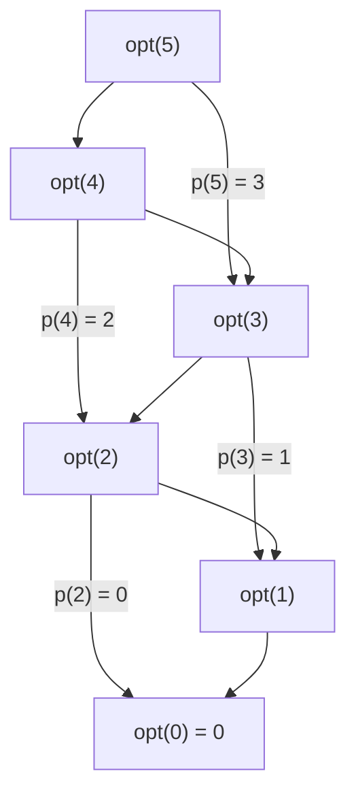

## Purpose

A recursive solution often asks the same question many times. Dynamic programming answers each distinct question once, stores the answer, and looks it up after that. When a problem has only polynomially many distinct subproblems but an exponential recursion tree, that one change turns an exponential algorithm into a polynomial one.

Richard Bellman named the method in the early 1950s for multistage decision problems ([Bellman 1954](https://www.ams.org/bull/1954-60-06/S0002-9904-1954-09848-8/S0002-9904-1954-09848-8.pdf)); "programming" meant planning, as in linear programming. The algorithmic view used here comes from [Kleinberg and Tardos, chapter 6](https://www.cs.princeton.edu/~wayne/kleinberg-tardos/pdf/06DynamicProgrammingI.pdf). You design a dynamic program the way you write a proof by [[algorithms/induction|induction]]: assume you can solve every smaller instance, then show how to solve this one from them. The difference is bookkeeping. Each smaller answer is computed once and stored.

This note opens with the general method and its costs, then works through problems, each with a recurrence, a correctness argument and code. Every Python block below runs as written: a harness extracts the blocks from this page and checks each against a brute-force solver on thousands of small random inputs ([how](#how-this-was-measured)).

## The method

Two properties make a problem a good fit. With **optimal substructure**, an optimal solution is assembled from optimal solutions to smaller instances, so a recurrence can take a max or min over smaller cases. With **overlapping subproblems**, the plain recursion reaches the same smaller instances again and again, so storing answers saves work. [[algorithms/divide-and-conquer|Divide and conquer]] has the first property without the second: merge sort's halves never overlap, so a cache would never hit.

The design work comes in five decisions:

1. **The subproblem.** Usually a prefix ("the first $j$ jobs"), an interval ("bases $i$ through $j$"), a pair of prefixes ("the first $i$ letters of $x$ and the first $j$ of $y$"), or a vertex with a budget. A good choice makes the answer to the whole problem one of the subproblems, or a simple combination of a few.
2. **The recurrence.** Guess one thing about the optimal solution (is the last job in it, what does the last base pair with), and write the answer for each guess in terms of smaller subproblems. Correctness is the induction step: the guesses cover every possibility, and each case is solved optimally.
3. **The order.** The subproblems and the "depends on" edges between them form a [[algorithms/DAGs|directed acyclic graph]]. Any topological order of that DAG works. A table filled row by row is one; a recursive function with a cache finds one on its own.
4. **The base cases**, the sources of the DAG.
5. **Recovery.** The table holds optimal *values*. To get the solution itself, walk back from the final entry, at each step redoing the comparison to see which case won.

Running time is the number of subproblems times the work per subproblem. That count is also the memory, unless the order lets you forget old entries.

The DAG view is literal. Each subproblem is a vertex, each case of the recurrence an edge, and the optimum is a shortest or longest path through that graph. [Longest path in a DAG](#longest-path-in-a-dag) below is the purest example; [Bellman-Ford](#shortest-paths-with-negative-edge-weights-bellman-ford) is the same idea where the graph has cycles and the DP unrolls it by path length.

### Top down or bottom up

There are two ways to visit the DAG. **Top down** (memoization) keeps the natural recursion and caches each result; Python's [`functools.cache`](https://docs.python.org/3/library/functools.html#functools.cache) does it in one line. **Bottom up** (tabulation) fills an array in an order you choose so that every dependency is ready before it is needed.

They compute the same answers, but they cost different amounts in practice. I timed the two knapsack implementations below and two one-row variants on 100 random items, five runs each ([numbers and setup](#how-this-was-measured)):

| Version | $W = 1{,}000$ | $W = 10{,}000$ |
| --- | --- | --- |
| Top down, `knapsack_rec` | 20.7 ms (20.2 to 22.8) | 193 ms (190 to 198) |
| Bottom up, `knapsack_it` | 10.3 ms (9.8 to 11.1) | 104 ms (103 to 105) |
| One row, `knapsack_one_row` | 4.9 ms (4.8 to 5.1) | 50.6 ms (50.0 to 66.4) |
| One row, NumPy | 0.16 ms (0.16 to 0.24) | 0.64 ms (0.60 to 0.69) |

Each cell is the median of five runs, with the fastest and slowest in parentheses. All four versions returned the same value on every run.

Top down pays for a function call and a cache lookup per subproblem, and only visits subproblems the recursion can reach, which here is 80% at $W = 1{,}000$ and 65% at $W = 10{,}000$ of the table. Bottom up visits every cell but each visit is a few list operations, and a bottom-up order makes the one-row and vectorized versions possible. Recursion depth is the other cost. CPython stops at a fixed depth (the default limit is 1000 frames, see [`sys.getrecursionlimit`](https://docs.python.org/3/library/sys.html#sys.getrecursionlimit)), so `knapsack_rec` with 2,000 items raised `RecursionError` in this run while `knapsack_it` finished. Prototype top down, where the recurrence reads straight off the page, then switch to bottom up when inputs grow.

## Weighted Interval Scheduling

**Problem**: Given jobs with start times $s_i$, finish times $f_i > s_i$ and weights $w_i$, find a set of mutually compatible jobs (none overlap; $f_i \le s_j$ or $f_j \le s_i$) of maximum total weight.

With all weights equal, earliest finish time first is optimal ([[algorithms/greedy-algorithms|greedy algorithms]]). With weights, every greedy rule fails on some input, and the first recursion that comes to mind is exponential: "either job $n$ is out, so recurse on the others, or it is in, so delete everything it overlaps and recurse on what's left". The sets left after deleting are arbitrary subsets of the jobs, and there are $2^n$ of them, so caching them buys nothing. In graph terms the jobs and their overlaps form an interval graph and we want a maximum-weight independent set. That problem is NP-hard in general graphs, and the subset recursion is the general-graph algorithm. Interval graphs have extra structure, and sorting exposes it.

Sort the jobs by finish time, so $f_1 \le f_2 \le \dots \le f_n$. Let $p(j)$ be the largest index $i < j$ with $f_i \le s_j$, or 0 if there is none. The jobs compatible with $j$ that come before it are exactly jobs $1, \dots, p(j)$, a prefix. So every subproblem is a prefix: let $OPT(j)$ be the best weight using jobs $1, \dots, j$. Either job $j$ is in the optimum, and then the rest of the optimum is an optimal schedule of jobs $1, \dots, p(j)$, or it is not, and the optimum is $OPT(j - 1)$:

$$
OPT(j) = \begin{cases}
0 & j = 0 \\
\max\big(OPT(j - 1),\ w_j + OPT(p(j))\big) & j \ge 1
\end{cases}
$$

```python
from bisect import bisect_right
from functools import cache

def max_weight_schedule(jobs):
    """jobs: list of (start, finish, weight) with start < finish."""
    jobs = sorted(jobs, key=lambda job: job[1])
    finish = [f for _, f, _ in jobs]
    # p[j]: how many jobs finish by the time job j starts. Those jobs come
    # before j in finish order, so they form the prefix compatible with j.
    p = [bisect_right(finish, s) for s, _, _ in jobs]

    @cache
    def opt(j):  # best weight using only the first j jobs
        if j == 0:
            return 0
        weight = jobs[j - 1][2]
        return max(opt(j - 1), weight + opt(p[j - 1]))

    return opt(len(jobs))
```

Sorting and the $n$ binary searches for $p$ cost $O(n \log n)$; after that each of the $n + 1$ subproblems takes constant time.

Without the cache the same recursion is exponential. Each call makes two calls, and both branches rederive the same prefixes. When every job overlaps only its predecessor, $p(j) = j - 2$ and the call count grows like the Fibonacci numbers, about $1.618^n$. I counted calls of the uncached recursion:

| Jobs $n$ | No overlaps, $p(j) = j - 1$ | Chain, $p(j) = j - 2$ | 5 random instances | With the cache |
| --- | --- | --- | --- | --- |
| 10 | 2,047 | 287 | 479 to 1,151 | 21 |
| 20 | 2,097,151 | 35,421 | 28,727 to 75,599 | 41 |
| 25 | *67,108,863* | 392,835 | 203,519 to 820,799 | 51 |
| 30 | *2,147,483,647* | 4,356,617 | 971,999 to 4,991,999 | 61 |

The worst case is jobs that never overlap: then $p(j) = j - 1$, both branches call the same subproblem, and the count doubles with every job, to $2^{n+1} - 1$. I measured it up to $n = 20$; the italic entries are that formula. When each job overlaps only its neighbors, $p(j) = j - 2$ and the count grows like the Fibonacci numbers, about $1.618^n$. Random instances (starts uniform in $[0, 1000]$, lengths in $[1, 100]$) land in between. The chain at $n = 30$ took 0.27 seconds to make its 4.4 million calls; the no-overlap case at $n = 30$ would make 490 times as many.

With the cache, the count is $2n + 1$ calls for every input: one real computation per prefix plus one cache hit per edge of the dependency DAG. For a 5-job instance with $p(5) = 3$, $p(4) = 2$, $p(3) = 1$ and $p(2) = 0$:



`opt(3)` is reachable along two paths and `opt(1)` along five, yet each is computed once.

### Recovering the schedule

The table says how much the best schedule is worth, not which jobs are in it. Walk back from $j = n$: if taking job $j$ is at least as good as skipping it, job $j$ is in an optimal schedule and the walk jumps to $p(j)$; otherwise it steps to $j - 1$. This costs $O(n)$ more and needs the whole table, or a stored decision per entry.

```python
def chosen_jobs(jobs):
    jobs = sorted(jobs, key=lambda job: job[1])
    finish = [f for _, f, _ in jobs]
    p = [bisect_right(finish, s) for s, _, _ in jobs]
    M = [0] * (len(jobs) + 1)
    for j in range(1, len(jobs) + 1):  # bottom up: M[j] = OPT(j)
        M[j] = max(M[j - 1], jobs[j - 1][2] + M[p[j - 1]])

    picked, j = [], len(jobs)
    while j > 0:
        if jobs[j - 1][2] + M[p[j - 1]] >= M[j - 1]:  # taking job j is optimal
            picked.append(jobs[j - 1])
            j = p[j - 1]
        else:
            j -= 1
    return picked[::-1]
```

## Knapsack Problem

**Problem**: Given $n$ items with positive integer weights $w_1, \ldots, w_n$ and values $v_1, \ldots, v_n$, and a knapsack of capacity $W$, find the most valuable subset of items whose total weight is at most $W$.

Prefixes of the items are not enough here. Whether item $i$ fits depends on how much room the earlier choices left, so the subproblem needs a second index for the remaining capacity. Let $OPT(i, w)$ be the best value using items $1, \ldots, i$ with capacity $w$. Item $i$ is either left out, or taken, which uses $w_i$ of the capacity:

$$
OPT(i, w) = \begin{cases}
0 & i = 0 \\
OPT(i - 1, w) & w_i > w \\
\max\big(OPT(i - 1, w),\ v_i + OPT(i - 1, w - w_i)\big) & \text{otherwise}
\end{cases}
$$

The induction is on $i$: assume $OPT(i - 1, w)$ is right for every $w \in [0, W]$, and the recurrence gives row $i$ for every $w$.

```python
def knapsack_rec(W: int, w: list[int], v: list[int]) -> int:
    n = len(w)
    M = [[-1] * (W + 1) for _ in range(n + 1)]

    def dp(i: int, cap: int) -> int:
        if i == 0 or cap == 0:
            return 0
        if M[i][cap] != -1:
            return M[i][cap]
        if w[i - 1] > cap:
            M[i][cap] = dp(i - 1, cap)
        else:
            M[i][cap] = max(v[i - 1] + dp(i - 1, cap - w[i - 1]), dp(i - 1, cap))
        return M[i][cap]

    return dp(n, W)


def knapsack_it(W: int, w: list[int], v: list[int]) -> int:
    n = len(w)
    M = [[0] * (W + 1) for _ in range(n + 1)]
    for i in range(1, n + 1):
        for j in range(1, W + 1):
            if w[i - 1] > j:
                M[i][j] = M[i - 1][j]
            else:
                M[i][j] = max(v[i - 1] + M[i - 1][j - w[i - 1]], M[i - 1][j])
    return M[n][W]
```

> [!info]- One row is enough
> Row $i$ reads only row $i - 1$, and only at capacities $\le w$. Sweep the capacities from high to low and you can overwrite a single array in place: when you write `best[c]`, the entry `best[c - wi]` you read still holds row $i - 1$. Sweeping low to high would let an item be taken twice, which is the recurrence for the unbounded knapsack instead.
>
> ```python
> def knapsack_one_row(W, w, v):
>     best = [0] * (W + 1)  # best[c] = OPT(i, c) for the items seen so far
>     for wi, vi in zip(w, v):
>         for c in range(W, wi - 1, -1):  # high to low keeps best[c - wi] at row i - 1
>             best[c] = max(best[c], vi + best[c - wi])
>     return best[W]
> ```
>
> The same update vectorizes, because every entry of a new row depends only on the old row: `best[wi:] = np.maximum(best[wi:], vi + best[:-wi])`, where NumPy evaluates the right-hand side in full before assigning. That is the NumPy row of the timing table above. You lose the ability to recover which items were taken, unless you also keep one bit per cell recording whether item $i$ was taken at capacity $c$.

> [!warning] The running time is pseudo-polynomial
> The table has $(n + 1)(W + 1)$ entries, and $W$ is a number, not a length. Writing $W$ takes $\log W$ bits, so $O(nW)$ is exponential in the size of the input, and knapsack stays NP-complete despite this algorithm. Rounding the values down to multiples of a scale factor and running a value-indexed version of the same DP gives a $(1 - \varepsilon)$-approximation in time polynomial in $n$ and $1/\varepsilon$ ([Ibarra and Kim 1975](https://dblp.org/rec/journals/jacm/IbarraK75)). [[#P1 - Knapsack Approximation|P1 below]] asks for something simpler: a 2-approximation in time polynomial in $n$ and $\log W$.

## String Building

**Problem**: Given integers $n \ge 1$ and $k_A, k_B \ge 1$, count the strings of length $n$ over $\{A, B\}$ with no run of more than $k_A$ consecutive $A$s and no run of more than $k_B$ consecutive $B$s, in time polynomial in $n$, $k_A$ and $k_B$.

Let $OPT(i, c)$ be the number of valid strings of length $i$ that end in the character $c \in \{A, B\}$, and write $c'$ for the other character and $k_c$ for the run limit of $c$. Every valid string ends in $A$ or $B$, so the answer is $OPT(n, A) + OPT(n, B)$.

A valid string of length $i$ that ends in $c$ ends in a run of $c$ of some length $r$ with $1 \le r \le \min(k_c, i)$. If $r = i$ the whole string is that run, and there is exactly one such string. If $r < i$, the character before the run is $c'$, and the first $i - r$ characters form a valid string ending in $c'$. Summing over $r$:

$$
OPT(i, c) = [\,i \le k_c\,] + \sum_{r = 1}^{\min(k_c,\, i - 1)} OPT(i - r, c')
$$

where $[\,i \le k_c\,]$ is 1 when the whole string can be a single run and 0 otherwise. The code below computes the same numbers with a shortcut for $i \le k_c$: when the run limit can't be reached, appending $c$ to any valid string of length $i - 1$ is valid, so $OPT(i, c) = OPT(i - 1, A) + OPT(i - 1, B)$.

```python
A, B = 0, 1

def num_strings(n, ka, kb):
    dp = [[None, None] for _ in range(n + 1)]

    def f(i, c):
        if i == 1:
            return 1
        if dp[i][c] is not None:
            return dp[i][c]
        kc = ka if c == A else kb
        notc = A if c == B else B
        if i <= kc:
            dp[i][c] = f(i - 1, notc) + f(i - 1, c)
        else:
            dp[i][c] = sum(f(i - j, notc) for j in range(1, kc + 1))
        return dp[i][c]

    return f(n, A) + f(n, B)
```

**Running time**: there are $2n$ subproblems. Those ending in $A$ cost $O(k_A)$ each and those ending in $B$ cost $O(k_B)$, so the total is $O(n(k_A + k_B))$. Keeping running sums of the last $k_c$ values of $OPT(\cdot, c')$ removes the inner loop and brings it to $O(n)$ arithmetic operations. The count itself grows exponentially with $n$, so for large $n$ the big-integer additions dominate.

## Post Office

**Problem**: $n$ villages sit at distinct integer positions $x_1 < x_2 < \dots < x_n$ along a straight highway. Place $k \le n$ post offices, each in a village, to minimize the sum over villages of the distance to the nearest post office.

This is the $k$-median problem on a line. In general metrics $k$-median is NP-hard, but on a line the offices split the villages into contiguous groups, and contiguous groups are what DP needs.

Let $f(n, k)$ be the minimum total distance for villages $1, \dots, n$ using $k$ offices, given that the $k$-th office sits in village $n$. The answer guesses where the last office goes, at some village $i \ge k$; villages after $i$ all walk back to it:

$$
\text{answer} = \min_{k \le i \le n} \Big( f(i, k) + \sum_{i < j \le n} (x_j - x_i) \Big)
$$

To compute $f(n, k)$, guess the village $i$ of the $(k-1)$-th office. Villages strictly between $i$ and $n$ go to whichever of the two is nearer:

$$
f(n, k) = \begin{cases}
0 & n \le k \\
\sum_{j < n} (x_n - x_j) & k = 1 \\
\min_{k - 1 \le i < n} \Big( f(i, k - 1) + \sum_{i < j < n} \min(x_j - x_i,\ x_n - x_j) \Big) & \text{otherwise}
\end{cases}
$$

The base case $n \le k$ is 0 because each village can have its own office. Correctness is induction on $k$ and $n$: the guess $i$ ranges over every possible position of the previous office, the villages left of $i$ are served optimally by $f(i, k - 1)$, and each village between the two offices is assigned to the nearer one.

```python
def min_dist_td(X, K):
    X = sorted(X)
    N = len(X)
    if K >= N:
        return 0

    memo = {}

    def f(n, k):
        # min total distance for villages 1..n with k offices,
        # given the k-th office sits at village n
        if n <= k:
            return 0
        if (n, k) in memo:
            return memo[(n, k)]
        if k == 1:
            memo[(n, k)] = sum(abs(X[i - 1] - X[n - 1]) for i in range(1, n))
        else:
            memo[(n, k)] = min(
                f(i, k - 1) + sum(
                    min(abs(X[j - 1] - X[n - 1]), abs(X[j - 1] - X[i - 1]))
                    for j in range(i + 1, n))
                for i in range(k - 1, n)
            )
        return memo[(n, k)]

    def c(i):
        return f(i, K) + sum(abs(X[i - 1] - X[j - 1]) for j in range(i + 1, N + 1))

    return min(c(i) for i in range(K, N + 1))
```

**Running time**: there are $O(nk)$ values of $f$, each a minimum over $O(n)$ choices of $i$ with an $O(n)$ sum inside, so $O(kn^3)$. The final minimum adds $O(n^2)$.

> [!info]- Faster: precompute the group costs
> The inner sum depends only on $i$ and $n$, so it can be tabulated once. A cleaner formulation splits the sorted villages into $k$ contiguous groups, each served by one office. The best office for a group is its median village, and with prefix sums the cost of any group $x_a, \dots, x_b$ is an $O(1)$ lookup. Then $g(n, k) = \min_{i < n} \big(g(i, k-1) + \text{cost}(i + 1, n)\big)$ runs in $O(kn^2)$. The group cost satisfies the quadrangle inequality, which makes the best $i$ move monotonically with $n$; the divide-and-conquer optimization uses that to bring the time to $O(kn \log n)$.

## RNA Secondary Structure

**Problem**: An RNA molecule is a string $B = b_1 b_2 \ldots b_n$ over $\{A, C, G, U\}$. It folds back on itself, and some bases pair. Find a set $S$ of pairs of maximum size subject to:

- *Pairing*: each pair is $A$–$U$ or $C$–$G$ (Watson–Crick), and each base is in at most one pair.
- *No sharp turns*: if $(i, j) \in S$ then $i < j - 4$, so at least four bases sit inside the loop the pair closes.
- *No crossing*: if $(i, j)$ and $(k, l)$ are in $S$, then not $i < k < j < l$.

This is the maximum-pairing model of [Nussinov and Jacobson (1980)](https://doi.org/10.1073/pnas.77.11.6309), the version in [Kleinberg and Tardos section 6.5](https://www.cs.princeton.edu/~wayne/kleinberg-tardos/pdf/06DynamicProgrammingI.pdf).

Prefixes fail here: if base $j$ pairs with base $t$, the bases inside the pair can only pair with each other, which leaves an interval in the middle. So the subproblems are intervals. Let $OPT(i, j)$ be the most pairs in a structure on $b_i \ldots b_j$. Guess what $b_j$ does:

- $b_j$ is unpaired: $OPT(i, j) = OPT(i, j - 1)$.
- $b_j$ pairs with $b_t$ for some $i \le t < j - 4$: by the no-crossing rule nothing pairs across $t$, so the structure splits into $b_i \ldots b_{t-1}$ and $b_{t+1} \ldots b_{j-1}$, giving $1 + OPT(i, t - 1) + OPT(t + 1, j - 1)$.

$$
OPT(i, j) = \begin{cases}
0 & i \ge j - 4 \\
\max\Big( OPT(i, j - 1),\ \max\limits_{\substack{i \le t < j - 4 \\ b_t b_j \text{ pair}}} \big(1 + OPT(i, t - 1) + OPT(t + 1, j - 1)\big) \Big) & \text{otherwise}
\end{cases}
$$

Each case reads intervals strictly shorter than $[i, j]$, so filling the table in order of increasing length works.

```python
WC = { 'A': 'U', 'U': 'A', 'C': 'G', 'G': 'C' }

def ssi(B):
    N = len(B)
    dp = [[0] * N for _ in range(N)]
    # bottom up over increasing substring length l
    for l in range(6, N + 1):  # a pair needs j - i >= 5, so length >= 6
        for i in range(N - l + 1):
            j = i + l - 1
            dp[i][j] = dp[i][j - 1]
            for t in range(i, j - 4):
                if WC[B[t]] == B[j]:
                    left = dp[i][t - 1] if t > i else 0
                    dp[i][j] = max(dp[i][j], 1 + left + dp[t + 1][j - 1])
    return dp[0][N - 1] if N else 0
```

**Running time**: $O(n^2)$ intervals, each a maximum over $O(n)$ choices of $t$, so $O(n^3)$ time and $O(n^2)$ space.

### Counting pairs is a poor model of folding

Real RNA folds toward low free energy, and most of that energy comes from *stacking*: two adjacent pairs, one inside the other, contribute far more than two isolated pairs, and loops cost energy that grows with their size. Counting pairs ignores both, and G–U "wobble" pairs, which are common in real structures, aren't allowed at all. The model that replaced it, [Zuker and Stiegler (1981)](https://doi.org/10.1093/nar/9.1.133), uses the same interval DP with experimentally measured energies for stacks and loops, and it is what [ViennaRNA](https://doi.org/10.1186/1748-7188-6-26) and similar tools compute today.

I tested the difference on yeast phenylalanine tRNA, a 76-base molecule whose structure is known from its crystal structure ([PDB 1EHZ](https://www.rcsb.org/structure/1EHZ)). Its secondary structure is the cloverleaf: four stems with 21 base pairs in all.

| Structure | Pairs | Cloverleaf pairs it has | Free energy (kcal/mol) |
| --- | --- | --- | --- |
| Cloverleaf, from the crystal structure | 21 | 21 | −22.4 |
| ViennaRNA minimum free energy fold | 21 | 21 | −22.4 |
| Maximum pairing, the optimum a plain traceback returns | 25 | 4 | +5.1 |
| Maximum pairing, the closest of 8,594 tied optima | 25 | 6 | −1.2 |
| Maximum pairing with G–U allowed, closest of 96,423 tied optima | 27 | 7 | −2.7 |

Every row is an exact optimum of its own objective. ViennaRNA's energy minimization recovers the cloverleaf pair for pair. Maximizing pairs finds four more pairs than the real molecule has, and they belong to a different fold: the thousands of structures that tie for the maximum share at most 6 of the 21 real pairs, and the energy model rates them barely more stable than the unfolded chain (0 kcal/mol). Finding "the closest of the tied optima" needs a second DP: maximize pairs, and break ties by the number of cloverleaf pairs, which is the same interval recurrence on a pair of numbers compared lexicographically.

> [!note]- The tRNA structures side by side
> Dot-bracket notation: matching parentheses are a pair, a dot is unpaired. Positions are 1 to 76 from left to right.
>
> ```text
> sequence     GCGGAUUUAGCUCAGUUGGGAGAGCGCCAGACUGAAGAUCUGGAGGUCCUGUGUUCGAUCCACAGAAUUCGCACCA
> cloverleaf   (((((((..((((........)))).(((((.......))))).....(((((.......))))))))))))....
> ViennaRNA    (((((((..((((........)))).(((((.......))))).....(((((.......))))))))))))....
> max pairs    (((.((((((((((((((((....).))).))))).)..))(((..((..(....)))))))...))).)))....
> max + G-U    ((((((((((((((((((((....).)))).)))).).).)((.((((..(....)))))).)).)))))))....
> ```
>
> The two maximum-pairing rows are the tied optima closest to the cloverleaf. Both build one long, irregular stem from the two ends of the molecule inward, where the real tRNA has four short stems.

## Sequence Alignment

**Problem**: Given strings $x = x_1 \ldots x_m$ and $y = y_1 \ldots y_n$, line them up with gaps so they agree as much as possible. Formally, an alignment is a set of pairs $(i, j)$, each position of $x$ and of $y$ in at most one pair, with no crossings: if $(i, j)$ and $(i', j')$ are both in it and $i < i'$, then $j < j'$. Each position left out of every pair costs a gap penalty $\delta$, and each pair $(i, j)$ with $x_i \ne y_j$ costs a mismatch penalty $\alpha$. Find an alignment of minimum cost.

With $\delta = \alpha = 1$ the cost is the Levenshtein edit distance: the fewest single-character insertions, deletions and substitutions that turn $x$ into $y$. Biology uses the same DP with a scoring matrix in place of $\alpha$, after [Needleman and Wunsch (1970)](https://pubmed.ncbi.nlm.nih.gov/5420325/), and `diff`-style tools use special cases of it.

Let $OPT(i, j)$ be the minimum cost of aligning the prefixes $x_1 \ldots x_i$ and $y_1 \ldots y_j$. In an optimal alignment of these prefixes, either $x_i$ and $y_j$ are paired, or $x_i$ is in no pair, or $y_j$ is in no pair. If both were paired, but not with each other, say $x_i$ with $y_{j'}$ and $x_{i'}$ with $y_j$, then $i' < i$ and $j' < j$, and those two pairs would cross. So the three cases cover everything:

$$
OPT(i, j) = \begin{cases}
j\delta & i = 0 \\
i\delta & j = 0 \\
\min\big(\alpha_{x_i y_j} + OPT(i - 1, j - 1),\ \delta + OPT(i - 1, j),\ \delta + OPT(i, j - 1)\big) & \text{otherwise}
\end{cases}
$$

where $\alpha_{x_i y_j}$ is 0 when $x_i = y_j$ and $\alpha$ otherwise. Each cell reads the cell diagonally above-left, the cell above and the cell to the left, so filling row by row works. The figure runs exactly this recurrence:

- **Step** fills one cell and shows the three candidates. The winning move is the arrow in the cell.
- **Play** fills the rest; **Fill** jumps to the end, where the shaded path is the traceback and the alignment appears underneath.
- **The sliders** change $\delta$ and $\alpha$. A mismatch competes with the two gaps that could replace it, so once $\alpha > 2\delta$ the alignment trades every mismatch for a pair of gaps.
- **Selecting a cell** shows the three candidates that produced its value.
- **Keep two rows** greys out every cell a two-row implementation would have discarded. The final cost survives; the path to it does not.

<AlignmentTable />

```python
def align_cost(x, y, gap=1, mismatch=1):
    m, n = len(x), len(y)
    M = [[0] * (n + 1) for _ in range(m + 1)]
    for i in range(m + 1):
        M[i][0] = i * gap
    for j in range(n + 1):
        M[0][j] = j * gap
    for i in range(1, m + 1):
        for j in range(1, n + 1):
            M[i][j] = min(
                M[i - 1][j - 1] + (0 if x[i - 1] == y[j - 1] else mismatch),
                M[i - 1][j] + gap,  # x_i against a gap
                M[i][j - 1] + gap,  # y_j against a gap
            )
    return M
```

The traceback starts at $(m, n)$ and repeats whichever case produced the value in the current cell, preferring the diagonal on ties:

```python
def alignment(x, y, gap=1, mismatch=1):
    M = align_cost(x, y, gap, mismatch)
    top, bottom = [], []
    i, j = len(x), len(y)
    while i > 0 or j > 0:
        if i > 0 and j > 0 and M[i][j] == M[i - 1][j - 1] + (0 if x[i - 1] == y[j - 1] else mismatch):
            top.append(x[i - 1]); bottom.append(y[j - 1]); i -= 1; j -= 1
        elif i > 0 and M[i][j] == M[i - 1][j] + gap:
            top.append(x[i - 1]); bottom.append('-'); i -= 1
        else:
            top.append('-'); bottom.append(y[j - 1]); j -= 1
    return ''.join(reversed(top)), ''.join(reversed(bottom))
```

Both take $O(mn)$ time and the table takes $O(mn)$ space.

### When the table doesn't fit

Space is the problem for long sequences. Two $100{,}000$-base sequences give $10^{10}$ cells. At 4 bytes a cell that is 40 GB, and Python's list of lists is worse: it measured 34 to 39 bytes per cell, because each cell is an 8-byte pointer and every cost above 256 is its own heap-allocated integer object.

The cost alone needs only the previous row:

```python
def align_cost_two_rows(x, y, gap=1, mismatch=1):
    m, n = len(x), len(y)
    prev = [j * gap for j in range(n + 1)]
    for i in range(1, m + 1):
        curr = [i * gap] + [0] * n
        for j in range(1, n + 1):
            curr[j] = min(
                prev[j - 1] + (0 if x[i - 1] == y[j - 1] else mismatch),
                prev[j] + gap,
                curr[j - 1] + gap,
            )
        prev = curr
    return prev[n]
```

That drops the alignment, since the traceback needs the whole table. [Hirschberg (1975)](https://ics.uci.edu/~dhirschb/pubs/p341-hirschberg.pdf) gets it back in linear space by combining DP with [[algorithms/divide-and-conquer|divide and conquer]]. Run the two-row DP forward over the top half of $x$ and backward over the bottom half. The column $j$ that minimizes the sum of the two final rows is where an optimal alignment crosses the middle row, so recurse on the two quadrants it defines. The work halves at each level, so the total is about twice one full pass ([Kleinberg and Tardos 6.7](https://www.cs.princeton.edu/~wayne/kleinberg-tardos/pdf/06DynamicProgrammingII.pdf)).

I measured all three in C on random DNA, with the second sequence a mutated copy of the first, three seeds each:

| Method | $n = 10{,}000$ | $n = 30{,}000$ | $n = 100{,}000$ | Peak memory |
| --- | --- | --- | --- | --- |
| Full table and traceback | 0.24 to 0.27 s | 2.2 to 2.4 s | needs 40 GB | 3.4 GiB at $n = 30{,}000$ |
| Two rows, cost only | 0.08 to 0.12 s | 0.71 to 0.77 s | 8.29 to 8.33 s | 2.3 MiB at $n = 100{,}000$ |
| Hirschberg, full alignment | 0.15 to 0.16 s | 1.40 to 1.47 s | 16.3 to 16.6 s | 2.7 MiB at $n = 100{,}000$ |

The two-row pass over $100{,}000 \times 100{,}000$ cells took 8.3 seconds, about 0.83 ns per cell. So $10^{10}$ operations is fine in C. The same loop in Python ran at about 120 ns per cell (117 to 139 across six runs), which projects to about 20 minutes for the two-row version; the full table would need about 380 GB of memory first. Hirschberg's alignment took 2.0 times as long as the cost-only pass, as the analysis predicts, and never held more than 2.7 MiB. The full table was slower per cell than two rows (2.4 to 2.7 ns), because it streams gigabytes through memory instead of reusing two rows that stay in cache.

> [!info]- When the strings are similar: banded alignment
> If the edit distance is at most $d$, an optimal path never strays more than $d$ cells from the main diagonal, since each step off it costs a gap. Filling only the band of width $2d + 1$ gives $O(nd)$ time ([Ukkonen 1985](https://doi.org/10.1016/S0019-9958(85)80046-2)), and doubling a guessed $d$ until the answer fits inside the band removes the need to know $d$ in advance. Myers' $O(ND)$ algorithm, behind GNU `diff` and git's default diff, is a greedy refinement of the same idea for the insert/delete-only case ([Myers 1986](https://doi.org/10.1007/BF01840446)).

## Longest Path in a DAG

**Problem**: Given a directed acyclic graph $G$, find the most edges on any path.

In a general directed graph this is NP-hard, since a path with $n - 1$ edges is a Hamiltonian path. A DAG has a topological order (see [[algorithms/DAGs|DAGs]]), and in that order every edge into $v$ comes from an earlier vertex. Let $OPT(v)$ be the length of the longest path that ends at $v$. Guess the last edge $u \to v$ of that path:

$$
OPT(v) = \max\Big(0,\ \max_{u \to v} \big(OPT(u) + 1\big)\Big)
$$

The answer is $\max_v OPT(v)$. Processing vertices in topological order means every $OPT(u)$ on the right is already known, and the whole thing runs in $O(n + m)$.

```python
from graphlib import TopologicalSorter

def longest_path(n, edges):
    """Vertices 0..n-1, edges as (u, v) pairs. Returns the most edges on any path."""
    preds = {v: [] for v in range(n)}
    for u, v in edges:
        preds[v].append(u)
    opt = {}
    for v in TopologicalSorter(preds).static_order():  # predecessors come first
        opt[v] = max((opt[u] + 1 for u in preds[v]), default=0)
    return max(opt.values(), default=0)
```

Every DP in this note is this algorithm on its own dependency DAG, with weights on the edges and min or max in place of "+1".

## Longest Increasing Subsequence

**Problem**: Given $x_1, \ldots, x_n$, find the longest strictly increasing subsequence (not necessarily contiguous).

Let $OPT(j)$ be the length of the longest increasing subsequence that ends at $x_j$. Guess the element before $x_j$; if no earlier element is smaller, $x_j$ starts a new subsequence:

$$
OPT(j) = 1 + \max\big(\{0\} \cup \{ OPT(k) : k < j,\ x_k < x_j \}\big)
$$

and the answer is $\max_j OPT(j)$. This is the longest path in the DAG with an edge $k \to j$ whenever $k < j$ and $x_k < x_j$.

```python
def LIS(X):
    n = len(X)
    dp = [None] * (n + 1)
    dp[0] = 0

    def f(i):
        if dp[i] is None:
            dp[i] = 1 + max([0] + [f(k) for k in range(1, i) if X[k - 1] < X[i - 1]])
        return dp[i]

    return max(f(i) for i in range(1, n + 1)) if n else 0
```

That is $O(n^2)$.

> [!info]- $O(n \log n)$ with a different table
> Index the table by length instead of by end position. Keep `tails[k]`, the smallest value that ends an increasing subsequence of length $k + 1$ seen so far. The list is always increasing, so each new element finds its place by binary search: it either extends the longest subsequence or lowers the tail of an existing length.
>
> ```python
> from bisect import bisect_left
>
> def lis_length(X):
>     tails = []  # tails[k] = smallest last element of an increasing subsequence of length k + 1
>     for x in X:
>         k = bisect_left(tails, x)
>         if k == len(tails):
>             tails.append(x)
>         else:
>             tails[k] = x
>     return len(tails)
> ```
>
> `bisect_left` keeps the subsequence strictly increasing; `bisect_right` would allow equal elements. Fredman showed that about $n \log n$ comparisons are needed in the worst case, so this is optimal among comparison-based algorithms ([Fredman 1975](https://researchr.org/publication/Fredman75-0)).

## Shortest Paths with Negative Edge Weights (Bellman-Ford)

**Problem**: Given a directed graph with $n$ vertices, $m$ edges and edge costs $c_{uv}$ that may be negative, find the shortest path from a source $s$ to every vertex.

If a cycle of negative total cost is reachable from $s$, going around it again always helps, and some distances are $-\infty$. Assume for now there is none. Then some shortest path to each vertex is simple, so it has at most $n - 1$ edges. Dijkstra's algorithm fails with negative edges because a vertex it has finalized can still be improved through a negative edge found later; the DP avoids committing early by organizing paths by their number of edges.

Let $OPT(i, v)$ be the cost of the cheapest path from $s$ to $v$ that uses at most $i$ edges. Either that path uses fewer than $i$ edges, or its last edge is some $u \to v$ and the rest is a cheapest path to $u$ with at most $i - 1$ edges:

$$
OPT(i, v) = \begin{cases}
0 & i = 0,\ v = s \\
\infty & i = 0,\ v \ne s \\
\min\Big( OPT(i - 1, v),\ \min_{u \to v} \big(OPT(i - 1, u) + c_{uv}\big) \Big) & i \ge 1
\end{cases}
$$

The answer is $OPT(n - 1, v)$. Each round $i$ examines every edge once, so $n - 1$ rounds cost $O(nm)$ time. Row $i$ only reads row $i - 1$, so one array suffices:

```python
def bellman_ford(n, edges, s):
    """edges: list of (u, v, cost). Returns the distances from s, or None if
    a negative cycle is reachable from s."""
    dist = [float('inf')] * n
    dist[s] = 0
    for _ in range(n - 1):
        changed = False
        for u, v, c in edges:
            if dist[u] + c < dist[v]:
                dist[v] = dist[u] + c
                changed = True
        if not changed:  # nothing improved, so nothing ever will
            break
    for u, v, c in edges:  # an nth round that still improves means a negative cycle
        if dist[u] + c < dist[v]:
            return None
    return dist
```

Updating in place can only make `dist[v]` smaller sooner, so after round $i$ it is at most $OPT(i, v)$ and never below the true distance. The stop when a round changes nothing is safe for the same reason. If a negative cycle is reachable, some edge on it can always be relaxed, and the extra round catches it ([Kleinberg and Tardos 6.8 and 6.10](https://www.cs.princeton.edu/~wayne/kleinberg-tardos/pdf/06DynamicProgrammingII.pdf)). The distance-vector routing protocols in [[systems/networks/3-network/routing|routing]] run the same relaxation, with each router doing its own vertex's update from its neighbors' tables.

## P1 - Knapsack Approximation

**Problem**: Given $n$ items with integer weights $w_i$ and values $v_i$ and a knapsack of capacity $W$, where every $w_i \le W/2$, find in time polynomial in $n$ and $\log W$ a set of items worth at least half the optimum.

Sort by value density $v_i / w_i$, highest first, and take items in that order until the first one that doesn't fit.

```python
def A(weights, values, W):
    n = len(weights)
    greed = [(values[i] / weights[i], i) for i in range(n)]
    greed.sort(reverse=True)  # highest value per unit weight first

    w, v = 0, 0
    for i in range(n):
        if w + weights[greed[i][1]] <= W:
            w += weights[greed[i][1]]
            v += values[greed[i][1]]
        else:
            break
    return v
```

**Running time**: $O(n \log n)$ comparisons for the sort and $O(n)$ additions, each on numbers of $O(\log W + \log \max v_i)$ bits, so polynomial in $n$ and $\log W$.

**Why it is a 2-approximation**: If every item fits, the algorithm takes everything, which is optimal. Otherwise let item $k$ be the first in density order that doesn't fit, let $\rho = v_k / w_k$, let $S$ be the items taken before it, and let $r = W - w(S)$ be the room left. Then:

- *The fractional greedy bounds the optimum.* If we may take part of an item, filling the knapsack by density is optimal, and that fractional solution is $S$ plus $r/w_k$ of item $k$. Every integral solution is also a fractional one, so $OPT \le v(S) + r\rho$.
- *$S$ fills more than half the knapsack.* Item $k$ didn't fit, so $r < w_k \le W/2$, and $w(S) = W - r > W/2 > r$.
- *$S$ is worth more than the fraction.* Every item in $S$ has density at least $\rho$, so $v(S) \ge \rho\, w(S) > \rho r$.

Together, $OPT \le v(S) + r\rho < 2\, v(S)$.

The assumption $w_i \le W/2$ matters. With items $(w, v) = (1, 2)$ and $(W, W)$, greedy takes the first item, finds the second doesn't fit, and returns 2 against an optimum of $W$. The standard repair returns the better of the greedy set and the single most valuable item, which is a 2-approximation for any weights. On 4,000 random small instances satisfying the assumption, the worst ratio the harness found was 2/3, short of the bound of 1/2.

## P2 - Maximum Sub-Rectangle

**Problem**: Given an $n \times n$ array $A$ of integers, possibly negative, find in $O(n^3)$ time the largest sum of a rectangle $\sum_{i = x_1}^{x_2} \sum_{j = y_1}^{y_2} A_{ij}$. The empty rectangle counts, with value 0.

Fix the columns $y_1 \le y_2$. Each row then contributes one number, its sum across those columns, and the best rectangle with exactly those columns is the best contiguous run of rows: the maximum subarray problem on $n$ numbers, which [Kadane's algorithm](https://en.wikipedia.org/wiki/Maximum_subarray_problem) solves in one pass with its own one-variable DP. Prefix sums along each row make each row's sum $O(1)$, so each column pair costs $O(n)$, and there are $O(n^2)$ column pairs.

```python
def max_rectangle(A):
    n = len(A)
    memo = {}
    pf_row = [[0] * (n + 1) for _ in range(n + 1)]
    for x in range(1, n + 1):
        for y in range(1, n + 1):
            pf_row[x][y] = pf_row[x][y - 1] + A[x - 1][y - 1]

    def row_sum(x, y1, y2):
        return pf_row[x][y2] - pf_row[x][y1 - 1]

    def g(y1, y2):
        if y1 > y2:
            return 0
        if (y1, y2) in memo:
            return memo[(y1, y2)]
        best = max(g(y1 + 1, y2), g(y1, y2 - 1))
        curr = 0
        for x in range(1, n + 1):
            curr = max(curr + row_sum(x, y1, y2), 0)
            best = max(best, curr)
        memo[(y1, y2)] = best
        return best

    return max(0, g(1, n))
```

> [!info]- Correctness
> Let $g(y_1, y_2)$ be the largest sum of a rectangle whose columns lie within $[y_1, y_2]$ (0 for the empty rectangle). If $y_1 > y_2$ only the empty rectangle fits, so $g = 0$. Otherwise a best rectangle either misses column $y_1$, and is counted by $g(y_1 + 1, y_2)$; misses column $y_2$, and is counted by $g(y_1, y_2 - 1)$; or uses both, so its columns are exactly $[y_1, y_2]$ and only its rows remain to choose.
>
> For the third case, let $a_x$ be the sum of row $x$ over columns $y_1$ through $y_2$, and let $h(x)$ be the best sum of a run of rows ending at row $x$, or 0 for the empty run. A best run ending at $x$ either is empty or extends the best run ending at $x - 1$, so $h(x) = \max(h(x - 1) + a_x, 0)$, and the best run anywhere is $\max_x h(x)$. The code keeps $h$ in `curr` and the running maximum in `best`. Both recursive calls are on narrower column ranges, so induction on $y_2 - y_1$ shows $g(y_1, y_2)$ is correct, and $g(1, n)$ is the answer.
>
> **Running time**: $O(n^2)$ prefix sums, then $O(n^2)$ column pairs at $O(n)$ each, so $O(n^3)$.

## P3 - Count Connected Subsets of Size k

**Problem**: Given a tree $T$ with $n$ vertices, each of degree at most 3, and an integer $k \ge 1$, count the sets $S$ of $k$ vertices that are connected: for any $u, v \in S$, the path between them in $T$ stays in $S$.

Root the tree anywhere. A connected set has a unique vertex closest to the root, its top. Let $f(v, j)$ be the number of connected sets of size $j$ whose top is $v$, meaning they contain $v$ and otherwise only descendants of $v$, with $f(v, 0) = 1$ standing for "take nothing below here". Such a set is $v$ plus, for each child $u$, either nothing from $u$'s subtree or a connected set with top $u$. So the sizes taken from the children add up to $j - 1$:

$$
f(v, j) = \sum_{\substack{j_1 + \dots + j_c = j - 1 \\ j_i \ge 0}} \ \prod_{i = 1}^{c} f(u_i, j_i)
$$

where $u_1, \dots, u_c$ are $v$'s children, and $f(v, 1) = 1$ (the set $\{v\}$). A leaf has $f(v, j) = 0$ for $j \ge 2$. Every connected set has exactly one top, so the answer is $\sum_v f(v, k)$.

```python
from collections import deque

def num_sets_deg_3(T, k):
    root = next(iter(T))
    L = {root: 0}
    q = deque([root])
    while q:
        curr = q.popleft()
        for nxt in T[curr]:
            if nxt not in L:
                L[nxt] = L[curr] + 1
                q.append(nxt)

    def children(v):
        return [u for u in T[v] if L[u] == L[v] + 1]

    dp = { v: { 1: 1, 0: 1 } for v in T }

    def f(v, k):
        if k in dp[v]:
            return dp[v][k]
        c = children(v)
        ans = 0
        if len(c) == 1:
            ans = f(c[0], k - 1)
        elif len(c) == 2:
            for c1 in range(k):
                c2 = k - c1 - 1
                ans += f(c[0], c1) * f(c[1], c2)
        elif len(c) == 3:
            for c1 in range(k):
                for c2 in range(k - c1):
                    c3 = k - c1 - c2 - 1
                    ans += f(c[0], c1) * f(c[1], c2) * f(c[2], c3)
        dp[v][k] = ans
        return ans

    return sum(f(u, k) for u in T)
```

The BFS levels serve only to orient the tree: a neighbor one level deeper is a child.

**Running time**: The BFS is $O(n)$. There are $O(nk)$ pairs $(v, j)$. A vertex has at most 3 neighbors, so every vertex except the root has at most 2 children and its sum has $O(k)$ terms; only the root can have 3 children, with $O(k^2)$ terms. Each term needs subproblems with smaller $j$, so the total is $O(nk^2)$, which is polynomial.

> [!info]- Without the degree bound
> For a vertex with many children, don't enumerate all splits of $j - 1$ at once. Fold the children in one at a time, keeping a table $F[s]$ = the number of ways to pick $s$ vertices from the children seen so far, and combine it with the next child's table by a convolution truncated at $k$. Bounding each convolution by the smaller of the two subtree sizes (and $k$) gives $O(nk)$ total, a standard "tree knapsack" argument.

## Potentially interesting ideas

> [!question]- Potentially interesting ideas
> These came up while measuring for this note. None of them was tested here; each is a question, not a result.
>
> - **Closing the full-table gap.** In C the full alignment table cost 2.4 to 2.7 ns per cell against 0.83 for two rows, which points at memory traffic rather than arithmetic. Storing a 2-bit traceback direction per cell instead of a 4-byte cost would cut the table 16 times, and filling it in cache-sized tiles might recover much of the two-row speed. How close either gets to two rows, and whether that beats Hirschberg's factor of two, would take a measurement.
> - **Ties as a sign of a weak objective.** On one tRNA, 8,594 structures tie for the most base pairs. Counting tied optima is cheap with the same DP, so the count might work as a quick check of how much an objective underdetermines its answer. A related question is how little of the energy model is needed to recover the cloverleaf: a bonus for stacked pairs alone might be enough, but that is a guess.
> - **When top down wins.** Here the top-down knapsack touched 65 to 80% of the table and still ran about twice as slow as bottom up. With weights that share a large common factor, or a few very heavy items, it would reach far fewer cells, so there may be a crossover worth locating.
> - **Affine gaps in the figure.** Real aligners charge more to open a gap than to extend one ([Gotoh 1982](https://doi.org/10.1016/0022-2836(82)90398-9)), which needs three tables instead of one. Adding that mode to the figure would show why long gaps then win over scattered ones.

## How this was measured

> [!note]- How this was measured
> Everything ran on a cloud VM with 4 vCPUs of an Intel Xeon at 2.30 GHz and 15 GiB of RAM, under Linux 6.18, with Python 3.13.18 and NumPy 2.5.3. Every timing is single-threaded. The harness lives beside this note in [`dp-harness/`](https://github.com/elimelt/web/tree/main/notes/content/algorithms/dp-harness), with the raw results in [`experiments_results.json`](dp-harness/experiments_results.json), [`check_results.json`](dp-harness/check_results.json) and [`align_runs.txt`](dp-harness/align_runs.txt).
>
> - **Code checks.** [`check_samples.py`](dp-harness/check_samples.py) reads this page, runs every Python block and compares each function with a brute-force solver on random small inputs: subset enumeration for scheduling, knapsack, LIS and P1; all $2^n$ strings for string building; all placements for the post office; backtracking over pair sets for RNA; breadth-first search over edit operations for alignment; path enumeration for DAGs and Bellman-Ford; all rectangles for P2; all vertex subsets for P3. All 12 checks pass on 25,100 inputs.
> - **Memoization and knapsack timing.** [`experiments.py`](dp-harness/experiments.py) counts calls of the uncached scheduling recursion and times the knapsack variants (100 items with weights uniform between $W/20$ and $W/4$ and values between 1 and 1,000; five runs per version, timed with `time.perf_counter`).
> - **Alignment.** [`align.c`](dp-harness/align.c), compiled with `gcc -O2` (GCC 13.3), times the full table with traceback, two rows and Hirschberg on random DNA; [`run_align.sh`](dp-harness/run_align.sh) runs the sweep. The second sequence copies the first with each position independently substituted (1.7%), deleted (1.7%) or followed by an inserted base (1.6%). Times are wall clock for the DP alone; memory is peak resident set size. The Python per-cell figures come from `align_cost` and `align_cost_two_rows` above on random DNA pairs of length 1,000 and 2,000, three seeds each, with memory measured in a separate run because `tracemalloc` slows allocation.
> - **RNA.** The tRNA sequence is chain A of [PDB 1EHZ](https://www.rcsb.org/structure/1EHZ) with modified bases written as their parent bases. The reference structure is the standard cloverleaf in Sprinzl numbering (acceptor stem 1–7 with 66–72, D stem 10–13 with 22–25, anticodon stem 27–31 with 39–43, T stem 49–53 with 61–65). Free energies are from ViennaRNA 2.8.0 with its default Turner 2004 parameters at 37 °C.
>
> ```sh
> cd notes/content/algorithms/dp-harness
> python3 check_samples.py           # the code checks
> python3 experiments.py             # writes experiments_results.json
> sh run_align.sh                    # writes align_runs.txt
> ```

## Related notes

- [[algorithms/induction|induction]], the proof technique every recurrence here rests on
- [[algorithms/DAGs|directed acyclic graphs]], the shape of every DP's dependencies
- [[algorithms/divide-and-conquer|divide and conquer]], for subproblems that don't overlap, and Hirschberg's mix of the two
- [[algorithms/greedy-algorithms|greedy algorithms]], which solve the unweighted interval problems that need DP once weights appear
- [[algorithms/approximation-algorithms|approximation algorithms]]
- [[algorithms/practice/4|problem set 4]]
- [[reference/cheatsheets/algorithms/intervals|interval scheduling and partitioning]]
