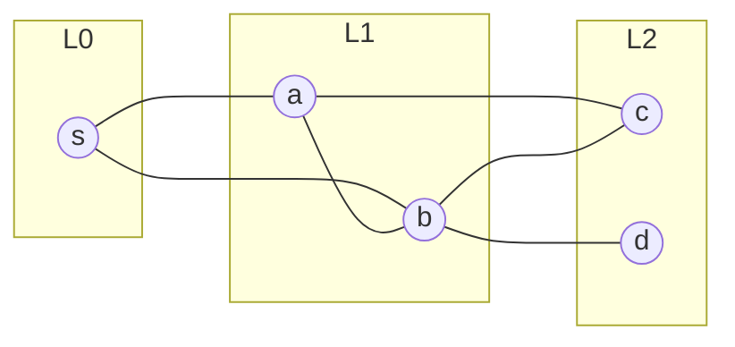

**Breadth-first search** (BFS) visits the vertices reachable from a start vertex $s$ in nondecreasing order of their distance from $s$, where the distance of a vertex is the number of edges on a shortest path from $s$ to it. Every vertex at distance $i$ is visited before any vertex at distance $i + 1$.

Its applications, among them shortest paths in unweighted graphs, connected components and bipartiteness testing, follow from this level-by-level visit order.

## Core idea

BFS explores vertices in order of the length of their shortest path from the starting vertex. In an unweighted graph, the shortest path between two vertices can therefore be found with BFS.

> [!warning] Weights break the guarantee
> BFS orders vertices by edge count, not by path weight. On a weighted graph the first path BFS finds can carry more total weight than a path with more edges, so weighted shortest paths are computed with Dijkstra's algorithm instead.

## Intuition

BFS runs on a queue. The start vertex is enqueued first, and when a vertex is dequeued, its undiscovered neighbors are enqueued. Every vertex at distance $1$ enters the queue before any vertex at distance $2$, and so on, so the traversal processes the graph one distance class at a time. A vertex is therefore first discovered along a shortest path from the start vertex.

## Level sets

The traversal can be described by level sets of vertices. Let $s$ be the start vertex and define

$$
L_0 = \{s\}
$$

$$
L_i = \{ v \notin L_0 \cup L_1 \cup \cdots \cup L_{i-1} : (u, v) \in E \text{ for some } u \in L_{i-1} \}
$$

Each level $L_i$ is exactly the set of vertices at distance $i$ from $s$. The proof is by induction on $i$. Suppose every vertex in levels $L_0$ through $L_{i-1}$ lies at distance equal to its level index. A vertex $v \in L_i$ has a neighbor in $L_{i-1}$, so its distance is at most $i$. Its distance is also not smaller than $i$, because a vertex at distance $j < i$ has a neighbor at distance $j - 1$, which by hypothesis lies in $L_{j-1}$ and would place $v$ in $L_j$.

In the graph below, the levels are the distance classes around $s$. The edge between $a$ and $b$ joins two vertices of $L_1$, which is the condition a bipartiteness check detects.

## What it solves

- Shortest paths in unweighted graphs.
- [[algorithms/connected-components|Connected components]], by running BFS from every unvisited vertex.
- Bipartiteness checks, since an edge between two vertices in the same level implies an odd cycle.

## Related notes

- [[reference/cheatsheets/algorithms/graphs|Graph Theory]]
- [[algorithms/patterns/sliding-window|Sliding Window Pattern]]
- [[algorithms/connected-components|Finding Connected Components]]
