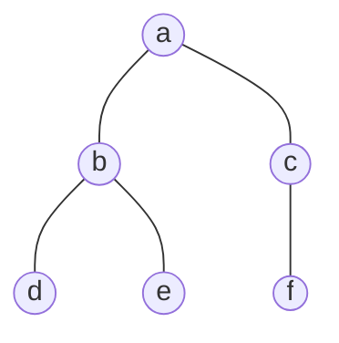

A **tree** is a connected graph with no cycles.

A tree on $n$ vertices has $n - 1$ edges, which follows by [[algorithms/induction|induction]] on $n$. Any two of the properties of being connected, being acyclic and having $|V| - 1$ edges imply the third, so a graph can be recognized as a tree by checking two of them.

## Edge Count

**Claim**: every tree with $n$ vertices has $n - 1$ edges.

The tree below has $6$ vertices and $5$ edges, and removing any leaf leaves a tree on $5$ vertices with $4$ edges. The inductive proof is based on this deletion.

**Proof**: by induction on $n$.

**Base case**: $n = 1$. A tree with 1 vertex has 0 edges.

**Inductive hypothesis**: suppose every tree with $n - 1$ vertices has $n - 2$ edges.

**Inductive step**: let $T$ be a tree with $n \ge 2$ vertices. Since $T$ is acyclic, it has a vertex of degree at most 1 (proved in [[algorithms/graphs-intro|graph fundamentals]]), and since $T$ is connected with at least 2 vertices, that vertex has degree exactly 1. Remove it and its edge to get a graph $T'$ with $n - 1$ vertices. $T'$ is still connected (the removed vertex was a leaf) and still acyclic, so it is a tree, and by the inductive hypothesis it has $n - 2$ edges. Adding the vertex and its edge back gives $n - 1$ edges. $\blacksquare$

## Leaf Bound

**Claim**: if $T$ is a tree, then the number of leaves of $T$ is at least the number of vertices of degree at least $3$.

**Proof**: by induction on the number of vertices.

**Base case**: a one-vertex tree has no leaves and no vertices of degree at least $3$.

**Inductive step**: let $T$ be a tree on $n + 1$ vertices, and remove a leaf $\ell$ and its incident edge. The remaining graph $T'$ is still a tree. By the inductive hypothesis,

$$
\#\text{leaves}(T') \ge \#\{v \in T' : deg(v) \ge 3\}.
$$

Let $p$ be the former neighbor of $\ell$.

- If $deg_{T'}(p) = 1$, then adding $\ell$ removes $p$ from the leaf set and adds $\ell$, so the number of leaves stays the same.
- If $deg_{T'}(p) = 2$, then in $T$ the vertex $p$ has degree $3$, so both the leaf count and the count of degree-at-least-$3$ vertices increase by $1$.
- If $deg_{T'}(p) \ge 3$, then $p$ was already counted among the branching vertices, and adding $\ell$ only increases the leaf count.

In every case the inequality is preserved, so the claim holds for $T$. $\blacksquare$

## Two-Out-of-Three Property

Any graph $G$ satisfying two of the following properties must satisfy the third, and is therefore a tree:

- $G$ is connected
- $G$ is acyclic
- $G$ has $|V| - 1$ edges

A graph can therefore be tested for being a tree by counting its edges and checking either connectivity or acyclicity with a single [[algorithms/BFS|BFS]] or [[algorithms/DFS|DFS]] traversal.

> [!warning] One property alone is not enough
> A two-component forest is acyclic without being connected. A triangle plus an isolated vertex has $|V| - 1$ edges and still contains a cycle. The test needs two of the three properties.

## Related notes

- [[algorithms/graphs-intro|graph fundamentals]]
- [[algorithms/BFS|breadth-first search]]
- [[algorithms/DFS|depth-first search]]
- [[algorithms/problems/graphs-and-trees|Graphs and Trees Problems]]
- [[reference/cheatsheets/algorithms/graphs|Graph Theory]]
