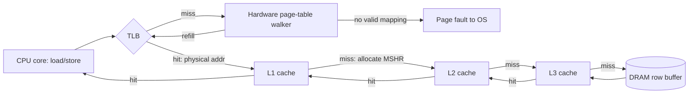

The memory system of a processor consists of the translation structures, caches and DRAM that serve a load or store between the issue of the access and the delivery of its data.

A load such as `int x = array[i]` is translated from a virtual to a physical address, looked up in each cache level in turn and, if it misses at every level, served from DRAM. Its latency depends on cache indexing and replacement, the cost of a miss, the number of misses a core can keep outstanding, address translation, and the state of the DRAM row buffers, so DRAM latency is not a single number. Each mechanism is tied to a measurement from the benchmark notes in the repository or to a hardware implementation in Rocket Chip.

## Core idea: an address is three fields

A physical address splits into **tag**, **index**, and **offset**. For a cache with $2^s$ sets, $B$-byte lines, and associativity $A$:

- **offset** ($\log_2 B$ bits): which byte within the line.
- **index** ($s$ bits): which set. Only the index picks the set; the tag disambiguates which of the $A$ lines in that set holds the data.
- **tag** (remaining bits): compared against every way in the indexed set in parallel.

Associativity sets a tradeoff between lookup hardware and conflict misses. A direct-mapped cache ($A=1$) has the fastest and simplest lookup, but two addresses that map to the same index repeatedly evict each other. A fully associative cache ($A = $ number of lines) has no conflicts between indices but requires a comparator per line. L1 caches in current processors are commonly 4- to 8-way set associative.

**Write policy** is independent of associativity. A *write-back* cache holds dirty data locally and writes it to the next level only on eviction; a *write-through* cache forwards every store to the next level immediately. *Write-allocate* fetches a line into the cache on a write miss before writing it, and is paired with write-back because a line just written is likely to be written again soon; *no-write-allocate* writes directly to the next level on a miss and caches nothing. Rocket's L1 data cache is write-back with write-allocate for cacheable addresses, as the `MSHR` state machine in the next section shows; it issues an `AcquireBlock` (fetch-for-ownership) on a tag miss.

The path from a virtual address to a value passes through translation and then through each cache level in sequence.



## MSHRs and non-blocking misses

A blocking cache stalls the whole pipeline on any miss. A **non-blocking cache** tracks each in-flight miss in a **Miss Status Holding Register (MSHR)** and continues to accept new requests while earlier misses are outstanding. The number of MSHRs is an upper bound on memory-level parallelism (MLP). Once every MSHR is occupied, the next miss stalls regardless of how many further requests the memory system could accept.

Rocket's `MSHRFile` allocates one `MSHR` module per outstanding block miss and arbitrates their `TLBundleA` requests onto the outer memory bus:

```scala
class MSHR(id: Int)(implicit edge: TLEdgeOut, p: Parameters) extends L1HellaCacheModule()(p) {
  val s_invalid :: s_wb_req :: s_wb_resp :: s_meta_clear ::
      s_refill_req :: s_refill_resp :: s_meta_write_req ::
      s_meta_write_resp :: s_drain_rpq :: Nil = Enum(9)
  val sec_rdy = idx_match && (state.isOneOf(states_before_refill) ||
    (state.isOneOf(s_refill_req, s_refill_resp) && !cmd_requires_second_acquire && !refill_done))
```

(from [rocket-chip `NBDcache.scala`](https://github.com/chipsalliance/rocket-chip/blob/master/src/main/scala/rocket/NBDcache.scala))

The code shows two properties. `sec_rdy` is a *secondary miss* check. A second request to a block already in flight does not allocate a new MSHR; it is queued on the existing one (`rpq`, the replay queue) and served when the first miss returns, so repeated accesses to a line that is still being fetched add little latency beyond the original miss. In addition, `MSHRFile` arbitrates all MSHRs' outgoing requests with `TLArbiter.lowestFromSeq`, so the number of *simultaneously outstanding, distinct* block misses is bounded by `cfg.nMSHRs`, a build-time parameter.

This bound can be measured. [[systems/operating-systems/benchmarks/mlp|The MLP benchmark]] runs $N$ independent pointer chases. On the machine its original numbers come from (model not recorded), the time per access falls from 92.6 ns with one chain to 15.6 ns with 8 (5.9x, 74% of linear) and 8.9 ns with 16 (10.4x, 65%), and fully independent random access takes 7.6 ns. The speedup is sublinear from 2 chains on (86% of linear). While each chain holds one outstanding miss, the chain count times the time per access is the latency of each miss, and on that machine it rises from 93 ns at one chain to 142 ns at 16. Intel documents 16 L1D fill buffers (its name for the L1 MSHRs) for the Golden Cove core. On an Emerald Rapids cloud VM, whose Raptor Cove core Intel does not document separately, the time per access stops falling at 18 to 20 chains, at 9.8 ns against 151.6 ns for one chain. By Little's law that is about 15 misses in flight, close to the 16 buffers; past that point an added chain waits for a buffer and the time per access no longer falls.

## Address translation

A **TLB** caches virtual-to-physical translations so that most loads do not access the page table. Rocket's `TLB` module implements the lookup as three separate structures instead of one flat array: a set-associative array for normal 4 KB pages (with *sectored* entries, in which several adjacent PTEs share one tag to amortize tag storage), a small fully-associative array for superpages, and (when PMP granularity is finer than a page) one dedicated entry for the sub-page permission checker.

```scala
val sectored_entries = Reg(Vec(cfg.nSets, Vec(cfg.nWays / cfg.nSectors,
  new TLBEntry(cfg.nSectors, false, false))))
val superpage_entries = Reg(Vec(cfg.nSuperpageEntries, new TLBEntry(1, true, true)))
val s_ready :: s_request :: s_wait :: s_wait_invalidate :: Nil = Enum(4)
```

(from [rocket-chip `TLB.scala`](https://github.com/chipsalliance/rocket-chip/blob/master/src/main/scala/rocket/TLB.scala))

On a miss the TLB moves `s_ready -> s_request -> s_wait`, sending the faulting VPN to the page-table walker (PTW, RISC-V's hardware page walker) and stalling the requesting pipeline until `io.ptw.resp` fires. `SFENCE.VMA` is handled as its own transient path (`s_wait_invalidate`) because a fence that arrives during a refill must invalidate the entry being refilled, so that a stale translation is not installed.

[[systems/operating-systems/benchmarks/tlb|The TLB benchmark]] isolates the walk cost by sweeping the access stride over a 256 MB array, so that every access falls on a different page once the stride reaches 4 KB.

| Stride | Accesses/page | ns/access | Cache behavior | TLB behavior |
|--------|---------------|-----------|-----------------|--------------|
| 64 B | 64 | 2.49 ns | miss (new line) | hit |
| 512 B | 8 | 5.38 ns | miss | hit |
| 4 KB | 1 | 12.51 ns | miss | miss |

Both 512 B and 4 KB strides miss the data cache on every access, so the jump from 5.38 ns to 12.51 ns isolates the page-walk cost at roughly 7 ns. A 4-level x86-64 walk is up to four dependent loads (PML4 → PDPT → PD → PT), which would cost several DRAM round trips in the worst case. The measured 7 ns indicates that the upper page-table levels, which are small and frequently accessed, remain cached in the same hierarchy as data, so the walk for a linear scan usually misses only on the leaf PTE. Huge pages reduce the same cost by a different mechanism. A 2 MB page covers 512x the address range per TLB entry, so a workload with this access pattern would continue to hit in the TLB until its footprint exceeded (TLB entries) x 2 MB instead of (TLB entries) x 4 KB.

## Average memory access time

**Average Memory Access Time** (AMAT) is a first-order model of memory latency:

$$\text{AMAT} = t_{L1} + m_{L1}\left(t_{L2} + m_{L2}\left(t_{L3} + m_{L3} \cdot t_{DRAM}\right)\right)$$

where $t_i$ is the hit time at level $i$ and $m_i$ is the miss rate *given a lookup reaches that level*. With the latencies measured on one machine by the [[systems/operating-systems/benchmarks/README|DRAM latency benchmark]] (L1 ~2 ns, L2 ~15 ns, L3 ~30 ns, DRAM ~97 ns for the pointer-chase floor) and illustrative miss rates $m_{L1}=0.05$, $m_{L2}=0.3$, $m_{L3}=0.5$, the model gives

$$\text{AMAT} = 2 + 0.05\left(15 + 0.3\left(30 + 0.5 \cdot 97\right)\right) = 2 + 0.05(15 + 23.55) = 3.93 \text{ ns}$$

AMAT assumes that misses are served one at a time and that each has a fixed cost, and the benchmarks in the repository contradict both assumptions. The [[systems/operating-systems/benchmarks/README|DRAM latency note]] reports sequential access at 1.35 ns/access and *pointer-chase* access at 97.4 ns/access, although both reach DRAM on a large array. The hardware prefetcher detects the stride-1 pattern and fetches nearly every line before it is accessed, so the access hits and AMAT's miss-cost term does not apply. The [[systems/operating-systems/benchmarks/mlp|MLP benchmark]] contradicts the one-at-a-time assumption. With 8 independent chains, serving misses one at a time would keep the time per access at the single-chain 92.6 ns; the measured 15.6 ns means that several misses overlap. Each miss is also slower than a lone one: with 8 chains each chain has one miss outstanding, so each miss takes 8 × 15.6 = 125 ns, against 92.6 ns for a single chain. AMAT is an accounting identity for a single thread issuing one request at a time. It omits prefetching and memory-level parallelism, which largely determine throughput on cores built after about 1995.

## DRAM: row buffers and why access has two costs

DRAM cells are arranged in a two-dimensional array. Each access opens a **row**, activating a word line so that the row's charge is transferred to sense amplifiers that latch it into the **row buffer** (on the order of 1-8 KB), and then reads a **column** from that buffer. A **row-buffer hit**, a second access to a row that is already open, incurs only the column access, ~10-15 ns in the numbers of the [[systems/operating-systems/benchmarks/README|DRAM benchmark]]. A **row-buffer miss** incurs precharge (~15 ns) to close the old row, activation (~15 ns) to open the new one, and then the column access, about 40-50 ns in total. Random pointer chasing produces a mix of both, and the measured average of 97.4 ns exceeds even the row-miss estimate; the benchmark note attributes the difference to memory-controller queueing and to an access pattern that gives the controller no opportunity to schedule for row locality. Memory controllers reorder requests to group accesses to the same row (row-buffer scheduling). The [[systems/operating-systems/benchmarks/bandwidth|bandwidth benchmark]]'s scaling from 24.9 GB/s at one thread to 63.7 GB/s at eight is partly due to this effect, since more outstanding requests give the controller more opportunities to find row-buffer locality that a single stream does not expose.

## Prefetching

Hardware prefetchers detect sequential and constant-stride access and fetch ahead speculatively; they have no effect on pointer chases because the next address is unknown until the current load returns. [[systems/operating-systems/benchmarks/prefetch|The prefetch benchmark]] shows that software prefetch distance affects performance even when the hardware prefetcher is active on sequential access. An explicit `__builtin_prefetch` 64 elements ahead is 2.5x faster than the hardware-only baseline (0.54 ns vs 1.37 ns/access). The hardware prefetcher limits its run-ahead distance to avoid cache pollution on patterns it has not yet confirmed, whereas software with known future indices can prefetch farther ahead. For random access with computable future indices the speedup is smaller (about 1.3x), because MLP already brings the baseline close to the bandwidth limit. When bandwidth rather than per-request latency limits throughput, prefetching changes when requests arrive but does not reduce their number.

## Edge cases and limits

- **Sectored TLB entries and superpages can produce ambiguous matches in addition to capacity pressure.** Rocket's `TLB.hit` explicitly checks for `multipleHits` (two entries matching the same VPN, possible when a superpage and a regular mapping overlap) and flushes the whole TLB instead of selecting one, since selecting the wrong entry would be an undetected correctness error.
- **AMAT is inaccurate whenever accesses are not independent events of identical cost.** It has no term for prefetch coverage, MSHR-limited concurrency, or row-buffer state, and the benchmarks in the repository measure variations of 2-70x from each of the three separately.
- **Write-allocate increases the cost of write-only workloads** that never reread the line, since the block fetched on a write miss is unused if nothing reads it. No-write-allocate avoids that fetch for such workloads, and mixed policies (write-allocate for the data cache, no-write-allocate for streaming stores) exist for this reason.

## Sources

- [What Every Programmer Should Know About Memory (Drepper)](https://www.akkadia.org/drepper/cpumemory.pdf)
- [rocket-chip: TLB.scala](https://github.com/chipsalliance/rocket-chip/blob/master/src/main/scala/rocket/TLB.scala)
- [rocket-chip: NBDcache.scala](https://github.com/chipsalliance/rocket-chip/blob/master/src/main/scala/rocket/NBDcache.scala)

## Related notes

- [[systems/operating-systems/benchmarks/README|measuring real DRAM latency]]
- [[systems/operating-systems/benchmarks/mlp|memory-level parallelism]]
- [[systems/operating-systems/benchmarks/tlb|TLB and page walk benchmarks]]
- [[systems/operating-systems/benchmarks/prefetch|software prefetching benchmarks]]
- [[systems/operating-systems/benchmarks/bandwidth|memory bandwidth benchmarks]]
- [[systems/operating-systems/lecture-notes/paging|virtual memory and paging]]
- [[systems/operating-systems/lecture-notes/tlb|TLB (lecture notes)]]
- [[hardware/computer-architecture/multiprocessors-cache-coherence|multiprocessors, cache coherence, and memory consistency]]
