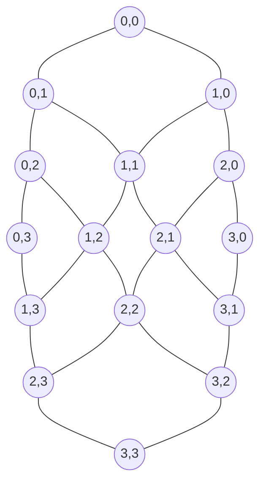

The interconnect of a processor is the transport that carries requests and responses between requesters and responders that are not directly attached to each other, including cache misses, coherence messages, DMA transfers, and MMIO accesses.

An interconnect is characterized by its topology, by the arbitration policy applied when two requesters contend for the same link, by the flow control that prevents data loss when a downstream buffer is full, and by the message abstraction that carries on-chip coherence traffic, off-chip DMA, and interrupts alike.

## Topologies

- **Bus**: every node shares one set of wires; only one transfer happens at a time. A bus has the lowest hardware cost, but its bandwidth is fixed regardless of node count, so it does not scale beyond a few cores.
- **Crossbar**: every input port connects to every output port through a dedicated switch matrix; $N$ inputs and $M$ outputs need $O(NM)$ switch points. A crossbar is non-blocking (any input can reach any free output simultaneously), but the area of its switch matrix grows quadratically, so crossbars are practical only for modest port counts. Rocket-chip's `TLXbar` is a crossbar of this kind, parameterized through diplomacy, that connects TileLink masters to managers; it emits a warning once `node.in.size * node.out.size > 8*32`, which reflects the quadratic cost.
- **Ring**: each node connects to two neighbors; a request hops node to node until it reaches its destination. Wiring is $O(N)$, but worst-case latency is also $O(N)$ hops, and a single ring saturates once enough nodes inject traffic simultaneously (every hop consumes ring bandwidth, including hops by messages in transit to another node).
- **2D mesh**: nodes arranged on a grid, each connected to its 4 (or fewer, at edges) neighbors. Wiring cost is $O(N)$, worst-case hop count is $O(\sqrt{N})$, and the mesh is a common choice beyond a few dozen cores. gem5's Ruby memory system provides a `Mesh_XY` topology for this regime, with **dimension-order (XY) routing**: a packet is routed fully in X and then fully in Y, which is deadlock-free by construction since it creates no cyclic dependency between the buffer resources of the two dimensions.

A 4x4 mesh, the size simulated by `noc-latency-model.py`, consists of router and core tiles, each connected only to its grid neighbors.



## Arbitration

Every switch point where multiple requesters can target the same output requires an arbitration policy. Rocket-chip's `TLArbiter` implements three, generically over any `DecoupledIO` channel:

```scala
val lowestIndexFirst: Policy = (width, valids, select) => ~(leftOR(valids) << 1)(width-1, 0)
val highestIndexFirst: Policy = (width, valids, select) => ~((rightOR(valids) >> 1).pad(width))
val roundRobin: Policy = (width, valids, select) => if (width == 1) 1.U(1.W) else {
  val mask = RegInit(((BigInt(1) << width)-1).U(width-1,0))
  ...
}
```

(from [rocket-chip `Arbiter.scala`](https://github.com/chipsalliance/rocket-chip/blob/master/src/main/scala/tilelink/Arbiter.scala))

`lowestIndexFirst` and `highestIndexFirst` are fixed-priority policies. They are fast to compute, but a low-priority requester can be starved indefinitely under sustained high-priority traffic. `roundRobin` prevents this starvation. A `mask` register records the most recent grant, and subsequent grants exclude that requester until every other pending requester has been served, which bounds waiting time (fairness) at the cost of one register per arbitration point. `TLXbar.circuit` instantiates these at every fan-in point in the crossbar (`out(o).a`, `out(o).c`, `out(o).e`, `in(i).b`, `in(i).d`), one arbiter instance per channel per port, and sets `roundRobin` as the default for the whole crossbar.

The arbiter also holds the grant for the duration of a multi-beat burst (`beatsLeft`), so a requester granted a multi-flit transfer keeps the output until the whole burst completes instead of being re-arbitrated every cycle. This is a basic form of **virtual cut-through** flow control, in which a whole packet is either granted the resource or not, instead of being interleaved flit by flit with competing packets. Flit-level interleaving, which requires per-flit tagging with virtual channels, prevents one large transfer from occupying a link while latency-sensitive small messages wait, and is the reason NoCs add virtual channels on top of this mechanism.

## Backpressure and deadlock avoidance

A switch cannot accept a request for which it has no buffer space. In `TLXbar.fanout`, the `.ready` of the fanned-out output is driven by `Mux1H(select, filtered.map(_.ready))`, so the input asserts `ready` (accepting the request) only after the *specific selected output* has signaled that it can accept. A request is therefore never accepted into a switch and then dropped. This is **credit-based** or ready/valid backpressure. A sender transmits only after the receiver has signaled available space, so buffers do not overflow, and packets are stalled instead of dropped.

**Deadlock** occurs when a cycle of full buffers forms in which each buffer waits for the next to drain, so no packet can proceed. Dimension-order routing on a mesh avoids this by construction, because a packet in the X-routing phase never depends on a buffer used only during Y-routing, which rules out any cycle between the two phases. General topologies need explicit **virtual channels** to break potential cycles when adaptive (non-dimension-order) routing is used, since adaptive routes can otherwise form the circular-wait pattern that produces deadlock.

## DMA, MMIO, and coherence traffic share one transport

At the transport layer, a cache miss's `AcquireBlock`, a DMA engine's block transfer, and a CPU's memory-mapped I/O write are all request messages that name an address and an operation and are routed through the same crossbar or mesh to the manager that owns that address range. Rocket's TileLink `Get`/`Put`/`AcquireBlock` operations (seen in the `MSHR` of [[hardware/computer-architecture/caches-virtual-memory|the caches note]]) are also the primitives a DMA engine issues. A DMA read is a `Get` sequence into a target buffer, and an MMIO write is a `Put` to a manager registered as an I/O device instead of DRAM. gem5's Ruby coherence protocols make this explicit. `MESI_Two_Level` defines a dedicated **DMA controller** machine type that serves coherent DMA requests through the same request/response network the L1/L2/directory controllers use, without a separate channel for DMA. Interrupts are the asymmetric case, a device-to-CPU notification instead of a CPU-initiated request, but they use the same physical links, typically as a small dedicated message class so that they are not queued behind bulk data traffic.

## Worked example: bandwidth and serialization latency

For a link with width $w$ bytes/beat, clock frequency $f$, and $k$ beats per packet, peak sustained bandwidth is $BW = w \cdot f$ bytes/s, and pure **serialization latency** (time to push all beats of one packet onto the link, ignoring queueing) is $T_{ser} = k / f$ seconds. A 512-bit (64-byte) TileLink link at 2 GHz gives $BW = 64 \times 2\times10^9 = 128$ GB/s per link and $T_{ser}$ for a 64-byte cache-line refill (1 beat at that width) of 0.5 ns.

The [[systems/operating-systems/benchmarks/bandwidth|memory bandwidth benchmark]] measured 63.7 GB/s at 8 threads, well below the 128 GB/s peak of a single on-chip link of this kind, so on that machine the *DRAM channel*, not the on-chip interconnect, limits bandwidth once traffic leaves the mesh. On-chip mesh links (tens to low hundreds of GB/s per link, with aggregate bandwidth scaling with mesh size) generally exceed the bandwidth of a single DRAM channel or PCIe link, so the principal design concern for the uncore is to avoid adding queueing delay to a DRAM or NIC bottleneck that determines overall latency.

## Analytic model: latency vs. throughput under load

**Little's Law**, $L = \lambda W$ (average packets in the network equals arrival rate times average latency), predicts the qualitative shape of NoC latency under load. At low injection rate $\lambda$, packets rarely queue, so latency $W$ remains near the zero-load value (hop count times per-hop delay). As $\lambda$ approaches the network's saturation throughput $\lambda_{sat}$, queueing delay grows without bound ($W \to \infty$ as $\lambda \to \lambda_{sat}$ from below), because packets arrive faster than buffers can drain and delay accumulates at every router on the path (**head-of-line blocking**: a stalled packet at the front of a buffer blocks every packet behind it even if their outputs are free).

`noc-latency-model.py`, in the same directory, is a cycle-level 4x4 mesh simulator with XY routing, per-link buffers, and round-robin arbitration matching the `TLArbiter.roundRobin` policy, under uniform-random traffic:

```bash
python3 content/hardware/computer-architecture/noc-latency-model.py
```

The script sweeps the per-node injection rate and reports average packet latency and delivered throughput. With 3000 measured cycles per injection rate after 500 warmup cycles, and uniform-random destinations, it gives the following results.

| injection rate (pkt/node/cycle) | avg latency (cycles) | delivered throughput (pkt/node/cycle) |
|---|---|---|
| 0.02 | 2.71 (+/- 0.08) | 0.0206 (+/- 0.0005) |
| 0.10 | 2.76 (+/- 0.02) | 0.0993 (+/- 0.0014) |
| 0.20 | 2.89 (+/- 0.05) | 0.1998 (+/- 0.0028) |
| 0.30 | 3.15 (+/- 0.05) | 0.2986 (+/- 0.0018) |
| 0.40 | 3.54 (+/- 0.05) | 0.4002 (+/- 0.0020) |
| 0.45 | 3.87 (+/- 0.07) | 0.4501 (+/- 0.0009) |

Latency remains nearly constant, near the 4-hop-average zero-load value, up to about 0.2 injection/node/cycle, and then rises as queueing begins, in agreement with the predicted shape. The sweep does not extend far enough to show the divergence at saturation, since the saturation throughput of a 4x4 mesh under uniform-random traffic is well above the maximum tested rate of 0.45; the results cover only the region below saturation, in which latency is first flat and then rising. Reaching the saturation knee requires a wider injection-rate sweep in the script.

## Edge cases and limits

- **Fixed-priority arbitration (`lowestIndexFirst`/`highestIndexFirst`) permits unbounded starvation.** Under `lowestIndexFirst`, a low-index requester with dense traffic can starve a high-index one indefinitely, which is why `roundRobin` is `TLXbar`'s default and fixed priority is reserved for cases (such as debug or control-plane ports) that require strict precedence.
- **Virtual cut-through's whole-packet grant uses more buffer space** than wormhole routing (which forwards flits as soon as the header is routed, before the whole packet has arrived), in exchange for simpler flow control. Rocket-chip's arbiter makes this tradeoff by holding the grant for a burst's `beatsLeft`.
- **The bandwidth and serialization example assumes zero queueing.** It gives a lower bound on latency and an upper bound on throughput, and the saturation behavior described by the queueing analysis accounts for the difference between these bounds and loaded behavior.

## Sources

- [rocket-chip: tilelink/Xbar.scala](https://github.com/chipsalliance/rocket-chip/blob/master/src/main/scala/tilelink/Xbar.scala)
- [rocket-chip: tilelink/Arbiter.scala](https://github.com/chipsalliance/rocket-chip/blob/master/src/main/scala/tilelink/Arbiter.scala)
- [gem5: interconnection network](https://www.gem5.org/documentation/general_docs/ruby/interconnection-network/)

## Related notes

- [[hardware/computer-architecture/caches-virtual-memory|caches, virtual memory, and memory systems]]
- [[hardware/computer-architecture/multiprocessors-cache-coherence|multiprocessors, cache coherence, and memory consistency]]
- [[systems/operating-systems/benchmarks/bandwidth|memory bandwidth benchmarks]]
- [[systems/operating-systems/benchmarks/mlp|memory-level parallelism]]
- [[ml/serving-systems/parallelism|parallelism in LLM serving systems]]
- [[ml/serving-systems/gpu-basics|GPU architecture and programming]]
