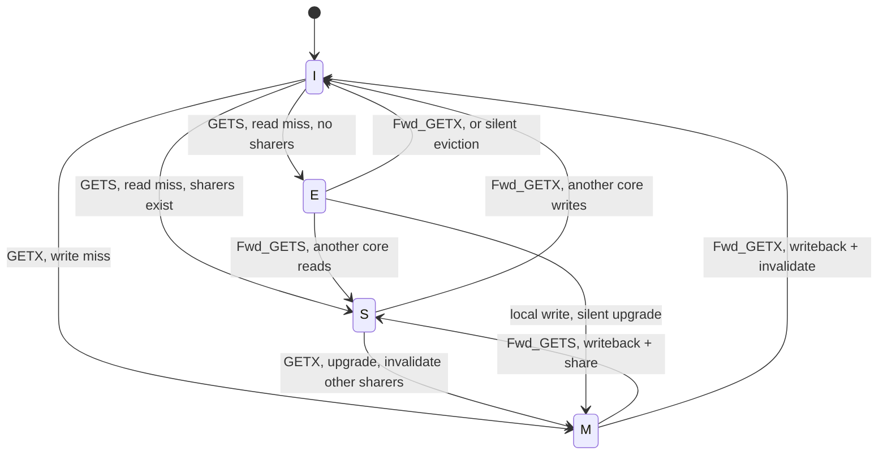

**Cache coherence** is the property that, for each memory location, all cores observe the writes to that location in a single order. A **memory consistency model** specifies which orderings of loads and stores to multiple locations a program may observe.

Coherence asks whether, for a *single memory location*, all cores eventually agree on the order of writes to it. Consistency asks which orderings across *multiple locations* a program can observe. A machine can be fully coherent and still allow two cores to disagree about the order in which two different variables were written. The two properties are often conflated.

## Coherence: single-location agreement

A coherent system guarantees, for every memory location: (1) a core's own reads and writes to that location appear in program order to itself, (2) if core A writes and core B later reads (with enough time between them), B sees A's value, and (3) writes to the same location are seen in the same order by every core (**write serialization**). These conditions concern a single location; ordering across *different* locations is the subject of consistency.

### Directory MESI, traced through gem5

**MESI** gives each cached line one of four states: **M**odified (dirty, sole owner, may write silently), **E**xclusive (clean, sole owner, may write without a coherence request), **S**hared (clean, possibly cached elsewhere, must request ownership before writing), **I**nvalid (not present). A **directory** protocol tracks, per line, which cores currently hold a copy and in what state, so a writer sends a request only to the directory, which forwards invalidations to the current sharers. No core broadcasts to every other core, as cores do under *snooping*, the alternative that does not scale beyond a shared bus.



gem5's `MESI_Two_Level-L1cache.sm` SLICC source uses these state names, together with the transient states that an implementation requires while a request is in flight:

```text
state_declaration(State, desc="Cache states", default="L1Cache_State_I") {
  NP, AccessPermission:Invalid, desc="Not present in either cache";
  I, AccessPermission:Invalid, desc="a L1 cache entry Idle";
  S, AccessPermission:Read_Only, desc="a L1 cache entry Shared";
  E, AccessPermission:Read_Only, desc="a L1 cache entry Exclusive";
  M, AccessPermission:Read_Write, desc="a L1 cache entry Modified";
  IS, AccessPermission:Busy, desc="L1 idle, issued GETS, have not seen response yet";
  IM, AccessPermission:Busy, desc="L1 idle, issued GETX, have not seen response yet";
```

(from [gem5 `MESI_Two_Level-L1cache.sm`](https://github.com/gem5/gem5/blob/stable/src/mem/ruby/protocol/MESI_Two_Level-L1cache.sm))

The transient states (`IS`, `IM`, `M_I`, ...) exist because protocol transactions are not instantaneous. Between issuing a `GETX` (get-exclusive) request and receiving data, the line is neither invalid nor modified, and the state machine must define the response to a forwarded request from another core (`Fwd_GETX`, `Fwd_GETS`) that arrives in that interval. This is the **invalidation race**. Two cores can request the same line at once, and the directory serializes their requests; the request ordered first blocks the other until it retries. The transitions out of `E` are the following.

```text
transition(E, Fwd_GETX, I) {
  forward_eviction_to_cpu;
  d_sendDataToRequestor;
  l_popRequestQueue;
}
transition(E, {Fwd_GETS, Fwd_GET_INSTR}, S) {
  d_sendDataToRequestor;
  d2_sendDataToL2;
  l_popRequestQueue;
}
```

(from [gem5 `MESI_Two_Level-L1cache.sm`](https://github.com/gem5/gem5/blob/stable/src/mem/ruby/protocol/MESI_Two_Level-L1cache.sm))

A core holding a line **E**xclusive transitions to **I** when another core requests write access (`Fwd_GETX`); the requester takes full ownership and the previous holder loses its copy. On a read request (`Fwd_GETS`) the core transitions only to **S**, keeping a clean shared copy, and forwards data to both the requester and the L2 (`d2_sendDataToL2`), since the L2 must hold an up-to-date copy once no core holds the line in exclusive or modified state. The source also shows **silent eviction**. A line in `E` can be dropped without notification because the copy is clean and no other core has requested it, whereas a line in `M` (dirty) must be written back before eviction (`g_issuePUTX`, sending data to L2). This requirement is the reason write-back caches need eviction protocols and write-through caches do not.

### Snooping vs. directory

**Snooping**: every cache observes every request on a shared bus and responds (invalidate, supply data) without a directory. It requires no extra storage but does not scale, since the bus becomes the bottleneck as core count grows; every request is observed by every cache, including caches that hold no copy of the line.

**Directory**: a directory entry per line tracks exact sharers, so messages go point-to-point instead of broadcast. Its costs are directory storage (bits per line per potential sharer, or a sharer list) and an additional hop of indirection (core → directory → sharers, instead of core → bus). Because snooping traffic grows with core count, directory protocols predominate beyond a few cores, and snooping is used mainly in small bus-based SMPs.

## Consistency: cross-location ordering, via RVWMO

RVWMO defines a total **global memory order** over every hart's loads and stores, constrained by **preserved program order (PPO)**: same-hart operation $a$ must precede $b$ in the global order if $a$ precedes $b$ in program order *and* one of several conditions holds: overlapping addresses, an explicit fence, an acquire/release annotation, or a syntactic dependency (address, data, or control) from $a$ to $b$. PPO does **not** require ordering between a store and a *later*, non-dependent load to a different address. Store buffers rely on this relaxation, and a fence removes it.

### Litmus test: store buffering (SB)

In the following test on two harts, `x` and `y` both start at 0, and `t0` contains 1 on both harts.

```text
Hart 0:               Hart 1:
sw t0, 0(x_addr)      sw t0, 0(y_addr)
lw a0, 0(y_addr)      lw a1, 0(x_addr)
```

Under RVWMO, `a0 = 0, a1 = 0` is a **legal** outcome, because neither hart's store-then-load pair has any address, data, or control dependency between them, and there is no fence. Each hart's own store can remain in a per-hart store buffer while its load from the *other* variable proceeds and returns the old value.

The store and load on each hart access different addresses, so this litmus test has no store-to-load forwarding relationship. [[systems/operating-systems/benchmarks/store_fwd|The store-forwarding benchmark]] instead tests exact and overlapping addresses within one core. Both mechanisms involve the load/store machinery, but the SB outcome comes from the absence of cross-address ordering. Inserting a `fence w, r` or the stronger `fence rw, rw` between each hart's store and load forbids the outcome, because rule 4 of PPO orders each store before its following load in global memory order, which is inconsistent with both loads returning 0.

### Litmus test: message passing (MP)

```text
Hart 0:                    Hart 1:
sw a1, 0(data_addr)        lw a0, 0(flag_addr)   # spin until a0 == 1
fence w, w                 fence r, r
sw x1, 0(flag_addr)        lw a1, 0(data_addr)
```

Here the fences make it **illegal** for hart 1 to observe `flag == 1` but `data == 0`. `fence w, w` on hart 0 orders the write to `data` before the write to `flag` in PPO (rule 4); `fence r, r` on hart 1 orders the read of `flag` before the read of `data`. Combined with the load value axiom (a load returns the value of the store latest in global order among stores preceding it in that order or in program order), once hart 1 observes `flag == 1` it has observed a point in global order after hart 0's fenced store to `flag`, which itself is after the fenced store to `data`, so the read of `data` cannot return the stale value. Without the fences, RVWMO permits `flag == 1, data == 0`, which makes this publish/subscribe pattern unsafe under RVWMO unless the program supplies the required ordering.

## False sharing: coherence traffic without any real conflict

[[systems/operating-systems/benchmarks/false_sharing|The false-sharing benchmark]] packs 8 threads' independent counters into a single 64-byte cache line and measures an 8.5x slowdown (57.8 ms vs 6.8 ms padded) attributable to coherence traffic. In terms of the MESI transitions, `counters[0]++` requires the line in **M** state on core 0 (a store needs write permission, i.e., MESI's read-modify-write access check `onAccess`). When core 1 then writes `counters[1]`, a different byte in the same line, the directory receives a `GETX` and must invalidate core 0's **M** copy (the `M, Fwd_GETX -> I` transition, which also writes the dirty data back to the cache that tracks the line). Core 0's next increment misses and refetches the line, returning it to **M** and causing core 1's next increment to miss in the same way. The protocol operates correctly, since no core reads stale data and write serialization holds, but its *granularity* (whole 64-byte lines, not individual bytes) converts logically independent writes into contention for ownership of one line. Padding each counter to its own line eliminates the contention, since no other core writes to a line that a given core holds in `M`. `perf c2c` detects false sharing by sampling cache-to-cache transfers, which is why the benchmark note recommends it for finding false sharing in existing programs.

## Edge cases and limits

- **Coherence provides no atomicity across two locations.** A protocol can be fully coherent per line and still allow a thread to observe half of a two-word update; preventing that requires a guarantee from the consistency model or from locking.
- **RCpc vs RCsc acquire/release annotations change which litmus outcomes are legal.** RVWMO's PPO rules 5-7 treat acquire and release annotations as directional fences (acquire orders itself before *later* ops, release orders *earlier* ops before itself) rather than full fences, which is weaker than `fence rw, rw` and cheaper on hardware that supports it natively.
- **Directory storage grows with core count.** A directory tracking full sharer bit-vectors costs $O(\text{cores})$ bits per line; coarser encodings (limited pointers, coarse vectors) reduce storage at the cost of precision and can cause spurious invalidations when the encoding cannot represent the exact sharer set.

## Sources

- [RVWMO Memory Consistency Model](https://github.com/riscv/riscv-isa-manual/blob/main/src/unpriv/rvwmo.adoc)
- [gem5: MESI_Two_Level-L1cache.sm](https://github.com/gem5/gem5/blob/stable/src/mem/ruby/protocol/MESI_Two_Level-L1cache.sm)

## Related notes

- [[systems/operating-systems/benchmarks/false_sharing|false sharing benchmarks]]
- [[systems/operating-systems/benchmarks/store_fwd|store-to-load forwarding benchmarks]]
- [[systems/distributed-systems/consistency|distributed systems consistency models]]
- [[systems/distributed-systems/distributed-cache-coherence|distributed cache coherence]]
- [[hardware/computer-architecture/caches-virtual-memory|caches, virtual memory, and memory systems]]
- [[hardware/computer-architecture/interconnects-noc-dma|interconnects, NoCs, DMA, and memory controllers]]
