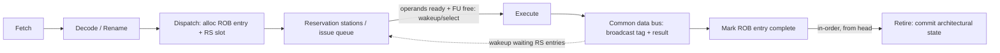

Out-of-order execution is a microarchitectural technique in which a processor issues each
instruction to a functional unit once its source operands are available, independent of its position
in program order, and commits results to architectural state in program order. In-order commit keeps
the architectural state equal to that of sequential execution and makes exceptions precise.

A five-stage in-order pipeline (see [[hardware/computer-architecture/pipelining-hazards-branch-prediction|pipelining
and hazards]]) issues and completes instructions strictly in program order, so a stalled instruction
stalls every instruction behind it, including those that are independent of it. An out-of-order core
executes those independent instructions during the stall. The mechanism descends from Tomasulo's
algorithm. The code excerpts are from the rename stage and reorder buffer of BOOM, an open-source
RISC-V out-of-order core, and the [[systems/operating-systems/benchmarks/mlp|MLP]]
and [[systems/operating-systems/benchmarks/reductions|reduction]] benchmarks measure the effect of
independent work on real hardware.

## Tomasulo's algorithm, in stages

Tomasulo's original algorithm (IBM 360/91, 1967) implements out-of-order execution with distributed
reservation stations and result buses, and it predates explicit reorder buffers. The modern pipeline
built on it has seven logical stages:

```text
Fetch -> Decode/Rename -> Dispatch -> Issue -> Execute -> Writeback -> Retire (in-order)
```



**Rename** replaces architectural register names with physical register tags, breaking false
dependencies. **Dispatch** allocates a reorder buffer (ROB) entry and an issue-queue (reservation
station) slot. **Issue** happens when an instruction's operands are ready and a functional unit is
free, and it is performed by wakeup/select logic. Each cycle, completing instructions broadcast their
destination tag, waiting instructions in the issue queue whose source tags match become ready, and a
select policy chooses which ready instructions receive a functional unit in that cycle. **Execute** and
**writeback** are specific to each functional unit. **Retire** commits results to architectural state
strictly in program order; in-order retirement distinguishes a reorder buffer from a scoreboard.

## Register renaming: false dependencies vs. true dependencies

A true (RAW) dependency is intrinsic to the computation, and no renaming scheme can let
`add x3, x1, x2` execute before `x1` and `x2` are known. WAR and WAW dependencies arise from the
finite set of architectural register names; they exist only because two unrelated computations are
assigned the same destination name. Renaming maps each architectural destination register to a fresh physical
register from a free list, so two writes to architectural `x1` land in different physical registers
and do not conflict. Only a *read* of `x1` needs to know which physical register currently
holds its value, tracked by a rename map table (RAT).

In BOOM's rename map table, each entry maps an architectural register number to the currently valid
physical register, and the table is updated on each committed or speculative rename:

```scala
val map_table = RegInit(VecInit((0 until numLregs) map { i => i.U(pregSz.W) }))
when (io.brupdate.b2.mispredict) {
  // Restore the map table to a branch snapshot.
  map_table := br_snapshots(io.brupdate.b2.uop.br_tag)
} .elsewhen (io.rollback) {
  map_table := com_map_table
} .otherwise {
  map_table := remap_table(plWidth)
}
```

(from [BOOM `src/main/scala/v4/exu/rename/rename-maptable.scala`](https://github.com/riscv-boom/riscv-boom/blob/97bf5363d814c460d4e8a3925bb5c08b9e0275e9/src/main/scala/v4/exu/rename/rename-maptable.scala), commit `97bf536`)

The free-list side of renaming allocates a physical register for every instruction that writes a
result and reclaims one when the physical register it replaces is no longer needed by any
in-flight or committed instruction (that is, once the *next* writer of the same architectural register
commits). This reclamation point limits the number of renames in flight, since the physical
register file must be large enough to hold both the committed architectural state and every
speculative in-flight write.

## Reorder buffer

The ROB is a circular buffer of in-flight instructions in program order, one entry per instruction from
dispatch until retirement. Each entry records enough to (a) commit the result to architectural state
when the instruction reaches the head of the buffer, and (b) detect and report an exception at the correct point in
program order even though execution happened out of order. Retirement walks the ROB head in program
order, committing each entry once it's marked complete, and stops at the first incomplete or excepting
entry. In-order retirement makes exceptions precise, because the architectural state visible at any
point corresponds exactly to the instructions that have retired, in order, and reflects no speculative
or in-flight work beyond that point.

BOOM's ROB tracks busy and exception state per entry and retires instructions from the ROB head:

```scala
val rob_val       = RegInit(VecInit(Seq.fill(numRobRows){false.B}))
val rob_bsy       = Reg(Vec(numRobRows, Bool()))
val rob_exception = Reg(Vec(numRobRows, Bool()))
// ...
can_commit(w) := rob_val(rob_head) && !(rob_bsy(rob_head)) && !io.csr_stall &&
  !io.brupdate.b2.mispredict && !io.trace_stall
```

(from [BOOM `src/main/scala/v4/exu/rob.scala`](https://github.com/riscv-boom/riscv-boom/blob/97bf5363d814c460d4e8a3925bb5c08b9e0275e9/src/main/scala/v4/exu/rob.scala), commit `97bf536`)

On a branch misprediction or exception, the ROB entries younger than the offending instruction are
squashed (their physical registers freed back to the freelist, their RAT entries rolled back to a
checkpoint), which is the out-of-order analog of flushing the pipeline registers in the in-order
design from [[hardware/computer-architecture/pipelining-hazards-branch-prediction|pipelining and
hazards]], with the difference that hundreds of in-flight instructions may have to be unwound instead
of two or three.

## Load/store queue and memory disambiguation

Loads and stores cannot issue out of order as freely as ALU operations, because a load might alias a store
that hasn't computed its address yet. The load/store queue (LSQ) tracks in-flight memory ops in
program order and resolves two questions per load: does an older, unresolved store's address possibly
overlap this load (if so, stall or speculate), and if an older store's address *is* known and matches,
forward that store's value directly instead of reading memory (store-to-load forwarding, matching the
mechanism in [[systems/operating-systems/benchmarks/store_fwd|the store-forwarding benchmark]]).
Speculative memory disambiguation, guessing a load doesn't alias any pending store and later
verifying, trades a rollback penalty on misspeculation for not stalling every load behind every
in-flight store.

The LSQ is the microarchitectural counterpart of the ordering concerns that Drepper raises about
concurrent access. [What Every Programmer Should Know About Memory](https://www.akkadia.org/drepper/cpumemory.pdf)
discusses the ordering guarantees that out-of-order loads and stores require for correctness on
multiprocessors, and the LSQ enforces those guarantees locally within one core before any cross-core
coherence protocol is involved.

## Wakeup/select and issue width

Every cycle, the issue queue broadcasts the tags of instructions that just finished execution;
waiting entries compare their source-operand tags against the broadcast and mark themselves ready
(wakeup). Among all ready entries, a select policy picks up to (issue width) instructions per cycle,
often oldest-first, which prevents starvation of instructions queued behind a long-latency operation, limited by the number of functional units and read ports available. Widening issue width
increases the peak ILP the core can exploit but scales the wakeup/select logic worse than linearly
(broadcast compares grow with the product of issue-queue size and issue width), and this scaling is a
main reason that very wide superscalar designs are difficult to clock as fast as narrower ones.

## Comparing in-order, scoreboard, and out-of-order on real workloads

Three benchmarks measure these mechanisms on out-of-order hardware without a simulator.

- [[systems/operating-systems/benchmarks/reductions|Parallel reductions]]: a single-accumulator
  reduction has a serial RAW dependency chain on the accumulator; breaking it into 8 independent
  accumulators gives only a 1.3x speedup at large array sizes because the bottleneck shifts from the
  ALU and issue width to memory bandwidth. In that regime the compiler's auto-vectorization already
  exposes enough ILP to the out-of-order engine, and additional independent work has nothing left to
  overlap with.
- [[systems/operating-systems/benchmarks/mlp|Memory-level parallelism]]: independent pointer chains
  scale from 92.6 ns/access (1 chain) to 8.9 ns/access (16 chains), a 10.4x speedup, because the LSQ
  and MSHRs can hold roughly 10-12 independent outstanding misses at once. This ceiling measures the
  effective depth of the load queue on that core rather than a property of DRAM.
- [[systems/operating-systems/benchmarks/store_fwd|Store-to-load forwarding]]: a pinned x86-64 run
  measured nearly identical reciprocal throughput for exact-match and independent store/load loops,
  while a one-byte-shifted partial overlap made the loop about 16 times slower. The iterations can
  overlap, so this result measures whole-loop throughput and partial-overlap backpressure rather than
  isolated forwarding latency. It does not show that a forwarding hit is faster than an L1 load.

A simple scoreboard (single in-order issue, but allowing out-of-order completion with WAR/WAW hazard
tracking, as in the CDC 6600) lies between in-order and out-of-order execution. It allows a
long-latency instruction to complete after later ones without stalling the pipeline, but it still issues in program order, so it cannot start a later
independent instruction ahead of an earlier one still waiting on an operand the way full out-of-order
issue can. The MLP benchmark's near-linear scaling up to 8 chains would not appear with only a
scoreboard's in-order issue, because only one load can be waiting to issue at a time.

## Precise exceptions and recovery as architectural obligations

Precise exceptions are an architectural guarantee. The ISA specifies that after a trap, all
instructions before the faulting one have fully committed and none after it have any visible effect,
so a handler can inspect and resume architectural state unambiguously. Out-of-order execution
complicates this guarantee, because by the time an exception is detected, later instructions may
have already executed (out of order) and written speculative results. The ROB provides
precise exceptions at low cost. Exceptions are recorded per entry at execution time and *acted on*
only at retirement, in program order, so speculative execution past an exception point is discarded
before it becomes visible. The same recovery path handles branch
mispredictions, interrupts, and memory-ordering fences (which stall retirement, not issue, until
prior memory ops are globally visible).

## Edge cases or limits

Register renaming is bounded by the physical register file size; running out of free physical
registers stalls rename (and therefore dispatch) even though the issue queue and ROB might have room,
which is a common bottleneck in workloads with many live values. Speculative memory disambiguation
that mispredicts costs a pipeline-flush-like recovery, similar in kind to (but usually narrower in
scope than) a branch misprediction. ROB size caps how far ahead of a stalled instruction the core can
look for independent work; a long-latency miss (e.g., an L3/DRAM load) can fill the ROB and stall
dispatch even with abundant ILP further down the instruction stream, and this limit implicitly bounds
the multi-chain results of [[systems/operating-systems/benchmarks/mlp|the MLP benchmark]].

## Sources

- [riscv-boom source, commit 97bf536](https://github.com/riscv-boom/riscv-boom/tree/97bf5363d814c460d4e8a3925bb5c08b9e0275e9)
- [What Every Programmer Should Know About Memory (Ulrich Drepper)](https://www.akkadia.org/drepper/cpumemory.pdf)
- [[systems/operating-systems/benchmarks/mlp|Memory-level parallelism benchmarks]]
- [[systems/operating-systems/benchmarks/reductions|Parallel reductions benchmarks]]
- [[systems/operating-systems/benchmarks/store_fwd|Store-to-load forwarding benchmarks]]

## Related notes

- [[hardware/computer-architecture/index|A working map of computer architecture]]
- [[hardware/computer-architecture/pipelining-hazards-branch-prediction|Pipelining, hazards, and branch prediction]]
- [[hardware/computer-architecture/isa-datapath-control|Instruction sets, datapaths, and control]]
- [[systems/operating-systems/benchmarks/mlp|Memory-level parallelism benchmarks]]
- [[systems/operating-systems/benchmarks/reductions|Parallel reductions benchmarks]]
