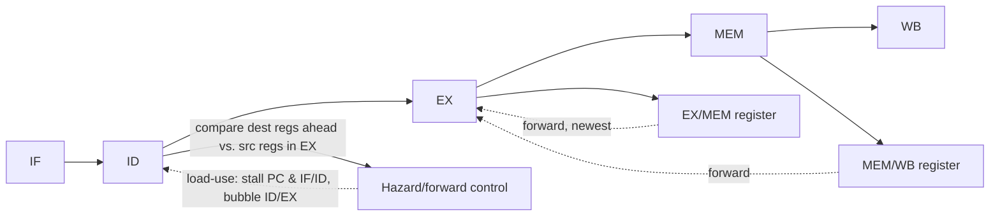

## Purpose

A pipeline overlaps instructions: while one instruction executes, the next is being decoded and
the one after that fetched. The overlap is free throughput until two instructions in flight need
the same hardware, or one needs a value the other has not produced yet, or the front of the pipe
needs to know where a branch goes before the branch has executed. This note works through those
three problems for a five-stage RV32I pipeline, then spends most of its length on the third one,
branch prediction, because that is where most of the engineering is.

The branch prediction half is measured rather than quoted. Every misprediction rate below comes
from replaying conditional-branch traces of seven real programs (gzip, bzip2, xz, sort, grep,
the Python interpreter and GCC's compiler proper) through simulated predictors, from a static
"backward taken" rule up to an 8 KB TAGE. The tracer, simulator and checks are in
[`branch-prediction-lab/`](https://github.com/elimelt/web/tree/main/notes/content/hardware/computer-architecture/branch-prediction-lab)
beside this note.

This note continues from [[hardware/computer-architecture/isa-datapath-control|ISA, datapath, and control]]
and precedes [[hardware/computer-architecture/out-of-order-execution|out-of-order execution]],
where register renaming removes most of the data hazards described here.

## Five-stage RV32I pipeline

Split the multicycle datapath's steps (IF fetch, ID decode and register read, EX execute, MEM
memory access, WB write back) into pipeline stages, each followed by a pipeline register that
carries the instruction's state forward:

```text
IF  ->  ID  ->  EX  ->  MEM  ->  WB
   [IF/ID] [ID/EX] [EX/MEM] [MEM/WB]
```

In steady state five instructions are in flight, one per stage, and one finishes every cycle, so
CPI approaches 1 instead of the multicycle design's 3 to 5. The clock period is set by the slowest
stage plus the pipeline register overhead. Each pipeline register carries whatever later stages
need: control signals, register values, the computed address, the destination register number,
and a valid bit, so that a bubble inserted by a stall or a flush does nothing when it reaches
MEM or WB.

## Hazards

**Structural hazards.** Two instructions need the same hardware in the same cycle. A single
memory port shared by instruction fetch and data access is the classic case; separate instruction
and data caches remove it. The register file is read in ID and written in WB by different
instructions in the same cycle. The textbook design (Patterson and Hennessy) writes in the first
half of the cycle and reads in the second half, so an instruction in ID sees a value being written
back in the same cycle; other designs add a bypass from WB to ID for the same effect.

**Data hazards.** Three orderings of a read and a write to the same register can go wrong:

| Hazard | Meaning | In this pipeline? |
|---|---|---|
| RAW (read after write) | A consumer reads a value its producer hasn't written yet | Yes. Fixed by forwarding, plus one stall for load-use |
| WAR (write after read) | A later instruction writes a register before an earlier one reads it | No. Registers are read in ID, before any later instruction can reach WB |
| WAW (write after write) | Two writes to one register land out of order | No. Every instruction writes in WB, one stage, in program order |

WAR and WAW need some instruction to finish before an earlier one, which cannot happen when every
instruction takes the same five stages in order. They do appear in in-order pipelines with
functional units of different latencies (a 4-cycle floating-point operation followed by a 1-cycle
integer operation to the same register is WAW), and they are everywhere once
[[hardware/computer-architecture/out-of-order-execution|out-of-order execution]] lets instructions
complete out of program order, where register renaming removes them.

**Control hazards.** Fetch needs the next PC every cycle, but a conditional branch's direction and
target are only known once it executes. Each cycle spent not knowing is either a stall or a guess.

## Forwarding and stalls

A RAW dependence between ALU instructions (`add x1, x2, x3` followed by `sub x4, x1, x5`) needs no
stall, because the sum exists at the end of the producer's EX stage, one cycle before the consumer's
EX stage needs it. Forwarding paths route the EX/MEM and MEM/WB pipeline register values back to
the ALU inputs. The forwarding unit compares the destination register of each older instruction
with the source registers of the instruction in EX and picks the newest match, EX/MEM before
MEM/WB, ignoring `x0`.



The one RAW case forwarding cannot fix is **load-use**. A load's value exists only at the end of
MEM, so an instruction that uses it immediately would need it before it exists. The hazard unit
compares the load's destination (in ID/EX) with the sources of the instruction behind it (in
IF/ID); on a match it holds the PC and IF/ID for one cycle and puts a bubble into ID/EX:

```text
lw   x1, 0(x2)     IF ID EX MEM WB
add  x3, x1, x4       IF ID ID  EX MEM WB   <- ID repeats once; x1 is forwarded from MEM/WB
```

Compilers hide most of these stalls by scheduling an independent instruction into the slot after
a load.

## Control hazards: what a branch costs

Suppose branches resolve in EX. By the time a branch is in EX, the two instructions behind it are
already in ID and IF. If fetch simply waits, every branch costs two bubbles. If fetch guesses
"not taken" and keeps going, a correct guess costs nothing and a wrong one costs the same two
bubbles, because those two instructions are squashed and fetch restarts at the target. In general
the cost of a wrong guess is the number of stages between fetch and the stage that resolves the
branch: 2 here, 15 or more on modern out-of-order cores (see
[misprediction recovery](#misprediction-recovery) below).

How often does that cost come up? In the seven traced programs, conditional branches are 86 to 191
of every 1000 instructions, between 1 in 12 and 1 in 5:

| program | branches per 1000 insns | taken | backward | backward, taken | branch sites | sites for 90% / 99% |
|---|---|---|---|---|---|---|
| gzip | 191.4 | 39.1% | 37.3% | 80.2% | 344 | 26 / 56 |
| bzip2 | 108.3 | 38.3% | 59.2% | 32.6% | 525 | 5 / 10 |
| xz | 86.1 | 53.3% | 40.6% | 69.8% | 1109 | 92 / 168 |
| sort | 150.9 | 17.4% | 17.3% | 99.4% | 526 | 6 / 8 |
| grep | 183.8 | 64.6% | 63.1% | 80.9% | 1646 | 20 / 346 |
| python | 182.6 | 26.4% | 32.4% | 42.9% | 8085 | 1168 / 3760 |
| cc1 | 166.9 | 23.1% | 23.8% | 54.1% | 5451 | 472 / 1279 |

Each row is the first 8 million user-mode instructions of one program; "branch sites" counts the
distinct conditional branches that ran, and the last column how few of them cover 90% and 99% of
all branch executions. The [measurement notes](#how-this-was-measured) say exactly what ran. Two columns matter later. Fewer
than half of branches are taken in five of the seven programs, so "predict taken" is a poor
default. And a handful of static branches carry most of the work in the compressors and sort,
while the interpreter and the compiler spread their branches over thousands of sites, which is
what fills up predictor tables.

## Static prediction

A static predictor decides from the instruction alone. The two classic rules:

- **Always taken.** Simple, and wrong whenever a branch falls through.
- **Backward taken, forward not taken (BTFNT).** A backward branch is usually the bottom of a loop
  and is taken on every iteration but the last; a forward branch usually skips an unusual case.

On the traces, BTFNT is the better rule by far but still misses a lot: 16.5% of gzip's branches,
21% of cc1's, and 59% of bzip2's, where most backward branches are *not* taken (32.6% in the table
above). Static rules survive today in the fallback a core uses for a branch it has never seen, and
in compilers laying out code so that the likely path falls through.

## Dynamic prediction with counters

A dynamic predictor learns each branch's behavior while the program runs. The simplest keeps one
bit per branch, the last outcome, in a table indexed by low bits of the branch address. The table
has no tags, so two branches whose addresses share those bits share an entry; that is aliasing,
and it comes back below.

A 1-bit predictor handles a branch that always goes one way, and it has a well-known flaw with
loops: when a loop exits, the bit flips to "not taken", and the next time the loop runs, its first
iteration is mispredicted too. Every loop exit costs two misses. Here is a real branch with that
shape, from gzip compressing text: gzip's `ct_tally()` writes out a byte of match/literal flags
every 8 symbols (`if ((last_lit & 7) == 0)`), so the jump around that code is taken 7 times in 8.
Press Replay to watch a 1-bit predictor step through 64 real executions:

<CounterPredictor preset="loop" bits={1} />

A **2-bit saturating counter** fixes this with hysteresis. Taken moves the counter up, not taken
moves it down, it stops at 0 and 3, and it predicts taken in states 2 and 3. One surprising outcome
moves it from "strongly" to "weakly" but does not change the prediction, so the loop exit costs one
miss instead of two. Smith's [1981 study](https://research.cs.wisc.edu/arch/uwarch-wiki2/index.php/PubsUWArch/B2hd-DBLPconfiscaSmith81)
of branch prediction strategies is the classic source for these counters, and small cores still
use them: CVA6's branch history table, shown [below](#hardware-example-cva6s-frontend), is a
table of them. On the same 64 outcomes:

<CounterPredictor preset="loop" bits={2} />

Across the whole trace the pattern holds exactly: 25.0% misses for the 1-bit predictor, 12.5% for
the 2-bit counter. Across all seven programs, with 4096 entries each, the 2-bit table has 22% fewer
misses per thousand instructions than the 1-bit table (geometric mean 5.32 against 6.80 MPKI).

### What a counter cannot see

A counter only knows how often a branch went each way recently, so it can never do better than
the branch's majority direction. Two real gzip branches show the two ways that limit bites.

The first mostly alternates. Each outcome pushes the counter toward the side that is about to be
wrong, so the 2-bit counter misses most of the time, and the 1-bit predictor does worse still (it
missed 82.6% of this branch's 12,669 executions):

<CounterPredictor preset="alternate" bits={2} />

The second is gzip deciding whether the symbol it just found is a literal byte or a match
(`if (dist == 0)` in `ct_tally()`). That depends on the input text, and to a counter it looks like
a biased coin: 38.1% misses over the run. But a branch in gzip's main loop, which runs just before
this one, has already answered a closely related question. In the trace, this branch's outcome is
the opposite of that branch's latest outcome 80% of the time, and once a predictor also sees the
few branches around them the pattern is close to exact. A predictor that keeps the last outcomes
of *all* branches, a global history, can see the answer before it is asked. The TAGE predictor
described below misses this branch 0.4% of the time:

<CounterPredictor preset="correlated" bits={2} />

## History-based predictors

**Two-level predictors.** Yeh and Patt's
[two-level adaptive predictors](https://www.eecg.utoronto.ca/~moshovos/ACA05/read/isca-92.2-level-adaptive.pdf)
keep a history of recent outcomes, either one global history register for all branches or one
history per branch, and use it to choose which 2-bit counter predicts. A branch that alternates
has a history of `...TNTN` before every taken outcome and `...NTNT` before every not-taken one, so
the two cases land in different counters and both become predictable. Their naming (GAg, PAg, PAp
and so on) says whether the history and the counter table are global or per-address.

**gshare.** McFarling's
[combining-predictors report](https://classes.cs.uchicago.edu/archive/2007/spring/22200-1/WRL-TN-36.pdf)
indexes one table of 2-bit counters with the branch address XORed with the global history, so a
single table serves both. The XOR spreads one branch over many entries, one per history it occurs
with, which is the point, and also means that a program with many branches needs a bigger table
before the spreading stops causing collisions.

**Tournament.** The same report combines two predictors (here a per-address bimodal table and
gshare) and adds a table of 2-bit choosers that learns, per branch, which of the two to believe.
The Alpha 21264 combined a per-branch local-history predictor and a global-history one this way.

**TAGE.** Seznec and Michaud's
[TAgged GEometric history length predictor](http://www.jilp.org/vol8/v8paper1.pdf) keeps a small
untagged base table plus several tagged tables, each indexed by the address hashed with a
different length of global history, the lengths forming a geometric series (this note's version
uses 5, 15, 44 and 130 branches). Tags let an entry say "I was trained for this branch with this
history", so the prediction comes from the matching table with the longest history, and the
next-longest match is kept as a fallback for freshly allocated entries. Short histories learn
quickly; long ones catch correlations far back. Descendants such as Seznec's
[TAGE-SC-L](https://jilp.org/cbp2016/paper/AndreSeznecLimited.pdf), an entry to the 2016 branch
prediction championship, add a statistical corrector and a loop predictor.

## Measured: seven programs, nine predictors

Mispredictions per thousand instructions (MPKI), lower is better. MPKI combines how often branches
occur with how often they are missed, so it maps directly to lost cycles. Each cell is the mean of
three runs; the runs differ only in where address-space randomization loaded the code, which moved
results by at most 1.8%.

| predictor | storage | gzip | bzip2 | xz | sort | grep | python | cc1 | geo. mean |
|---|---|---|---|---|---|---|---|---|---|
| always taken | 0 | 116.6 | 66.8 | 40.2 | 124.7 | 65.1 | 134.5 | 128.4 | 88.9 |
| BTFNT | 0 | 31.7 | 63.8 | 32.1 | 0.44 | 47.1 | 56.6 | 35.2 | 22.2 |
| 1-bit, 4096 entries | 0.5 KB | 20.7 | 4.09 | 15.5 | 0.18 | 25.3 | 14.2 | 8.09 | 6.80 |
| 2-bit bimodal, 4096 | 1 KB | 15.4 | 2.56 | 11.1 | 0.21 | 16.6 | 11.3 | 6.88 | 5.32 |
| gshare, 4096 | 1 KB | 14.5 | 1.19 | 10.5 | 0.14 | 16.7 | 13.7 | 5.94 | 4.44 |
| tournament, 3 × 1024 | 0.75 KB | 14.0 | 1.17 | 9.35 | 0.12 | 15.9 | 11.6 | 5.64 | 4.08 |
| 2-bit bimodal, 32768 | 8 KB | 15.4 | 2.56 | 11.0 | 0.21 | 16.6 | 10.1 | 6.59 | 5.20 |
| gshare, 32768 | 8 KB | 13.2 | 1.05 | 8.74 | 0.14 | 16.3 | 10.3 | 4.99 | 3.94 |
| TAGE, 4 tagged tables | 8.3 KB | 11.3 | 0.92 | 7.14 | 0.12 | 13.9 | 6.84 | 2.98 | 3.06 |

What the table says:

- **Any dynamic predictor beats any static rule by a wide margin.** BTFNT's geometric mean is 22.2
  MPKI; a half-kilobyte table of 1-bit entries gets 6.80.
- **A bigger counter table stops helping almost at once.** Going from 1 KB to 8 KB of 2-bit
  counters moves the geometric mean only from 5.32 to 5.20, because the programs run a few hundred
  to a few thousand static branches and 4096 entries already give most of them their own counter.
  What is left is the counters' own limit from the previous section.
- **History needs room.** gshare keeps improving with size (4.44 at 1 KB, 3.94 at 8 KB) because it
  spreads each branch over one entry per history. At 1 KB that spreading collides for the
  programs with the most branches: on python, gshare (13.7) is worse than the plain counter
  table of the same size (11.3), and on grep the two are even.
- **TAGE is the best per byte.** At 8.3 KB it has 22% fewer misses than gshare at 8 KB in the
  geometric mean, and 40% fewer on the compiler (2.98 against 4.99 MPKI), the most
  branch-diverse workload.
- **Some programs are simply hard.** gzip, xz and grep keep a floor of 7 to 14 MPKI under every
  predictor here; their hot branches test bytes of the input, as the literal-or-match branch
  above does, and only some of them correlate with anything earlier.

> [!note]- Deep dive: what these numbers leave out
> The simulation updates each predictor as soon as a branch is predicted, with the true outcome.
> A real core predicts several branches ahead of resolving them, sometimes along the wrong path,
> and must repair its history when it mispredicts. Only conditional branches are counted, not
> indirect jumps or returns. The traces are the first 8 million instructions of each run, which
> for python and cc1 is mostly start-up (loading modules, building the compiler's tables) rather
> than steady-state work. And the TAGE here is a teaching-sized one: no path history, one
> allocation per miss, and a simple periodic aging of the useful bits. The
> [TAGE-SC-L](https://jilp.org/cbp2016/paper/AndreSeznecLimited.pdf) designs from the branch
> prediction championships are larger and add components this one lacks. Treat the ranking as
> solid and the absolute values as specific to these traces.

## Hardware example: CVA6's frontend

The [CVA6](https://github.com/openhwgroup/cva6/tree/e4184b665b7c777224688e8973167c8c5842762a)
RISC-V core shows what a small real core carries, and how the structures divide the work. Its
`cv64a6_imafdc_sv39` configuration has a 128-entry branch history table (BHT), a 32-entry branch
target buffer (BTB) and a 2-entry return address stack (RAS).

**Conditional branches use the BHT**, a table of 2-bit saturating counters with a valid bit,
indexed by PC bits, with no tags. Counters reset to `2'b10` (weakly taken), the prediction is the
counter's top bit, and the update is the counter from the figures above:

```systemverilog
if (saturation_counter == 2'b11) begin
  // we can safely decrease it
  if (!bht_update_i.taken)
    bht_d[update_pc][update_row_index].saturation_counter = saturation_counter - 1;
end else if (saturation_counter == 2'b00) begin
  // we can safely increase it
  if (bht_update_i.taken)
    bht_d[update_pc][update_row_index].saturation_counter = saturation_counter + 1;
end else begin  // otherwise we are not in any boundaries and can decrease or increase it
  if (bht_update_i.taken)
    bht_d[update_pc][update_row_index].saturation_counter = saturation_counter + 1;
  else bht_d[update_pc][update_row_index].saturation_counter = saturation_counter - 1;
end
```

(from [`core/frontend/bht.sv`](https://github.com/openhwgroup/cva6/blob/e4184b665b7c777224688e8973167c8c5842762a/core/frontend/bht.sv), comments trimmed)

A conditional branch's target is PC-relative, so the frontend computes it from the instruction
bits once the instruction is fetched and needs no table for it.

**The BTB is only for indirect jumps** (`jalr` that is not a return), whose target comes from a
register. CVA6 writes an entry only when such a jump was mispredicted:

```systemverilog
// only update mispredicted branches e.g. no returns from the RAS
assign btb_update.valid = resolved_branch_i.valid
                              & resolved_branch_i.is_mispredict
                              & (resolved_branch_i.cf_type == ariane_pkg::JumpR);
```

(from [`core/frontend/frontend.sv`](https://github.com/openhwgroup/cva6/blob/e4184b665b7c777224688e8973167c8c5842762a/core/frontend/frontend.sv))

An entry is a valid bit and a target address, indexed by a slice of the PC. Like the BHT it has no
tag, so two branches whose PCs share the index bits share an entry, which is the aliasing measured
above. The source says as much: a comment notes that a tag field "to mitigate aliasing effects"
might be added, and `btb.sv` declares an `ANTIALIAS_BITS` parameter that nothing uses at this
commit. Larger cores tag the BTB and use it for every taken branch, so fetch can redirect before
the instruction is even decoded.

**Returns use the RAS.** A function called from several places returns to a different address each
time, so a BTB that remembers the last target mispredicts every alternation. A return address
stack is pushed on a call and popped on a return:

```systemverilog
if (push_i) begin
  stack_d[0].ra = data_i;
  // mark the new return address as valid
  stack_d[0].valid = 1'b1;
  stack_d[DEPTH-1:1] = stack_q[DEPTH-2:0];
end

if (pop_i) begin
  stack_d[DEPTH-2:0] = stack_q[DEPTH-1:1];
  // we popped the value so invalidate the end of the stack
  stack_d[DEPTH-1].valid = 1'b0;
  stack_d[DEPTH-1].ra = 'b0;
end
```

(from [`core/frontend/ras.sv`](https://github.com/openhwgroup/cva6/blob/e4184b665b7c777224688e8973167c8c5842762a/core/frontend/ras.sv))

When calls nest deeper than the stack (2 entries in this configuration), the oldest return
addresses fall off the bottom, and those returns are mispredicted when the program unwinds back to
them.

## Misprediction recovery

On a misprediction, every instruction fetched after the branch is on the wrong path and is
squashed: valid bits are cleared, turning them into bubbles, and fetch restarts at the correct
target. In the five-stage pipeline that is the 2 cycles derived above.

On deep out-of-order cores the distance from fetch to branch resolution is much longer, and the
penalty grows with it. Agner Fog's
[microarchitecture manual](https://www.agner.org/optimize/microarchitecture.pdf) puts it at
"between 10 and 20 clock cycles" on the Pentium Pro, II and III, at "rarely less than 24 clock
cycles" on the long-pipelined Pentium 4, and at "15 clock cycles or more" on Sandy Bridge.

The [[systems/operating-systems/benchmarks/branch|branch misprediction benchmark]] measures the cost
directly by summing an array under a branch that is either predictable (sorted data) or a coin flip
(random data). The difference, divided by the number of mispredictions, comes to about 3.8 ns per
miss, which that note converts to roughly 11 cycles by assuming a 3 GHz clock; the machine's model
and clock were not recorded, so the cycle count is an estimate. An out-of-order core can also keep
executing independent older work while the wrong path is flushed, which hides part of the
penalty. A five-stage in-order pipeline cannot.

## Worked example: what the predictor is worth

Take the compiler trace (cc1), and the CPI model

$$
\text{CPI} = \text{CPI}_\text{base} + f_{lu} \cdot 1 + \frac{\text{MPKI}}{1000} \cdot k
$$

where $f_{lu}$ is the fraction of instructions that stall on a load-use pair (assume 0.10) and $k$
is the misprediction penalty in cycles. With the measured MPKI of the 1 KB counter table (6.88)
and of TAGE (2.98):

- **Five-stage pipeline**, $\text{CPI}_\text{base} = 1$, $k = 2$: the counter table gives
  $1 + 0.10 + 0.0138 = 1.114$, TAGE gives $1.106$. Under 1% apart; a simple counter is all this
  pipeline needs.
- **A 4-wide out-of-order core**, $\text{CPI}_\text{base} = 0.25$, $k = 15$, ignoring load-use
  (out-of-order execution hides it): the counter table gives $0.25 + 0.103 = 0.353$, TAGE gives
  $0.25 + 0.045 = 0.295$. The better predictor makes the whole core about 20% faster.

The same misses cost 7.5 times as many cycles on the deep core, and each of those cycles wastes
four instruction slots instead of one. That is why predictor storage grew from a few hundred bits
in early pipelines to kilobytes of tagged tables in current ones.

## Edge cases and limits

The forwarding and stall logic here assumes single issue. A second in-order issue lane adds
forwarding between the two lanes, more register file ports, and two branches that may resolve in
the same cycle. Predictor tables without tags alias silently: a collision looks like an ordinary
misprediction, which is why it only shows up in measurements such as gshare's at 1 KB above. And
branch prediction is speculation: the wrong-path instructions a misprediction squashes still ran
far enough to touch caches, which is the opening that Spectre-style attacks use.

> [!note]- How this was measured
> **Traces.** [`btrace.c`](https://github.com/elimelt/web/blob/main/notes/content/hardware/computer-architecture/branch-prediction-lab/btrace.c)
> runs a program under `ptrace`, lets the dynamic loader run at full speed to the program's ELF
> entry point, then single-steps every user-mode instruction. It decodes x86-64 conditional jumps
> (`Jcc`, `JRCXZ`, `LOOPcc`) and records each one's address, direction and outcome (taken if the
> next PC is not the fall-through; it also checks that a taken branch landed on its decoded target,
> and all 21 traces had zero mismatches). Single-stepping in this VM runs at about 20,000
> instructions per second per process, so each run is capped at the first 8 million instructions.
> [`trace.sh`](https://github.com/elimelt/web/blob/main/notes/content/hardware/computer-architecture/branch-prediction-lab/trace.sh)
> builds the inputs from this site's own notes (a 2 MB Markdown corpus, a list of 200,000 words,
> and `btrace.c` preprocessed) and runs:
>
> | name | command | version |
> |---|---|---|
> | gzip | `gzip -6 -c corpus.txt` | GNU gzip 1.12 |
> | bzip2 | `bzip2 -9 -c corpus.txt` | bzip2 1.0.8 |
> | xz | `xz -T1 -6 -c corpus.txt` | XZ Utils 5.4.5 |
> | sort | `sort --parallel=1 -S 64M words.txt` | GNU coreutils 9.4 |
> | grep | `grep -E -c -i` with a pattern for prediction words and timings, over `corpus.txt` | GNU grep 3.11 |
> | python | `python3 -S wordfreq.py corpus.txt` | CPython 3.13.18 |
> | cc1 | `cc1 -quiet -O2 btrace.i -o /dev/null` | GCC 13.3.0 |
>
> Program output goes to a file: GNU grep notices when standard output is `/dev/null` and stops at
> the first match, which silently truncated the first grep traces. As an independent check of the
> tracer, Valgrind's cachegrind (3.22) counted about 3.10 million conditional branches in 16.9
> million instructions for the full grep run, 183 per 1000, against 183.8 per 1000 in the traced
> first 8 million. Each program ran three times with address-space randomization on.
>
> **Machine.** A 4-vCPU cloud VM reporting "Intel Xeon Processor @ 2.10GHz", Ubuntu 24.04, x86-64.
> The predictors are simulated, so the host CPU only matters for which code paths glibc picked at
> run time.
>
> **Predictors.** [`predsim.c`](https://github.com/elimelt/web/blob/main/notes/content/hardware/computer-architecture/branch-prediction-lab/predsim.c)
> replays a trace through every configuration (1-bit, bimodal and gshare tables from 64 to 65,536
> entries, tournament from 64 to 32,768, and TAGE) and writes JSON;
> [`summarize.py`](https://github.com/elimelt/web/blob/main/notes/content/hardware/computer-architecture/branch-prediction-lab/summarize.py)
> builds the tables here and
> [`results.json`](https://github.com/elimelt/web/blob/main/notes/content/hardware/computer-architecture/branch-prediction-lab/results.json),
> which keeps every run and every table size. Tables are indexed by the low bits of the branch's
> byte address; counters start weakly not taken. The TAGE has a 4096-entry 2-bit base table and
> four 1024-entry tagged tables with 8 to 11-bit tags, 3-bit counters and 2-bit useful counters,
> histories of 5, 15, 44 and 130 branches, about 8.3 KB in all.
> [`check_predsim.py`](https://github.com/elimelt/web/blob/main/notes/content/hardware/computer-architecture/branch-prediction-lab/check_predsim.py)
> re-implements the static rules, 1-bit, bimodal, gshare, tournament and TAGE in Python (TAGE's
> folded histories computed from the full history rather than incrementally) and reproduced
> predsim's miss counts exactly on all seven programs.
>
> **Figure.** [`pick_branches.py`](https://github.com/elimelt/web/blob/main/notes/content/hardware/computer-architecture/branch-prediction-lab/pick_branches.py)
> lists each static branch's own 1-bit, 2-bit and TAGE miss rates, and cut the three windows the
> figure replays
> ([`figure-windows.json`](https://github.com/elimelt/web/blob/main/notes/content/hardware/computer-architecture/branch-prediction-lab/figure-windows.json)):
> 64 consecutive outcomes from each branch's 3000th execution in the first gzip run, with the
> state its own counters held at that point. Offsets are into `/usr/bin/gzip`; the source lines
> named in the text were matched against the disassembly and gzip's `trees.c`. The figure's own
> tests check its counters against a closed form and an independent transition table.
>
> ```sh
> cd notes/content/hardware/computer-architecture/branch-prediction-lab
> ./trace.sh /tmp/bp 8000000 3
> cc -O2 -o /tmp/bp/predsim predsim.c
> mkdir -p /tmp/bp/res
> for f in /tmp/bp/*.bin; do b=$(basename "$f" .bin)
>   /tmp/bp/predsim "$f" "$(sed 's/.*insns=\([0-9]*\).*/\1/' "$f.txt")" > /tmp/bp/res/$b.json; done
> python3 check_predsim.py /tmp/bp/gzip.1.bin /tmp/bp/res/gzip.1.json --tage
> python3 summarize.py /tmp/bp/res
> ```

> [!note]- Potentially interesting ideas
> - The gzip flag-byte branch repeats with period 8 exactly, yet this TAGE still misses 12.9% of
>   it, no better than a 2-bit counter, because the data-dependent branches between its executions
>   scramble the global history. A per-branch loop predictor, the "L" in TAGE-SC-L, should get it
>   close to zero; it would be worth measuring how much of gzip's remaining MPKI comes from
>   branches like this one.
> - gshare at 1 KB loses to a plain counter table on python. Whether a better hash (more PC bits,
>   or fewer history bits for small tables) recovers that is a quick experiment with `predsim.c`.

## Sources

- J. E. Smith, [A Study of Branch Prediction Strategies](https://research.cs.wisc.edu/arch/uwarch-wiki2/index.php/PubsUWArch/B2hd-DBLPconfiscaSmith81), ISCA 1981
- T.-Y. Yeh and Y. N. Patt, [Alternative Implementations of Two-Level Adaptive Branch Prediction](https://www.eecg.utoronto.ca/~moshovos/ACA05/read/isca-92.2-level-adaptive.pdf), ISCA 1992
- S. McFarling, [Combining Branch Predictors](https://classes.cs.uchicago.edu/archive/2007/spring/22200-1/WRL-TN-36.pdf), DEC WRL Technical Note TN-36, 1993
- A. Seznec and P. Michaud, [A case for (partially) TAgged GEometric history length branch prediction](http://www.jilp.org/vol8/v8paper1.pdf), Journal of Instruction-Level Parallelism 8, 2006
- A. Seznec, [TAGE-SC-L Branch Predictors Again](https://jilp.org/cbp2016/paper/AndreSeznecLimited.pdf), 5th Championship Branch Prediction, 2016
- [The microarchitecture of Intel, AMD and VIA CPUs](https://www.agner.org/optimize/microarchitecture.pdf) (Agner Fog)
- [CVA6 source, commit e4184b6](https://github.com/openhwgroup/cva6/tree/e4184b665b7c777224688e8973167c8c5842762a)
- [[systems/operating-systems/benchmarks/branch|Branch misprediction benchmark]]

## Related notes

- [[hardware/computer-architecture/index|A working map of computer architecture]]
- [[hardware/computer-architecture/isa-datapath-control|Instruction sets, datapaths, and control]]
- [[hardware/computer-architecture/out-of-order-execution|Out-of-order and superscalar execution]]
- [[hardware/computer-architecture/experiments-and-benchmarking|Experiments and benchmarking in computer architecture]]
- [[systems/operating-systems/benchmarks/branch|Branch misprediction benchmark]]
- [[systems/operating-systems/benchmarks/store_fwd|Store-to-load forwarding benchmarks]]
