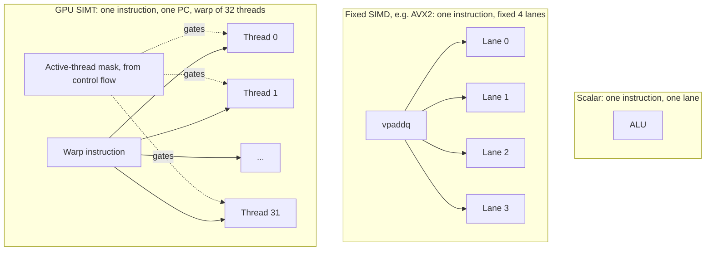

Data-level parallelism applies one operation to many data elements under a single instruction stream, so that the cost of fetching and decoding an instruction is amortized over many elements. Fixed-width SIMD, the RISC-V vector extension (RVV) and GPU SIMT are three hardware contracts for it. They differ in what determines the number of elements an instruction processes and in how individual elements are excluded from an operation.

Elementwise vector add serves as the common example. Systolic-array accelerators extend the same principle, one instruction driving many ALUs, to a grid of cells that pass operands to one another. GPU hardware is described in [[ml/serving-systems/gpu-basics|GPU Architecture and Programming]]; the treatment here concerns the instruction set and the datapath.

## SIMD: fixed lanes, fixed width

Fixed-width SIMD (SSE, AVX2, AVX-512, NEON) fixes the lane count when the ISA is designed and encodes it in the instruction. An AVX2 `vpaddq` adds four 64-bit lanes packed into a 256-bit register. In the [[systems/operating-systems/benchmarks/reductions|parallel reductions benchmark]], `gcc -O3 -march=native` compiles a scalar summation loop directly into `vpaddq (%rax), %ymm0, %ymm0`, four adds per instruction, with no source-level vector syntax.

The fixed width limits portability. Code compiled for AVX2 cannot use AVX-512's eight 64-bit lanes without recompiling, and a loop trip count that isn't a multiple of the lane width needs a scalar remainder loop or a masked tail. Every generation of wider SIMD (SSE to AVX to AVX-512) has repeated this: new registers, new encodings, and old binaries limited to the old width.

## RISC-V V: vector-length-agnostic

[RISC-V V](https://github.com/riscvarchive/riscv-v-spec) removes the fixed width from the encoding. A vector instruction does not encode the number of elements it processes. The program requests a length with `vsetvli`, and the hardware grants one at run time:

```asm
;; rd = vl (vector length actually granted), rs1 = requested length (AVL)
vsetvli t0, a0, e32, m1, ta, ma   # SEW=32 bits, LMUL=1, tail/mask agnostic
vle32.v v1, (a1)                  # load vl elements from a1 into v1
vle32.v v2, (a2)                  # load vl elements from a2 into v2
vadd.vv v3, v1, v2                # v3[i] = v1[i] + v2[i] for i < vl
vse32.v v3, (a3)                  # store vl elements
```

`SEW` sets the element width, `LMUL` groups multiple physical vector registers into one logical operand so a single instruction can span more lanes than one register holds, and `vl` (vector length, capped by `vsetvli`'s return value) is the actual number of elements the next instructions touch. The same binary runs on a machine with 4 physical lanes or 4096 and executes more or fewer loop iterations, because the loop is written to consume `vl` elements per iteration and re-issue `vsetvli` until the remaining count hits zero. There is no separate remainder loop, because the last iteration's `vsetvli` returns a smaller `vl`.

Masking replaces the branch-per-element pattern that scalar and AVX2 code sometimes needs. The mask register `v0` holds one bit per lane, and appending `.t` (mask undisturbed by default) to an instruction predicates it:

```asm
vmslt.vx v0, v1, x5      # v0[i] = (v1[i] < x5)
vadd.vv v3, v1, v2, v0.t  # v3[i] = v1[i]+v2[i] only where v0[i]==1
```

Lanes where the mask bit is clear keep their old value (mask-undisturbed) or, under the mask-agnostic policy chosen by `vsetvli`'s `ma` field, may either keep their old value or be overwritten with all 1s. The [masked ALU lane](#rtl-a-masked-vector-alu-lane) implements this predication for a single lane.

## SIMT: scalar threads in lockstep

SIMT takes the opposite approach. Instead of one instruction naming many data elements, SIMT (single instruction, multiple threads) issues one instruction to a warp of threads with scalar semantics, and the hardware executes it in lockstep across the threads that are active. NVIDIA's [PTX ISA](https://docs.nvidia.com/cuda/parallel-thread-execution/) describes the model in these terms. PTX section 3.1 calls the hardware "a set of SIMT multiprocessors," and section 9.5 covers "Divergence of Threads in Control Constructs."

The threads in a warp share one program counter and one set of active-thread masks, much like RVV's mask register but generated implicitly by control flow instead of an explicit `vmslt`:

```
if (threadIdx.x < 16) {
    a = ...;   // only threads 0-15 execute this
} else {
    a = ...;   // only threads 16-31 execute this
}
```

A conditional like this compiles to predicated execution across the whole warp: first the true-branch instructions run with threads 16-31 masked off, then the false-branch instructions run with threads 0-15 masked off. Both paths take time although each thread executes only one of them, and this serialization is the cost of divergence in SIMT. [[ml/serving-systems/gpu-basics|GPU Architecture and Programming]] describes the warp/block/kernel hierarchy above this level, and PTX section 8 defines a memory consistency model that governs communication between threads in different warps.

## Same operation, three contracts

For elementwise vector add, `c[i] = a[i] + b[i]`, the three models differ as follows:

| Model | Who decides lane count | How predication works | Cost of divergence |
|---|---|---|---|
| Fixed SIMD (AVX2) | Compiler, at compile time | Explicit blend/mask instructions | Wasted lanes in a remainder loop |
| RISC-V V | Hardware, at `vsetvli` time | Mask register `v0`, `.t` suffix | Wasted work on masked-off lanes, but no separate remainder loop |
| GPU SIMT | Fixed warp size (commonly 32), hardware masks per branch | Implicit, from control flow, per warp | Serializes both sides of a divergent branch |

RVV combines a property of SIMT, a single instruction stream that the compiler writes for arbitrary widths, with a property of fixed SIMD, one instruction with an explicit element count.



## RTL: a masked vector ALU lane

The following module is a single lane of a vector ALU in which a mask bit determines whether the lane's result is written. It implements the mechanism behind RVV's `.t` suffix and, at a smaller scale, AVX-512's per-lane `k`-register masking.

```systemverilog
// A single masked ALU lane: computes op(a, b) and writes to `result`
// only when `mask` is asserted. When mask is deasserted, `result`
// holds `old_value` (mask-undisturbed policy, as in RVV's default).
module masked_alu_lane #(
    parameter int WIDTH = 32
)(
    input  logic                  clk,
    input  logic                  rst_n,
    input  logic [1:0]            op,        // 00=add, 01=sub, 10=and, 11=or
    input  logic [WIDTH-1:0]      a,
    input  logic [WIDTH-1:0]      b,
    input  logic [WIDTH-1:0]      old_value, // value to hold when masked off
    input  logic                  mask,      // 1 = lane active
    output logic [WIDTH-1:0]      result
);
  logic [WIDTH-1:0] alu_out;

  always_comb begin
    unique case (op)
      2'b00:   alu_out = a + b;
      2'b01:   alu_out = a - b;
      2'b10:   alu_out = a & b;
      default: alu_out = a | b;
    endcase
  end

  logic [WIDTH-1:0] next_result;
  assign next_result = mask ? alu_out : old_value;

  always_ff @(posedge clk or negedge rst_n) begin
    if (!rst_n) result <= '0;
    else        result <= next_result;
  end
endmodule
```

A full vector ALU is `VLEN/SEW` copies of this lane, all sharing `op`, all fed from one mask register bit each, and all clocked together. In hardware, vector width corresponds to this replication of lanes.

## RTL: a reduction tree

Horizontal reduction (summing all lanes of a vector into one scalar) is the second part of the pattern in `red_naive`'s compiled AVX2 output in [[systems/operating-systems/benchmarks/reductions|parallel reductions]]. Its `vextracti128` / `vpaddq` / `vpsrldq` chains form a log-depth adder tree implemented with shuffles instead of dedicated wires. An accelerator can build the tree directly:

```systemverilog
// Combinational log-depth reduction tree: sums N (power-of-two)
// WIDTH-bit lanes down to one WIDTH-bit result in ceil(log2(N)) adder stages.
module reduction_tree #(
    parameter int WIDTH = 32,
    parameter int N     = 8   // must be a power of two
)(
    input  logic [WIDTH-1:0] lanes [N],
    output logic [WIDTH-1:0] sum
);
  localparam int STAGES = $clog2(N);

  // stage[0] holds the raw inputs; stage[STAGES] holds the final sum
  logic [WIDTH-1:0] stage [STAGES+1][N];

  for (genvar i = 0; i < N; i++) begin : gen_load
    assign stage[0][i] = lanes[i];
  end

  for (genvar s = 0; s < STAGES; s++) begin : gen_stage
    localparam int COUNT = N >> (s+1);
    for (genvar i = 0; i < COUNT; i++) begin : gen_add
      assign stage[s+1][i] = stage[s][2*i] + stage[s][2*i+1];
    end
  end

  assign sum = stage[STAGES][0];
endmodule
```

This is the same shape as Ibex's parallel-prefix bit counter in `ibex_alu.sv` (Brent-Kung style, `log2(width)` stages of pairwise combination), applied to addition instead of population count. Any associative reduction (sum, max, popcount, AND-reduce) can be computed by a tree of the same depth, and that depth is a lower bound on latency regardless of how the surrounding hardware is organized.

## RTL: a systolic multiply-accumulate cell

Accelerators such as TPUs, and the tensor cores that CUTLASS targets, extend the principle of one instruction driving many ALUs. Instead of independent lanes, they arrange ALUs in a grid in which each cell forwards its inputs to its neighbors, so data reused across many multiply-accumulates is read from memory once and then flows through the array. The following module is a single output-stationary systolic cell:

```systemverilog
// One cell of an output-stationary systolic array. `a` flows rightward,
// `b` flows downward, and `c_out` accumulates a*b locally across cycles.
// Chaining these in a grid builds a matmul array: feed a matrix rows
// from the left, a matrix columns from the top, and read partial sums
// out of each cell once all operands have passed through.
module systolic_mac_cell #(
    parameter int WIDTH = 16,
    parameter int ACC_WIDTH = 32
)(
    input  logic                    clk,
    input  logic                    rst_n,
    input  logic                    clear_acc,
    input  logic [WIDTH-1:0]        a_in,
    input  logic [WIDTH-1:0]        b_in,
    output logic [WIDTH-1:0]        a_out,
    output logic [WIDTH-1:0]        b_out,
    output logic [ACC_WIDTH-1:0]    c_out
);
  logic [ACC_WIDTH-1:0] acc;
  logic [ACC_WIDTH-1:0] product;

  assign product = ACC_WIDTH'(a_in) * ACC_WIDTH'(b_in);

  always_ff @(posedge clk or negedge rst_n) begin
    if (!rst_n) begin
      a_out <= '0;
      b_out <= '0;
      acc   <= '0;
    end else begin
      a_out <= a_in;  // forward operand rightward, one cycle later
      b_out <= b_in;  // forward operand downward, one cycle later
      acc   <= clear_acc ? product : acc + product;
    end
  end

  assign c_out = acc;
endmodule
```

An $M \times N$ grid of these cells computes an $M \times K$ by $K \times N$ matrix multiply in roughly $M + N + K$ cycles once the pipeline fills, instead of $M \times N \times K$ separate multiply-accumulate instructions, because every partial product is produced by hardware that also handles moving the operand to its next consumer. The [[ml/serving-systems/roofline-reference|arithmetic-intensity]] argument applies here in physical form. A systolic array raises achievable FLOPs per byte moved from memory by maximizing on-chip reuse of each operand, the property that places matmul at large $M$ in the compute-bound region of the roofline.

## Edge cases and limits

RVV's vector-length agnosticism provides portability only when the compiler or programmer writes stripmined loops (`vsetvli` in a loop, consuming `vl` elements per trip); code that assumes a fixed `VLEN` loses it.

SIMT divergence cost is incurred per warp. An `if` inside a tight loop that most threads resolve the same way still serializes the warp in every iteration in which any of its threads takes the other path. For this reason data-dependent branches inside GPU kernels are often restructured into arithmetic or lookup tables, the GPU analogue of the branchless techniques in [[systems/operating-systems/benchmarks/branch|branch prediction benchmarks]].

Systolic arrays exchange flexibility for reuse. The grid described here is wired for one dataflow (output-stationary matmul). Supporting convolution, sparse matmul, or reduced precision can require a different array topology or a separate execution unit, and CUTLASS accordingly ships dozens of instantiated kernel variants (`cutlass_tensorop_*`, `cutlass_simt_*`) rather than one generic array.

## Sources

- [RISC-V V Vector Extension, Version 1.0 (working draft repo)](https://github.com/riscvarchive/riscv-v-spec)
- [PTX ISA 9.3 documentation](https://docs.nvidia.com/cuda/parallel-thread-execution/)
- [CUTLASS](https://github.com/NVIDIA/cutlass)

## Related notes

- [[ml/serving-systems/gpu-basics|GPU Architecture and Programming]]
- [[ml/serving-systems/roofline-reference|Modeling and Scaling Performance with Roofline]]
- [[ml/serving-systems/parallelism|Parallelism in LLM Serving Systems]]
- [[systems/operating-systems/benchmarks/reductions|Parallel Reductions Benchmarks]]
- [[hardware/computer-architecture/rtl-reading-lab|Open-Source CPU RTL Reading Lab]]
