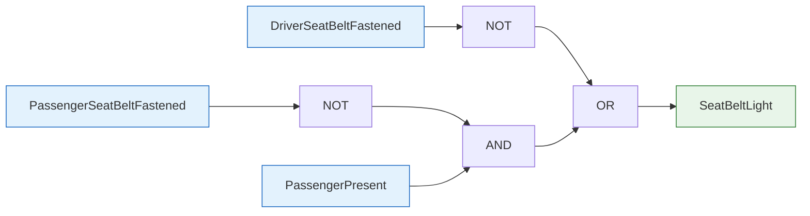

A combinational circuit is one whose outputs are a function of its present inputs alone. It contains no feedback paths and therefore holds no state.

Such a circuit can be specified by a truth table and implemented from a boolean expression derived from it. Logic minimization replaces that expression with an equivalent one that has fewer gates, literals or levels, and smaller expressions require fewer transistors and have lower delay.

## Combinational vs. sequential

The output of combinational logic depends only on the current input. There is no feedback, so the circuit holds no state. Multiplexers, decoders, and adders are combinational. Sequential logic adds feedback, so its output depends on the current input and on stored state. [[hardware/digital-design/369/sequential-logic|Sequential Logic]] treats that case.

## Representation

The same logic can be written as text, a circuit, a truth table, or an equation. A car's warning lights provide an example. The door is ajar if the driver door is open or the passenger door is open:

```plaintext
DoorAjar = DriverDoorOpen OR PassengerDoorOpen
```

The seat belt light is on if the driver's belt is unfastened, or if a passenger is present with their belt unfastened:

```plaintext
SeatBeltLight = (NOT DriverSeatBeltFastened) OR (NOT PassengerSeatBeltFastened AND PassengerPresent)
```

The gate network for the same expression is:



## Truth table to boolean expression

Sum of products: for each row where the output is 1, AND the inputs together, complementing any input that is 0 in that row. OR all of those product terms.

Product of sums: for each row where the output is 0, OR the inputs together, complementing any input that is 1 in that row. AND all of those sum terms.

> [!tip] Pick the form from the truth table
> Sum of products generates one term per 1 in the output column, and product of sums one term per 0. When the output is mostly 0s, SOP starts smaller; when it is mostly 1s, POS does. Both minimize to equivalent logic, so the shorter one is the more convenient starting point.

## Boolean identities

| Identity | Description |
|----------|-------------|
| `A + 0 = A` | Identity |
| `A + A = A` | Idempotent |
| `A + 1 = 1` | Annihilation |
| `A + A' = 1` | Complement |
| `A + B = B + A` | Commutative |
| `A + (B + C) = (A + B) + C` | Associative |
| `A(B + C) = AB + AC` | Distributive |
| `A + AB = A` | Absorption |

## Logic minimization

Reducing complexity at the gate level yields smaller and faster hardware. Minimization counts four quantities:

- Number of gates. Fewer gates means less area.
- Number of literals (gate inputs). Fewer literals means less wiring.
- Number of levels. Fewer levels means a shorter critical path and fewer dependencies.
- Types of gates. Some gates cost fewer transistors than others.

Simpler boolean expressions generally map to smaller transistor networks, which means smaller circuit delays. CMOS transistor counts per gate, from lecture:

| Type | CMOS transistors required |
|------|---------------------------|
| NOT | 2 |
| AND | 6 |
| OR | 6 |
| NAND | 4 |
| NOR | 4 |
| XOR | 8 |
| XNOR | 8 |

NAND and NOR are universal gates. Every other gate type can be built from either one alone. For example, AND is a NAND followed by an inverter, and the inverter itself is a NAND with both inputs tied together. NAND-based implementations also use fewer transistors, since NAND costs 4 transistors while AND costs 6.

## DeMorgan's law

$$
\overline{A \cdot B} = \overline{A} + \overline{B}
$$

$$
\overline{A + B} = \overline{A} \cdot \overline{B}
$$

In a circuit, the general rule for applying DeMorgan's law to an AND or OR gate with some inverted terminals is to swap the gate type (AND becomes OR, OR becomes AND) and toggle the inversion on every terminal, so inverted points become plain and plain points become inverted.

## Related

- [[hardware/digital-design/369/karnaugh-maps|Karnaugh Maps]]
- [[hardware/digital-design/369/sequential-logic|Sequential Logic]]
- [[hardware/digital-design/369/system-verilog|SystemVerilog]]
