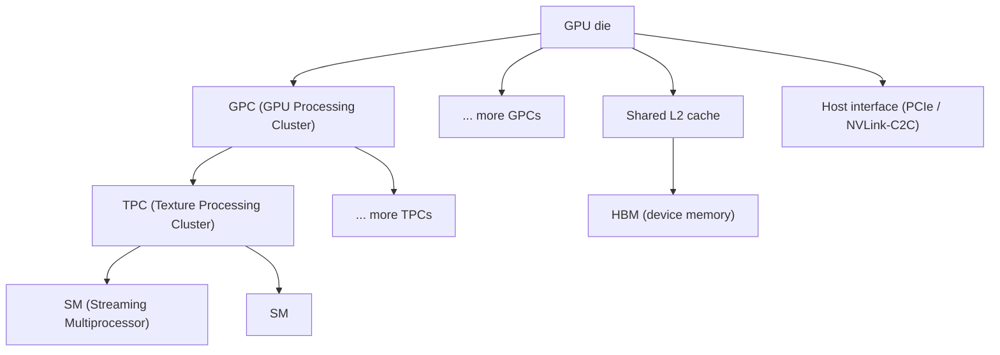
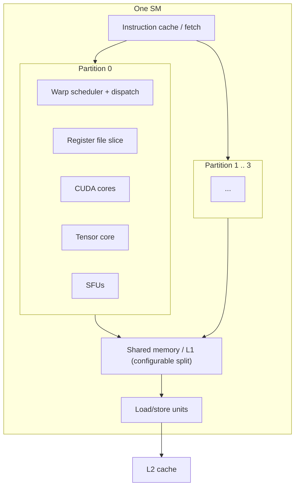
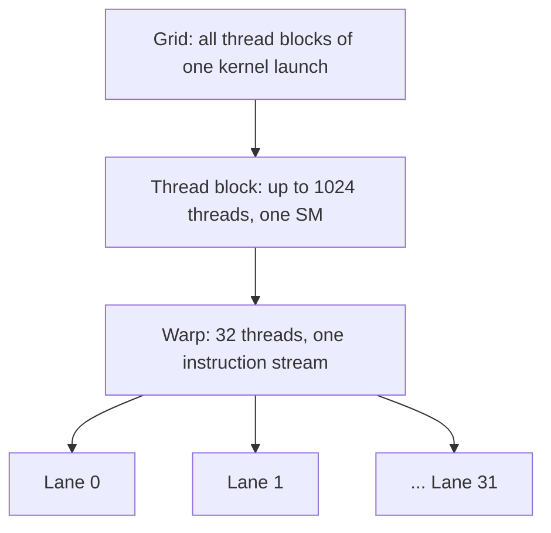

A GPU is a throughput-oriented processor composed of many streaming multiprocessors (SMs). Each SM issues one instruction at a time to a group of 32 threads, a warp, whose threads execute it in parallel lanes; NVIDIA calls this execution model SIMT.

The exposition starts from clocked digital logic (the registers and combinational datapaths covered in [[hardware/digital-design/369/system-verilog|SystemVerilog]]) rather than from CUDA's thread/block/grid vocabulary, and builds up to the warps, SMs and memory pipeline that CUDA exposes. In this derivation the SIMT execution model follows from hardware constraints.

Statements about the H100 and B200 cite NVIDIA documentation. The four SystemVerilog modules are simplified teaching models, not vendor RTL, since NVIDIA has not published its SM microarchitecture at the gate level. For comparison with real open GPU RTL, [MIAOW](https://github.com/VerticalResearchGroup/miaow) is a synthesizable implementation of AMD's Southern Islands ISA built for architecture research.

## From wires to lanes: the hardware building blocks

The construction rests on three primitives, all covered in [[hardware/digital-design/369/system-verilog|SystemVerilog]] and [[hardware/digital-design/369/sequential-logic|Sequential Logic]]:

- **A clocked register** (`always_ff @(posedge clk)`) is a single bit or word of state that only changes on a clock edge. In a synchronous design, all state is held in such registers.
- **A combinational datapath** (`always_comb` or continuous `assign`) computes a function of its inputs with no memory; an adder, a multiplexer, or an ALU are all combinational blocks wired between registers.
- **Valid/ready handshaking** is the protocol by which two hardware blocks pass data when the receiver may not be ready. The sender asserts `valid`, the receiver asserts `ready`, and a transfer happens only on a cycle where both are high. Independent clocked blocks (for example, a warp scheduler and an execution unit) communicate in this way without assuming a shared, synchronous notion of "now."

A GPU core consists of very large numbers of these three primitives, replicated and specialized. An ALU lane is a combinational datapath. A register file is an array of clocked registers with an addressing scheme. A pipeline is a chain of registers separated by combinational stages, one instruction phase advancing on every clock edge. The remaining structures are design choices layered on this substrate to exploit data parallelism.

## The chip-level hierarchy

The [CUDA programming guide](https://docs.nvidia.com/cuda/cuda-c-programming-guide/) documents a hierarchy of compute resources; the H100-class figures are from the guide and the [Hopper architecture page](https://www.nvidia.com/en-us/data-center/technologies/hopper-architecture/).



An H100 SXM part has 132 SMs (up to 144 on the full GH100 die), 50 MB of L2, and 80 GB of HBM3 at roughly 3.35 TB/s, per the Hopper architecture page. A GPC groups several TPCs, and a TPC groups two SMs sharing an instruction cache path; the exact grouping is a floorplanning decision that does not change the programming model, since CUDA's grid/block abstraction targets SMs directly and the scheduler maps blocks onto any SM with available resources.

## Inside one SM

Each SM is itself a parallel processor rather than a single core. NVIDIA's documented H100 SM contains four warp-scheduler partitions, each with its own register file slice, CUDA cores (scalar FP32/INT32/FP64 ALUs), fourth-generation tensor cores, special function units (SFUs) for transcendentals, and load/store units, sharing one block of configurable L1/shared memory (up to 228 KB per SM) per the [CUDA programming guide](https://docs.nvidia.com/cuda/cuda-c-programming-guide/).



An SM has four independent warp schedulers because a single scheduler cannot issue instructions fast enough to keep all of the SM's ALUs occupied from one instruction stream. The division into partitions serves throughput, as superscalar issue does in a CPU, with the difference that the parallelism comes from separate warps rather than from independent instructions of one thread.


## SIMT: one instruction stream, many lanes

Single Instruction, Multiple Threads (SIMT) is NVIDIA's name for the execution model documented in the [CUDA programming guide](https://docs.nvidia.com/cuda/cuda-c-programming-guide/): the hardware groups 32 consecutive threads into a warp, fetches and issues one instruction for the whole warp, and broadcasts it across 32 parallel lanes. The grouping follows from the RTL substrate. Fetching and decoding an instruction requires registers and combinational logic regardless of how many lanes execute it, so amortizing that cost over 32 lanes instead of 1 reduces the control overhead per lane. A lane with no useful work for a given instruction (a divergent branch, a masked-off predicate) still occupies a slot in the warp and consumes execution resources, and its result is discarded.



Compute capability 9.0 (Hopper) and 10.0 (Blackwell) both support up to 64 concurrent warps resident per SM, per the [Blackwell Tuning Guide](https://docs.nvidia.com/cuda/archive/12.8.1/blackwell-tuning-guide/index.html), which states that Blackwell targets occupancy similar to Hopper's. Since Independent Thread Scheduling arrived in Volta (compute capability 7.0), threads within a warp can each carry their own program counter and diverge and reconverge independently rather than executing in lockstep with a single shared PC; the [Blackwell compatibility guide](https://docs.nvidia.com/cuda/inline-ptx-assembly/blackwell-compatibility-guide/index.html) still documents an opt-in flag to fall back to the older Pascal-style scheduling model for code that assumed warp-synchronous behavior. Independent Thread Scheduling did not remove the cost of divergence; it removed the requirement of full lockstep execution, and a warp whose threads take different branches still executes both sides serially at the warp level.

## Four educational RTL models

The four models are simplified teaching designs that make the SIMT concepts testable in simulation. None of them is NVIDIA RTL, since NVIDIA has not published SM microarchitecture at the gate level. [MIAOW](https://github.com/VerticalResearchGroup/miaow), a synthesizable open-source GPU implementing AMD's Southern Islands ISA, is the closest public reference for real compute-unit RTL, and its wiki documents a warp scheduler, vector register file, and ALU pipeline at a level of detail that these four models intentionally omit.

### Model 1: warp issue arbiter

Each scheduler partition selects one ready warp to issue per cycle. This constraint underlies the structure in which four warps issue at once per SM and the others wait. Only one of the warps mapped to a partition can issue in a given cycle, so a round-robin policy (or an alternative such as greedy-then-oldest, which GPU simulators commonly model) ensures that every ready warp makes progress and none starves.

```systemverilog
// Educational model, not vendor RTL. Round-robin arbiter picking one
// ready warp to issue each cycle, one-hot output.
module warp_issue_arbiter #(
    parameter int NUM_WARPS = 4
) (
    input  logic                  clk,
    input  logic                  rst_n,
    input  logic [NUM_WARPS-1:0]  warp_ready,   // warp i has a decoded instruction ready
    output logic [NUM_WARPS-1:0]  warp_grant,   // one-hot: warp granted issue this cycle
    output logic                  issue_valid   // some warp was granted
);
    logic [$clog2(NUM_WARPS)-1:0] rr_ptr;       // round-robin priority pointer
    logic [2*NUM_WARPS-1:0]       ready_x2;     // ready mask duplicated for rotation
    logic [2*NUM_WARPS-1:0]       grant_x2;

    assign ready_x2 = {warp_ready, warp_ready};

    always_comb begin
        grant_x2    = '0;
        issue_valid = 1'b0;
        for (int i = 0; i < NUM_WARPS; i++) begin
            if (!issue_valid && ready_x2[rr_ptr + i]) begin
                grant_x2[rr_ptr + i] = 1'b1;
                issue_valid = 1'b1;
            end
        end
        warp_grant = grant_x2[NUM_WARPS-1:0] | grant_x2[2*NUM_WARPS-1:NUM_WARPS];
    end

    always_ff @(posedge clk or negedge rst_n) begin
        if (!rst_n)          rr_ptr <= '0;
        else if (issue_valid) rr_ptr <= (rr_ptr + 1) % NUM_WARPS; // move past the granted warp
    end
endmodule
```

Testbench sketch: assert fairness (every ready warp gets granted within `NUM_WARPS` cycles) and correctness (no grant when nothing is ready).

```systemverilog
module warp_issue_arbiter_tb;
    logic clk = 0, rst_n = 0;
    logic [3:0] warp_ready, warp_grant;
    logic issue_valid;

    warp_issue_arbiter #(.NUM_WARPS(4)) dut (.*);
    always #5 clk = ~clk;

    initial begin
        rst_n = 0; warp_ready = 4'b0000;
        @(posedge clk); rst_n = 1;

        warp_ready = 4'b0100;  // only warp 2 ready
        @(posedge clk);
        assert (warp_grant == 4'b0100)
            else $error("expected warp 2 granted, got %b", warp_grant);

        warp_ready = 4'b0000;  // nobody ready
        @(posedge clk);
        assert (issue_valid == 1'b0)
            else $error("issued with no ready warps");
        $finish;
    end
endmodule
```

### Model 2: banked (per-lane) register file

In the model, the 32 lanes read from 32 independent register-file banks in the same cycle, one bank per lane, so the whole warp reads its operands in a single cycle instead of serializing 32 scalar reads. Modeling each lane's registers as a separate small memory makes that parallelism explicit and makes a bank conflict structurally impossible, since lane `i` addresses only bank `i`.

```systemverilog
// Educational model, not vendor RTL. One synchronous register-file
// bank per SIMT lane; a warp-wide register read is 32 parallel bank
// reads in a single cycle, addressed identically across lanes.
module lane_register_file #(
    parameter int NUM_LANES     = 32,
    parameter int REGS_PER_LANE = 256,
    parameter int DATA_WIDTH    = 32
) (
    input  logic                                 clk,
    input  logic [$clog2(REGS_PER_LANE)-1:0]     raddr,   // same register index, all lanes
    input  logic [$clog2(REGS_PER_LANE)-1:0]     waddr,
    input  logic                                 we,
    input  logic [NUM_LANES-1:0][DATA_WIDTH-1:0] wdata,
    output logic [NUM_LANES-1:0][DATA_WIDTH-1:0] rdata
);
    logic [DATA_WIDTH-1:0] bank [NUM_LANES-1:0][REGS_PER_LANE-1:0];

    genvar lane;
    generate
        for (lane = 0; lane < NUM_LANES; lane++) begin : g_lane
            always_ff @(posedge clk) begin
                if (we) bank[lane][waddr] <= wdata[lane];
                rdata[lane] <= bank[lane][raddr];
            end
        end
    endgenerate
endmodule
```

Testbench sketch: write register 3 with a distinct value per lane, then confirm the whole warp reads it back in one cycle.

```systemverilog
module lane_register_file_tb;
    localparam int LANES = 32;
    logic clk = 0;
    logic [7:0] raddr, waddr;
    logic we;
    logic [LANES-1:0][31:0] wdata, rdata;

    lane_register_file #(.NUM_LANES(LANES), .REGS_PER_LANE(256)) dut (.*);
    always #5 clk = ~clk;

    initial begin
        waddr = 8'd3; we = 1'b1;
        for (int i = 0; i < LANES; i++) wdata[i] = i;
        @(posedge clk);
        we = 1'b0;

        raddr = 8'd3;
        @(posedge clk);
        for (int i = 0; i < LANES; i++)
            assert (rdata[i] == i)
                else $error("lane %0d expected %0d got %0d", i, i, rdata[i]);
        $finish;
    end
endmodule
```

### Model 3: pipelined multiply-accumulate datapath (matrix engine primitive)

Tensor cores compute small matrix products per instruction instead of one multiply-add per thread. The underlying primitive is a multiply-accumulate (MAC) chain, a systolic-style pipeline of registered MAC stages through which operands stream, so that a new partial product completes every cycle although each result takes several cycles to reach the output. The pipelining principle from [[hardware/digital-design/371/static-timing-analysis|static timing analysis]] applies here to arithmetic. Splitting one long combinational multiply-then-add into registered stages raises the achievable clock frequency at the cost of latency.

```systemverilog
// Educational model, not vendor RTL. 4-deep pipelined MAC chain, one
// educational analog of the systolic accumulation inside a matrix
// engine: each stage multiplies one (a,b) pair and adds it into the
// running sum carried from the previous stage.
module pipelined_mac_chain #(
    parameter int WIDTH = 16,
    parameter int DEPTH = 4
) (
    input  logic                   clk,
    input  logic                   rst_n,
    input  logic                   in_valid,
    input  logic [DEPTH-1:0][WIDTH-1:0] a,
    input  logic [DEPTH-1:0][WIDTH-1:0] b,
    output logic                   out_valid,
    output logic [2*WIDTH+DEPTH-1:0] acc_out
);
    logic [2*WIDTH+DEPTH-1:0] acc [DEPTH:0];
    logic [DEPTH:0]           valid_pipe;

    assign acc[0]        = '0;
    assign valid_pipe[0] = in_valid;

    genvar s;
    generate
        for (s = 0; s < DEPTH; s++) begin : g_stage
            always_ff @(posedge clk or negedge rst_n) begin
                if (!rst_n) begin
                    acc[s+1]        <= '0;
                    valid_pipe[s+1] <= 1'b0;
                end else begin
                    acc[s+1]        <= acc[s] + (a[s] * b[s]); // multiply-add this stage
                    valid_pipe[s+1] <= valid_pipe[s];          // carry the valid bit downstream
                end
            end
        end
    endgenerate

    assign acc_out   = acc[DEPTH];
    assign out_valid = valid_pipe[DEPTH];
endmodule
```

Testbench sketch: push one operand set in, confirm `out_valid` rises exactly `DEPTH` cycles later and `acc_out` equals the reference dot product.

```systemverilog
module pipelined_mac_chain_tb;
    localparam int WIDTH = 16, DEPTH = 4;
    logic clk = 0, rst_n = 0, in_valid, out_valid;
    logic [DEPTH-1:0][WIDTH-1:0] a, b;
    logic [2*WIDTH+DEPTH-1:0] acc_out;
    int expected;

    pipelined_mac_chain #(.WIDTH(WIDTH), .DEPTH(DEPTH)) dut (.*);
    always #5 clk = ~clk;

    initial begin
        rst_n = 0; in_valid = 0;
        @(posedge clk); rst_n = 1;

        for (int i = 0; i < DEPTH; i++) begin a[i] = i + 1; b[i] = 2; end
        expected = 0;
        for (int i = 0; i < DEPTH; i++) expected += (i + 1) * 2;

        in_valid = 1'b1;
        @(posedge clk);
        in_valid = 1'b0;

        repeat (DEPTH - 1) @(posedge clk);
        assert (out_valid == 1'b1)
            else $error("expected out_valid after %0d cycles", DEPTH);
        assert (acc_out == expected)
            else $error("expected acc_out=%0d got %0d", expected, acc_out);
        $finish;
    end
endmodule
```

### Model 4: valid/ready handshake between scheduler and execution unit

The arbiter (Model 1) and the MAC pipeline (Model 3) run at different depths and can stall independently (a shared-memory bank conflict downstream, a busy tensor core). A valid/ready handshake decouples them: the scheduler asserts `valid` when it has an instruction to issue, the execution unit asserts `ready` when it can accept one, and only a cycle with both high is a real transfer. The same handshake is used in NoCs and AXI-style buses, and the model reduces it to two blocks.

```systemverilog
// Educational model, not vendor RTL. Minimal valid/ready handshake
// between an issuing warp scheduler and a downstream execution unit
// that is not always free to accept a new instruction.
module issue_handshake #(
    parameter int OPWIDTH = 8
) (
    input  logic               clk,
    input  logic                rst_n,
    input  logic                sched_valid,   // scheduler has an instruction
    input  logic [OPWIDTH-1:0]  sched_op,
    output logic                sched_ready,   // execution unit can accept it
    output logic                exec_valid,    // instruction accepted this cycle
    output logic [OPWIDTH-1:0]  exec_op
);
    logic busy;   // models a multi-cycle execution unit occupied by a prior op

    assign sched_ready = !busy;
    assign exec_valid  = sched_valid && sched_ready; // transfer iff both sides agree

    always_ff @(posedge clk or negedge rst_n) begin
        if (!rst_n) begin
            busy    <= 1'b0;
            exec_op <= '0;
        end else if (exec_valid) begin
            busy    <= 1'b1;      // pretend this op occupies the unit next cycle
            exec_op <= sched_op;
        end else begin
            busy    <= 1'b0;      // frees up if nothing was accepted
        end
    end
endmodule
```

Testbench sketch: hold `sched_valid` high while the unit is busy and assert no transfer occurs, then release and confirm exactly one transfer.

```systemverilog
module issue_handshake_tb;
    logic clk = 0, rst_n = 0, sched_valid, sched_ready, exec_valid;
    logic [7:0] sched_op, exec_op;

    issue_handshake #(.OPWIDTH(8)) dut (.*);
    always #5 clk = ~clk;

    initial begin
        rst_n = 0; sched_valid = 0; sched_op = 8'hAA;
        @(posedge clk); rst_n = 1;

        sched_valid = 1'b1;
        @(posedge clk);
        assert (exec_valid == 1'b1 && exec_op == 8'hAA)
            else $error("expected transfer of op AA");

        @(posedge clk); // execution unit now busy, sched_ready should drop
        assert (sched_ready == 1'b0)
            else $error("expected sched_ready low while busy");
        $finish;
    end
endmodule
```

## Worked trace: one warp instruction, issue to writeback

The trace follows a single `FFMA` (fused multiply-add) warp instruction through the pipeline built from the four models, in a simplified 5-stage view in which fetch and decode are already complete, so the trace starts at issue:

1. **Issue (cycle 0)**: `warp_issue_arbiter` grants warp 2, which has a decoded `FFMA R3, R1, R2, R3` ready. `warp_grant = 0100`, `issue_valid = 1`.
2. **Register read (cycle 1)**: the issued warp's register index feeds `lane_register_file.raddr` for `R1` and `R2` across all 32 lanes in parallel; 32 pairs of operands come out one cycle later (the model's registered read).
3. **Handshake to execution unit (cycle 2)**: the decoded operands and opcode present as `sched_valid` to `issue_handshake`; if the target ALU/tensor pipe is free (`sched_ready = 1`), `exec_valid` is asserted and the operands enter the pipeline.
4. **Execute (cycles 3-6)**: the multiply-add streams through the 4-stage `pipelined_mac_chain`; each stage advances one operand set per cycle, so throughput is one FFMA issued per cycle once the pipeline is full, but this particular instruction's result is not ready until 4 cycles after it entered.
5. **Writeback (cycle 7)**: `acc_out` with `out_valid = 1` is written back into `lane_register_file` at `R3` (`we = 1`, `waddr = R3`), one bank per lane, completing the instruction.

The pipeline depth (4 execute stages here) is why a single warp cannot issue two dependent instructions back to back without a stall or without the scheduler filling the gap with a different warp's instruction. Many resident warps per SM (up to 64 on Hopper/Blackwell) address this stall. While warp 2's FFMA is still draining through the pipeline, the scheduler can issue warp 5's instruction in the same slot and hide the pipeline latency.


## Memory pipeline: registers to HBM

Reading `R1` and `R2` in the trace is the fastest access path. Most kernels also access shared memory, L2, and HBM, each further from the ALU and each with different documented bandwidth and latency:

- **Registers**: read in the same cycle as issue in this model (real hardware pipelines this over 1-2 cycles); private per thread, largest but cheapest resource per access.
- **Shared memory / L1**: on-chip SRAM, configurable up to 228 KB per SM on Hopper and Blackwell compute capability 10.0 per the [Blackwell Tuning Guide](https://docs.nvidia.com/cuda/archive/12.8.1/blackwell-tuning-guide/index.html); visible to a whole thread block, tens of cycles of latency, banked similarly to the register file so that a warp's 32 threads can hit 32 different banks in one cycle without conflict.
- **L2 cache**: shared across the whole GPU, 50 MB on H100 and up to 126 MB on GB200 per the tuning guide; hundreds of cycles of latency but far faster than a round trip to HBM.
- **HBM (device memory)**: off-chip, ~3.35 TB/s on H100 SXM and up to 8 TB/s aggregate on B200-class HBM3e configurations per NVIDIA's published specs; the slowest and highest-capacity tier, hundreds of cycles away, and the layer the [[ml/serving-systems/performance-modeling|roofline model]] treats as "the" bandwidth denominator for a single-GPU kernel.


## Bandwidth and latency: a worked calculation

An H100 SXM has 3.35 TB/s HBM bandwidth and roughly 132 SMs (Hopper architecture page). A kernel that streams through the entire 80 GB of HBM once, purely memory bound, takes at minimum

$$T = \frac{80 \times 10^9 \text{ bytes}}{3.35 \times 10^{12} \text{ bytes/s}} \approx 23.9\text{ ms}$$

Per-SM share of that bandwidth, if perfectly divided, is $3.35\text{ TB/s} / 132 \approx 25.4\text{ GB/s}$ per SM. A single warp's load instruction moving 32 lanes x 4 bytes = 128 bytes in one coalesced transaction, issued back to back with zero stall, would need $128\text{ bytes} / 25.4\text{ GB/s} \approx 5\text{ ns}$ per transaction to stay bandwidth-bound at the SM's fair share, which at a ~1.8 GHz clock is roughly 9 cycles, well above the roughly 1-cycle issue rate. Real kernels therefore keep many warps in flight (as in the [worked trace](#worked-trace-one-warp-instruction-issue-to-writeback)) rather than relying on one warp to saturate memory bandwidth. The [[ml/serving-systems/performance-modeling|roofline model]] reaches the same conclusion from the software side. Memory traffic from a single thread or a single warp falls far short of peak bandwidth, and occupancy keeps enough memory requests outstanding to approach it.

## Resource tradeoff: registers, shared memory, occupancy, pipeline depth

These resources share one finite SM budget. On Hopper/Blackwell compute capability 10.0, an SM has 64K 32-bit registers and up to 228 KB of shared memory per SM, with up to 64 resident warps per SM per the [Blackwell Tuning Guide](https://docs.nvidia.com/cuda/archive/12.8.1/blackwell-tuning-guide/index.html). These quantities trade off directly:

- **More registers per thread** reduces spills to local memory (which resides in device memory and so generates HBM traffic) but reduces how many warps' worth of registers fit in the 64K-register file, lowering occupancy.
- **More shared memory per block** enables larger tiles (fewer HBM round trips per unit of compute, raising arithmetic intensity per the [[ml/serving-systems/performance-modeling|roofline model]]) but reduces how many blocks fit per SM simultaneously.
- **Deeper execution pipelines** (Model 3 above) raise achievable clock frequency and per-cycle throughput once full, but raise the latency that any chain of dependent instructions incurs, which again requires more resident warps to hide that latency.

None of these axes can be maximized independently: a kernel using all 228 KB of shared memory per block leaves room for only one block per SM regardless of register usage, and a kernel using 255 registers per thread (the compute-capability 10.0 max per the tuning guide) leaves room for at most $65536 / (255 \times 32) \approx 8$ warps per SM, an eighth of the 64-warp ceiling. Occupancy alone is not a sufficient optimization target (see [[ml/serving-systems/gpu-basics|GPU Basics]] for why), but it reflects this three-way competition for resources, and tuning any one axis (registers, shared memory, launch bounds) affects the other two.

## Related notes

- [[hardware/digital-design/369/system-verilog|SystemVerilog]] and [[hardware/digital-design/369/sequential-logic|Sequential Logic]] for the RTL primitives used in the models.
- [[hardware/digital-design/371/static-timing-analysis|Static Timing Analysis]] for why pipelining trades latency for frequency.
- [[ml/serving-systems/gpu-basics|GPU Basics]] for the software-facing view of warps, occupancy, and dtype throughput.
- [[ml/serving-systems/optimizing-gpu-kernels|Optimizing GPU Kernels]] for how these hardware constraints shape real kernel design (tiling, TMA, tensor cores).
- [[ml/serving-systems/performance-modeling|Performance Modeling for LLM Serving Systems]] for the roofline model to which the bandwidth calculation applies.
- [[ml/serving-systems/gpu-interconnects|GPU Interconnects and Collective Communication]] for what happens once data leaves a single GPU's HBM.
