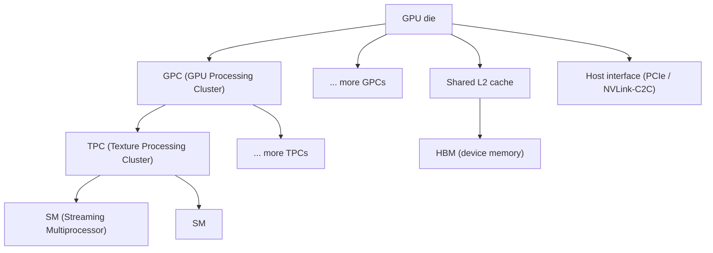
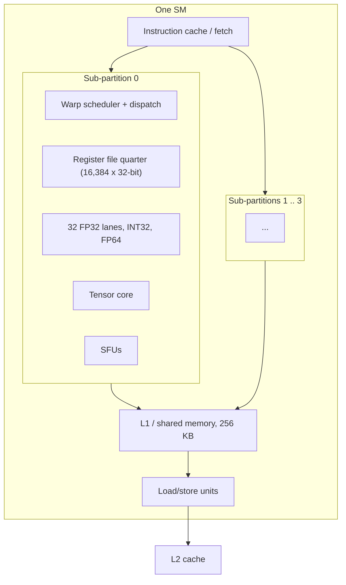
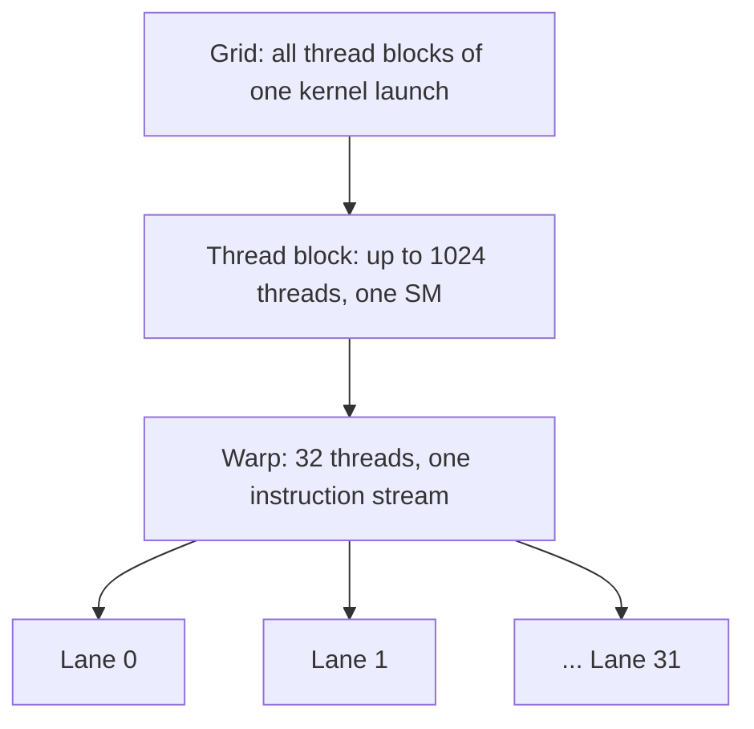

A GPU is a throughput-oriented processor composed of many streaming multiprocessors (SMs). Each SM keeps many groups of 32 threads, called warps, resident at once, and in each cycle each of its warp schedulers issues one instruction from one warp whose operands are ready; the 32 threads of that warp execute it in parallel lanes. NVIDIA calls this execution model SIMT (single instruction, multiple threads). Throughput comes from fine-grained multithreading: while one warp waits for a long-latency result, the scheduler issues from another.

The construction below starts from clocked digital logic (the registers and combinational datapaths of [[hardware/digital-design/369/system-verilog|SystemVerilog]]) rather than from CUDA's thread, block and grid vocabulary. Four small SystemVerilog models (a warp issue arbiter, a banked register file with an operand collector, a pipelined multiply-accumulate chain and a valid/ready pipeline stage) are composed into a toy SM sub-partition and simulated cycle by cycle in two open-source simulators. The models are teaching designs, not vendor RTL, since NVIDIA has not published its SM microarchitecture at the gate level; statements about the H100 and B200 cite NVIDIA documentation or published microbenchmarks. The RTL, testbenches and outputs are in [`gpu-architecture-rtl/`](https://github.com/elimelt/web/tree/main/notes/content/hardware/gpu-architecture-rtl). For complete open GPU RTL, [MIAOW](https://github.com/VerticalResearchGroup/miaow) implements AMD's Southern Islands compute unit. KB means 1024 bytes throughout, as in NVIDIA's documentation.

## From wires to lanes

Three primitives carry the construction; [[hardware/digital-design/369/sequential-logic|Sequential Logic]] covers them in detail.

- **A clocked register** (`always_ff @(posedge clk)`) holds state that changes only at a clock edge. In a synchronous design all state lives in such registers.
- **A combinational datapath** (`always_comb` or `assign`) computes a function of its inputs with no state. Adders, multiplexers and ALUs are combinational blocks placed between registers.
- **A valid/ready handshake** passes data between two blocks when the receiver may not be able to accept it. The sender raises `valid`, the receiver raises `ready`, and a transfer happens at a clock edge where both are high. Blocks that stall independently, such as a warp scheduler and an execution unit, communicate this way.

An ALU lane is a combinational datapath. A register file is an array of registers with read and write ports. A pipeline is a chain of registers separated by combinational stages, with each instruction advancing one stage per clock edge. A GPU replicates these structures and adds scheduling to keep them occupied.

## The chip-level hierarchy



The full GH100 die has 8 GPCs, 72 TPCs (9 per GPC), 2 SMs per TPC, 144 SMs and 60 MB of L2. The H100 SXM5 product enables 132 SMs (66 TPCs) and 50 MB of L2, and the H100 PCIe enables 114 SMs, per NVIDIA's [Hopper architecture in-depth](https://developer.nvidia.com/blog/nvidia-hopper-architecture-in-depth/) article. The H100 SXM has 80 GB of HBM3 at 3.35 TB/s according to the [H100 product page](https://www.nvidia.com/en-us/data-center/h100/); the 2022 whitepaper's preliminary table listed 3 TB/s. Each Blackwell GPU is two reticle-limited dies with 208 billion transistors joined by a 10 TB/s die-to-die link ([Blackwell architecture page](https://www.nvidia.com/en-gb/data-center/technologies/blackwell-architecture/)). A [DGX B200](https://www.nvidia.com/en-gb/data-center/dgx-b200/) lists 1,440 GB of HBM3e and 64 TB/s across its eight GPUs, 180 GB and 8 TB/s per GPU, and the [Blackwell tuning guide](https://docs.nvidia.com/cuda/archive/12.8.1/blackwell-tuning-guide/index.html) gives 126 MB of L2 for the GB200. CUDA's grid of thread blocks targets SMs directly: the block scheduler places each block on any SM with enough free resources, so the GPC and TPC grouping does not appear in the programming model. Thread block clusters, introduced with compute capability 9.0, are the exception, since a cluster's blocks are co-scheduled within one GPC.

## Inside one SM

An H100 SM has 128 FP32 lanes ("CUDA cores") and 4 fourth-generation tensor cores ([Hopper in-depth](https://developer.nvidia.com/blog/nvidia-hopper-architecture-in-depth/)), a 256 KB register file of 64K 32-bit registers, and 256 KB of combined L1 data cache and shared memory, of which up to 228 KB can be shared memory ([Hopper tuning guide](https://docs.nvidia.com/cuda/archive/12.2.1/hopper-tuning-guide/index.html)). The SM is split into four sub-partitions: NVIDIA's occupancy calculator (`cuda_occupancy.h`, shipped with the CUDA runtime; see [How this was measured](#how-this-was-measured)) models four for compute capabilities 9.0 and 10.0 and allocates each warp's registers from one sub-partition's quarter of the register file. Each sub-partition has its own warp scheduler, so the 128 FP32 lanes divide into 32 per scheduler, one warp-wide FP32 instruction per scheduler per cycle. The datasheet is consistent with that accounting: $132 \times 128$ lanes, each completing one fused multiply-add (2 FLOP) per cycle, reach the H100 SXM's 67 TFLOPS FP32 at

$$
f = \frac{67 \times 10^{12}}{132 \times 128 \times 2} \approx 1.98\ \text{GHz},
$$

the boost clock that [Manjunath and Ramachandra (2026)](https://arxiv.org/abs/2608.15764) report for their H100 SXM5 parts.



## SIMT: one instruction stream, many lanes

The [CUDA programming guide](https://docs.nvidia.com/cuda/cuda-programming-guide/05-appendices/compute-capabilities.html) fixes the warp size at 32 and a block at up to 1024 threads, and allows a compute capability 9.0 or 10.0 SM up to 64 resident warps (2048 threads) in up to 32 resident blocks. One fetch, decode and issue serves 32 lanes, so the control logic per instruction is shared across the warp. A lane whose thread is inactive for an instruction (a divergent branch, a false predicate) still occupies its slot in the warp, and its result is discarded.



"NVIDIA GPUs since Volta architecture have Independent Thread Scheduling among threads in a warp," in the words of the [Blackwell compatibility guide](https://docs.nvidia.com/cuda/blackwell-compatibility-guide/index.html) (section 1.4.3). Threads of a warp can diverge and reconverge at different points, so code may not assume that a warp's threads are synchronized at every instruction. The same guide documents an opt-in to the Pascal scheduling model for code written with that assumption, `nvcc -gencode=arch=compute_60,code=sm_100`. Independent thread scheduling does not remove the cost of divergence: a warp whose threads take different paths still executes the paths one after another, with the inactive lanes masked.

## Four RTL models, simulated

Each model was simulated with [Icarus Verilog](https://steveicarus.github.io/iverilog/) 12.0 and [Verilator](https://www.veripool.org/verilator/) 5.020. The testbenches drive inputs and sample outputs on the falling clock edge, so the results do not depend on how a simulator orders events within the rising-edge time step, and both simulators produced the same results on every test they both accept. The models replace earlier hand-written sketches. Simulating the sketches found four defects, described under each model; the sketches are kept in [`original/`](https://github.com/elimelt/web/tree/main/notes/content/hardware/gpu-architecture-rtl/original) for comparison. Three of the four sketch testbenches also sampled outputs in the same time step as the clock edge that updated them, a race: each passed in Verilator and failed in Icarus.

### Model 1: warp issue arbiter

A scheduler selects at most one ready warp per cycle. A round-robin arbiter starts its search at a pointer and, after a grant is accepted, moves the pointer to the warp after the one granted, so the warp just served has the lowest priority in the next cycle and every ready warp receives an equal share of issue slots. GPU simulators also model other policies; GPGPU-Sim, for example, offers greedy-then-oldest, which keeps issuing from one warp until it stalls.

```systemverilog
module warp_issue_arbiter #(
    parameter int NUM_WARPS = 4          // at least 2
) (
    input  logic                  clk,
    input  logic                  rst_n,
    input  logic [NUM_WARPS-1:0]  warp_ready,   // warp i has an issuable instruction
    input  logic                  issue_accept, // downstream takes the grant this cycle
    output logic [NUM_WARPS-1:0]  warp_grant,   // one-hot grant
    output logic [$clog2(NUM_WARPS)-1:0] grant_idx,
    output logic                  issue_valid   // some warp is granted
);
    localparam int IW = $clog2(NUM_WARPS);
    logic [IW-1:0] rr_ptr;
    int w;

    always_comb begin
        warp_grant  = '0;
        grant_idx   = '0;
        issue_valid = 1'b0;
        w = 0;
        for (int i = 0; i < NUM_WARPS; i++) begin
            w = (int'(rr_ptr) + i) % NUM_WARPS;
            if (!issue_valid && warp_ready[w]) begin
                warp_grant[w] = 1'b1;
                grant_idx     = IW'(w);
                issue_valid   = 1'b1;
            end
        end
    end

    always_ff @(posedge clk or negedge rst_n) begin
        if (!rst_n)
            rr_ptr <= '0;
        else if (issue_valid && issue_accept)
            rr_ptr <= IW'((int'(grant_idx) + 1) % NUM_WARPS);
    end
endmodule
```

The [testbench](https://github.com/elimelt/web/blob/main/notes/content/hardware/gpu-architecture-rtl/tb/tb_arbiter.sv) holds each of the 15 non-empty ready masks of four warps for 48 cycles and counts grants, then compares 20,000 cycles of pseudo-random ready masks and accept signals against a reference round-robin model. Every mask gave each of its ready warps the same number of grants, and all 20,000 grants matched the reference, for three seeds.

**Defect in the original.** The sketch advanced the pointer by one from its old position rather than past the granted warp. No warp starves, since the pointer reaches every index within four cycles, but the shares are unequal: with warps 0 and 1 ready, warp 0 received 36 of 48 grants and warp 1 received 12, and 7,001 of the 20,000 random cycles granted a different warp than round robin would.

### Model 2: banked register file and operand collector

A warp instruction such as `FFMA R3, R1, R2, R3` reads three registers, each 32 lanes wide. Rather than give each sub-partition a register file with three full read ports, register files are built from several single-ported (or narrow multi-ported) SRAM banks, and an **operand collector** gathers an instruction's source operands from the banks over one or more cycles. NVIDIA's [operand collector patent](https://patents.google.com/patent/US7834881B2/en) (filed 2006) describes collector units that "gather source operands from the banks as needed," and the [GPGPU-Sim manual](http://gpgpu-sim.org/manual/index.php/Main_Page) models the same structure: a collector unit buffers one instruction's operands, single-ported banks serve one access per cycle each, and an arbiter sends up to four non-conflicting accesses to the banks per cycle.

The banks are indexed by register number, and each bank row holds one register for all 32 lanes, so the lanes make up the width of a bank rather than its index. [Jia et al. (2018)](https://arxiv.org/abs/1804.06826) determined Volta's mapping by microbenchmarking: "The register file on Volta is divided into 2 banks and the width of each bank is 64 bits," the bank of a register is its index modulo 2, and "a conflict will only happen when all three 32-bit source registers in an FFMA instruction are in a same bank." The Kepler, Maxwell and Pascal parts they measured had 4 banks of 32 bits, where two sources in one bank already conflict. They also found 4 operand reuse caches, one per source operand slot, controlled by reuse flags in each instruction's control bits, which let an instruction consume a value that the previous one read without a bank access.

The model follows that structure. Each bank row is one warp's register across all lanes, the bank is `reg % NUM_BANKS`, each bank serves `PORTS` distinct registers per cycle, and a source that names the same register as another rides on its read. `NUM_BANKS=2, PORTS=2` mimics the Volta measurement and `NUM_BANKS=4, PORTS=1` the Maxwell and Pascal one. The model has no reuse cache. The arbitration for one cycle is a function of the sources still to be read:

```systemverilog
// in banked_regfile.sv: grant pending sources in operand order, at most
// PORTS distinct registers per bank per cycle
function automatic logic [2:0] select_reads(input logic [3*RID-1:0] src, input logic [2:0] pend);
    int used [NUM_BANKS];
    logic [2:0] g;
    logic dup;
    g = '0;
    for (int b = 0; b < NUM_BANKS; b++) used[b] = 0;
    for (int j = 0; j < 3; j++) begin
        if (pend[j]) begin
            dup = 1'b0;
            for (int k = 0; k < 3; k++)
                if (k < j && g[k] && src[k*RID +: RID] == src[j*RID +: RID]) dup = 1'b1;
            if (dup) begin
                g[j] = 1'b1;
            end else if (used[bank_of(src[j*RID +: RID])] < PORTS) begin
                g[j] = 1'b1;
                used[bank_of(src[j*RID +: RID])] = used[bank_of(src[j*RID +: RID])] + 1;
            end
        end
    end
    return g;
endfunction
```

The collector accepts an instruction over valid/ready, reads for as many cycles as the banks require while holding `in_ready` low, and presents all three operands one cycle after its last read, since the bank reads are synchronous; the full module is [`banked_regfile.sv`](https://github.com/elimelt/web/blob/main/notes/content/hardware/gpu-architecture-rtl/rtl/banked_regfile.sv). Its [testbench](https://github.com/elimelt/web/blob/main/notes/content/hardware/gpu-architecture-rtl/tb/tb_regfile.sv) sends all 512 source triples over 8 registers and compares the read cycles with $\max_b \lceil d_b / \text{PORTS} \rceil$, where $d_b$ is the number of distinct registers in bank $b$:

| banks × ports | 1 read cycle | 2 read cycles | 3 read cycles |
|---|---|---|---|
| 1 × 1 | 8 | 168 | 336 |
| 4 × 1 (Maxwell-like) | 344 | 168 | 0 |
| 2 × 2 (Volta-like) | 464 | 48 | 0 |

All 512 cycle counts and all returned operands matched in every configuration. In the Volta-like configuration the 48 conflicting triples are exactly the triples of three distinct registers in one bank, the condition Jia et al. report.

**Defect in the original.** The sketch gave each of the 32 lanes its own bank, all addressed with the same register index, and described this as how a warp reads its operands in one cycle. Banks that always receive the same address form one wide bank with one read port, so the sketch could read one register per cycle, while the worked trace that used it read `R1` and `R2` together.

### Model 3: pipelined multiply-accumulate chain

A tensor core computes a small matrix product per instruction instead of one multiply-add per thread. The primitive underneath is a multiply-accumulate chain: stage $s$ adds $a_s b_s$ to the partial sum that stage $s-1$ produced a cycle earlier, so one dot product of length `DEPTH` completes per cycle, each with a latency of `DEPTH` cycles. Splitting the long combinational multiply-add path into registered stages raises the achievable clock frequency at the cost of latency, the trade that [[hardware/digital-design/371/static-timing-analysis|static timing analysis]] quantifies. For stage $s$ to use the operands of the set that entered $s$ cycles earlier, the operands travel down the pipeline with the partial sum, as the skew registers of a systolic array do.

```systemverilog
module pipelined_mac_chain #(
    parameter int WIDTH = 16,
    parameter int DEPTH = 4
) (
    input  logic                         clk,
    input  logic                         rst_n,
    input  logic                         in_valid,
    input  logic [DEPTH-1:0][WIDTH-1:0]  a,
    input  logic [DEPTH-1:0][WIDTH-1:0]  b,
    output logic                         out_valid,
    output logic [2*WIDTH+DEPTH-1:0]     acc_out
);
    localparam int AW = 2 * WIDTH + DEPTH;
    logic [DEPTH:1][AW-1:0]                acc_q;     // register s+1: state after stage s
    logic [DEPTH:1]                        valid_q;
    logic [DEPTH:1][DEPTH-1:0][WIDTH-1:0]  a_q, b_q;  // operands travel with the sum

    genvar s;
    generate
        for (s = 0; s < DEPTH; s++) begin : g_stage
            logic [AW-1:0]                acc_in;
            logic                         valid_in;
            logic [DEPTH-1:0][WIDTH-1:0]  a_in, b_in;
            if (s == 0) begin : g_first
                assign acc_in   = '0;
                assign valid_in = in_valid;
                assign a_in     = a;
                assign b_in     = b;
            end else begin : g_rest
                assign acc_in   = acc_q[s];
                assign valid_in = valid_q[s];
                assign a_in     = a_q[s];
                assign b_in     = b_q[s];
            end
            always_ff @(posedge clk or negedge rst_n) begin
                if (!rst_n) begin
                    acc_q[s+1]   <= '0;
                    valid_q[s+1] <= 1'b0;
                    a_q[s+1]     <= '0;
                    b_q[s+1]     <= '0;
                end else begin
                    acc_q[s+1]   <= acc_in + AW'(a_in[s]) * AW'(b_in[s]);
                    valid_q[s+1] <= valid_in;
                    a_q[s+1]     <= a_in;
                    b_q[s+1]     <= b_in;
                end
            end
        end
    endgenerate

    assign acc_out   = acc_q[DEPTH];
    assign out_valid = valid_q[DEPTH];
endmodule
```

The [testbench](https://github.com/elimelt/web/blob/main/notes/content/hardware/gpu-architecture-rtl/tb/tb_mac.sv) streams a new pseudo-random operand set every cycle for 2,000 cycles and checks each result, and its arrival exactly `DEPTH` cycles later, against the dot product of the set that entered then: 2,000 of 2,000 were correct, for two seeds.

**Defect in the original.** Every stage of the sketch read its operands from the input port in the current cycle, so stage $s$ added $a_s b_s$ from an operand set that arrived $s$ cycles after the one whose partial sum it held. The sketch testbench held the operands constant for the whole computation, which hides the error; with a new operand set every cycle, 1,999 of 2,000 results were wrong (only the first, with nothing before it, was right). The sketch also drove `acc[0]` and `valid_pipe[0]` with continuous assignments while `always_ff` blocks drove the other elements of the same arrays, which Icarus rejects, so the comparison used [a copy](https://github.com/elimelt/web/blob/main/notes/content/hardware/gpu-architecture-rtl/original/pipelined_mac_chain_drivers_fixed.sv) with only those drivers rewritten.

### Model 4: valid/ready pipeline stage

A one-entry valid/ready stage decouples a producer, such as the arbiter, from a consumer that can stall, such as an operand collector reading through a bank conflict. It accepts an item when it is empty or when its current item leaves in the same cycle, so a stream with both sides ready moves one item per cycle.

```systemverilog
module valid_ready_stage #(
    parameter int WIDTH = 8
) (
    input  logic             clk,
    input  logic             rst_n,
    input  logic             in_valid,
    output logic             in_ready,
    input  logic [WIDTH-1:0] in_data,
    output logic             out_valid,
    input  logic             out_ready,
    output logic [WIDTH-1:0] out_data
);
    logic             full;
    logic [WIDTH-1:0] data;

    assign in_ready  = !full || out_ready;   // combinational path from out_ready
    assign out_valid = full;
    assign out_data  = data;

    always_ff @(posedge clk or negedge rst_n) begin
        if (!rst_n) begin
            full <= 1'b0;
            data <= '0;
        end else if (in_valid && in_ready) begin
            full <= 1'b1;          // refill, possibly in the cycle the old item leaves
            data <= in_data;
        end else if (out_ready) begin
            full <= 1'b0;          // item left, nothing arrived
        end
    end
endmodule
```

`in_ready` depends combinationally on `out_ready`, so a chain of such stages has a ready path through every stage; a two-entry skid buffer cuts that path at the cost of a second register. The [testbench](https://github.com/elimelt/web/blob/main/notes/content/hardware/gpu-architecture-rtl/tb/tb_stage.sv) offers the sequence 0, 1, 2, ... with pseudo-random `valid` and consumes it with pseudo-random `ready`; for two seeds, every item arrived once and in order, and no item changed while waiting for `ready`. With both sides always ready, 3,999 items passed in 4,000 cycles, with the last one still in the stage at the end.

**Defect in the original.** The sketch asserted `exec_valid` combinationally in the transfer cycle but registered `exec_op`, which appeared a cycle later, so a consumer that took `exec_op` when `exec_valid` was high received the previous operation: 1,357 of 1,358 transfers delivered the wrong value.

## Worked trace: dependent instructions, issue to writeback

[`toy_partition.sv`](https://github.com/elimelt/web/blob/main/notes/content/hardware/gpu-architecture-rtl/rtl/toy_partition.sv) composes the models into one sub-partition. The arbiter (Model 1) grants a ready warp into an issue latch (Model 4), the collector (Model 2) reads the operands, a 4-stage lane-parallel pipeline executes `IMAD d, a, b, c` ($d = ab + c$ on 32-bit integers in each of 32 lanes, the integer analog of `FFMA`), and the last execute stage writes the result back into the register file. A per-warp scoreboard holds one pending bit per register, and a warp is ready when its next instruction neither reads nor writes a register with a write in flight. The [testbench](https://github.com/elimelt/web/blob/main/notes/content/hardware/gpu-architecture-rtl/tb/tb_partition.sv) checks every lane of every register of every warp against an in-order reference model at the end of each run. The tables below are the simulator's output, byte-identical in Icarus and Verilator.

One warp runs `IMAD R3, R1, R2, R3` twice on the Volta-like register file. The second instruction depends on the first through `R3`:

```text
cyc | rdy  | issue | latch | collector  operands | exec s1 s2 s3 s4 | writeback
  0 | 0001 |  w0   |   .   |     .          .    |      .  .  .  . | .
  1 | 0000 |   .   |  w0   |     .          .    |      .  .  .  . | .
  2 | 0000 |   .   |   .   | w0 read        .    |      .  .  .  . | .
  3 | 0000 |   .   |   .   |     .       w0 opnd |      .  .  .  . | .
  4 | 0000 |   .   |   .   |     .          .    |     w0  .  .  . | .
  5 | 0000 |   .   |   .   |     .          .    |      . w0  .  . | .
  6 | 0000 |   .   |   .   |     .          .    |      .  . w0  . | .
  7 | 0000 |   .   |   .   |     .          .    |      .  .  . w0 | w0 R3
  8 | 0001 |  w0   |   .   |     .          .    |      .  .  .  . | .
  9 | 0000 |   .   |  w0   |     .          .    |      .  .  .  . | .
 10 | 0000 |   .   |   .   | w0 read        .    |      .  .  .  . | .
 11 | 0000 |   .   |   .   |     .       w0 opnd |      .  .  .  . | .
 12 | 0000 |   .   |   .   |     .          .    |     w0  .  .  . | .
 13 | 0000 |   .   |   .   |     .          .    |      . w0  .  . | .
 14 | 0000 |   .   |   .   |     .          .    |      .  . w0  . | .
 15 | 0000 |   .   |   .   |     .          .    |      .  .  . w0 | w0 R3
```

The arbiter grants warp 0 in cycle 0. The instruction sits in the issue latch in cycle 1, the collector reads `R1`, `R2` and `R3` in cycle 2 (`R1` and `R3` share bank 1, which serves two registers per cycle), the operands are in the collector's output registers in cycle 3, the four execute stages occupy cycles 4 to 7, and the result is written at the end of cycle 7. The scoreboard clears `R3` at that edge, so the dependent instruction issues in cycle 8. The issue-to-issue latency of dependent instructions in this model is therefore $L = 8$ cycles (issue, latch, read, operand register and four execute stages), and the register read takes place two cycles after issue.

Three warps run `IMAD R5, R1, R3, R5` three times each, whose three sources are all odd and therefore all in bank 1 (the first 13 of 32 cycles; the full trace is in [`results/trace_w3_p1.txt`](https://github.com/elimelt/web/blob/main/notes/content/hardware/gpu-architecture-rtl/results/trace_w3_p1.txt)):

```text
cyc | rdy  | issue | latch | collector  operands | exec s1 s2 s3 s4 | writeback
  0 | 0111 |  w0   |   .   |     .          .    |      .  .  .  . | .
  1 | 0110 |  w1   |  w0   |     .          .    |      .  .  .  . | .
  2 | 0100 |   .   |  w1   | w0 read+cnf    .    |      .  .  .  . | .
  3 | 0100 |  w2   |  w1   | w0 read        .    |      .  .  .  . | .
  4 | 0000 |   .   |  w2   | w1 read+cnf w0 opnd |      .  .  .  . | .
  5 | 0000 |   .   |  w2   | w1 read        .    |     w0  .  .  . | .
  6 | 0000 |   .   |   .   | w2 read+cnf w1 opnd |      . w0  .  . | .
  7 | 0000 |   .   |   .   | w2 read        .    |     w1  . w0  . | .
  8 | 0000 |   .   |   .   |     .       w2 opnd |      . w1  . w0 | w0 R5
  9 | 0001 |  w0   |   .   |     .          .    |     w2  . w1  . | .
 10 | 0000 |   .   |  w0   |     .          .    |      . w2  . w1 | w1 R5
 11 | 0010 |  w1   |   .   | w0 read+cnf    .    |      .  . w2  . | .
 12 | 0000 |   .   |  w1   | w0 read        .    |      .  .  . w2 | w2 R5
```

Bank 1 serves two of the three registers in the first read cycle (`read+cnf`) and the third in the next, so each instruction holds the collector for two cycles. The backpressure reaches the arbiter through the valid/ready chain: in cycle 2 warp 2 is ready, but the latch is full and the collector busy, so nothing issues. When every instruction conflicts, the collector admits one instruction per two cycles, which caps the issue rate at 0.5 per cycle however many warps are resident.

## Latency hiding in the model

Little's law states that the mean number of items in a stable system equals their mean arrival rate times their mean time in the system. For the issue pipeline the items are instructions: to issue one instruction per cycle when each must wait $L$ cycles for its predecessor, $L$ independent instructions must be in flight, supplied by $W$ warps (thread-level parallelism) or by independent instructions within a warp (instruction-level parallelism). For a dependent chain the issue rate is $\min(1, W/L)$.

The sweep ran 256 instructions per warp, for 1 to 16 warps, four programs and four configurations of register file and pipeline depth: 384 runs, each of which passed the register check ([summary](https://github.com/elimelt/web/blob/main/notes/content/hardware/gpu-architecture-rtl/results/sweep_summary.txt)). For the conflict-free chain, all 36 runs' cycle counts equal the closed form $(N-1)\max(L,W) + W + L$ for $N$ instructions per warp. Instructions issued per cycle:

| register file, execute stages | program | W=1 | W=2 | W=4 | W=8 | W=12 | W=16 |
|---|---|---|---|---|---|---|---|
| 2 × 2, 4 ($L=8$) | chain | 0.125 | 0.250 | 0.499 | 0.996 | 0.997 | 0.998 |
| 2 × 2, 4 | 4 chains per warp | 0.496 | 0.985 | 0.992 | 0.996 | 0.997 | 0.998 |
| 2 × 2, 4 | conflicting chain | 0.111 | 0.222 | 0.443 | 0.499 | 0.499 | 0.500 |
| 2 × 2, 4 | random registers, mean of 5 | 0.207 | 0.404 | 0.736 | 0.914 | 0.914 | 0.914 |
| 2 × 2, 8 ($L=12$) | chain | 0.083 | 0.167 | 0.333 | 0.665 | 0.996 | 0.997 |
| 4 × 1, 4 | 4 chains per warp | 0.441 | 0.660 | 0.663 | 0.665 | 0.666 | 0.666 |
| 1 × 1, 4 | chain | 0.100 | 0.200 | 0.332 | 0.333 | 0.333 | 0.333 |

The chain saturates the issue slot at $W = L$: 8 warps with the 4-stage pipeline and 12 with the 8-stage one, so the deeper pipeline costs four more resident warps. Four independent chains per warp reach the same rate with a quarter of the warps. The conflicting chain stops at 0.5, since extra parallelism does not shorten the collector's two read cycles, and its single-warp latency is 9 cycles instead of 8. On the Maxwell-like 4 × 1 file, two of the four chains put two sources in one bank (`R1` with `R5`, `R2` with `R6`), which caps that program at two thirds, while on the 2 × 2 file none of them conflicts. A single-ported file needs three read cycles for every instruction with three distinct sources, which caps both chains at one third; random programs reach 0.377 there only because some of their instructions name one register twice. With random registers (every source and destination drawn uniformly from 8 registers) on the 2 × 2 file, the five seeds spread from 0.20 to 0.21 at $W=1$, 0.72 to 0.75 at $W=4$ and 0.91 to 0.92 from $W = 8$ on.

## Memory hierarchy: registers to HBM

- **Registers.** 64K 32-bit registers per SM, 16,384 per sub-partition, at most 255 per thread ([programming guide](https://docs.nvidia.com/cuda/cuda-programming-guide/05-appendices/compute-capabilities.html)). Operands reach the execute units through the operand collector; in the model the read takes place two cycles after issue.
- **L1 and shared memory.** 256 KB per SM. On compute capabilities 9.0 and 10.0 the shared-memory part can be 0, 8, 16, 32, 64, 100, 132, 164, 196 or 228 KB with the rest serving as L1, and one block may use up to 227 KB, since "CUDA reserves 1 KB of shared memory per thread block" ([Hopper tuning guide](https://docs.nvidia.com/cuda/archive/12.2.1/hopper-tuning-guide/index.html)). Shared memory has 32 banks, so a warp's 32 accesses complete together when they fall in distinct banks; these banks are selected by address and are unrelated to the register file's banks. [Luo et al. (2025)](https://arxiv.org/abs/2501.12084) measured, by pointer chasing on an H800 PCIe (a Hopper part), 32 cycles for an L1 hit and 29 cycles for shared memory.
- **L2.** 50 MB on the H100, in two partitions. Luo et al. measured 258 cycles for a hit in the near partition and 414 cycles for one in the far partition on the H800 PCIe.
- **HBM.** 3.35 TB/s on the H100 SXM. Luo et al. measured 656 cycles to global memory on the H800 PCIe, and [Manjunath and Ramachandra (2026)](https://arxiv.org/abs/2608.15764) measured latency plateaus of about 17 ns (L1), 145 ns (L2) and 353 ns (HBM) with a single-SM pointer chase on an H100 SXM5. A [[ml/serving-systems/performance-modeling|roofline model]] uses the HBM bandwidth as the denominator for a memory-bound kernel.


## Bandwidth and latency: Little's law

A purely memory-bound kernel that reads all 80 GB of an H100 SXM's HBM once takes at least

$$
T = \frac{80 \times 10^9\ \text{B}}{3.35 \times 10^{12}\ \text{B/s}} \approx 23.9\ \text{ms}.
$$

Divided evenly, each of the 132 SMs receives $3.35\ \text{TB/s} / 132 \approx 25.4\ \text{GB/s}$, or 13.9 bytes per cycle at 1.83 GHz: one coalesced 128-byte warp load (32 lanes × 4 bytes) every 9.2 cycles. A scheduler can issue a load every cycle, so the issue rate does not limit bandwidth; a single warp issuing loads back to back would request nine times its share. The limit is latency. A load's data returns about 353 ns after issue, and a warp can have only a bounded number of independent loads outstanding before an instruction needs their data. Little's law gives the number of bytes that must be outstanding to sustain bandwidth $B$ at latency $\lambda$:

$$
\text{bytes in flight} = B \lambda = 3.35 \times 10^{12}\ \text{B/s} \times 353 \times 10^{-9}\ \text{s} \approx 1.18\ \text{MB}
$$

for the whole GPU, or $1.18\ \text{MB} / 132 \approx 8{,}960$ bytes (8.75 KB) per SM. Manjunath and Ramachandra state the same order of magnitude, "on the order of ten kilobytes per SM in flight." With one outstanding 4-byte load per thread, a warp contributes 128 bytes, so an SM would need 70 warps' worth of loads, more than its 64 warp slots; even at full occupancy, $64 \times 128 = 8{,}192$ bytes covers 91% of the requirement. With 16-byte vector loads a warp contributes 512 bytes and 18 warps suffice. Their measurements agree with this accounting: the main configuration (32 warps per SM, 16-byte loads, 2 independent loads per thread, so 32 KB in flight per SM) reached 3,049 to 3,111 GB/s, 91 to 93% of the datasheet bandwidth. On the H800 PCIe, Luo et al.'s 656 cycles at the part's 1,755 MHz maximum clock is about 374 ns, and with its 2,039 GB/s theoretical bandwidth the requirement is about 760 KB across the GPU; their streaming kernel reached 1,861.5 GB/s, 91% of theoretical.

Two qualifications apply. Little's law uses the latency under load, which queueing makes longer than the unloaded pointer-chase figure, so 8.75 KB per SM is a lower bound, and the bandwidth implied by a given amount in flight is an upper bound. More in flight also stops helping past saturation: Manjunath and Ramachandra found that raising independent loads per thread from 2 to 8 in the same configuration lowered attained bandwidth by about 35%, to about 1,990 GB/s, and they did not identify the mechanism.

<OccupancyLab preset="full" />

The figure computes, for one H100 SM, how many warps a launch keeps resident and how many bytes those warps hold in flight against the 8.75 KB requirement. It opens on the case above: 256-thread blocks, 32 registers per thread, no shared memory and one 4-byte load per thread in flight. Setting the bytes in flight per thread to 16 gives the vector-load case.

## Occupancy: registers, shared memory and threads per block

Four per-SM resources limit resident warps at once: 64 warp slots, 32 block slots, 64K registers and 228 KB of shared memory. NVIDIA's occupancy calculator adds allocation granularity. A warp's registers are rounded up to a multiple of 256 and allocated from one sub-partition's 16,384, and a block's shared memory, plus the 1 KB reserved, is rounded up to a multiple of 128 bytes. At 255 registers per thread a warp needs $255 \times 32 = 8{,}160$ registers, rounded up to 8,192; a sub-partition holds two such warps, so the SM holds 8 warps, an eighth of its 64 slots.

<OccupancyLab preset="registers" />

Shared memory limits blocks rather than warps directly. A block that uses 100 KB of shared memory is allocated 101 KB, two such blocks fit in 228 KB, and 256-thread blocks then give 16 resident warps regardless of register use. The figure's model reproduces NVIDIA's calculator on all 6,188 launch configurations of a grid over block size, registers per thread and shared memory per block ([How this was measured](#how-this-was-measured)).

These axes cannot be set independently. More registers per thread reduce spills to local memory, which lives in device memory and is cached in L1 and L2, but lower the number of warps that fit. More shared memory per block allows larger tiles, fewer HBM accesses per operation and higher arithmetic intensity in the [[ml/serving-systems/performance-modeling|roofline]] sense, but fewer resident blocks. A deeper execution pipeline allows a higher clock but lengthens dependent latency; in the toy model, going from 4 to 8 execute stages raised the warps needed to saturate issue from 8 to 12. Fewer resident warps can still sustain bandwidth when each holds more bytes in flight, which is why large-tile, low-occupancy kernels rely on wide vector loads and asynchronous copies ([[ml/serving-systems/optimizing-gpu-kernels|Optimizing GPU Kernels]]). Occupancy serves to keep enough independent work in flight, and [[ml/serving-systems/gpu-basics|GPU Basics]] discusses why a higher value does not by itself make a kernel faster.

> [!note]- How this was measured
> **Machine.** A shared 4-vCPU x86-64 cloud VM (Intel Xeon) with no GPU, running other agents' jobs at the same time, Ubuntu 24.04, at most 2 cores used. Nothing was measured on a GPU; GPU latencies and bandwidths come from the cited papers and NVIDIA's pages.
>
> **RTL simulation.** Icarus Verilog 12.0 (`iverilog -g2012`) and Verilator 5.020 (`--binary --timing`), both from Ubuntu 24.04's packages. [`run.sh`](https://github.com/elimelt/web/blob/main/notes/content/hardware/gpu-architecture-rtl/run.sh) runs every unit testbench in both simulators, runs the original sketches and their sketch testbenches, writes the traces with both simulators and compares them byte for byte, and runs the sweep in Verilator with a 16-run slice repeated in Icarus (identical results). The whole script took 2 minutes 32 seconds. Simulation is deterministic, so repeated runs give identical output; the seeds vary the pseudo-random stimulus and the random programs, drawn from an xorshift generator in the testbench so that both simulators see the same inputs. Outputs are in [`results/`](https://github.com/elimelt/web/tree/main/notes/content/hardware/gpu-architecture-rtl/results), and `python3 -I analyze_sweep.py results/sweep.txt` rebuilds the summary.
>
> **Occupancy reference.** [`occupancy/run_occupancy.sh`](https://github.com/elimelt/web/blob/main/notes/content/hardware/gpu-architecture-rtl/occupancy/run_occupancy.sh) downloads the CUDA 12.8 runtime wheel (`nvidia-cuda-runtime-cu12==12.8.90`) from PyPI, compiles its header-only `cuda_occupancy.h` for the host CPU with GCC 13.3 against the documented compute capability 9.0 limits ([`occ_ref.cpp`](https://github.com/elimelt/web/blob/main/notes/content/hardware/gpu-architecture-rtl/occupancy/occ_ref.cpp)), and writes [`occupancy_h100_reference.csv`](https://github.com/elimelt/web/blob/main/notes/content/hardware/gpu-architecture-rtl/occupancy/occupancy_h100_reference.csv) for 13 block sizes × 17 register counts × 28 shared-memory sizes, 6,188 configurations. The header is NVIDIA's and is not redistributed. [`occupancy.py`](https://github.com/elimelt/web/blob/main/notes/content/hardware/gpu-architecture-rtl/occupancy/occupancy.py), a separate implementation of the documented limits, matches it on all 6,188, and the figure's TypeScript model is tested against the same file and against nine configurations worked out by hand from the documented limits.
>
> **Published numbers.** The H100 SXM5 latency plateaus are from Manjunath and Ramachandra's single-SM pointer chase, for which they give no repetition count; the clock during those probes is not stated, so the note uses nanoseconds for them. The cycle counts from Luo et al. are for an H800 PCIe, which has HBM2e rather than HBM3.

> [!note]- Potentially interesting ideas
> - Manjunath and Ramachandra report that plain loads on an H100 lose about a third of their bandwidth when each thread has 8 independent loads in flight instead of 2, with the mechanism unidentified. A queueing model of the memory system with a finite number of outstanding-request entries per SM might reproduce such a peak-then-decline curve, and would indicate which loaded latency Little's law should use.
> - The toy sub-partition has one operand collector. GPGPU-Sim models several collector units per core, in dedicated and shared pools, which would let a conflict-free instruction proceed while another waits out a conflict; a second collector in the model would show how much of the 0.5 cap on the conflicting chain that recovers when conflicting and conflict-free instructions mix.

## Related notes

- [[hardware/digital-design/369/system-verilog|SystemVerilog]] and [[hardware/digital-design/369/sequential-logic|Sequential Logic]] for the RTL primitives.
- [[hardware/digital-design/371/static-timing-analysis|Static Timing Analysis]] for why pipelining trades latency for clock frequency.
- [[hardware/computer-architecture/pipelining-hazards-branch-prediction|Pipelining, Hazards, and Branch Prediction]] for scoreboards and dependent-instruction latency in a CPU pipeline, and [[hardware/computer-architecture/simd-vectors-gpus-accelerators|SIMD, Vectors, GPUs and Accelerators]] for the wider family of data-parallel designs.
- [[ml/serving-systems/gpu-basics|GPU Basics]] for the software-facing view of warps, occupancy and data types.
- [[ml/serving-systems/optimizing-gpu-kernels|Optimizing GPU Kernels]] for how these constraints shape tiling, TMA and tensor-core kernels.
- [[ml/serving-systems/performance-modeling|Performance Modeling for LLM Serving Systems]] for the roofline model.
- [[ml/serving-systems/gpu-interconnects|GPU Interconnects and Collective Communication]] for data movement beyond one GPU's HBM.
