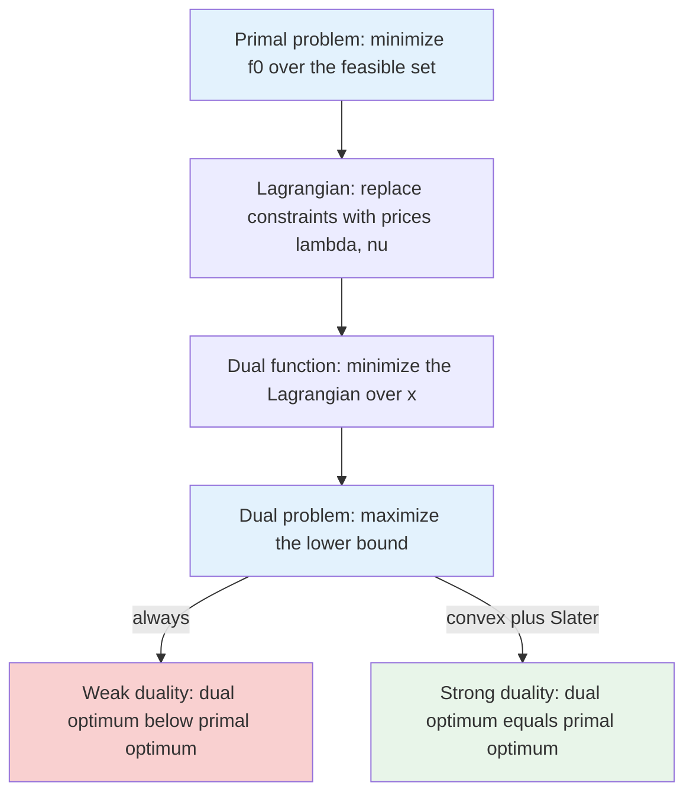

A constrained optimization problem minimizes an objective function over the points that satisfy a set of inequality and equality constraints. When the objective and the feasible set are convex, every local minimum is a global minimum. The Lagrangian of the problem attaches a multiplier to each constraint and yields a dual problem whose optimal value bounds the primal optimum from below, and the Karush-Kuhn-Tucker (KKT) conditions characterize the primal-dual optimal pairs.

[[algorithms/linear-programming|Linear Programming]] is the special case in which the objective and every constraint are affine. Resource allocation under constraints, as in [[systems/scheduling/index|scheduling]], uses the interpretation of dual variables as prices without naming it. Section and equation references are to [Boyd and Vandenberghe](https://web.stanford.edu/~boyd/cvxbook/), cited as B&V.

## Convex sets and functions

A set $C$ is convex if it contains the segment between any two of its points, that is, if $x, y \in C$ and $\theta \in [0,1]$ imply $\theta x + (1-\theta) y \in C$ (B&V §2.1). A function $f$ is convex if its domain is convex and

$$
f(\theta x + (1-\theta) y) \le \theta f(x) + (1-\theta) f(y),
$$

so that every chord lies on or above the graph (B&V §3.1). For differentiable $f$, convexity is equivalent to the first-order condition $f(y) \ge f(x) + \nabla f(x)^T (y - x)$, which states that the tangent plane is a global underestimator, and for twice differentiable $f$ it is equivalent to the second-order condition $\nabla^2 f(x) \succeq 0$.

For a convex $f$ over a convex set, every local minimum is global, and by the first-order condition a zero gradient, which in general indicates only stationarity, certifies optimality. Without convexity, the conditions derived from the Lagrangian are at most necessary, and none of them certifies that a point is a global minimum.

## The Lagrangian and the dual

A problem in standard form (B&V §4.2, §5.1) is

$$
\begin{aligned}
\text{minimize} \quad & f_0(x) \\
\text{subject to} \quad & f_i(x) \le 0, \quad i = 1, \dots, m \\
& h_j(x) = 0, \quad j = 1, \dots, p,
\end{aligned}
$$

and it is convex when $f_0, \dots, f_m$ are convex and the $h_j$ affine. The Lagrangian adds the constraints to the objective, each weighted by a multiplier, in place of enforcing them:

$$
L(x, \lambda, \nu) = f_0(x) + \sum_{i=1}^m \lambda_i f_i(x) + \sum_{j=1}^p \nu_j h_j(x),
$$

with multipliers $\lambda_i \ge 0$ for inequalities and free $\nu_j$ for equalities. The dual function is the infimum of the Lagrangian over $x$:

$$
g(\lambda, \nu) = \inf_x L(x, \lambda, \nu).
$$

For any feasible $x$ and any $\lambda \succeq 0$, the penalty terms are nonpositive, so $L(x, \lambda, \nu) \le f_0(x)$, and therefore $g(\lambda, \nu) \le p^\star$, the primal optimum. Every dual feasible point therefore gives a lower bound on $p^\star$. This property is weak duality, and it holds without any convexity assumption (B&V §5.1.3). Maximizing the bound gives the dual problem, which is a concave maximization problem regardless of the primal, with optimum $d^\star \le p^\star$. For convex problems the gap $p^\star - d^\star$ is zero under mild conditions. Slater's condition, the existence of a strictly feasible point with $f_i(x) < 0$, guarantees strong duality $d^\star = p^\star$ (B&V §5.2.3).



In [EE364a lecture 9](https://see.stanford.edu/materials/lsocoee364a/transcripts/ConvexOptimizationI-Lecture09.html), Boyd interprets the optimal multipliers $\lambda_i^\star$ as shadow prices. If constraint $i$ is relaxed from $f_i(x) \le 0$ to $f_i(x) \le u_i$, the optimal value changes at rate $-\lambda_i^\star$ in $u_i$ (B&V §5.6.3). A large multiplier indicates that the optimal value is sensitive to the constraint, and a zero multiplier indicates that a small relaxation of the constraint leaves the optimal value unchanged.

## KKT conditions

For problems with differentiable objective and constraint functions, the Karush-Kuhn-Tucker conditions on a primal-dual pair are the following (B&V §5.5.3).

1. Primal feasibility: $f_i(x) \le 0$, $h_j(x) = 0$.
2. Dual feasibility: $\lambda_i \ge 0$.
3. Complementary slackness: $\lambda_i f_i(x) = 0$ for every $i$.
4. Stationarity: $\nabla f_0(x) + \sum_i \lambda_i \nabla f_i(x) + \sum_j \nu_j \nabla h_j(x) = 0$.

When strong duality holds, any primal-dual optimal pair satisfies KKT (necessity). For convex problems, any point satisfying KKT is optimal (sufficiency), so with Slater's condition, KKT exactly characterizes the solution (B&V §5.5.3).

Complementary slackness states that each inequality constraint is either inactive with a zero multiplier or active, in which case its multiplier may be positive. Stationarity states that the negative objective gradient is a combination of the active constraint gradients, with nonnegative weights on the inequality constraints. Geometrically, at the optimum there is no feasible descent direction, because every descent direction leaves the feasible set.

> [!abstract] KKT as a checklist
> To verify a candidate pair $(x, \lambda, \nu)$, check the four conditions.
>
> 1. $x$ is feasible: $f_i(x) \le 0$ and $h_j(x) = 0$.
> 2. The multipliers are dual feasible: $\lambda_i \ge 0$.
> 3. Every product $\lambda_i f_i(x) = 0$, so inactive constraints have zero multipliers.
> 4. The Lagrangian gradient in $x$ vanishes: $\nabla f_0 + \sum_i \lambda_i \nabla f_i + \sum_j \nu_j \nabla h_j = 0$.
>
> For a convex problem satisfying Slater's condition, the four conditions are necessary and sufficient for optimality. The [[#Worked example: water-filling|water-filling example]] is solved by a case analysis on which constraints are active, using complementary slackness to set the multipliers of inactive constraints to zero and solving the stationarity condition in each case.

## Worked example: water-filling

The water-filling problem of B&V §5.5.3 allocates one unit of power among $n$ channels with noise levels $\alpha_i > 0$ by solving

$$
\begin{aligned}
\text{maximize} \quad & \textstyle\sum_{i=1}^n \log(\alpha_i + x_i) \\
\text{subject to} \quad & x \succeq 0, \quad \textstyle\sum_i x_i = 1.
\end{aligned}
$$

Written as a minimization of $-\sum_i \log(\alpha_i + x_i)$, with multipliers $\lambda_i \ge 0$ for the constraints $-x_i \le 0$ and $\nu$ for the budget, the problem has the following KKT conditions.

- Stationarity: $-\frac{1}{\alpha_i + x_i} - \lambda_i + \nu = 0$ for each $i$.
- Complementary slackness: $\lambda_i x_i = 0$.
- Feasibility: $x \succeq 0$, $\sum_i x_i = 1$, $\lambda \succeq 0$.

The analysis splits into two cases for each channel $i$. If $x_i > 0$, then $\lambda_i = 0$ and stationarity gives $\alpha_i + x_i = 1/\nu$. If $x_i = 0$, then $\lambda_i = \nu - 1/\alpha_i \ge 0$ requires $\alpha_i \ge 1/\nu$. The two cases combine into

$$
x_i^\star = \max\!\left(0,\; \tfrac{1}{\nu^\star} - \alpha_i\right),
$$

with $\nu^\star$ determined by the budget $\sum_i x_i^\star = 1$. The method is named for a geometric picture in which one unit of water is poured over bars of height $\alpha_i$. The water settles at level $1/\nu^\star$, covering the low-noise channels and leaving dry the channels whose $\alpha_i$ lies above the water level. The water level is the reciprocal of the dual variable $\nu^\star$, and solving the problem reduces to a one-dimensional search for it.

```python
import numpy as np

alpha = np.array([0.3, 0.6, 1.1, 2.0])

def waterfill(level):                      # total water below `level`
    return np.maximum(0.0, level - alpha).sum()

lo, hi = alpha.min(), alpha.min() + 1.0    # bisection on the water level
for _ in range(60):
    mid = (lo + hi) / 2
    lo, hi = (lo, mid) if waterfill(mid) > 1.0 else (mid, hi)

x = np.maximum(0.0, hi - alpha)
print(np.round(x, 4))    # [0.65 0.35 0.   0.  ] - two channels stay dry
print(x.sum())           # 1.0000...
```

The two noisier channels ($\alpha = 1.1, 2.0$) lie above the water level $1/\nu^\star = 0.95$ and receive no power, in agreement with the KKT case analysis. The allocations satisfy $0.65 + 0.35 = 1$, and both channels that receive power end at $\alpha_i + x_i = 0.95$.

## Applications

Lagrangian duality is used outside optimization theory as well. SVM training is a quadratic program whose dual identifies the support vectors as the training points with nonzero multipliers. Regularized regression replaces a constraint $\lVert w \rVert \le t$ with a penalty $\lambda \lVert w \rVert$, which is the Lagrangian form of the same problem. Utility-maximizing resource allocation, congestion control, and [[systems/scheduling/3-network-and-packet/fair-queueing-wfq-and-drr|fair queueing]] use the price interpretation, in which a scarce resource has a positive multiplier equal to the marginal value of one more unit of that resource. [[algorithms/linear-programming|Linear Programming]] duality is the same theory with every function affine, where strong duality holds without Slater's condition.

## Sources

- [Boyd and Vandenberghe, Convex Optimization (Cambridge, 2004)](https://web.stanford.edu/~boyd/cvxbook/), §2.1, §3.1, §4.2, §5.1-5.6
- [Stanford EE364a, Convex Optimization I, lecture 9 transcript](https://see.stanford.edu/materials/lsocoee364a/transcripts/ConvexOptimizationI-Lecture09.html)

## Related notes

- [[algorithms/linear-programming|Linear Programming]]
- [[math/matrix-calculus|Matrix Calculus for Machine Learning]]
- [[math/numerical-optimization|Numerical Optimization for Machine Learning]]
