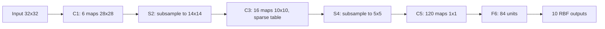

## Purpose

A convolutional neural network (CNN) replaces most of a fully connected network's weights with small filters that slide across the input. This note shows what that costs and what it buys, with a small MNIST network that runs in the page and an experiment that compares it to fully connected networks. It then follows the line from LeNet-5 through ResNet and U-Net, shows how libraries actually compute a convolution, and ends with where CNNs stand now that [[ml/deep-learning/decoder-only-transformers|transformers]] also do vision.

It assumes you know how a fully connected network trains; [[ml/deep-learning/neural-networks-from-scratch|Neural Networks from Scratch]] covers that.

## What a Convolution Layer Computes

A convolution layer takes a stack of $C_{in}$ feature maps and produces $C_{out}$ new ones. Each output map has its own filter: a $k \times k$ grid of weights for every input map, plus one bias. The output at position $(i, j)$ is the filter's dot product with the $k \times k$ window of the input at that position:

$$
y_{o,i,j} = b_o + \sum_{c=1}^{C_{in}} \sum_{u=0}^{k-1} \sum_{v=0}^{k-1} W_{o,c,u,v}\, x_{c,\, i \cdot s + u - p,\; j \cdot s + v - p}
$$

Here $s$ is the stride, how far the window moves between outputs, and $p$ is the padding, how many rows and columns of zeros surround the input. For an $n \times n$ input the output is

$$
\left\lfloor \frac{n + 2p - k}{s} \right\rfloor + 1
$$

positions on a side ([Dumoulin and Visin](https://arxiv.org/abs/1603.07285) work through every case, including transposed convolutions). With $k = 5$, $p = 2$, $s = 1$ the output keeps the input's size, which the network below uses throughout. LeNet-5 used $p = 0$, so its $32 \times 32$ input shrank to $28 \times 28$ after the first layer.

Strictly, the formula is a cross-correlation: signal processing's convolution flips the kernel first. Deep-learning libraries compute the unflipped version and call it convolution ([Goodfellow et al., §9.1](https://www.deeplearningbook.org/contents/convnets.html)). Since the weights are learned, the network just learns the flipped filter, and nothing else changes.

The parameter count is $C_{out}(C_{in}k^2 + 1)$, which doesn't depend on the image size. The second layer of the network below maps 8 maps of $14 \times 14$ to 16 maps of $14 \times 14$ with 3,216 parameters. A fully connected layer between the same two shapes would need $1568 \times 3136 = 4{,}917{,}248$ weights, 1,529 times as many.

That saving rests on three assumptions about images:

- **Locality.** A pixel's meaning depends mostly on its neighbors, so each output only reads a small window.
- **Stationarity.** A pattern worth detecting in one place is worth detecting anywhere, so every position shares one set of weights.
- **Hierarchy.** Large patterns are made of smaller ones, so stacking layers builds detectors for progressively larger structures out of the outputs below.

Weight sharing has a precise consequence. Shift the input by one pixel and every output map shifts by one pixel, apart from effects at the borders. A layer with that property is *equivariant* to translation. It is not *invariant*: the output changes, it just changes predictably. Invariance, the same prediction for a shifted digit, has to come from somewhere else, and the experiment below measures how much of it this network actually has.

## The Network in Your Browser

The figure runs a trained CNN in JavaScript. It has two convolution layers and one fully connected layer:

- `conv1`: 8 filters of $5 \times 5$, padding 2, then ReLU and $2 \times 2$ max pooling, giving $8 \times 14 \times 14$.
- `conv2`: 16 filters of $5 \times 5 \times 8$, padding 2, then ReLU and $2 \times 2$ max pooling, giving $16 \times 7 \times 7$.
- A linear layer from those 784 values to 10 class scores.

Its weights were trained by [`cnn_mnist.py`](cnn-mnist/cnn_mnist.py), described in the next section. A test checks that the page's forward pass gives the same scores as the NumPy network for the ten digits shown.

Things to try:

- **Draw a digit.** The figure scales and centers your drawing the way MNIST's digits were prepared: fit into a $20 \times 20$ box, then moved so the center of mass sits in the middle of the $28 \times 28$ image ([MNIST's description](https://openml.org/d/554)).
- **Click a conv1 map.** The panel below shows the 25 products of pixel and weight that make that one number. Every position in the map uses the same 25 weights.
- **Click a conv2 map.** The orange box on the input is the $14 \times 14$ window that unit can see. The heat map is the unit's gradient with respect to each input pixel, which shows which part of that window it actually uses.
- **Move a digit with the arrows.** The conv1 maps move with it, pixel for pixel. Move a 7 three or four pixels and watch the prediction start to slip.

<CnnExplorer digit={7} />

## What Weight Sharing Buys, Measured

The experiment trains three networks on MNIST's 60,000 training images with the same optimizer and schedule, then scores them on the 10,000 test images, both as given and shifted sideways by whole pixels with zeros filled in behind. The two fully connected networks (MLPs) have one hidden ReLU layer. The 14-unit MLP matches the CNN's parameter count, and the 256-unit one has 18 times as many parameters.

| Model | Parameters | Multiply-adds per image | Test accuracy | Prediction changed by a 1-pixel shift |
| --- | ---: | ---: | ---: | ---: |
| CNN | 11,274 | 791,840 | **98.96%** | 3.5% of test digits |
| MLP, 14 hidden units | 11,140 | 11,116 | 94.92% | 23.7% |
| MLP, 256 hidden units | 203,530 | 203,264 | 97.87% | 11.7% |

Accuracy as the test digits move sideways, averaging the left and right shift of each size:

| Shift | CNN | MLP, 14 | MLP, 256 |
| --- | ---: | ---: | ---: |
| 0 px | 98.96% | 94.92% | 97.87% |
| 1 px | 98.56% | 90.70% | 95.55% |
| 2 px | 96.50% | 70.95% | 79.04% |
| 3 px | 86.47% | 48.71% | 53.84% |
| 4 px | 68.77% | 30.58% | 33.51% |
| 6 px | 36.02% | 11.11% | 13.76% |

What the numbers show:

- At equal parameter count the CNN makes a fifth as many errors as the MLP (1.04% against 5.08%), and it beats the MLP with 18 times its parameters. One seed per model can't resolve differences of a few tenths of a point, but these gaps are far larger than that.
- The CNN spends its parameters on compute instead. It does 71 times as many multiply-adds per image as the equal-size MLP, because each weight is reused at every position. In this NumPy implementation a CNN training epoch took about 49 seconds against 0.2 seconds for the small MLP; [How Convolution Is Computed](#how-convolution-is-computed) looks at where that time goes.
- The CNN tolerates small shifts far better than either MLP, but it is not shift-invariant. One test digit in 28 changes its predicted class when moved by a single pixel, and a 4-pixel shift costs 30 points of accuracy.

The last point has three causes in this network, and the literature names each:

- **The classifier is position-specific.** The final layer has separate weights for each of the $7 \times 7$ positions, so a feature that moves to a new cell meets new weights. Modern CNNs average each final map over all positions before classifying, which [Network in Network](https://arxiv.org/abs/1312.4400) introduced as global average pooling and ResNet adopted.
- **Downsampling aliases.** Max pooling with stride 2 keeps every other position, so a one-pixel input shift can change which values survive. [Zhang (2019)](https://arxiv.org/abs/1904.11486) shows small shifts change the outputs of standard ImageNet CNNs and that blurring before each downsampling step makes them more consistent and slightly more accurate. [Azulay and Weiss (2019)](https://arxiv.org/abs/1805.12177) find the same failure and argue that data augmentation fixes it only partly, because the training set rarely shows each object at every offset.
- **The training digits are centered.** MNIST's preprocessing put every digit's center of mass in the middle, so the training digits barely vary in position. Training with random shifts would teach it what the architecture doesn't guarantee.

> [!note]- Measurement record
> - **Code and data**: [`cnn_mnist.py`](cnn-mnist/cnn_mnist.py), run from `notes/` as `python3 content/ml/deep-learning/cnn-mnist/cnn_mnist.py --data work/notebook-data/mnist/mnist.npz`. The data is Keras's copy of MNIST, SHA-256 `731c5ac6…b673d1`. Results land in [`cnn_mnist_results.json`](cnn-mnist/cnn_mnist_results.json) and the browser figure's weights in [`cnn_mnist_model.json`](cnn-mnist/cnn_mnist_model.json).
> - **Models**: written in NumPy with hand-derived backward passes; the convolution's gradient was checked against finite differences while writing it. He initialization, pixel values scaled to 0 to 1, no other normalization.
> - **Training**: 6 epochs of SGD with momentum 0.9, batch size 128, learning rate 0.05 with cosine decay per epoch, seed 0, no augmentation. All three models see the same batches in the same order.
> - **Evaluation**: accuracy on the 10,000 test images; shifted copies made by translating whole pixels and filling with zeros. "Changed by a 1-pixel shift" counts test digits whose predicted class differs from the unshifted prediction for any of the four one-pixel shifts.
> - **Environment**: Intel Xeon at 2.10 GHz, 4 cores, Python 3.13.18, NumPy 2.5.3.
> - **Repeatability**: a second run from scratch reproduced every number in the tables exactly. Only one seed was run, so the tables give no spread across initializations.

## LeNet-5

[LeCun et al. (1998)](https://yann.lecun.com/exdb/publis/pdf/lecun-98.pdf) is the paper the architecture above descends from. Its LeNet-5 has about 60,000 trainable parameters:

- **Input**: $32 \times 32$. MNIST's $28 \times 28$ digits are padded so that stroke ends and corners can fall in the center of the top layer's receptive fields.
- **C1**: 6 filters of $5 \times 5$ with no padding, giving $28 \times 28$ maps.
- **S2**: $2 \times 2$ subsampling. Each unit sums its four inputs, multiplies by a trainable coefficient, adds a trainable bias and applies a sigmoid, so the pooling itself has parameters.
- **C3**: 16 filters of $5 \times 5$, giving $10 \times 10$ maps. Each map reads only a subset of S2's 6 maps, set by a fixed connection table, which cut computation and forced the maps to differ from each other.
- **S4**: subsampling to $5 \times 5$.
- **C5**: 120 filters of $5 \times 5$ over S4's whole output, so each produces a single value.
- **F6**: 84 fully connected units.
- **Output**: 10 radial basis function units, one per digit, each scoring the distance between F6's output and a fixed prototype.



It reached 0.95% test error on MNIST, and 0.8% when the training set was enlarged with randomly distorted copies of the digits. Spatial size shrinks while the number of maps grows; nearly every CNN since keeps that shape.

The network in this note keeps LeNet's layout and swaps its parts for the ones that won out later: ReLU instead of sigmoids, max pooling without parameters, every map connected to every input map, and a softmax classifier. With a fifth of LeNet's parameters it gets 1.04% test error.

The paper's broader argument is about training the whole system end to end. Its later sections describe a check-reading system in which segmentation, recognition and a language model are all trained jointly by gradient descent, instead of being designed as separate hand-built modules.

## Receptive Fields, Stride, and Pooling

The receptive field of a unit is the region of the input that can affect it. For a stack of layers it grows by a simple recurrence ([Araujo et al.](https://distill.pub/2019/computing-receptive-fields/) derive the general form). Let $r_l$ be the receptive field after layer $l$ and $j_l$ the distance, in input pixels, between neighboring units of layer $l$:

$$
r_l = r_{l-1} + (k_l - 1)\, j_{l-1}, \qquad j_l = j_{l-1}\, s_l, \qquad r_0 = j_0 = 1
$$

For the network above: `conv1` gives $r = 5$; pooling ($k = 2$, $s = 2$) gives $r = 6$ with $j = 2$; `conv2` adds $4 \times 2$ for $r = 14$. That $14 \times 14$ window is the orange box in the figure. Stride and pooling grow the receptive field fast because they multiply the spacing that every later layer's kernel is measured in.

> [!tip] Depth buys receptive field cheaply
> Two stacked $3 \times 3$ convolutions see a $5 \times 5$ region and three see $7 \times 7$. For $C$ channels in and out, three $3 \times 3$ layers cost $27C^2$ weights against $49C^2$ for one $7 \times 7$ layer, which [VGG (§2.3)](https://arxiv.org/abs/1409.1556) points out is 81% more, and the stack applies three nonlinearities instead of one. Most backbones since VGG are built from $3 \times 3$ layers.

> [!note]- Deep dive: the effective receptive field is much smaller
> The receptive field is the window a unit *can* see. [Luo et al. (2016)](https://arxiv.org/abs/1701.04128) measure how much each input pixel actually affects a unit, using the same gradient the figure shows for conv2 units. In deep networks that influence is roughly Gaussian: concentrated in the middle and fading toward the edges, because many more paths through the network reach a central pixel than a corner one.
>
> They show the effective receptive field grows with the square root of depth while the theoretical one grows linearly, so the effective share of the window shrinks as networks deepen. Training enlarges it, and so do downsampling and dilated convolutions. The figure's text for a conv2 unit reports how much of that gradient falls in the middle $8 \times 8$ of its $14 \times 14$ window, which is a third of the window's area.

Pooling and stride also discard detail, which hurts tasks that need a precise location. [Dilated convolutions](https://arxiv.org/abs/1511.07122) widen the receptive field instead by spacing the kernel's taps apart, so a $3 \times 3$ filter with dilation 2 covers a $5 \times 5$ area at full resolution. U-Net, below, takes the other route: downsample for context, then upsample and reattach the detail.

## The ResNet Argument

[He et al. (2015)](https://arxiv.org/abs/1512.03385) start from an observation about depth. On CIFAR-10, a 56-layer plain network has higher *training* error than a 20-layer one. Overfitting can't explain that. A deeper network can represent everything the shallower one can, since its extra layers could learn the identity, so the deeper network is failing to optimize.

Their fix makes the identity the default. Each block learns a correction $F$ to its input instead of a whole new representation:

$$
y = x + F(x)
$$

If a block has nothing useful to add, driving $F$ toward zero is easy, and the gradient reaches earlier layers directly through the addition. Each $F$ is two or three convolutions with [batch normalization](https://arxiv.org/abs/1502.03167) after each, and the network ends with global average pooling and one fully connected layer.

The paper trains networks up to 152 layers on ImageNet and an ensemble reaches 3.57% top-5 error on the test set, meaning the correct class was outside its five best guesses 3.57% of the time. ResNet-50, 101 and 152 use **bottleneck** blocks to keep that depth affordable: a $1 \times 1$ convolution reduces the channel count, a $3 \times 3$ convolution works at the reduced width, and another $1 \times 1$ restores it.

A follow-up, [Identity Mappings in Deep Residual Networks](https://arxiv.org/abs/1603.05027), moves the normalization and ReLU inside $F$ so that the path along $x$ is a pure identity from input to output. With that change the authors train a 1,001-layer network on CIFAR-10. The PyTorch block further down uses the original ordering.

## U-Net

[Ronneberger, Fischer, and Brox (2015)](https://arxiv.org/abs/1505.04597) designed U-Net to label every pixel of biomedical images, a task with few labeled examples. It has:

- a **contracting path** of convolutions and pooling that builds context,
- a symmetric **expanding path** of upsampling and convolutions that restores resolution,
- **skip connections** that copy each contracting level's maps across to the matching expanding level, so the upsampled maps regain the detail pooling threw away.

All its convolutions are unpadded, so each one trims the map's border. A $572 \times 572$ input tile produces a $388 \times 388$ label map, and the skip connections have to crop the copied maps to fit: the "copy and crop" arrows in the paper's diagram. To label a large image the paper tiles it with overlapping input tiles, and fills the missing context at the image's edge by mirroring. Training leaned heavily on elastic deformations because labels were scarce.

U-Net won the ISBI cell tracking challenge in 2015, and segmenting a $512 \times 512$ image took under a second on the paper's GPU. Its later life is wider than biomedicine:

- [nnU-Net](https://arxiv.org/abs/1809.10486) configures a plain U-Net automatically from a dataset's properties (patch size, resolution, depth, augmentation), and that configuration alone produced top results across the Medical Segmentation Decathlon's tasks. Its argument is that the training pipeline mattered more than the architectural variants proposed since.
- [Denoising diffusion models](https://arxiv.org/abs/2006.11239) use a U-Net as the network that predicts noise at each step, which is how image generation came to run on a segmentation architecture; [[ml/deep-learning/diffusion-models|Diffusion Models]] covers that side.

## How Convolution Is Computed

The direct loop is the clearest way to see weight sharing, and the slowest way to compute it:

```python
import numpy as np

def conv2d_single_channel(x, kernel, stride=1, padding=0):
    x = np.pad(x, ((padding, padding), (padding, padding)))
    kh, kw = kernel.shape
    oh = (x.shape[0] - kh) // stride + 1
    ow = (x.shape[1] - kw) // stride + 1
    out = np.zeros((oh, ow), dtype=x.dtype)

    for i in range(oh):
        for j in range(ow):
            patch = x[i * stride:i * stride + kh, j * stride:j * stride + kw]
            out[i, j] = np.sum(patch * kernel)
    return out
```

Libraries use one of three faster formulations:

- **im2col and matrix multiply.** Copy every input window into a row of a matrix, one row per output position, and the whole layer becomes one matrix multiply against the filters ([Chellapilla et al., 2006](https://inria.hal.science/inria-00112631)). The copy multiplies the input's memory by roughly $k^2$, but matrix multiply is the most tuned routine on any hardware. This note's experiment computes every convolution this way.
- **FFT.** Convolution becomes elementwise multiplication in the frequency domain, which pays off for large kernels ([Mathieu et al., 2013](https://arxiv.org/abs/1312.5851)).
- **Winograd.** Minimal filtering algorithms trade multiplies for additions on small tiles. For $3 \times 3$ filters, computing $2 \times 2$ outputs at a time takes 2.25 times fewer multiplies, and $4 \times 4$ tiles reach 4 times fewer ([Lavin and Gray, 2015](https://arxiv.org/abs/1509.09308)).

GPU libraries such as [cuDNN](https://arxiv.org/abs/1410.0759) implement several of these and pick per layer shape. [[ml/serving-systems/roofline-reference|The roofline model]] explains the choice: a layer with few channels does little arithmetic per byte it reads, so it is limited by memory bandwidth, and the algorithm that moves less data wins even if it does more arithmetic.

[`conv_bench.py`](cnn-mnist/conv_bench.py) times three NumPy versions of the network's `conv2` layer on a batch of 128 digits: the loop above, extended to 8 input channels, then im2col, then FFT. It checks that all three give the same output before timing anything.

| Method | Median time | Range over repeats | Throughput |
| --- | ---: | ---: | ---: |
| Python loop | 1,100 ms | 1,086 to 1,189 ms (3 calls) | 0.07 GMAC/s |
| im2col and matrix multiply | 7.3 ms | 7.1 to 8.6 ms (31 calls) | 11.0 GMAC/s |
| FFT | 13.4 ms | 12.0 to 17.9 ms (31 calls) | 6.0 GMAC/s |

im2col is 150 times faster than the loop. The loop calls NumPy once per output value, 401,408 times, and pays the interpreter's overhead on every call; im2col makes one call to an optimized matrix multiply. FFT does fewer multiplications in principle but loses here: transforming all 1,024 input maps and 16 filters costs more than a $5 \times 5$ kernel saves.

> [!note]- Measurement record
> - **Code**: [`conv_bench.py`](cnn-mnist/conv_bench.py), run from `notes/` as `python3 content/ml/deep-learning/cnn-mnist/conv_bench.py`. Results in [`conv_bench_results.json`](cnn-mnist/conv_bench_results.json).
> - **Layer**: batch 128, 8 input and 16 output channels, $14 \times 14$, $5 \times 5$ kernels, same padding, float32 random inputs from seed 0. That is 80.3 million multiply-adds per call.
> - **Method**: one warm-up call, then repeated calls timed with `time.perf_counter`; the table gives the median, minimum and maximum. Single process, nothing else running.
> - **Environment**: Intel Xeon at 2.10 GHz, 4 cores, Python 3.13.18, NumPy 2.5.3 with its bundled BLAS.
> - **Repeatability**: three runs of the script gave medians of 6.1 to 7.5 ms for im2col and 10.4 to 13.4 ms for FFT. The ordering held every time; the second digit of each time did not.

## PyTorch Residual CNN

A residual block and a small classifier built from it, using the original ResNet ordering of convolution, batch normalization and ReLU:

```python
import torch
import torch.nn as nn

class ResidualBlock(nn.Module):
    def __init__(self, channels: int):
        super().__init__()
        self.net = nn.Sequential(
            nn.Conv2d(channels, channels, kernel_size=3, padding=1, bias=False),
            nn.BatchNorm2d(channels),
            nn.ReLU(inplace=True),
            nn.Conv2d(channels, channels, kernel_size=3, padding=1, bias=False),
            nn.BatchNorm2d(channels),
        )
        self.act = nn.ReLU(inplace=True)

    def forward(self, x: torch.Tensor) -> torch.Tensor:
        return self.act(x + self.net(x))

class SmallCNN(nn.Module):
    def __init__(self, n_classes: int = 10):
        super().__init__()
        self.stem = nn.Sequential(
            nn.Conv2d(3, 64, kernel_size=7, stride=2, padding=3),
            nn.ReLU(inplace=True),
            nn.MaxPool2d(2),
        )
        self.block = ResidualBlock(64)
        self.head = nn.Linear(64, n_classes)

    def forward(self, x: torch.Tensor) -> torch.Tensor:
        x = self.stem(x)
        x = self.block(x)
        x = x.mean(dim=(-2, -1))  # global average pooling
        return self.head(x)
```

The convolutions before batch normalization have no bias, because normalization subtracts the mean and would cancel it.

## What Changed Later

**Cheaper convolutions.** A depthwise separable convolution splits a layer in two: a $k \times k$ filter applied to each channel on its own, then a $1 \times 1$ convolution that mixes channels. [MobileNets](https://arxiv.org/abs/1704.04861) derive its cost relative to a full convolution as $1/C_{out} + 1/k^2$, so with $3 \times 3$ filters it needs 8 to 9 times less computation, for a small loss of accuracy. Most networks built for phones use it.

**Vision transformers.** [ViT](https://arxiv.org/abs/2010.11929) cuts an image into $16 \times 16$ patches and treats them as a sequence of tokens for a standard transformer. It builds in neither locality nor weight sharing across positions, and it underperforms comparable CNNs when trained on ImageNet alone, but pretrained on hundreds of millions of images it matches or beats them. The inductive bias that made the small CNN above beat its MLPs matters less when data is plentiful.

**CNNs caught up again.** [ConvNeXt](https://arxiv.org/abs/2201.03545) modernizes a ResNet step by step with design choices borrowed from transformers (larger $7 \times 7$ depthwise kernels, fewer activations and normalizations, layer normalization) and reaches 87.8% ImageNet top-1 accuracy, competitive with Swin transformers of similar cost. [Smith et al. (2023)](https://arxiv.org/abs/2310.16764) pretrain NFNet CNNs on 4 billion images and find they match vision transformers given comparable compute, reaching 90.4% top-1 after fine-tuning. Their conclusion is that compute and data, more than architecture, decided the comparison.

The ideas from this note survive in all of these, CNN or not: local processing, residual connections, several resolutions at once, and skip connections for dense prediction.

## Related Notes

- [[ml/deep-learning/neural-networks-from-scratch|Neural Networks from Scratch]]: the fully connected networks the experiment compares against.
- [[ml/deep-learning/mlp-from-scratch-on-mnist|MLP from Scratch on MNIST]]: the same dataset with a fully connected network.
- [[ml/deep-learning/graph-neural-networks|Graph Neural Networks]]: weight sharing over a graph's neighborhoods instead of a pixel grid.
- [[ml/deep-learning/diffusion-models|Diffusion Models]]: where U-Net does the denoising.
- [[ml/deep-learning/decoder-only-transformers|Decoder-Only Transformers]]: the architecture ViT applies to image patches.
- [[ml/serving-systems/roofline-reference|Roofline Reference]] and [[ml/serving-systems/optimizing-gpu-kernels|Optimizing GPU Kernels]]: why convolution algorithms are chosen per layer.
- [[ml/deep-learning/modeling-architecture-and-data|Modeling, Architecture, and Data]]

## Sources

- [LeCun et al. (1998), Gradient-Based Learning Applied to Document Recognition](https://yann.lecun.com/exdb/publis/pdf/lecun-98.pdf)
- [Goodfellow, Bengio, and Courville (2016), Deep Learning, chapter 9](https://www.deeplearningbook.org/contents/convnets.html)
- [Dumoulin and Visin (2016), A Guide to Convolution Arithmetic for Deep Learning](https://arxiv.org/abs/1603.07285)
- [Araujo, Norris, and Sim (2019), Computing Receptive Fields of Convolutional Neural Networks](https://distill.pub/2019/computing-receptive-fields/)
- [Simonyan and Zisserman (2014), Very Deep Convolutional Networks](https://arxiv.org/abs/1409.1556)
- [Luo et al. (2016), Understanding the Effective Receptive Field](https://arxiv.org/abs/1701.04128)
- [Zhang (2019), Making Convolutional Networks Shift-Invariant Again](https://arxiv.org/abs/1904.11486)
- [Azulay and Weiss (2019), Why Do Deep Convolutional Networks Generalize So Poorly to Small Image Transformations?](https://arxiv.org/abs/1805.12177)
- [Lin, Chen, and Yan (2013), Network In Network](https://arxiv.org/abs/1312.4400)
- [He et al. (2015), Deep Residual Learning for Image Recognition](https://arxiv.org/abs/1512.03385)
- [He et al. (2016), Identity Mappings in Deep Residual Networks](https://arxiv.org/abs/1603.05027)
- [Ioffe and Szegedy (2015), Batch Normalization](https://arxiv.org/abs/1502.03167)
- [Ronneberger, Fischer, and Brox (2015), U-Net](https://arxiv.org/abs/1505.04597)
- [Isensee et al. (2018), nnU-Net](https://arxiv.org/abs/1809.10486)
- [Ho, Jain, and Abbeel (2020), Denoising Diffusion Probabilistic Models](https://arxiv.org/abs/2006.11239)
- [Chellapilla, Puri, and Simard (2006), High Performance Convolutional Neural Networks for Document Processing](https://inria.hal.science/inria-00112631)
- [Mathieu, Henaff, and LeCun (2013), Fast Training of Convolutional Networks through FFTs](https://arxiv.org/abs/1312.5851)
- [Lavin and Gray (2015), Fast Algorithms for Convolutional Neural Networks](https://arxiv.org/abs/1509.09308)
- [Chetlur et al. (2014), cuDNN](https://arxiv.org/abs/1410.0759)
- [Howard et al. (2017), MobileNets](https://arxiv.org/abs/1704.04861)
- [Yu and Koltun (2015), Dilated Convolutions](https://arxiv.org/abs/1511.07122)
- [Dosovitskiy et al. (2020), An Image is Worth 16x16 Words](https://arxiv.org/abs/2010.11929)
- [Liu et al. (2022), A ConvNet for the 2020s](https://arxiv.org/abs/2201.03545)
- [Smith et al. (2023), ConvNets Match Vision Transformers at Scale](https://arxiv.org/abs/2310.16764)
- [MNIST database description (OpenML copy)](https://openml.org/d/554)
