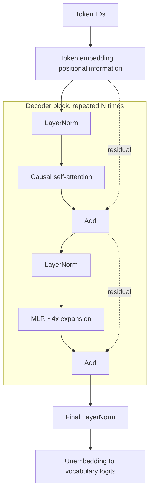

A decoder-only transformer is an autoregressive sequence model built from a stack of residual blocks, each applying causal (masked) multi-head self-attention and a position-wise MLP, that predicts each token from the tokens before it.

It is the original transformer with the encoder and the cross-attention path removed, and it is the architecture of GPT-style language models. [[ml/serving-systems/transformers|Transformer Architecture and Implementation]] treats the same model from a systems perspective.

## From the Original Transformer to GPT-Style Models

The original transformer is an encoder-decoder model. Decoder-only models keep the masked self-attention stack and language-model objective, then drop the encoder and cross-attention path.

The model factorizes the probability of a sequence as

$$
p(x_{1:T}) = \prod_{t=1}^{T} p(x_t \mid x_{<t})
$$

Each factor is a next-token prediction, which is the training task.

## Scaled Dot-Product Self-Attention

Given hidden states $X \in \mathbb{R}^{T \times d_{model}}$:

$$
Q = XW_Q,\quad K = XW_K,\quad V = XW_V
$$

and

$$
\operatorname{Attn}(Q, K, V)
=
\operatorname{softmax}\left(\frac{QK^\top}{\sqrt{d_k}} + M\right)V
$$

where $M$ is the causal mask. Future positions get $-\infty$ before softmax, so position $t$ can only attend to $1,\dots,t$.

> [!warning] Causal masking is what makes teacher forcing valid
> Without the mask, position $t$ could attend to position $t+1$ and copy the token it is trained to predict. The mask allows every position to be trained in parallel while the model still matches the autoregressive factorization $p(x_t \mid x_{<t})$ used at generation time.

The $1/\sqrt{d_k}$ scale from Vaswani et al. compensates for the growth of raw dot products with dimension, which would otherwise saturate the softmax.

## Multi-Head Attention

Multi-head attention computes $h$ attention maps in parallel, one per head:

$$
\operatorname{MHA}(X)
=
\operatorname{Concat}(\text{head}_1, \dots, \text{head}_h)W_O
$$

with

$$
\text{head}_i
=
\operatorname{Attn}(XW_Q^{(i)}, XW_K^{(i)}, XW_V^{(i)})
$$

In the original transformer base model:

- $N = 6$ layers
- $d_{model} = 512$
- $d_{ff} = 2048$
- $h = 8$ heads

Many later variants scaled up from this configuration.

## Decoder Block

GPT-style blocks since GPT-2 apply layer normalization at the input of each sub-block (pre-norm):

$$
\begin{aligned}
H_1 &= X + \operatorname{MHA}(\operatorname{LN}(X)) \\
H_2 &= H_1 + \operatorname{MLP}(\operatorname{LN}(H_1))
\end{aligned}
$$

The MLP has the form

$$
\operatorname{MLP}(x) = W_2 \phi(W_1x + b_1) + b_2
$$

with a hidden width of $4 d_{model}$ in the original transformer base model and in GPT-2.

The original transformer used post-norm. GPT-2 moves layer normalization to the input of each sub-block, as the paper notes, which makes the block resemble a pre-activation residual network.

The full model is this block repeated $N$ times between an embedding and an unembedding:



The dotted residual edges are the identity paths. They carry activations forward and gradients backward unchanged, which allows stacks as deep as the 48 layers of GPT-2 1.5B to be trained.

## Positional Information

Self-attention alone is permutation-equivariant, so position information must be added to the input.

The original transformer uses sinusoidal positional encodings:

$$
\operatorname{PE}(pos, 2i) = \sin\left(pos / 10000^{2i/d_{model}}\right)
$$

$$
\operatorname{PE}(pos, 2i+1) = \cos\left(pos / 10000^{2i/d_{model}}\right)
$$

GPT-style models replace this with learned position embeddings (as in GPT-2) or rotary embeddings, which serve the same purpose.

## Training Objective

For a tokenized sequence, training maximizes

$$
\sum_{t=1}^{T} \log p(x_t \mid x_{<t})
$$

Teacher forcing makes this parallel over positions during training. Every position predicts the next token simultaneously, with the mask enforcing causality.

## GPT-2 Architectural Details

Radford et al. train four decoder-only transformers with the following sizes:

| Parameters | Layers | $d_{model}$ |
| --- | ---: | ---: |
| 117M | 12 | 768 |
| 345M | 24 | 1024 |
| 762M | 36 | 1280 |
| 1542M | 48 | 1600 |

The paper lists several design changes relative to GPT:

- layer normalization moved to the input of each sub-block
- an extra layer norm after the final self-attention block
- vocabulary expanded to **50,257**
- context length increased from **512** to **1024**
- residual-layer weights scaled at initialization by $1/\sqrt{N}$ where $N$ is the number of residual layers

The optimization behavior of a decoder-only transformer depends on these choices, in particular the placement of layer normalization and the scale of the residual-layer initialization, in addition to its attention and MLP layers.

## Adoption of Decoder-Only Models for Language Modeling

Vaswani et al. gave the architectural argument for transformers: self-attention connects any two positions with a constant sequential path length and parallelizes training. GPT-2 adds the empirical finding that scaling this setup on WebText produces strong zero-shot transfer.

The GPT-2 paper reports that the **1.5B** parameter model achieves state-of-the-art results on **7 of 8** evaluated language-modeling datasets in a zero-shot setting while still underfitting WebText.

## NumPy Self-Attention

```python
import numpy as np

def causal_mask(T):
    mask = np.full((T, T), -1e9, dtype=np.float32)
    return np.triu(mask, k=1)

def softmax(x, axis=-1):
    x = x - x.max(axis=axis, keepdims=True)
    e = np.exp(x)
    return e / e.sum(axis=axis, keepdims=True)

def self_attention(x, Wq, Wk, Wv):
    Q = x @ Wq
    K = x @ Wk
    V = x @ Wv
    scores = Q @ np.swapaxes(K, -1, -2) / np.sqrt(Q.shape[-1])
    scores = scores + causal_mask(x.shape[1])[None, :, :]
    probs = softmax(scores, axis=-1)
    return probs @ V
```

## PyTorch Block with `einops`

```python
import torch
import torch.nn as nn
from einops import rearrange

class CausalSelfAttention(nn.Module):
    def __init__(self, d_model: int, n_heads: int):
        super().__init__()
        assert d_model % n_heads == 0
        self.n_heads = n_heads
        self.head_dim = d_model // n_heads
        self.qkv = nn.Linear(d_model, 3 * d_model, bias=False)
        self.out = nn.Linear(d_model, d_model, bias=False)

    def forward(self, x: torch.Tensor) -> torch.Tensor:
        B, T, D = x.shape
        qkv = self.qkv(x)
        q, k, v = qkv.chunk(3, dim=-1)

        q = rearrange(q, "b t (h d) -> b h t d", h=self.n_heads)
        k = rearrange(k, "b t (h d) -> b h t d", h=self.n_heads)
        v = rearrange(v, "b t (h d) -> b h t d", h=self.n_heads)

        scores = torch.matmul(q, k.transpose(-1, -2)) / (self.head_dim ** 0.5)
        mask = torch.triu(torch.ones(T, T, device=x.device, dtype=torch.bool), diagonal=1)
        scores = scores.masked_fill(mask, float("-inf"))
        attn = scores.softmax(dim=-1)
        y = torch.matmul(attn, v)
        y = rearrange(y, "b h t d -> b t (h d)")
        return self.out(y)

class DecoderBlock(nn.Module):
    def __init__(self, d_model: int, n_heads: int, mlp_mult: int = 4):
        super().__init__()
        self.ln1 = nn.LayerNorm(d_model)
        self.attn = CausalSelfAttention(d_model, n_heads)
        self.ln2 = nn.LayerNorm(d_model)
        self.mlp = nn.Sequential(
            nn.Linear(d_model, mlp_mult * d_model),
            nn.GELU(),
            nn.Linear(mlp_mult * d_model, d_model),
        )

    def forward(self, x: torch.Tensor) -> torch.Tensor:
        x = x + self.attn(self.ln1(x))
        x = x + self.mlp(self.ln2(x))
        return x
```

## Executable Experiment

The companion notebook trains a small character-level decoder on WikiText-2, plots optimization progress, samples text, and visualizes learned attention maps. The model is small enough to train on a laptop and retains the causal mask, residual blocks, and next-token objective used by larger models.

[Run the decoder-only Transformer experiment](/ml/deep-learning/decoder-only-transformer-on-wikitext-2.ipynb)

## Complexity

For sequence length $T$ and width $d$, the compute of full self-attention is

$$
O(T^2 d)
$$

and the attention scores occupy $O(T^2)$ memory per head. The quadratic cost in $T$ motivates long-context attention variants and work on inference memory.

## Related Notes

- [[ml/deep-learning/encoder-decoder-transformers|Encoder-Decoder Transformers]]
- [[ml/serving-systems/transformers|Transformer Architecture and Implementation]]
- [[ml/deep-learning/modeling-architecture-and-data|Modeling, Architecture, and Data]]

## Sources

- [Vaswani et al. (2017), Attention Is All You Need](https://arxiv.org/abs/1706.03762)
- [Radford et al. (2019), Language Models are Unsupervised Multitask Learners](https://cdn.openai.com/better-language-models/language_models_are_unsupervised_multitask_learners.pdf)
- [einops documentation](https://einops.rocks/)
