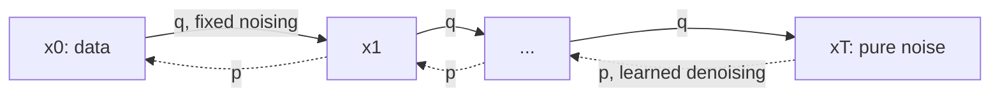

## Purpose

A diffusion model generates data by learning to undo noise. Take a data point, add a little Gaussian noise, then a little more, a thousand times, until nothing of the original is left. That direction needs no learning. Then train a network to take one small step back: given a noisy point and how noisy it is, guess the noise. To generate, start from pure noise and apply the network over and over until a clean point comes out.

Three things make this work, and the note takes them in order:

1. a fixed forward process that destroys data, with a closed form that jumps to any noise level in one step;
2. a training objective that reduces to plain regression on the noise that was added;
3. a reverse process that turns the trained network into a sampler, which can take 1,000 steps or far fewer.

The idea comes from [Sohl-Dickstein et al. (2015)](https://arxiv.org/abs/1503.03585). [Ho, Jain, and Abbeel (2020)](https://arxiv.org/abs/2006.11239), "DDPM", found the parameterization and objective that made it competitive with GANs, and that paper is the canonical reference for everything below.

Every figure on this page runs a real model: a small network trained with the DDPM objective on 2D point clouds, in NumPy, by the harness in [`diffusion-2d/diffusion2d.py`](/ml/deep-learning/diffusion-2d/diffusion2d.py). Its weights load into the page and the sampler runs in your browser. Two dimensions are small enough to watch every point move and to measure sample quality exactly, which images are not.



The solid direction is fixed and has no parameters. All learning happens in the dotted direction.

## Forward process

Start from clean data $x_0$. Each step shrinks the point slightly toward the origin and adds a little Gaussian noise:

$$
q(x_t \mid x_{t-1}) = \mathcal{N}\left(x_t;\ \sqrt{1-\beta_t}\,x_{t-1},\ \beta_t I\right),
\qquad
q(x_{1:T}\mid x_0) = \prod_{t=1}^{T} q(x_t \mid x_{t-1})
$$

The variances $\beta_1, \dots, \beta_T$ are the noise schedule. DDPM uses $T = 1000$ and $\beta_t$ rising linearly from $10^{-4}$ to $0.02$. The shrink factor $\sqrt{1-\beta_t}$ keeps the total variance near 1 instead of letting it grow without bound, which is why this is called a variance-preserving process.

Because every step is a linear map plus independent Gaussian noise, the steps compose. With

$$
\alpha_t = 1-\beta_t,
\qquad
\bar{\alpha}_t = \prod_{s=1}^{t} \alpha_s,
$$

the distribution of $x_t$ given $x_0$ has a closed form:

$$
q(x_t \mid x_0) = \mathcal{N}\left(x_t;\ \sqrt{\bar{\alpha}_t}\,x_0,\ (1-\bar{\alpha}_t) I\right),
\qquad\text{so}\qquad
x_t = \sqrt{\bar{\alpha}_t}\,x_0 + \sqrt{1-\bar{\alpha}_t}\,\epsilon,
\quad \epsilon \sim \mathcal{N}(0, I).
$$

> [!note]- Deep dive: why the steps compose
> Suppose $x_{t-1} = \sqrt{\bar\alpha_{t-1}}\,x_0 + \sqrt{1-\bar\alpha_{t-1}}\,\epsilon'$. One more step gives
> $x_t = \sqrt{\alpha_t}\sqrt{\bar\alpha_{t-1}}\,x_0 + \sqrt{\alpha_t(1-\bar\alpha_{t-1})}\,\epsilon' + \sqrt{1-\alpha_t}\,\epsilon''$.
> The two noise terms are independent zero-mean Gaussians, so their sum is Gaussian with variance $\alpha_t - \alpha_t\bar\alpha_{t-1} + 1 - \alpha_t = 1 - \bar\alpha_t$. That is the claim for $t$, and it holds at $t = 1$, so it holds for all $t$ by induction. The figure's test checks the closed form against simulating the chain step by step for 20,000 points.

Each point is a weighted mix of where it started and fresh noise, with weights $\sqrt{\bar\alpha_t}$ and $\sqrt{1-\bar\alpha_t}$. Drag the slider to watch the two-moons data dissolve. Every frame is computed from the closed form with the same noise draw per point, so the points move smoothly.

<DiffusionSteps mode="forward" data="moons" schedule="linear" t={0} caption="The forward process on 600 held-out points of the two-moons data, DDPM's linear schedule. Every frame comes straight from the closed form for q(x_t | x_0)." />

Under the linear schedule the data goes faster than the slider suggests. Half the signal variance is gone by $t = 260$ ($\bar\alpha_t < 0.5$), less than 1% is left by $t = 674$, and at $t = 1000$ the signal weight $\sqrt{\bar\alpha_T}$ is 0.0064. The last third of the chain is almost pure noise, which wastes steps on both sides: a third of training's samples land on noise levels where there is little left to learn, and a third of sampling's steps are spent there.

[Nichol and Dhariwal (2021)](https://arxiv.org/abs/2102.09672) proposed a cosine schedule that sets $\bar\alpha_t$ directly,

$$
\bar\alpha_t = \frac{f(t)}{f(0)},\qquad f(t) = \cos^2\left(\frac{t/T + s}{1 + s}\cdot\frac{\pi}{2}\right),\qquad s = 0.008,
$$

with $\beta_t$ clipped at 0.999 near $t = T$. It removes signal at a steadier rate: $\bar\alpha_t$ crosses 0.5 at $t = 497$ instead of 260. The same 600 points at $t = 300$, under each schedule:

<DiffusionSteps mode="forward" data="moons" schedule="linear" t={300} caption="Linear schedule at t = 300: ᾱ = 0.396, and the moons are already hard to make out." />

<DiffusionSteps mode="forward" data="moons" schedule="cosine" t={300} caption="Cosine schedule at t = 300: ᾱ = 0.787, and the moons are still plain." />

## Training: predict the noise

The closed form is what makes training cheap. One training step (DDPM's Algorithm 1) is:

1. take a data point $x_0$;
2. pick a timestep $t$ uniformly from $1, \dots, T$ and draw $\epsilon \sim \mathcal{N}(0, I)$;
3. form $x_t = \sqrt{\bar\alpha_t}\,x_0 + \sqrt{1-\bar\alpha_t}\,\epsilon$ in one shot;
4. take a gradient step on $\lVert \epsilon - \epsilon_\theta(x_t, t)\rVert^2$.

Averaged over data, timesteps and noise, that is the simplified objective

$$
L_\text{simple}
=
\mathbb{E}_{t, x_0, \epsilon}
\left[
\left\lVert
\epsilon - \epsilon_\theta\!\left(\sqrt{\bar\alpha_t}\,x_0 + \sqrt{1-\bar\alpha_t}\,\epsilon,\ t\right)
\right\rVert^2
\right].
$$

The network $\epsilon_\theta$ takes a noisy point and the timestep and returns a vector the size of the data. Nothing is simulated step by step, and a minibatch trains every noise level at once. The 1,000-step sequential cost only appears at sampling time.

The network in this note's figures is about as small as a denoiser gets: the 2D point concatenated with a 32-number sinusoidal embedding of $t$ (the Transformer position embedding DDPM also uses), three hidden layers of 64 SiLU units, and a 2D output, 10,690 parameters in all. It trains for 50,000 Adam steps of 1,024 points in about two and a half minutes on one CPU core, with the forward and backward passes written out by hand in NumPy (the same way [[ml/deep-learning/neural-networks-from-scratch|Neural Networks from Scratch]] derives them) and checked against finite differences.

A noise prediction is also a clean-data prediction. Rearranging the closed form,

$$
\hat{x}_0 = \frac{x_t - \sqrt{1-\bar\alpha_t}\,\epsilon_\theta(x_t, t)}{\sqrt{\bar\alpha_t}},
$$

so a network that knows the noise knows its best guess of where the point came from. Watching that guess is the clearest way to see what the network has learned, and the sampling section below does.

> [!note]- Deep dive: where the objective comes from
> DDPM starts from the variational bound on the negative log likelihood, the same bound a variational autoencoder maximizes, with $x_{1:T}$ as the latent variables:
>
> $$\mathbb{E}\left[-\log p_\theta(x_0)\right] \le \mathbb{E}_q\Big[\underbrace{D_\text{KL}(q(x_T\mid x_0)\,\Vert\,p(x_T))}_{L_T} + \sum_{t>1}\underbrace{D_\text{KL}(q(x_{t-1}\mid x_t, x_0)\,\Vert\,p_\theta(x_{t-1}\mid x_t))}_{L_{t-1}} \underbrace{- \log p_\theta(x_0\mid x_1)}_{L_0}\Big].$$
>
> $L_T$ has no parameters. Each $L_{t-1}$ compares the model's reverse step with the forward process's posterior, which is Gaussian and has a closed form once $x_0$ is known:
>
> $$q(x_{t-1}\mid x_t, x_0) = \mathcal{N}\big(\tilde\mu_t,\ \tilde\beta_t I\big),\quad \tilde\mu_t = \frac{\sqrt{\bar\alpha_{t-1}}\,\beta_t}{1-\bar\alpha_t}x_0 + \frac{\sqrt{\alpha_t}(1-\bar\alpha_{t-1})}{1-\bar\alpha_t}x_t,\quad \tilde\beta_t = \frac{1-\bar\alpha_{t-1}}{1-\bar\alpha_t}\beta_t.$$
>
> With the reverse step fixed to variance $\sigma_t^2 I$, the KL between two Gaussians reduces to the squared distance between their means. Writing $x_0$ in terms of $x_t$ and $\epsilon$ and choosing the parameterization $\mu_\theta = \frac{1}{\sqrt{\alpha_t}}\big(x_t - \frac{\beta_t}{\sqrt{1-\bar\alpha_t}}\epsilon_\theta(x_t, t)\big)$ turns each term into a weighted noise regression (DDPM eq. 12):
>
> $$L_{t-1} = \mathbb{E}\left[\frac{\beta_t^2}{2\sigma_t^2\,\alpha_t(1-\bar\alpha_t)}\left\lVert\epsilon - \epsilon_\theta(x_t, t)\right\rVert^2\right] + C.$$
>
> $L_\text{simple}$ drops the weight. DDPM (Section 3.4) describes the result as a reweighted bound that down-weights the small-$t$ terms, where denoising is easy, so the network spends its capacity on the harder, noisier levels. On CIFAR-10 it gave better samples and slightly worse likelihood than training on the true bound: FID 3.17 against 13.51, and at most 3.75 against at most 3.70 bits per dimension (DDPM, Table 1).

> [!note]- Deep dive: noise prediction is score estimation
> The score of a distribution is the gradient of its log density, the direction in which the data gets more likely. For the Gaussian $q(x_t\mid x_0)$ it is $-(x_t - \sqrt{\bar\alpha_t}x_0)/(1-\bar\alpha_t) = -\epsilon/\sqrt{1-\bar\alpha_t}$. Averaging over which $x_0$ produced $x_t$ (Tweedie's formula), the best noise predictor in squared error is
>
> $$\epsilon^*(x_t, t) = -\sqrt{1-\bar\alpha_t}\ \nabla_{x_t}\log q_t(x_t),$$
>
> where $q_t$ is the distribution of all noisy points at level $t$. So training $\epsilon_\theta$ is denoising score matching at every noise level at once, and the DDPM sampler is a discretized form of dynamics that follow the score. [Song et al. (2021)](https://arxiv.org/abs/2011.13456) made this exact by taking $T \to \infty$: the forward process becomes a stochastic differential equation, sampling solves the reverse-time SDE, and a deterministic "probability flow ODE" (their Section 4.3) has the same marginals at every $t$. That ODE is what DDIM, below, discretizes.

## Sampling: running the chain backwards

To generate, start from $x_T \sim \mathcal{N}(0, I)$ and at each step replace the true posterior mean $\tilde\mu_t$ with the network's version. DDPM's Algorithm 2 is, for $t = T, \dots, 1$:

$$
x_{t-1}
=
\frac{1}{\sqrt{\alpha_t}}
\left(
x_t - \frac{\beta_t}{\sqrt{1-\bar{\alpha}_t}}
\,\epsilon_\theta(x_t, t)
\right)
+
\sigma_t z,
\qquad z \sim \mathcal{N}(0, I) \text{ for } t > 1,\ z = 0 \text{ at } t = 1.
$$

The variance $\sigma_t^2$ is a choice. DDPM tried $\sigma_t^2 = \beta_t$ and $\sigma_t^2 = \tilde\beta_t$ and found "similar results" at 1,000 steps (Section 3.2); they are the right answer when the data is itself standard normal and when it is a single point, respectively. Learning the variance made DDPM's training unstable; [Nichol and Dhariwal](https://arxiv.org/abs/2102.09672) later made it work.

Here is that sampler with $\sigma_t^2 = \tilde\beta_t$, all 1,000 steps, on 300 points of pure noise. Gray dots are real data, for reference only; the network never sees them.

<DiffusionSteps mode="reverse" data="moons" sampler="ddpm" steps={1000} src="/ml/deep-learning/diffusion-2d/weights-moons.json" caption="Ancestral DDPM, 1,000 steps, run in your browser by the network trained on the two-moons data. Gray: real data." />

Almost nothing happens for the first half. Measured on 2,000 samples from the same model, the 2-Wasserstein distance between the cloud and the data (defined in the next section; lower is closer) is 0.58 for the starting noise and still 0.55 after 500 steps. It is 0.49 at $t = 300$, 0.24 at $t = 100$ and 0.08 at the end. The moons form in the last 300 steps, the same stretch of the schedule where the forward process destroyed them.

Plotting the network's guess $\hat x_0$ at each step shows what is happening. Early on, the best guess for any point is close to the average of everything it could have come from, so the guesses huddle near the middle. As the noise falls, each guess commits to one part of the spiral, and the points follow their guesses in. DDPM saw the same order on images (Section 4.3): "Large scale image features appear first and details appear last."

<DiffusionSteps mode="reverse" data="spiral" sampler="ddpm" steps={1000} show="x0" src="/ml/deep-learning/diffusion-2d/weights-spiral.json" caption="Ancestral DDPM, 1,000 steps, on the spiral. Orange: the network's guess of the clean point, made from the blue points as they are at that step." />

The numbers show the huddle. Measured on 2,000 samples, the guesses' root-mean-square distance from the center is 0.43 at $t = 900$ and 0.16 at $t = 700$, close to a single point at the data's mean, then grows back to 0.90 at $t = 300$ and 1.35 at $t = 100$, near the data's own 1.41. Only the very first guesses break the pattern. At $t = 1000$ they are scattered to a radius of 2.85, because turning a noise prediction into $\hat x_0$ there divides the network's error by $\sqrt{\bar\alpha_T} = 0.0064$. That amplification decides what happens with very few steps, below.

## How many steps does it take?

One sample costs one network call per step, and 1,000 calls is why DDPM is slow: sampling a batch of 256 CIFAR-10 images took 17 seconds on a TPU v3-8 (DDPM, Appendix B), where a GAN needs one call. The question is how much quality survives with fewer steps.

Any of these samplers can skip steps by running on a subsequence $\tau_1 > \tau_2 > \dots > \tau_k$ of the timesteps. [Song, Meng, and Ermon (2020)](https://arxiv.org/abs/2010.02502), "DDIM", wrote one update that covers a family of samplers on any subsequence (their eq. 12):

$$
x_{\tau_{i+1}} = \sqrt{\bar\alpha_{\tau_{i+1}}}\ \hat x_0 + \sqrt{1 - \bar\alpha_{\tau_{i+1}} - \sigma_i^2}\ \epsilon_\theta(x_{\tau_i}, \tau_i) + \sigma_i z,
\qquad
\sigma_i = \eta\sqrt{\frac{1-\bar\alpha_{\tau_{i+1}}}{1-\bar\alpha_{\tau_i}}\left(1 - \frac{\bar\alpha_{\tau_i}}{\bar\alpha_{\tau_{i+1}}}\right)}.
$$

Read it as: jump to the predicted clean point, then re-noise it to the next level, partly with the noise the network just predicted and partly with fresh noise. At $\eta = 1$ this is ancestral DDPM with $\sigma^2 = \tilde\beta$ on the shortened schedule. At $\eta = 0$ no fresh noise enters, the sampler is deterministic, and it is a discretization of the probability flow ODE: the same starting noise always gives the same sample. The DDIM paper also reports DDPM with its original $\sigma^2 = \beta$ on the subsequence, which adds more noise than $\eta = 1$.

None of these needs retraining; they all use the same $\epsilon_\theta$. So I trained three models per dataset (different seeds and training draws), sampled 2,000 points from each with every sampler at 1 to 1,000 steps, twice, and scored each set by its exact 2-Wasserstein distance to 2,000 held-out data points: the root mean squared distance a point has to move under the best one-to-one matching of the two sets. Lower is better. Two independent draws of 2,000 real points are themselves 0.042 apart on the two-moons data, which is what a perfect sampler would score at this sample size, and the starting noise scores 0.57. Each cell is the mean and sample standard deviation over three trained models and two sampling seeds each.

| Steps | DDIM, η = 0 | DDPM, η = 1 | DDPM, σ² = β |
| ---: | ---: | ---: | ---: |
| 1 | 1.64 ± 0.36 | 1.64 ± 0.36 | 1.64 ± 0.36 |
| 2 | 1.61 ± 0.35 | 1.61 ± 0.35 | 1.82 ± 0.33 |
| 3 | 1.04 ± 0.03 | 1.02 ± 0.04 | 0.577 ± 0.054 |
| 5 | 0.537 ± 0.012 | 0.583 ± 0.009 | 0.444 ± 0.012 |
| 10 | 0.259 ± 0.015 | 0.338 ± 0.012 | 0.301 ± 0.006 |
| 20 | 0.156 ± 0.015 | 0.201 ± 0.015 | 0.181 ± 0.009 |
| 50 | 0.103 ± 0.018 | 0.120 ± 0.034 | 0.111 ± 0.024 |
| 100 | 0.093 ± 0.021 | 0.104 ± 0.014 | 0.098 ± 0.011 |
| 1,000 | 0.092 ± 0.021 | 0.097 ± 0.023 | 0.096 ± 0.023 |

> [!note]- The other two datasets
> Same setup, W2 to held-out data, mean ± standard deviation over 6 sample sets. On these two, two real draws differ by more (eight Gaussians 0.18 ± 0.03, spiral 0.13 ± 0.03), mostly because a random sample of 2,000 never splits its points between the modes or along the curve in exactly the same proportions. Pure noise scores 0.65 and 0.47.
>
> **Eight Gaussians**
>
> | Steps | DDIM, η = 0 | DDPM, η = 1 | DDPM, σ² = β |
> | ---: | ---: | ---: | ---: |
> | 1 | 1.87 ± 0.34 | 1.87 ± 0.34 | 1.87 ± 0.34 |
> | 2 | 1.83 ± 0.33 | 1.83 ± 0.33 | 2.06 ± 0.31 |
> | 3 | 1.08 ± 0.13 | 1.06 ± 0.06 | 0.686 ± 0.082 |
> | 5 | 0.542 ± 0.028 | 0.574 ± 0.008 | 0.584 ± 0.008 |
> | 10 | 0.215 ± 0.014 | 0.228 ± 0.009 | 0.371 ± 0.004 |
> | 20 | 0.157 ± 0.034 | 0.167 ± 0.033 | 0.210 ± 0.010 |
> | 50 | 0.162 ± 0.037 | 0.201 ± 0.023 | 0.177 ± 0.017 |
> | 100 | 0.165 ± 0.037 | 0.201 ± 0.021 | 0.188 ± 0.021 |
> | 1,000 | 0.165 ± 0.037 | 0.179 ± 0.016 | 0.178 ± 0.016 |
>
> **Spiral**
>
> | Steps | DDIM, η = 0 | DDPM, η = 1 | DDPM, σ² = β |
> | ---: | ---: | ---: | ---: |
> | 1 | 1.80 ± 0.27 | 1.80 ± 0.27 | 1.80 ± 0.27 |
> | 2 | 1.76 ± 0.26 | 1.76 ± 0.26 | 1.90 ± 0.29 |
> | 3 | 1.12 ± 0.17 | 1.07 ± 0.07 | 0.535 ± 0.120 |
> | 5 | 0.549 ± 0.016 | 0.605 ± 0.010 | 0.414 ± 0.007 |
> | 10 | 0.275 ± 0.020 | 0.366 ± 0.022 | 0.298 ± 0.011 |
> | 20 | 0.189 ± 0.028 | 0.246 ± 0.016 | 0.187 ± 0.008 |
> | 50 | 0.143 ± 0.033 | 0.170 ± 0.018 | 0.125 ± 0.012 |
> | 100 | 0.130 ± 0.034 | 0.144 ± 0.017 | 0.119 ± 0.009 |
> | 1,000 | 0.121 ± 0.033 | 0.137 ± 0.025 | 0.135 ± 0.025 |
>
> Every number, including 250 steps and the two nearest-neighbor distances used below, is in [`diffusion-2d/results.json`](/ml/deep-learning/diffusion-2d/results.json).

Read down a column and three regimes appear, on all three datasets.

**One or two steps is worse than not denoising at all.** The starting noise scores 0.57; a one-step sample scores 1.64. With one step every sampler simply returns $\hat x_0$ computed at $t = 1000$, where the network's error is divided by 0.0064, and the samples land far from the data: their mean distance to the nearest real point is 0.71, against 0.007 for real points. [Salimans and Ho (2022)](https://arxiv.org/abs/2202.00512) hit the same wall when distilling samplers down to a few steps: as the signal-to-noise ratio goes to zero, "the link between ε-prediction and x-prediction breaks down completely" (their Section 4). They trained the network to predict $x$ directly, or $v = \alpha_t\epsilon - \sigma_t x$, instead.

**From 3 to 10 steps the samplers fail in opposite directions.** W2 mixes two errors that are worth pulling apart: samples that sit off the data (blur, or points between modes) and data that no sample comes near (collapse). Two nearest-neighbor distances measure them. At 3 steps DDIM and η = 1 collapse: the mean distance from a real point to the nearest sample is 0.51, 25 times the 0.020 of a second real draw, because three big steps all aim at averages. The extra noise of $\sigma^2 = \beta$ spreads the samples back over the data (0.046) at the cost of blur: its samples sit 0.21 from the data on average, against 0.15 for DDIM. W2 punishes the collapse more, so it ranks $\sigma^2 = \beta$ first at 3 steps on every dataset, and at 5 steps on two of the three. FID on images punishes leftover noise far more, which is why DDIM's own table ranks that sampler last at 10 steps, by a factor of 27.

**From 10 steps on, DDIM leads, then all three converge.** DDIM is best or tied at 10 and 20 steps on all three datasets. On the moons it reaches its 1,000-step score by 100 steps (0.093 against 0.092), and 50 steps is already within the spread between runs; the stochastic samplers get there by about 100 steps too. At 1,000 steps all three sit at 0.09 to 0.10, about twice the 0.042 a perfect sampler would score. That remaining gap is the network's error, and no number of steps removes it. On the other two datasets the 1,000-step samples score as well as a second draw of real data does.

The eight Gaussians make the difference easy to see. Here are the same network and the same 300 starting points, three steps each:

<DiffusionSteps mode="reverse" data="eight" sampler="ddim" steps={3} src="/ml/deep-learning/diffusion-2d/weights-eight.json" caption="DDIM (η = 0), 3 steps, on the eight Gaussians. Gray: real data." />

<DiffusionSteps mode="reverse" data="eight" sampler="ddpm-beta" steps={3} src="/ml/deep-learning/diffusion-2d/weights-eight.json" caption="DDPM with σ² = β, 3 steps, same network, same starting points." />

With three steps, DDIM's points pile up near the middle, where the first big step aimed them, and most never reach a mode. The larger noise of $\sigma^2 = \beta$ scatters them over all eight modes and well beyond.

<DiffusionSteps mode="reverse" data="eight" sampler="ddim" steps={10} src="/ml/deep-learning/diffusion-2d/weights-eight.json" caption="DDIM (η = 0), 10 steps, same network, same starting points." />

At 10 steps DDIM has found all eight modes, but some points still sit on the ring between them. By 20 steps its samples are as close to the data, by W2, as a second draw of real data is (0.157, against 0.18 ± 0.03).

## Faster samplers since DDIM

Getting from 1,000 steps to a handful has been one of the field's main threads. With unconditional CIFAR-10 FID as the common yardstick (lower is better):

| Method | Network calls | FID | Idea |
| --- | ---: | ---: | --- |
| [DDPM](https://arxiv.org/abs/2006.11239), $\sigma^2 = \beta$ | 1,000 | 3.17 | ancestral sampling |
| [DDIM](https://arxiv.org/abs/2010.02502), $\eta = 0$ | 50 | 4.67 | deterministic, skip steps |
| [DPM-Solver](https://arxiv.org/abs/2206.00927) | 10 / 20 | 4.70 / 2.87 | a higher-order ODE solver that uses the ODE's semi-linear structure |
| [EDM](https://arxiv.org/abs/2206.00364) | 35 | 1.97 | redesigned noise levels, network preconditioning and a second-order sampler |
| [Progressive distillation](https://arxiv.org/abs/2202.00512) | 4 | 3.0 | train a student to match two teacher steps in one, and repeat |
| [Consistency distillation](https://arxiv.org/abs/2303.01469) | 1 / 2 | 3.55 / 2.93 | train a network to map any point on an ODE path straight to its end |

DDIM's Table 1 shows how much the ranking of samplers depends on the step count. At 10 steps its FID is 13.36 for $\eta = 0$, 41.07 for $\eta = 1$ and 367.43 for $\sigma^2 = \beta$; at 1,000 steps the order reverses and $\sigma^2 = \beta$ is best, at 3.17 against 4.04 and 4.73. In this note's 2D experiment the three samplers end within the spread between runs at 1,000 steps, so there is no reversal to see.

A second line of work changes what is learned rather than how it is sampled. [Flow matching](https://arxiv.org/abs/2210.02747) regresses the velocity of a chosen path from noise to data without simulating it, and [rectified flow](https://arxiv.org/abs/2209.03003) picks straight paths so that a few Euler steps follow them well. A diffusion model sampled with the probability flow ODE is one member of that family, with a curved path set by the noise schedule.

## Conditioning and guidance

A conditional model $\epsilon_\theta(x_t, t, c)$ takes a class label or a text embedding $c$ as an extra input. On its own, conditioning tends to produce samples that match $c$ only loosely. Guidance trades diversity for fidelity:

- [Classifier guidance](https://arxiv.org/abs/2105.05233) adds the gradient of a separately trained classifier on noisy images, $\nabla_{x_t}\log p(c\mid x_t)$, to the score. With it, Dhariwal and Nichol's ADM reached FID 4.59 on class-conditional ImageNet 256×256 and passed the best GANs.
- [Classifier-free guidance](https://arxiv.org/abs/2207.12598) drops the classifier. During training $c$ is replaced by a null token some of the time (10 to 20% worked best), so one network learns both $\epsilon_\theta(x_t, c)$ and $\epsilon_\theta(x_t)$. At sampling time it extrapolates away from the unconditional prediction, $\tilde\epsilon = (1 + w)\,\epsilon_\theta(x_t, c) - w\,\epsilon_\theta(x_t)$, with guidance weight $w$. It is the form most text-to-image systems use.

## Architectures

Images need a denoiser that keeps full resolution in its output, sees large regions, and knows $t$. The [U-Net](https://arxiv.org/abs/1505.04597), built for segmentation, already had the first two: a contracting path, an expanding path, and skip connections that carry fine detail across ([[ml/deep-learning/convolutional-neural-networks|Convolutional Neural Networks]] covers it). DDPM's network is a U-Net "similar to an unmasked PixelCNN++" with group normalization, self-attention at the 16×16 resolution, and $t$ fed to each residual block through the sinusoidal embedding; the CIFAR-10 model has 35.7 million parameters.

Two later changes matter most:

- [Latent diffusion](https://arxiv.org/abs/2112.10752) runs the diffusion in the latent space of a pretrained autoencoder instead of on pixels. Downsampling by 4 to 8 per side kept quality and cut compute enough to train on large text-image datasets.
- [Diffusion Transformers](https://arxiv.org/abs/2212.09748) (DiT) replace the U-Net with a Transformer over latent patches, standard Transformer blocks like those in [[ml/deep-learning/decoder-only-transformers|decoder-only Transformers]], without the causal mask and with the timestep and class fed in through adaptive layer norm, and reached FID 2.27 on class-conditional ImageNet 256×256.

How $t$ enters is the part every denoiser shares. A minimal convolutional block, in PyTorch, adds a projection of the timestep embedding to every channel between two convolutions:

```python
import math
import torch
import torch.nn as nn

class TimeEmbedding(nn.Module):
    def __init__(self, dim: int):
        super().__init__()
        self.dim = dim

    def forward(self, t: torch.Tensor) -> torch.Tensor:
        half = self.dim // 2
        freqs = torch.exp(-math.log(10000) * torch.arange(half, device=t.device) / half)
        args = t[:, None].float() * freqs[None]
        return torch.cat([args.sin(), args.cos()], dim=-1)

class TimeConditionedBlock(nn.Module):
    """Conv, add the time signal to every channel, conv."""
    def __init__(self, cin: int, cout: int, tdim: int):
        super().__init__()
        self.conv1 = nn.Conv2d(cin, cout, 3, padding=1)
        self.conv2 = nn.Conv2d(cout, cout, 3, padding=1)
        self.time_proj = nn.Linear(tdim, cout)
        self.act = nn.SiLU()

    def forward(self, x: torch.Tensor, t_emb: torch.Tensor) -> torch.Tensor:
        h = self.act(self.conv1(x))
        h = h + self.time_proj(t_emb)[:, :, None, None]
        return self.act(self.conv2(h))
```

A real image denoiser stacks blocks like this, with residual connections and normalization, into the U-Net's down and up paths. Its output has the input's shape, because it is a prediction of the noise in every pixel.

## A minimal implementation

Given a trained network, the method fits in a few lines of NumPy. This is the core of the harness behind the figures, with `eps_model(x, t)` standing for the network; `t` here is a 0-based index into the schedule arrays, so index 999 is the paper's $t = 1000$:

```python
import numpy as np

T = 1000
betas = np.linspace(1e-4, 0.02, T)
alpha_bars = np.cumprod(1.0 - betas)

def q_sample(x0, t, eps):
    """Jump straight to noise level t (closed form)."""
    return np.sqrt(alpha_bars[t]) * x0 + np.sqrt(1 - alpha_bars[t]) * eps

def training_pair(x0, rng):
    """One L_simple example: the network sees (x_t, t) and must output eps."""
    t = rng.integers(T, size=len(x0))
    eps = rng.standard_normal(x0.shape)
    return q_sample(x0, t[:, None], eps), t, eps

def sample(eps_model, n, k, eta, rng):
    """k steps of the generalized DDIM update: eta=1 is DDPM, eta=0 is DDIM."""
    ts = np.round(np.linspace(T - 1, 0, k)).astype(int) if k > 1 else [T - 1]
    x = rng.standard_normal((n, 2))
    for i, t in enumerate(ts):
        ab, ab_next = alpha_bars[t], (alpha_bars[ts[i + 1]] if i + 1 < len(ts) else 1.0)
        eps = eps_model(x, np.full(n, t))
        x0_hat = (x - np.sqrt(1 - ab) * eps) / np.sqrt(ab)
        sigma = eta * np.sqrt((1 - ab_next) / (1 - ab) * (1 - ab / ab_next))
        x = np.sqrt(ab_next) * x0_hat + np.sqrt(1 - ab_next - sigma**2) * eps
        x += sigma * rng.standard_normal(x.shape)
    return x
```

> [!note]- How this was measured
> Everything above comes from [`diffusion-2d/diffusion2d.py`](/ml/deep-learning/diffusion-2d/diffusion2d.py), a NumPy-only harness with the forward pass, backward pass and Adam written out by hand (the backward pass was checked against finite differences, worst relative error 6e-8). Its docstring gives the four commands that train, evaluate, collect and export.
>
> - **Data:** three 2D datasets, each standardized to mean 0 and standard deviation 1 per axis. Two moons (`make_moons`, noise 0.05), eight Gaussians (centers on a circle of radius 2, standard deviation 0.1) and a Swiss-roll spiral (`make_swiss_roll`, noise 0.3, first and third coordinates). 20,000 training points per model and a separate held-out set for scoring.
> - **Model:** the input point plus a 32-number sinusoidal embedding of $t$, three hidden layers of 64 SiLU units, 2 outputs: 10,690 parameters.
> - **Training:** $L_\text{simple}$ with $t$ uniform on 1 to 1,000 and the linear schedule $\beta_1 = 10^{-4}$ to $\beta_T = 0.02$; Adam, learning rate $2 \times 10^{-3}$ with cosine decay, batch 1,024, 50,000 steps; an exponential moving average of the weights (decay 0.999) is the model used for sampling. Three models per dataset, seeds 0, 1 and 2. Each took 130 to 150 s on one core.
> - **Sampling:** the generalized update shown above on the timesteps $\mathrm{round}(\mathrm{linspace}(999, 0, k))$, for $k$ = 1, 2, 3, 5, 10, 20, 50, 100, 250 and 1,000. "DDPM, σ² = β" is the DDPM mean with variance $1 - \bar\alpha_t / \bar\alpha_{t'}$ between the visited timesteps and no noise on the last step. Two sample seeds per model, so 6 sample sets of 2,000 points per cell.
> - **Metrics:** exact 2-Wasserstein distance between 2,000 samples and 2,000 held-out points, by solving the assignment problem (`scipy.optimize.linear_sum_assignment`). "Off the data" is the mean distance from each sample to its nearest neighbor in a 20,000-point reference draw; "missed data" is the mean distance from each held-out point to its nearest sample. The real-data rows score three further draws of 2,000 real points the same way.
> - **Environment:** Python 3.13, NumPy 2.5, SciPy 1.18, scikit-learn 1.9, on a 4-core Intel Xeon at 2.1 GHz. No GPU.
> - **Browser figures:** the weights are exported as float16 (29 KB per dataset) and the sampler is re-implemented in TypeScript. Tests check the network's outputs and whole 10-step DDIM and DDPM trajectories against NumPy to within $10^{-9}$, given the same starting points and the same injected noise. The figures run their own random seeds, so the clouds on this page are fresh samples, not the ones scored above.

> [!note]- Potentially interesting ideas
> - The best amount of sampling noise depended on the metric here. At 3 and 5 steps W2 preferred the noisiest sampler because it trades collapse for blur, while FID on CIFAR-10 ranks the same sampler last. [Karras et al. (2022)](https://arxiv.org/abs/2206.00364) found that the right amount of stochasticity "should be determined empirically" per model. Scoring off-data distance and missed-data distance separately, as above, might show whether some intermediate $\eta$ at few steps improves both at once; this note didn't test it.
> - The 1- and 2-step failure comes from dividing by $\sqrt{\bar\alpha_T}$. Retraining the same small network to predict $v$ or $x$ instead of $\epsilon$, as progressive distillation does, should fix the first step, but whether it also removes the 3-step collapse, which comes from averaging rather than amplification, is open.

## Related notes

- [[ml/deep-learning/neural-networks-from-scratch|Neural Networks from Scratch]]: the hand-written forward and backward passes the harness uses.
- [[ml/deep-learning/convolutional-neural-networks|Convolutional Neural Networks]]: the U-Net that image diffusion models inherited.
- [[ml/deep-learning/decoder-only-transformers|Decoder-Only Transformers]]: the blocks DiT uses in place of the U-Net.
- [[ml/deep-learning/modeling-architecture-and-data|Modeling, Architecture, and Data]]

## Sources

- [Sohl-Dickstein et al. (2015), Deep Unsupervised Learning using Nonequilibrium Thermodynamics](https://arxiv.org/abs/1503.03585), ICML 2015
- [Ho, Jain, and Abbeel (2020), Denoising Diffusion Probabilistic Models](https://arxiv.org/abs/2006.11239)
- [Song, Meng, and Ermon (2020), Denoising Diffusion Implicit Models](https://arxiv.org/abs/2010.02502)
- [Song et al. (2021), Score-Based Generative Modeling through Stochastic Differential Equations](https://arxiv.org/abs/2011.13456)
- [Nichol and Dhariwal (2021), Improved Denoising Diffusion Probabilistic Models](https://arxiv.org/abs/2102.09672)
- [Dhariwal and Nichol (2021), Diffusion Models Beat GANs on Image Synthesis](https://arxiv.org/abs/2105.05233)
- [Ho and Salimans (2022), Classifier-Free Diffusion Guidance](https://arxiv.org/abs/2207.12598)
- [Rombach et al. (2022), High-Resolution Image Synthesis with Latent Diffusion Models](https://arxiv.org/abs/2112.10752)
- [Karras et al. (2022), Elucidating the Design Space of Diffusion-Based Generative Models](https://arxiv.org/abs/2206.00364)
- [Lu et al. (2022), DPM-Solver: A Fast ODE Solver for Diffusion Probabilistic Model Sampling in Around 10 Steps](https://arxiv.org/abs/2206.00927)
- [Salimans and Ho (2022), Progressive Distillation for Fast Sampling of Diffusion Models](https://arxiv.org/abs/2202.00512)
- [Song et al. (2023), Consistency Models](https://arxiv.org/abs/2303.01469)
- [Lipman et al. (2023), Flow Matching for Generative Modeling](https://arxiv.org/abs/2210.02747)
- [Liu, Gong, and Liu (2022), Flow Straight and Fast: Learning to Generate and Transfer Data with Rectified Flow](https://arxiv.org/abs/2209.03003)
- [Peebles and Xie (2023), Scalable Diffusion Models with Transformers](https://arxiv.org/abs/2212.09748)
- [Ronneberger, Fischer, and Brox (2015), U-Net](https://arxiv.org/abs/1505.04597)
