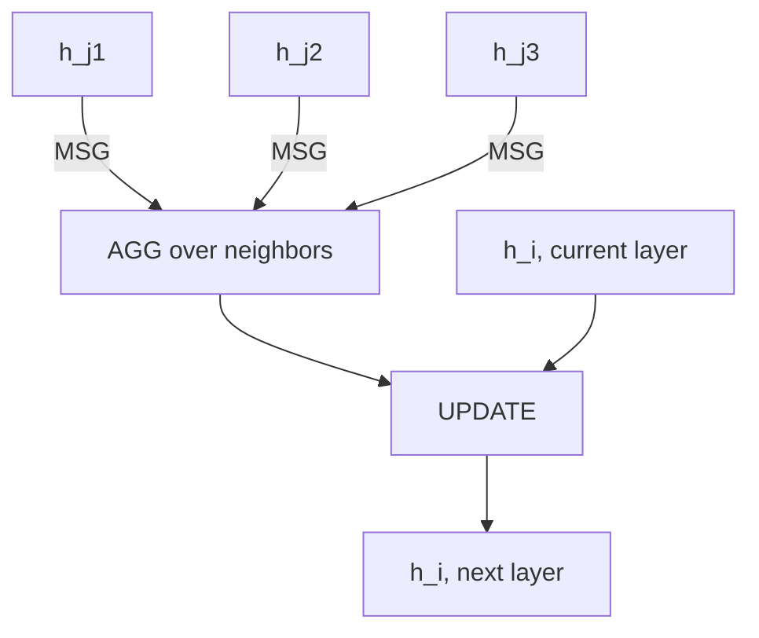

A graph neural network (GNN) is a neural network that computes a representation of each node of a graph by repeatedly aggregating the representations of the node's neighbors.

Graph data has neither the fixed left-to-right order of a sequence nor the regular lattice of an image, so the layers of recurrent and convolutional networks do not apply to it directly. A GNN instead defines each layer over node neighborhoods.

## Message Passing View

A generic message-passing layer updates node $i$ by aggregating over its neighbors:

$$
h_i^{(\ell+1)}
=
\operatorname{UPDATE}^{(\ell)}
\left(
h_i^{(\ell)},
\operatorname{AGG}^{(\ell)}
\left(
\{
\operatorname{MSG}^{(\ell)}(h_i^{(\ell)}, h_j^{(\ell)}, e_{ij})
:
j \in \mathcal{N}(i)
\}
\right)
\right)
$$

Many named GNN architectures are concrete instantiations of `MSG`, `AGG`, and `UPDATE`.



One layer moves information one hop. Stacking $\ell$ layers gives each node a receptive field of its $\ell$-hop neighborhood, which is the graph analogue of stacking convolutions.

> [!tip] GCN and GAT differ only in how AGG weighs neighbors
> GCN fixes the weights from graph structure: neighbor $j$ contributes with weight $1/\sqrt{\tilde{d}_i \tilde{d}_j}$, determined entirely by degrees. GAT learns the weights: $\alpha_{ij}$ comes from an attention score over the node features themselves. Both fit the message-passing template; they differ in whether neighbor weights are determined by graph structure or by node content.

## GCN from Spectral Approximation

Kipf and Welling motivate GCN as a localized first-order approximation to spectral graph convolutions. The resulting propagation rule is:

$$
H^{(\ell+1)}
=
\sigma\left(
\tilde{D}^{-1/2}\tilde{A}\tilde{D}^{-1/2}
H^{(\ell)}W^{(\ell)}
\right)
$$

where

$$
\tilde{A} = A + I
$$

adds self-loops and

$$
\tilde{D}_{ii} = \sum_j \tilde{A}_{ij}
$$

is the corresponding degree matrix.

The paper explicitly introduces this as a **renormalization trick** to avoid numerical instability and exploding/vanishing gradients in deeper stacks.

## Interpretation of the GCN Layer

The GCN update decomposes into three steps:

1. add each node to its own neighborhood
2. average or normalize neighbor information
3. apply a learned linear map

The layer is simple, and after normalization it treats all neighbors symmetrically, which is an inductive bias.

## Datasets and Setting

The paper evaluates on citation-network benchmarks:

- **Cora**
- **Citeseer**
- **Pubmed**

and also on NELL. The problem is semi-supervised node classification with few labels.

This setting contributed to the rapid adoption of GCN. The update rule is short and scalable, and it was effective on a widely used family of benchmarks.

## Executable Cora Experiment

The companion notebook implements sparse graph convolution with PyTorch and uses the official LINQS Cora archive. It compares a feature-only MLP, a GCN over observed citations, and the same GCN after edge destinations are shuffled. Five initialization seeds measure run-to-run variation, and edge-label agreement and the rewired null indicate whether the graph contains structure that neighborhood aggregation can use.

[Run the Cora node-classification experiment](/ml/deep-learning/graph-neural-networks.ipynb)

## GAT

Velickovic et al. replace fixed normalized averaging with learned attention over neighborhoods.

The unnormalized attention score is

$$
e_{ij}
=
\operatorname{LeakyReLU}
\left(
\vec{a}^{\,T}
[W\vec{h}_i \,\|\, W\vec{h}_j]
\right)
$$

which is normalized over the neighborhood,

$$
\alpha_{ij}
=
\operatorname{softmax}_j(e_{ij})
=
\frac{\exp(e_{ij})}{\sum_{k \in \mathcal{N}_i}\exp(e_{ik})}
$$

and the node update is

$$
\vec{h}'_i
=
\sigma\left(
\sum_{j \in \mathcal{N}_i}
\alpha_{ij}W\vec{h}_j
\right)
$$

The paper uses **LeakyReLU** with negative slope **0.2** inside the attention mechanism.

## Multi-Head Attention on Graphs

As in transformers, GAT uses multi-head attention to stabilize learning. The paper states that extending the mechanism to **multi-head attention** was beneficial.

Head outputs are combined in one of two ways, depending on the stage of the network:

- concatenation of head outputs in hidden layers
- averaging of head outputs at the final layer

## Properties and Evaluation of GAT

GAT addresses a limitation of GCN. In GCN, every neighbor contributes through the same normalized operator. In GAT, the model can assign different weights to different neighbors without expensive global matrix operations or requiring a fixed spectral basis.

The paper evaluates on:

- **Cora**
- **Citeseer**
- **Pubmed**
- **PPI**

The PPI result evaluates the method in an inductive setting, in which the test graphs are unseen during training.

## NumPy GCN Layer

```python
import numpy as np

def gcn_layer(A, H, W):
    A_hat = A + np.eye(A.shape[0], dtype=A.dtype)
    D_hat = np.diag(np.sum(A_hat, axis=1))
    D_inv_sqrt = np.linalg.inv(np.sqrt(D_hat))
    A_norm = D_inv_sqrt @ A_hat @ D_inv_sqrt
    return np.maximum(0.0, A_norm @ H @ W)
```

## PyTorch GCN Module

```python
import torch
import torch.nn as nn

class GCNLayer(nn.Module):
    def __init__(self, d_in: int, d_out: int):
        super().__init__()
        self.proj = nn.Linear(d_in, d_out, bias=False)

    def forward(self, A: torch.Tensor, H: torch.Tensor) -> torch.Tensor:
        A_hat = A + torch.eye(A.size(0), device=A.device, dtype=A.dtype)
        D = A_hat.sum(dim=1)
        D_inv_sqrt = torch.diag(torch.rsqrt(D))
        A_norm = D_inv_sqrt @ A_hat @ D_inv_sqrt
        return torch.relu(A_norm @ self.proj(H))
```

## Common Failure Modes

Known difficulties for GNNs include

- oversmoothing
- oversquashing
- noisy neighborhoods
- weak or missing node features

> [!warning] Depth and oversmoothing
> Because each layer averages over neighborhoods, stacking many layers makes node representations converge toward one another, an effect called oversmoothing. For this reason the strong Cora baselines in the notebook are only two layers deep. Each additional layer extends the receptive field by one hop, and beyond the distance over which node labels are correlated, the additional neighbors contribute mostly noise.

GCN and GAT do not address all of these problems. They establish two designs for neighborhood aggregation:

- fixed normalized neighborhood mixing
- learned attention-weighted neighborhood mixing

## Related Notes

- [[ml/deep-learning/modeling-architecture-and-data|Modeling, Architecture, and Data]]
- [[ml/recommender-systems/sequential-recommendation|Sequential and Graph Recommenders]]

## Sources

- [Kipf and Welling (2016), Semi-Supervised Classification with Graph Convolutional Networks](https://arxiv.org/abs/1609.02907)
- [Velickovic et al. (2017), Graph Attention Networks](https://arxiv.org/abs/1710.10903)
- [LINQS Cora dataset](https://linqs-data.soe.ucsc.edu/public/lbc/cora.tgz)
