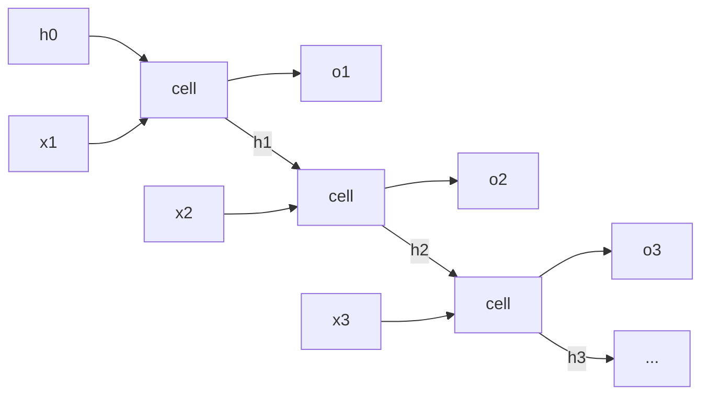

A recurrent neural network (RNN) is a sequence model that applies the same parameterized transition at every time step, computing a hidden state from the previous hidden state and the current input.

RNNs were the principal neural sequence model before transformers. They also make explicit the central optimization problem of sequence learning, in which both information and gradients must pass through repeated applications of the same transition.

## The Elman Simple Recurrent Network

Elman's simple recurrent network predicts the next symbol from the current input and a copy of the previous hidden state. At time step $t$:

$$
h_t = \phi(W_{xh}x_t + W_{hh}h_{t-1} + b_h)
$$

and for logits

$$
o_t = W_{hy}h_t + b_y
$$

The model's inductive bias consists of three assumptions:

- the same parameters are reused at every time step
- the hidden state is the memory
- prediction is a function of the current input plus that memory

Elman's paper framed temporal structure as something a model could infer from regularities in the raw sequence rather than from manually defined symbolic units.

## Backpropagation Through Time

Unrolled over $T$ steps, the RNN is a depth-$T$ network with shared parameters:



Every "cell" box is the same function with the same $W_{xh}$, $W_{hh}$, $b_h$. The loop in the rolled form becomes depth in the unrolled form, and gradients must traverse that entire horizontal chain to reach early timesteps.

For total loss

$$
\mathcal{L} = \sum_{t=1}^{T} \mathcal{L}_t
$$

the gradient to an early hidden state contains repeated Jacobian products:

$$
\frac{\partial \mathcal{L}}{\partial h_t}
=
\sum_{k=t}^{T}
\frac{\partial \mathcal{L}_k}{\partial h_k}
\prod_{j=t+1}^{k}
\frac{\partial h_j}{\partial h_{j-1}}
$$

This product is the source of vanishing and exploding gradients. If the Jacobians tend to shrink norms, the product vanishes; if they amplify norms, it explodes. The effect is a property of the recurrent structure and occurs with any gradient-based optimizer.

> [!warning] Vanishing gradients are a property of the parameterization
> The product $\prod_j \partial h_j / \partial h_{j-1}$ multiplies the same recurrent Jacobian $T$ times, so its norm behaves like $\lambda^T$ for the dominant singular value $\lambda$. Unless $\lambda$ is very close to 1, the long-range gradient either vanishes or grows exponentially in sequence length. Gradient clipping addresses the exploding case. The vanishing case required an architectural change, which the LSTM's additive cell-state update provides.

## Why a Fixed-Length State Can Be a Bottleneck

Sequence-to-sequence encoder-decoder models before attention often encoded the source sentence as a single fixed-length vector. Bahdanau, Cho, and Bengio argue that this vector is a bottleneck. Their extension of the encoder-decoder lets the decoder **search softly** over relevant source positions instead of compressing the entire source into one vector.

The paper connects recurrent sequence models to the later attention-based architectures.

## LSTM

The central idea of Hochreiter and Schmidhuber is a path for **constant error flow** through the cell state. The paper states that LSTM can bridge lags in excess of **1000** time steps by enforcing this constant error flow through **constant error carousels**.

A common modern formulation is

$$
\begin{aligned}
f_t &= \sigma(W_f [h_{t-1}; x_t] + b_f) \\
i_t &= \sigma(W_i [h_{t-1}; x_t] + b_i) \\
\tilde{c}_t &= \tanh(W_c [h_{t-1}; x_t] + b_c) \\
c_t &= f_t \odot c_{t-1} + i_t \odot \tilde{c}_t \\
o_t &= \sigma(W_o [h_{t-1}; x_t] + b_o) \\
h_t &= o_t \odot \tanh(c_t)
\end{aligned}
$$

The essential equation is the cell-state update

$$
c_t = f_t \odot c_{t-1} + i_t \odot \tilde{c}_t
$$

because an additive state update supports long-range credit assignment better than repeated multiplication through a single general hidden transition.

The original paper also emphasizes locality: LSTM is **local in space and time**, with **$O(1)$ computational complexity per time step and weight**.

## GRU

The GRU uses fewer gates:

$$
\begin{aligned}
z_t &= \sigma(W_z x_t + U_z h_{t-1}) \\
r_t &= \sigma(W_r x_t + U_r h_{t-1}) \\
\tilde{h}_t &= \tanh(W_h x_t + U_h(r_t \odot h_{t-1})) \\
h_t &= (1 - z_t)\odot h_{t-1} + z_t \odot \tilde{h}_t
\end{aligned}
$$

The GRU does not appear in the sources cited here. It shares the LSTM's main architectural idea, which is to make state updates additive and gate-controlled instead of purely recurrent and multiplicative.

## Attention

Bahdanau attention computes a context vector for decoder step $i$:

$$
c_i = \sum_{j=1}^{T_x} \alpha_{ij} h_j
$$

with alignment weights

$$
\alpha_{ij} = \frac{\exp(e_{ij})}{\sum_{k=1}^{T_x} \exp(e_{ik})}
$$

and score

$$
e_{ij} = a(s_{i-1}, h_j)
$$

where $s_{i-1}$ is the decoder state and $h_j$ is the encoder annotation at source position $j$.

With attention, the decoder no longer depends on a fixed-width hidden state to retain the entire source. The alignment weights determine, for each output step, which source positions are read.

## NumPy Vanilla RNN

```python
import numpy as np

def tanh(x):
    return np.tanh(x)

class VanillaRNN:
    def __init__(self, d_in, d_hidden, d_out, seed=0):
        rng = np.random.default_rng(seed)
        self.Wxh = rng.normal(0, 0.1, size=(d_hidden, d_in))
        self.Whh = rng.normal(0, 0.1, size=(d_hidden, d_hidden))
        self.bh = np.zeros(d_hidden)
        self.Why = rng.normal(0, 0.1, size=(d_out, d_hidden))
        self.by = np.zeros(d_out)

    def step(self, x_t, h_prev):
        h_t = tanh(x_t @ self.Wxh.T + h_prev @ self.Whh.T + self.bh)
        o_t = h_t @ self.Why.T + self.by
        return h_t, o_t

    def forward(self, x):
        B, T, _ = x.shape
        h = np.zeros((B, self.Whh.shape[0]))
        outputs = []
        for t in range(T):
            h, o = self.step(x[:, t], h)
            outputs.append(o)
        return np.stack(outputs, axis=1)
```

## PyTorch LSTM Language Model

```python
import torch
import torch.nn as nn

class LSTMLM(nn.Module):
    def __init__(self, vocab_size: int, d_model: int, n_layers: int = 2):
        super().__init__()
        self.embed = nn.Embedding(vocab_size, d_model)
        self.rnn = nn.LSTM(
            input_size=d_model,
            hidden_size=d_model,
            num_layers=n_layers,
            batch_first=True,
        )
        self.lm_head = nn.Linear(d_model, vocab_size, bias=False)

    def forward(self, token_ids: torch.Tensor) -> torch.Tensor:
        x = self.embed(token_ids)
        h, _ = self.rnn(x)
        return self.lm_head(h)
```

## Executable Experiment

The companion notebook trains a compact character-level GRU on a cropped WikiText-2 corpus and reports the loss curve, a generated sample and the behavior of the hidden state.

[Run the character-level RNN experiment](/ml/deep-learning/character-level-rnn-on-wikitext-2.ipynb)

## Where RNNs Remain in Use

- streaming settings where strict online updates are natural
- smaller-scale sequence problems
- domains where state compression is acceptable and low latency matters

Their main limitation is that the hidden state is a narrow information bottleneck. Attention relaxes this bottleneck by making memory access a data-dependent retrieval.

## Related Notes

- [[ml/nlp/reading/neural-networks|Feedforward Neural Networks]]
- [[systems/research/sparsity-notes|Faster Causal Self Attention]]
- [[ml/deep-learning/neural-networks-from-scratch|Neural Networks from Scratch]]
- [[ml/deep-learning/encoder-decoder-transformers|Encoder-Decoder Transformers]]
- [[ml/deep-learning/decoder-only-transformers|Decoder-Only Transformers]]

## Sources

- [Elman (1990), Finding Structure in Time](https://papers.baulab.info/papers/Elman-1990.pdf)
- [Hochreiter and Schmidhuber (1997), Long Short-Term Memory](https://deeplearning.cs.cmu.edu/S23/document/readings/LSTM.pdf)
- [Bahdanau, Cho, and Bengio (2014), Neural Machine Translation by Jointly Learning to Align and Translate](https://arxiv.org/abs/1409.0473)
