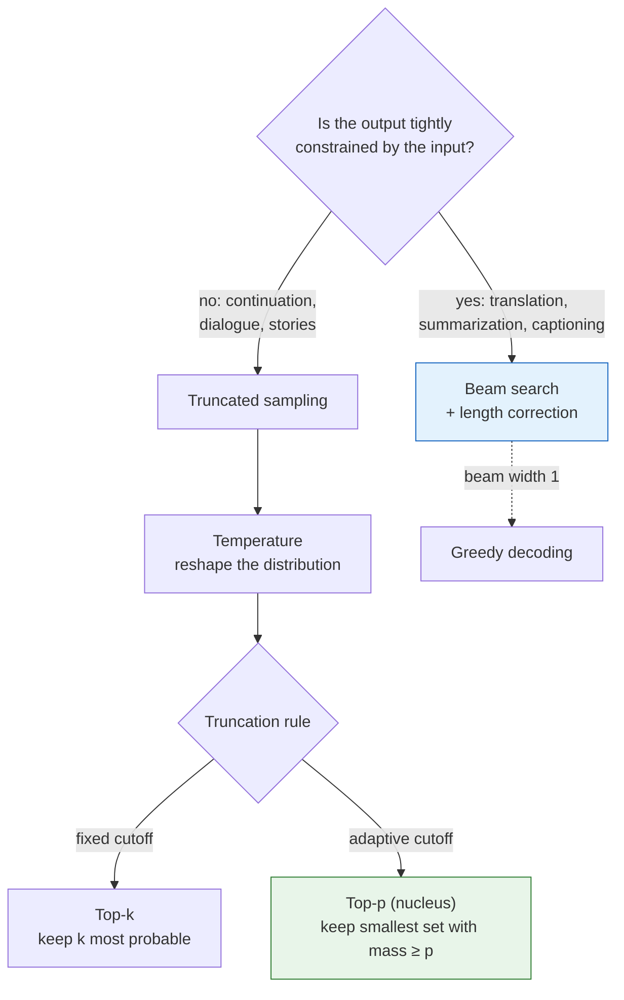

Decoding is the procedure that produces an output sequence from an autoregressive model, which defines only the conditional distribution $p(x_t \mid x_{<t})$ over the next token. A decoder either searches for a high-probability sequence, as greedy decoding and beam search do, or samples from a reshaped version of the model's distribution, as temperature, top-k and top-p sampling do.

The model side of the factorization is treated in [[ml/deep-learning/decoder-only-transformers|Decoder-Only Transformers]].

<a id="the-beam-curse-and-length-bias"></a>

## Beam curse and length normalization

The **beam curse** is the observation that increasing beam width can produce worse translations. In the translation experiments reported by [Murray and Chiang (2018)](https://aclanthology.org/W18-6322.pdf), wider beams find higher-scoring sequences that are shorter and have worse BLEU. A locally normalized sequence model can assign its highest probability to output that is too short. Each additional token contributes another log-probability term at or below zero, so a longer hypothesis tends to have a more negative raw log-probability.

[Murray and Chiang (2018)](https://aclanthology.org/W18-6322.pdf) connect this length bias to the drop in BLEU observed with wider beams. Their experiments find that correcting the preference for short hypotheses almost eliminates the beam problem.

| Beam score | Formula | What it changes |
| --- | --- | --- |
| Raw log-probability | $s(e) = \sum_t \log p(e_t \mid e_{<t})$ | Favors hypotheses that accumulate fewer negative terms, often short output |
| Length normalization | $s(e) / \lvert e\rvert$ | Compares average log-probability per token; this correction has no additional parameter |
| Per-word reward | $s(e) + \gamma \lvert e\rvert$ | Adds a tunable reward for each generated token and can be applied while hypotheses remain in the beam |

Length normalization does not make a wider beam inherently better. It changes the score used to compare hypotheses so that search is less dominated by sequence length. The correction must still be evaluated for the task and model; the per-word reward parameter $\gamma$ is tuned on held-out data.

## Decoding as search

A decoder-only model factorizes sequence probability as $p(x_{1:T}) = \prod_t p(x_t \mid x_{<t})$. Finding the most probable sequence under this factorization is a search over a tree that branches by the vocabulary size at every step, so exact search is intractable and every practical decoder is a heuristic.

Greedy decoding takes $\arg\max_x p(x \mid x_{<t})$ at each step. It requires one forward pass per token and is deterministic, and it can commit to a locally likely token that leads to a globally poor continuation, since the product of conditionals is not maximized by maximizing each factor.

Beam search keeps the $k$ highest-scoring partial hypotheses at each step, extends each by every token, and re-prunes to $k$. It approximates the mode of the sequence distribution more closely than greedy decoding, and it became the conventional decoder in machine translation. The [Hugging Face generation docs](https://huggingface.co/docs/transformers/main/en/generation_strategies) recommend it for input-grounded tasks like translation and captioning, where the output is tightly constrained by the input and the mode is a sensible target.

## Decoding as distribution shaping

Open-ended generation poses a different problem. [Holtzman et al. (2020)](https://arxiv.org/abs/1904.09751) show that maximizing likelihood at decode time produces text that is bland and repetitive, and that models enter repetition loops to which the likelihood assigns increasing probability. Human text does not consist of maximally probable tokens. Sampling-based decoding therefore draws from a reshaped version of the model's distribution instead of searching for its mode.

Each of these methods operates on the logits $x_i$ before the softmax, or on the resulting probabilities, at each step.

**Temperature** rescales logits before the softmax:

$$
p_i = \frac{\exp(x_i / T)}{\sum_j \exp(x_j / T)}
$$

$T < 1$ sharpens the distribution toward the argmax, $T > 1$ flattens it, and $T \to 0$ recovers greedy decoding. Temperature reweights the tail of the distribution but does not remove it.

**Top-k** keeps the $k$ most probable tokens, renormalizes, and samples. The truncation size is fixed regardless of the shape of the distribution. When the distribution is flat, $k$ tokens may exclude many plausible options, and when it is peaked, the $k$ tokens include implausible ones.

**Top-p (nucleus) sampling** truncates adaptively. [Holtzman et al.](https://arxiv.org/abs/1904.09751) define the nucleus $V^{(p)}$ as the smallest set of tokens whose cumulative probability reaches $p$:

$$
\sum_{x \in V^{(p)}} p(x \mid x_{<t}) \ge p
$$

Sampling then renormalizes over $V^{(p)}$. Their argument is that the tail of the distribution, which consists of individually improbable tokens that jointly hold substantial probability mass, is unreliable, and that sampling from it causes generations to degenerate. The size of the nucleus varies from step to step; they observe that it typically ranges from one to around a thousand candidates, and with GPT-2 large, $p \approx 0.95$ produced text closest to human statistics on their metrics.

**Repetition penalty** discounts tokens that already appeared. The formulation from [CTRL](https://arxiv.org/abs/1909.05858) divides the logit of any previously generated token by $\theta$ inside the softmax, with $\theta \approx 1.2$ reported as balancing fidelity to the model's distribution against the avoidance of repetition. Hugging Face implements this as `repetition_penalty`, together with a hard variant, `no_repeat_ngram_size`, that forbids any repeated n-gram. The hard variant also blocks legitimate repetition, such as a name that appears many times.

These operations can be combined. A common sequence is temperature scaling, then top-k or top-p truncation, then renormalization and sampling.

## Sampling from toy logits

The pipeline requires a few lines of code over a logit vector. The example applies temperature, top-k and top-p to a toy distribution.

```python
import numpy as np

rng = np.random.default_rng(0)
logits = np.array([4.0, 3.0, 2.5, 1.0, 0.5, -1.0, -2.0, -5.0])

def softmax(x):
    z = np.exp(x - x.max())
    return z / z.sum()

def sample(logits, temperature=1.0, top_k=None, top_p=None):
    logits = logits / temperature
    probs = softmax(logits)
    order = np.argsort(probs)[::-1]          # tokens by descending probability
    keep = np.ones_like(probs, dtype=bool)
    if top_k is not None:
        keep[order[top_k:]] = False
    if top_p is not None:
        csum = np.cumsum(probs[order])
        cut = np.searchsorted(csum, top_p) + 1   # smallest prefix with mass >= p
        keep[order[cut:]] = False
    probs = np.where(keep, probs, 0.0)
    probs /= probs.sum()
    return rng.choice(len(probs), p=probs), probs

token, probs = sample(logits, temperature=0.8, top_p=0.9)
print(np.round(probs, 3))   # [0.695 0.199 0.107 0.    0.    0.    0.    0.   ]
print(token)                # 0
```

At $T = 0.8$ with $p = 0.9$, the nucleus contains three of the eight tokens, and the remaining five are set to zero. At $T = 1.5$, the nucleus for the same $p = 0.9$ contains four tokens; a fixed top-k cutoff does not adapt in this way.

Greedy decoding and beam search over the same interface are search loops rather than sampling calls. A minimal beam step scores every extension of every hypothesis and keeps the top $k$ by summed log-probability. The length bias arises at this step, because each extension adds a negative term, so shorter hypotheses score higher unless the score is corrected.

## Task tradeoffs



The choice between search and sampling depends on the task. When the output is largely determined by the input (translation, summarization, speech transcription), the mode is meaningful and beam search with a length correction is appropriate. When the task is open-ended (continuation, dialogue, story generation), the mode is degenerate and truncated sampling produces text closer to human text. This is the central empirical claim of [Holtzman et al.](https://arxiv.org/abs/1904.09751), who found beam search text far more repetitive than human text, while nucleus sampling matched human statistics most closely. In both cases the model was trained to maximize likelihood, and the decoding procedure determines how closely the output follows that objective.

## Serving constraints

Decoding policy affects serving cost. Beam search multiplies the KV-cache footprint by the beam width, since each hypothesis needs its own cache, which consumes the memory budget described in [[ml/serving-systems/memory-management|Memory Management in LLM Serving Systems]]. Sampling parameters vary per request, so a batched server applies temperature and truncation per row of the logit matrix, a small cost relative to the forward pass but part of every decode step in the loop described in [[ml/serving-systems/batching|Batching]]. Speculative decoding interacts with the sampling policy. The rejection rule in [[ml/serving-systems/speculative-decoding|Speculative Decoding]] preserves the target distribution under sampling, and greedy or heavily truncated policies change draft acceptance rates. Assisted generation in the [Hugging Face docs](https://huggingface.co/docs/transformers/main/en/generation_strategies) is the same idea exposed as a decoding strategy.

## Sources

- [Holtzman et al. (2020), The Curious Case of Neural Text Degeneration](https://arxiv.org/abs/1904.09751)
- [Murray and Chiang (2018), Correcting Length Bias in Neural Machine Translation](https://aclanthology.org/W18-6322.pdf)
- [Keskar et al. (2019), CTRL: A Conditional Transformer Language Model for Controllable Generation](https://arxiv.org/abs/1909.05858)
- [Hugging Face Transformers, Generation strategies](https://huggingface.co/docs/transformers/main/en/generation_strategies)

## Related notes

- [[ml/deep-learning/decoder-only-transformers|Decoder-Only Transformers]]
- [[ml/serving-systems/speculative-decoding|Speculative Decoding in LLM Serving Systems]]
- [[ml/nlp/prompting|Prompting Language Models]]
