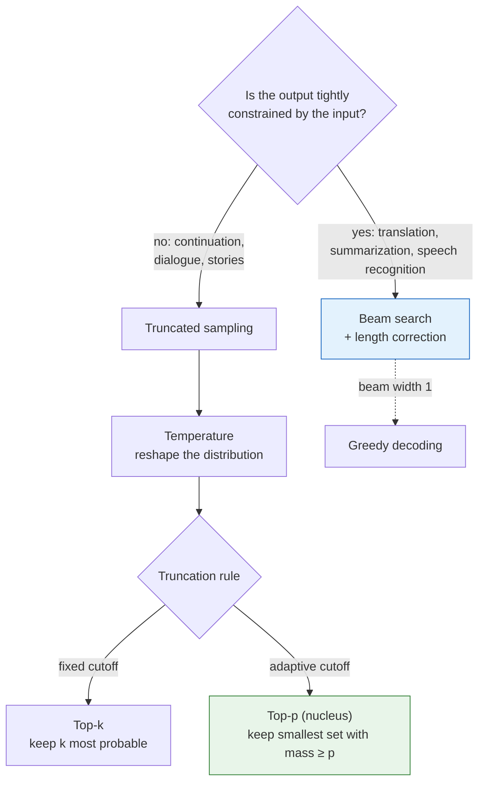

Decoding is the procedure that turns an autoregressive model, which defines only the conditional distributions $p(y_t \mid y_{1:t-1}, x)$ over the next token given a prefix and an input $x$, into an output sequence. A decoder either searches for a sequence with high model probability $p(y \mid x) = \prod_t p(y_t \mid y_{1:t-1}, x)$, as greedy decoding and beam search do, or draws a sample from a reshaped version of the model's distribution, as temperature, top-k and top-p sampling do.

The two families serve different tasks. When the output is largely determined by the input, as in translation or speech recognition, a high-probability output is a reasonable target and search is the conventional choice. When the task is open-ended, as in story continuation or dialogue, the highest-probability sequences are repetitive and generic, and sampling is used instead. The model side of the factorization is treated in [[ml/deep-learning/decoder-only-transformers|Decoder-Only Transformers]]. The measurements here use an encoder-decoder translation model, for which the decoding algorithms are the same.

## Decoding as search

Exact maximization of $\log p(y \mid x)$ is a search over a tree that branches by the vocabulary size $\lvert V\rvert$ at every step. Every practical decoder is therefore a heuristic, and an output error is either a search error (the decoder missed a higher-scoring sequence) or a model error (the highest-scoring sequence is itself a poor output).

**Greedy decoding** takes $\arg\max_w p(w \mid y_{1:t-1}, x)$ at each step and stops at the end-of-sentence token `</s>`. It needs one forward pass per output token, and it can commit to a locally probable token that leads to a low-probability continuation, since maximizing each factor does not maximize the product.

**Beam search** with width $k$ keeps the $k$ highest-scoring prefixes. At each step it scores every one-token extension of every prefix in the beam, $k \lvert V\rvert$ candidates, by the summed log-probability $s(y) = \sum_t \log p(y_t \mid y_{1:t-1}, x)$, and keeps the $k$ best. Greedy decoding is the case $k = 1$. Implementations differ in what happens when a candidate ends with `</s>`, and the differences change the output:

- In [fairseq](https://github.com/facebookresearch/fairseq/blob/main/fairseq/sequence_generator.py)'s sequence generator, which the experiments below follow, each step ranks the $2k$ best candidates ("2 x beam size in case half are EOS"). An `</s>` candidate among the $k$ best moves its hypothesis to a finished set, and the best $k$ of the other candidates form the next beam, so the beam stays at width $k$. The search stops once $k$ hypotheses have finished, and the output is the best finished hypothesis under the final score, which by default divides the log-probability by the length including `</s>`.
- Hugging Face Transformers exposes the stopping rule as `early_stopping`: `True` stops as soon as there are `num_beams` finished candidates, `False` stops when a heuristic judges better candidates unlikely, and `"never"` stops only when no better candidate is possible, which its documentation calls the canonical algorithm.

With the raw log-probability as the score, a finished hypothesis that outscores every live hypothesis cannot be overtaken, since extending a prefix only adds terms $\log p \le 0$. A length-normalized score has no such bound, so under it every stopping rule is a heuristic.

A wider beam does not always return a higher-scoring output. A wider beam can push the greedy path out at a later step, and the first-$k$-finished rule can stop before that path ends. In the measurements below, width 2 returned a lower raw score than greedy decoding on 75 of the 300 sentences, and width 100 on 29.

## Length bias and the beam search curse

The **beam search curse**, or beam problem, is the observation that translation quality falls as the beam widens past a small width. [Koehn and Knowles (2017)](https://arxiv.org/abs/1706.03872) tested widths from 1 to 1,000 on eight language pairs and found that "in almost all cases, worse translations are found beyond an optimal beam size setting", with the optimal width between 4 and about 30 for unnormalized scores. Normalizing scores by output length moved the optimum to 30 to 50 and gave better optimal quality on 5 of the 8 pairs, but "quality still drops with larger beams". They attribute the drop mainly to shorter translations under wider beams.

The cause is a length bias in the score. Every token adds a term $\log p(y_t \mid y_{1:t-1}, x) \le 0$, including the final `</s>`, so the raw score decreases along any path, and a short hypothesis accumulates fewer negative terms than a long one. [Murray and Chiang (2018)](https://aclanthology.org/W18-6322/) describe the mechanism through `</s>`: once a prefix has ended, its continuation has zero entropy, so "at each time step, the score of `</s>` puts a limit on the total remaining score a translation can have", and a model that overestimates the probability of `</s>` "may proceed to ignore the rest of the input and generate a truncated translation." A narrow beam rarely reaches the short, high-scoring hypotheses, because they must survive pruning at every step on the way; a wide beam reaches them. On Russian to English, their baseline fell from 24.9 BLEU at width 10 to 3.7 at width 1,000, where the output had 0.31 times the reference length and 37.3% of the outputs were empty.

Exact search shows that the bias belongs to the model and that beam search conceals it. [Stahlberg and Byrne (2019)](https://aclanthology.org/D19-1331/) ran exact search with a Transformer-base model on the English-German news-test2015 set (2,169 sentences): "for 51.8% of the sentences, NMT assigns the global best model score to the empty translation", and exact search scored 2.1 BLEU against 30.3 for beam width 10. In their words, the search errors of beam search "paradoxically, often prevent the decoder from suffering from a frequent but very serious model error." [Meister, Cotterell and Vieira (2020)](https://arxiv.org/abs/2010.02650) derive an objective for which beam search returns the exact solution: the log-probability plus a regularizer that favors evenly distributed surprisal across the output. They relate that property to the uniform information density hypothesis from cognitive science, and find that how closely outputs adhere to it "strongly correlates with BLEU".

The standard corrections change the score by which finished hypotheses are compared:

| Beam score | Formula | Effect |
| --- | --- | --- |
| Raw log-probability | $s(y) = \sum_t \log p(y_t \mid y_{1:t-1}, x)$ | Favors hypotheses with fewer negative terms, often short or empty output |
| Length normalization | $s(y) / \lvert y\rvert$ | Compares average log-probability per token; no parameter |
| GNMT length penalty | $s(y) / \mathrm{lp}(y)$, $\mathrm{lp}(y) = \left(\frac{5 + \lvert y\rvert}{6}\right)^{\alpha}$ | $\alpha = 0$ is the raw score; larger $\alpha$ moves toward per-token comparison |
| Word reward | $s(y) + \gamma \lvert y\rvert$ | Adds a tuned reward per token; also applies to partial hypotheses |

The length penalty is from [Wu et al. (2016)](https://arxiv.org/abs/1609.08144), who use $\alpha = 0.2$ together with a coverage penalty and report that on their WMT'14 English-French development set "slightly larger $\alpha$ and $\beta$ values improve BLEU score by up to +1.1" over pure probability scoring. Hugging Face's `length_penalty` divides the score by $\lvert y\rvert^{\alpha}$ and defaults to 1.0, which is length normalization. [Murray and Chiang](https://aclanthology.org/W18-6322/) tune $\gamma$ on development data with a perceptron-style update and report that correcting the length bias "almost eliminates the beam problem": with the tuned reward, Russian to English at width 1,000 scored 25.7 BLEU at a length ratio of 1.02.

### Measured: beam width on newstest2021

The sweep below reproduces the curse with a pretrained model on CPU. The model is [OpenNMT-py's English-German Transformer-base](https://opennmt.net/Models-py/), trained on WMT data with a shared SentencePiece vocabulary (its model page lists 26.89 BLEU on newstest2014). It runs in a NumPy reimplementation whose greedy outputs match CTranslate2's on 46 of 50 sentences. The test data are 300 sentences drawn at random from WMT newstest2021 English to German, scored against reference A, and decoded at widths 1 to 100 with the fairseq-style search above. That search does not depend on the final score, so each width's finished set is rescored four ways: raw log-probability, per-token normalization, and the GNMT penalty at $\alpha = 0.2$ and $0.6$, with $\lvert y\rvert$ counting `</s>`. BLEU is sacreBLEU with signature `nrefs:1|case:mixed|eff:no|tok:13a|smooth:exp|version:2.6.0`, and the length ratio is output length over reference length in sacreBLEU's tokens. Decoding is deterministic, so the brackets are 95% bootstrap intervals over test sentences (1,000 resamples) and measure how much the result depends on which sentences were sampled.

| Width | Raw BLEU | Raw length ratio | Raw short outputs | Per-token BLEU | Per-token length ratio | Per-token short outputs | GNMT $\alpha = 0.6$ BLEU |
| ---: | --- | ---: | ---: | --- | ---: | ---: | ---: |
| 1 | 21.68 [19.8, 23.6] | 0.971 | 6 | 21.68 [19.8, 23.6] | 0.971 | 6 | 21.68 |
| 2 | 22.54 [20.6, 24.5] | 0.974 | 3 | 22.59 [20.7, 24.5] | 0.982 | 3 | 22.61 |
| 3 | 22.30 [20.3, 24.2] | 0.967 | 3 | 22.44 [20.6, 24.3] | 0.978 | 2 | 22.48 |
| 5 | 21.81 [19.9, 23.9] | 0.945 | 7 | 22.67 [20.7, 24.6] | 0.980 | 2 | 22.23 |
| 10 | 21.60 [19.5, 23.7] | 0.929 | 10 | 22.46 [20.5, 24.4] | 0.979 | 2 | 21.78 |
| 20 | 21.14 [19.2, 23.2] | 0.910 | 13 | 22.54 [20.5, 24.5] | 0.974 | 3 | 21.85 |
| 50 | 20.88 [18.8, 23.0] | 0.900 | 16 | 22.35 [20.4, 24.3] | 0.973 | 3 | 21.45 |
| 100 | 19.96 [18.0, 22.0] | 0.887 | 20 | 21.55 [19.6, 23.6] | 0.973 | 3 | 20.80 |

"Short outputs" counts the outputs, out of 300, that are shorter than half their reference in sacreBLEU tokens. The [summary file](https://github.com/elimelt/web/blob/main/notes/content/ml/nlp/decoding-strategies-experiments/summary.json) has every cell's interval, the GNMT $\alpha = 0.2$ rows and the paired differences from greedy decoding.

With the raw score, BLEU peaked at width 2 and fell to 19.96 at width 100, a paired difference of −2.58 BLEU (95% interval −3.63 to −1.55). The length ratio fell from 0.974 to 0.887, and the number of outputs shorter than half their reference rose from 3 to 20. Over the same range the search did better at its own objective: the mean log-probability of the returned output rose at every width, from −18.12 for greedy decoding to −14.89 at width 100, while the mean output length fell from 37.2 pieces at width 1 to 33.9 at width 100. The drop in BLEU therefore comes from model error, exposed by better search, which is the pattern [Koehn and Knowles](https://arxiv.org/abs/1706.03872) and [Murray and Chiang](https://aclanthology.org/W18-6322/) describe. The single-system intervals are about ±2 BLEU wide at 300 sentences, so only the paired differences separate the widths.

Per-token normalization held the length ratio between 0.973 and 0.982 at every width, with 2 or 3 short outputs, and kept BLEU between 22.35 and 22.67 from width 2 to 50. At width 100 it scored 1.59 BLEU above the raw score (interval 0.65 to 2.52) but 1.11 below its own width-5 result (interval 0.20 to 2.00), so normalization removed most of the decline but not all of it, as Koehn and Knowles also found. The GNMT penalty fell between the two, closer to raw at $\alpha = 0.2$ (20.42 at width 100) than at $\alpha = 0.6$ (20.80, 0.84 above raw with interval 0.15 to 1.61).

No width returned an empty translation; `</s>` was never among the $k$ best first tokens, so the empty hypothesis never entered a finished set. Its score, the log-probability of `</s>` as the first token, had a median of −10.44 over the 300 sentences. That was higher than the raw score of the greedy output on 239 sentences and of the width-100 output on 208, so on those sentences the output of beam search is not the model's most probable translation, and the most probable one is either empty or scores higher still. This is the condition [Stahlberg and Byrne](https://aclanthology.org/D19-1331/) found with exact search, observed here without it.

## Stepping through one sentence

The figure replays beam search over next-token log-probabilities recorded from the same model on one newstest2021 sentence, at widths 1 to 8. The upper table lists the candidates at the current step: the hypotheses kept in the beam (newest token in bold), those that ended with `</s>`, and the best of the pruned candidates (dropped token struck through). The lower table ranks the finished hypotheses by the chosen final score.

<BeamSearch k={3} scoring="raw" src="/ml/nlp/decoding-strategies-experiments/beam-figure.json" />

The source is "The bridge was designed by English Royal Navy officer Capt Samuel Brown." At width 1 the decisive step is the fifth: after "Die Brücke wurde von", the piece "Cap" scores −3.10 and "dem", which begins "von dem englischen Royal Navy Officer", scores −4.00, so greedy decoding drops the officer's description and ends with "Die Brücke wurde von Capt Samuel Brown entworfen." (12 tokens, log p −5.11). At width 2 the longer prefix survives that step, but the search stops after two hypotheses have finished, and the second is a translation that repeats "entworfen" (log p −12.10). From width 3 the finished set contains the full translation, "Die Brücke wurde von dem englischen Royal Navy Officer Capt Samuel Brown entworfen." It has a lower log-probability, −6.70 over 18 tokens, because it has six more negative terms, and a higher average, −0.372 per token against −0.425. Raw log-probability returns the truncated output at every width from 1 to 8; the per-token average returns the full one at every width from 3 to 8. A wider beam is what puts the long hypothesis in the finished set, and the final score decides whether it is returned.

## Decoding as distribution shaping

For open-ended generation, [Holtzman et al. (2020)](https://arxiv.org/abs/1904.09751) show that decoding for high probability produces degenerate text. With GPT-2 Large (762M parameters), 73.66% of greedy continuations and 28.94% of width-16 beam search continuations ended in a repetition loop (a phrase of two or more tokens repeated at least three times at the end of a 200-token generation), against 0.28% of human text, and "the probability of a repeated phrase increases with each repetition, creating a positive feedback loop." Human text is not a sequence of maximally probable tokens, so sampling decoders draw from the model's distribution instead, after reshaping it. Each method below acts on the logits $z_i$ or the probabilities at one step.

**Temperature** rescales logits before the softmax:

$$
p_i = \frac{\exp(z_i / T)}{\sum_j \exp(z_j / T)}
$$

$T < 1$ sharpens the distribution toward the argmax, $T > 1$ flattens it, and $T \to 0$ recovers greedy decoding. Temperature reweights the tail of the distribution but does not remove it.

**Top-k** keeps the $k$ most probable tokens, renormalizes and samples. [Fan, Lewis and Dauphin (2018)](https://arxiv.org/abs/1805.04833) used it for story generation with $k = 10$, finding it "substantially more effective than beam search", whose sentences "tend to be short and generic." The truncation size is fixed regardless of the shape of the distribution, so a flat distribution loses plausible tokens and a peaked one keeps implausible ones.

**Top-p (nucleus) sampling** truncates adaptively. [Holtzman et al.](https://arxiv.org/abs/1904.09751) define the nucleus $V^{(p)}$ as the smallest set of tokens whose probability reaches $p$,

$$
\sum_{w \in V^{(p)}} p(w \mid y_{1:t-1}) \ge p,
$$

and sample from the renormalized distribution over $V^{(p)}$. The tail they cut consists of individually improbable tokens that jointly hold substantial probability mass, and sampling from it is what makes pure sampling incoherent. For GPT-2 Large the nucleus "tends to range between one and a thousand candidates". In their Table 1, nucleus sampling at $p = 0.95$ had the highest human-judged score among the sampling methods (HUSE 0.97, against 0.94 for top-k with $k = 640$ and 0.19 with $k = 40$) and a perplexity of 13.13, close to the 12.38 of human text. Hugging Face's `TopPLogitsWarper` implements the rule by sorting probabilities in ascending order and removing the tokens whose cumulative probability is at most $1 - p$.

A translation model's next-token distribution concentrates most of its mass on a few tokens but not all of it. Over 1,946 greedy decoding steps of the model above (50 newstest2021 sentences), the median probability of the most likely token was 0.79, and the $p = 0.9$ nucleus held a single token at 27% of the steps and a median of 8 tokens. The $p = 0.95$ nucleus had a median of 5,074 tokens and a maximum of 16,703, over half of the 31,538-token vocabulary. The model was trained with label smoothing of 0.1 (recorded in its checkpoint's options), which moves 10% of each training target's probability from the reference token to the rest of the vocabulary; nuclei this large are consistent with the model having learned a long, flat tail of that kind, though the tail mass itself was not measured. A fixed $p$ therefore cuts this distribution very differently at 0.9 and at 0.95.

**Repetition penalty** discounts tokens that already appeared. [CTRL](https://arxiv.org/abs/1909.05858) divides the logit of every previously generated token by $\theta$ before the softmax, and reports that greedy decoding with $\theta \approx 1.2$ balances fidelity to the model against repetition. Dividing a negative logit by $\theta > 1$ raises it, so Hugging Face's `repetition_penalty` [multiplies negative logits by $\theta$ and divides positive ones](https://github.com/huggingface/transformers/blob/main/src/transformers/generation/logits_process.py), which lowers the token's probability in both cases. The hard variant, `no_repeat_ngram_size`, forbids any repeated n-gram of the given size, which also blocks legitimate repetition such as a name that occurs several times.

These operations compose. A common order is repetition penalty, temperature, top-k or top-p truncation, then renormalization and sampling.

## Task tradeoffs

When the output is largely determined by the input, a high-probability output is a reasonable target, and beam search at a moderate width with a length correction is the conventional decoder. The [Hugging Face guide](https://huggingface.co/docs/transformers/main/en/generation_strategies) describes beam search as "best suited for input-grounded tasks, like describing an image or speech recognition." The curse makes the width a hyperparameter to tune on development data rather than a setting to maximize. When the task is open-ended, the model's mode is degenerate, and truncated sampling produces text closer to human text by the measures of [Holtzman et al.](https://arxiv.org/abs/1904.09751). In both cases the model was trained to maximize likelihood, and the decoder determines how closely the output follows that objective.

## Serving constraints

Decoding policy affects serving cost. Beam search keeps $k$ hypotheses per request, each with its own key-value cache for the tokens it generated, which consumes the memory budget described in [[ml/serving-systems/memory-management|Memory Management in LLM Serving Systems]]. The prompt's cache and the prefixes the hypotheses share need not be copied: vLLM's PagedAttention shares cache blocks among beam candidates through reference counts and copy-on-write, and [Kwon et al. (2023)](https://arxiv.org/abs/2309.06180) report up to 55% memory saving for beam search. Sampling parameters vary per request, so a batched server applies temperature and truncation per row of the logit matrix, a small cost relative to the forward pass but part of every decode step in the loop described in [[ml/serving-systems/batching|Batching]]. In [[ml/serving-systems/speculative-decoding|Speculative Decoding]], the rejection rule preserves the target model's distribution under sampling; under greedy decoding, verification reduces to checking that each draft token is the target model's argmax.

> [!note]- How this was measured
> The code and data are in [decoding-strategies-experiments](https://github.com/elimelt/web/tree/main/notes/content/ml/nlp/decoding-strategies-experiments), in the same directory. Everything ran on a shared cloud VM (4-vCPU Intel Xeon at 2.10 GHz, no GPU, with three other agents running experiments at the same time) limited to 2 BLAS threads, so no timings are reported.
>
> - **Data and model:** `sh fetch.sh` downloads OpenNMT-py's pretrained `transformer-ende-wmt-pyOnmt.tar.gz` (the averaged checkpoint `averaged-10-epoch.pt` and `sentencepiece.model`) and the newstest2021 English-German source and reference A from the [WMT21 news systems repository](https://github.com/wmt-conference/wmt21-news-systems) at tag v1.3, and checks their SHA-256. Hugging Face model hosting was not reachable from the VM, which ruled out the Marian OPUS-MT models.
> - **Model code:** `ptload.py` reads the PyTorch checkpoint without PyTorch, and `nmt_numpy.py` implements the network as OpenNMT-py 0.4 defines it (pre-norm Transformer-base with 6 encoder and 6 decoder layers, 512 dimensions, 8 heads, and OpenNMT's LayerNorm, which divides by the unbiased standard deviation plus $\epsilon$), with an incremental decoder. `python3 convert_ct2.py data/averaged-10-epoch.pt data/ct2` converts the same checkpoint for CTranslate2, and `python3 checks.py` reports that greedy outputs agree on 46 of 50 sentences and that sentence log-probabilities differ by a median of 0.31% (maximum 0.68%) in relative terms, since CTranslate2 applies a standard LayerNorm to the same weights.
> - **Sweep:** `OPENBLAS_NUM_THREADS=2 python3 beam_exp.py --n 300 --widths 1,2,3,5,10,20,50,100 > results.jsonl` (committed gzipped as `results.jsonl.gz`) decodes sentences in a random order (NumPy seed 0) and records, for every width, the best finished hypothesis under each score, every finished hypothesis's length and score, and the log-probability of `</s>` as the first token, which is the score of the empty translation. The maximum output length is twice the source length plus 10 pieces. The 300 sentences are a random subset of the 1,002. `python3 analyze.py results.jsonl.gz > summary.json` computes the table and `python3 contrasts.py results.jsonl.gz > contrasts.txt` the paired differences quoted in the text (Python 3.13.18, NumPy 2.5.3, sentencepiece 0.2.3, sacreBLEU 2.6.0, CTranslate2 4.9.0).
> - **Nucleus sizes:** `OPENBLAS_NUM_THREADS=2 python3 nucleus.py > nucleus.json`.
> - **Figure:** `python3 figure_scan.py` lists short sentences whose raw-score and normalized outputs differ at some width from 1 to 8. `python3 figure_data.py > beam-figure.json` records, for newstest2021 line 555, every prefix the search expands at those widths with its 16 most probable next tokens and the `</s>` log-probability, which suffices to replay the search exactly, and asserts that a search over the recorded numbers returns what the live model's search returned. `python3 figure_replay.py` replays the stored numbers with a separately written implementation and writes `beam-figure-expected.json`, against which the figure's TypeScript is tested step by step.

> [!note]- Potentially interesting ideas
> - Width 2 returned a lower raw score than greedy decoding on 75 of the 300 sentences, and width 100 on 29, under the first-$k$-finished stopping rule. Running the same sweep with a stopping rule that is exact for the raw score (Hugging Face's `early_stopping="never"`) would show how much of the small-width behavior comes from the stopping rule rather than from pruning.
> - The empty translation outscored the greedy output on 239 of 300 sentences, yet the beam never reached it. Exact search on this model, as [Stahlberg and Byrne](https://aclanthology.org/D19-1331/) ran on theirs, would show how often the mode is empty for a model trained with label smoothing and a SentencePiece vocabulary; their model and test set differ, so their 51.8% need not carry over.
> - The $p = 0.95$ nucleus held thousands of tokens at most steps. Whether that tail is mainly an effect of label smoothing could be tested by repeating the measurement on a comparable model trained without it, which was not available here.

## Related notes

- [[ml/deep-learning/decoder-only-transformers|Decoder-Only Transformers]]
- [[ml/serving-systems/speculative-decoding|Speculative Decoding in LLM Serving Systems]]
- [[ml/serving-systems/memory-management|Memory Management in LLM Serving Systems]]
- [[ml/nlp/prompting|Prompting Language Models]]
