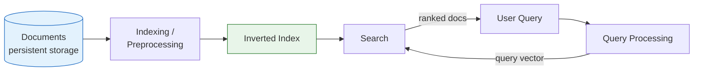

Information retrieval (IR) is the task of returning, for a query that expresses an information need, the items of a collection that satisfy that need, ordered by estimated relevance. It applies to collections of any medium; web search engines are its most familiar application, and retrieval-augmented generation is a recent one. The core treatment follows Jurafsky & Martin, [SLP3](https://web.stanford.edu/~jurafsky/slp3/), and Manning, Raghavan & Schütze, [Introduction to Information Retrieval](https://nlp.stanford.edu/IR-book/) (IIR).

Two families of scoring functions are in use. **Lexical** (sparse) methods such as tf-idf and BM25 score a document by the query terms it contains, weighted by how rare each term is, and are served from an inverted index. **Dense** methods encode the query and the document as vectors with a neural network and score by their inner product, so a document can match a query with which it shares no terms. On the SciFact claim-verification collection, [measured below](#bm25-versus-dense-retrieval-on-scifact), BM25 reaches an nDCG@10 of 0.680, a 22-million-parameter sentence encoder 0.645, and a fusion of their two rankings 0.719; the two methods fail on largely different queries.

Retrieval pipelines consume [[ml/nlp/reading/tokenization|tokenized document representations]], and retrieval-augmented systems pass retrieved results into the [[ml/nlp/prompting|prompting]] workflow.

## Ad hoc retrieval

In **ad hoc retrieval** a user poses a **query** to a retrieval system, which returns an ordered list of **documents** from a **collection**. A document is whatever unit of text the system indexes and returns (a web page, an abstract, a passage of a book). The collection is the set of all indexed documents. A **term** is a word, phrase or other unit by which documents are indexed, and a query is treated as a set or multiset of terms.

A simple architecture has four parts. The document collection sits in persistent storage. An indexing module converts documents into an inverted index. A query processing module turns a query into terms or a query vector. A search module scores documents against the query using the index and returns them ranked.



The index is built offline and persisted, so that it is not recomputed for every search; online queries are served from an index held in memory or memory-mapped from disk.

Queries and documents can both be mapped to vectors of unigram counts, and documents ranked by the cosine of their vectors with the query vector. This is an instance of the **bag-of-words** model, in which terms are treated independently of their positions.

### Term weighting (tf-idf)

Raw counts are a poor measure of a term's importance: a document that contains a word 100 times is not 100 times as much about it, and words that occur in nearly every document distinguish none of them. Each term in each document is instead assigned a **term weight**. For **tf-idf** (term frequency times inverse document frequency) the weight is the product of a term frequency factor and an inverse document frequency factor:

$$
\text{tf}_{t, d} = \begin{cases}
    1 + \log_{10} \text{count}(t, d) & \text{if count}(t, d) > 0 \\
    0 & \text{otherwise}
\end{cases}
$$

The logarithm dampens repetition: a term that appears 100 times in a document gets a tf of 3, against 1 for a single occurrence. Alternative definitions of tf exist, such as $\log_{10}(1 + \text{count}(t, d))$; IIR §6.4 lists the common variants in the SMART notation.

The **document frequency** $\text{df}_t$ is the number of documents containing term $t$, and the idf is

$$
\text{idf}_t = \log_{10} \left( \frac{N}{\text{df}_t} \right)
$$

where $N$ is the number of documents in the collection. A term contained in every document gets an idf of 0. The tf-idf weight is then

$$
\text{tf-idf}_{t, d} = \text{tf}_{t, d} \times \text{idf}_t .
$$

### Document scoring

A document $d$ is scored by the cosine of its weight vector $v_d$ with the query vector $v_q$, which is the dot product of the two unit vectors:

$$
\text{score}(q, d) = \cos(v_q, v_d) = \frac{v_q \cdot v_d}{\|v_q\| \|v_d\|} = \frac{v_q}{\|v_q\|} \cdot \frac{v_d}{\|v_d\|}
$$

Substituting the tf-idf weights gives

$$
\text{score}(q, d) = \sum_{t \in q} \frac{\text{tf-idf}_{t, q}}{\sqrt{\sum_{t' \in q} \text{tf-idf}_{t', q}^2}} \times \frac{\text{tf-idf}_{t, d}}{\sqrt{\sum_{t' \in d} \text{tf-idf}_{t', d}^2}}
$$

Only terms that occur in both the query and the document contribute to the sum, which is what makes scoring from an inverted index efficient. The query norm is the same for every document and does not affect the ranking, so systems often drop it.

## BM25

**BM25** (Okapi BM25, "best match" function 25 from the Okapi system at City University London) replaces the logarithmic tf with a saturating function and normalizes for document length explicitly. [Robertson & Zaragoza (2009)](https://doi.org/10.1561/1500000019) derive it from the probabilistic relevance framework. A common form is

$$
\text{score}(q, d) = \sum_{t \in q} \text{idf}_t \cdot \frac{(k_1 + 1)\, \text{tf}_{t,d}}{k_1 \left(1 - b + b \frac{|d|}{\text{avgdl}}\right) + \text{tf}_{t,d}},
\qquad
\text{idf}_t = \log \frac{N - \text{df}_t + 0.5}{\text{df}_t + 0.5}
$$

where $\text{tf}_{t,d}$ is the raw count of $t$ in $d$, $|d|$ the length of $d$ in terms and $\text{avgdl}$ the mean document length in the collection. The idf is the Robertson–Spärck Jones weight with no relevance information; it is negative for a term in more than half the collection, and implementations differ in how they prevent that. The factor $(k_1 + 1)$ is the same for every term and does not change the ranking; Robertson & Zaragoza's main statement of the function (their Eq. 3.15) omits it and describes it as a common variant. Lucene, and so Elasticsearch, Solr and Pyserini, omit it too and use $\log\left(1 + \frac{N - \text{df}_t + 0.5}{\text{df}_t + 0.5}\right)$ as the idf, which is always positive. SLP3 (Eq. 11.12) gives a simpler form with $\text{idf}_t = \log(N/\text{df}_t)$.

Each factor has a role that can be read off the formula.

- **Saturation ($k_1$).** For fixed length, the term's contribution rises with tf toward the ceiling $(k_1+1)\,\text{idf}_t$ (or $\text{idf}_t$ without the constant factor) and reaches half of it at $\text{tf} = k_1$ (for an average-length document). With $k_1 = 0$ every present term contributes exactly its idf, whatever its count, so the score is a sum of idf over matched terms. As $k_1 \to \infty$ the contribution becomes proportional to tf.
- **Length normalization ($b$).** The denominator scales $k_1$ by the document's length relative to the average. With $b = 1$ a document twice the average length needs twice the count to earn the same contribution; with $b = 0$ length is ignored. Long documents contain more term occurrences because they cover more material and because they repeat themselves, and $b$ sets how much of the extra count is attributed to length.
- **Rarity (idf).** A term that occurs in a few documents can contribute several times as much as a common one, so a single match on a rare term can outweigh several matches on common terms.

Lucene's defaults are $k_1 = 1.2$ and $b = 0.75$, and Anserini and Pyserini default to $k_1 = 0.9$, $b = 0.4$; Robertson & Zaragoza (§3.5) state that $1.2 < k_1 < 2$ and $0.5 < b < 0.8$ work well in many circumstances. [Kamphuis et al. (2020)](https://doi.org/10.1007/978-3-030-45442-5_4) reimplemented eight published BM25 variants in one system and found no significant differences in effectiveness among them. On SciFact the Lucene form and the SLP3 form at $k_1 = 1.2$, $b = 0.75$ score 0.686 and 0.685 nDCG@10.

The figure below scores one SciFact claim against all 5,183 abstracts with the Lucene form. The query terms are the analyzer's output: lowercased, with Lucene's English stop words removed and Snowball stemming, which is why "S-nitrosylated" becomes the two terms `s` and `nitrosyl`. The term `transnitrosyl` occurs in a single abstract (idf 8.15), the judged-relevant one, and that abstract also matches the other six terms, so it ranks first at every setting. Moving $k_1$ changes how much repeated terms count: the abstracts in ranks 2 to 5 earn most of their score from one or two terms repeated up to ten times, and at $k_1 = 0$ each of those terms counts once.

<BM25Score query="1062" k1={0.9} b={0.4} controls="k1" />

Claim 1100, "Statins increase blood cholesterol", has a short relevant abstract (82 terms, against a collection mean of 164) that mentions statins once and cholesterol twice. Without length normalization, longer abstracts that repeat "statin" up to ten times rank above it, and it ranks 8th at $k_1 = 1.2$, $b = 0$. Raising $b$ discounts those counts by length, and the relevant abstract ranks 5th at $b = 0.4$, 2nd at $b = 0.75$ and 1st at $b = 1$.

<BM25Score query="1100" k1={1.2} b={0} controls="b" />

Tuning both parameters on the 300 SciFact test claims moves nDCG@10 between 0.646 ($k_1 = 0$, any $b$) and 0.693 ($k_1 = 2$, $b = 0.9$), a range of 0.047; at the Pyserini defaults it is 0.680. Tuning on the test queries overstates what a tuned system would reach on new queries, so these values describe the sensitivity of the function and are not a result.

#### Stop words and stemming

Stop words are frequent function words that were traditionally removed before indexing. tf-idf and BM25 already give them idf near 0, so removal matters less for ranking than for index size, and many systems keep them to support phrase queries. **Stemming** maps inflected forms to a common stem (`nitrosylated`, `nitrosylation` → `nitrosyl`), which lets a query term match other forms of the same word at the cost of occasionally conflating unrelated words. On SciFact, BM25 without stemming or stop word removal scores 0.661 nDCG@10 against 0.680 with them, a paired difference of −0.019 (95% CI −0.037 to −0.002), and its recall@100 falls from 0.922 to 0.885.

### Inverted index

An inverted index returns all documents that contain a given term. It has two parts, a **dictionary** and **postings lists**. The dictionary maps each term to its postings list, and is stored in a structure built for fast lookup (a hash table, a B-tree, or a sorted array or finite-state transducer, as in Lucene's term dictionary; see [[systems/databases/foundations/ch3-storage-and-retrieval|Storage and Retrieval]]). A postings list holds the ids of the documents that contain the term, sorted, usually with the term's frequency in each and optionally its positions for phrase queries. Postings are stored as gaps between successive ids in a variable-length integer code, which compresses them severalfold ([Zobel & Moffat 2006](https://doi.org/10.1145/1132956.1132959)).

Scoring a query reads only the postings lists of its terms, and the cost is proportional to their total length. The SciFact index built for the experiment holds 26,389 terms and 512,831 postings; it is built in 0.76 s and scored in 1.0 ms per query by a NumPy implementation that reads every posting of every query term. Large engines avoid reading whole lists with dynamic pruning (MaxScore, WAND, block-max WAND), which skips documents whose score bound cannot reach the current top $k$.

Some systems index other units. The document retriever in DrQA ([Chen et al. 2017](https://aclanthology.org/P17-1171/)) represents articles and questions as tf-idf-weighted bags of unigrams and bigrams, with the bigrams hashed into $2^{24}$ bins, and passes the most similar Wikipedia articles to its reader model.

## Evaluation

A test collection consists of documents, queries and **relevance judgments** (qrels) that state which documents are relevant to which queries. Judgments are made by people, and for large collections only the documents near the top of some system's ranking are judged (pooling); an unjudged document is counted as not relevant.

### Precision and recall

**Precision** is the fraction of returned documents that are relevant, and **recall** the fraction of all relevant documents that are returned. Let $U$ be the set of relevant documents, $T$ the set of returned documents, and $R = T \cap U$. Then

$$
\text{precision} = \frac{|R|}{|T|} \qquad \text{recall} = \frac{|R|}{|U|}
$$

For a ranked list both are measured at a cutoff $k$ (precision@$k$, recall@$k$). Recall does not decrease as $k$ grows, since an irrelevant document leaves it unchanged; precision falls whenever an irrelevant document is added. A precision-recall curve plots precision against recall as $k$ varies. Its sawtooth shape is smoothed by **interpolated precision**, the maximum precision at any recall level at or above $r$:

$$
\text{InterpolatedPrecision}(r) = \max_{r' \ge r} \text{Precision}(r')
$$

```python
import numpy as np

def interpolate_pr_curve(precision, recall):
    """Interpolated precision at the 11 recall levels 0.0, 0.1, ..., 1.0.

    precision and recall are arrays with one entry per rank cutoff."""
    recall_levels = np.linspace(0, 1, 11)
    interpolated = np.zeros_like(recall_levels)
    for i, r in enumerate(recall_levels):
        reached = precision[recall >= r]
        interpolated[i] = reached.max() if reached.size else 0.0
    return interpolated, recall_levels
```

### Average precision and MAP

**Average precision** (AP) for one query is the mean of the precision values at the ranks where relevant documents occur, averaged over all relevant documents:

$$
\text{AP} = \frac{1}{|U|} \sum_{k=1}^{n} \text{Precision@}k \cdot \text{rel}(k)
$$

where $\text{rel}(k)$ is 1 if the document at rank $k$ is relevant and 0 otherwise, and $n$ is the length of the ranking (1,000 in TREC). A relevant document that is never returned contributes a precision of 0. This is the definition used by `trec_eval` and IIR §8.4. SLP3 divides instead by the number of relevant documents retrieved, $|R|$; that variant gives a ranking that returns one of ten relevant documents, at rank 1, an AP of 1.0, and it is not the measure reported in the literature. **Mean average precision** (MAP) is the mean of AP over a set of queries $Q$:

$$
\text{MAP} = \frac{1}{|Q|} \sum_{q \in Q} \text{AP}(q)
$$

### nDCG and MRR

**Normalized discounted cumulative gain** ([Järvelin & Kekäläinen 2002](https://doi.org/10.1145/582415.582418)) rewards relevant documents by a gain that decreases with rank, and allows graded judgments:

$$
\text{DCG@}k = \sum_{i=1}^{k} \frac{\text{gain}_i}{\log_2(i + 1)}, \qquad \text{nDCG@}k = \frac{\text{DCG@}k}{\text{IDCG@}k}
$$

where $\text{gain}_i$ is the relevance grade of the document at rank $i$ and IDCG@$k$ is the DCG@$k$ of the ideal ordering, so nDCG lies in $[0, 1]$. nDCG@10 is the main measure of the BEIR benchmark ([Thakur et al. 2021](https://arxiv.org/abs/2104.08663)). **Mean reciprocal rank** (MRR) averages $1/\text{rank}$ of the first relevant document, and suits tasks with one relevant answer. Recall@100 or recall@1000 measures a first-stage retriever whose output is passed to a reranker, since a document missing from the candidate list cannot be recovered later.

## Dense retrieval

tf-idf and BM25 credit a document only for query terms that appear in it in the same analyzed form. A query phrased in different words from a relevant document scores low regardless of the document's content, which is the **vocabulary mismatch** problem. Dense representations computed by a trained encoder place texts with related meaning near each other, so that a relevant document can be found without shared terms.

### Bi-encoders

A **bi-encoder** (dual encoder) maps the query and the document separately to vectors and scores them by inner product:

$$
\text{score}(q, d) = E_Q(q) \cdot E_D(d)
$$

$E_Q$ and $E_D$ are transformer encoders, often with shared weights, whose output vector is the [CLS] token's representation or the mean of the token representations. Documents are encoded once at indexing time, so a query costs one encoder pass plus a search over the stored vectors. The search is exact for small collections (the 5,183 dot products of length 384 take 0.05 ms per query when the 300 SciFact queries are scored as one matrix product) and approximate for large ones, with graph indexes such as HNSW ([Malkov & Yashunin 2020](https://doi.org/10.1109/TPAMI.2018.2889473)) or quantized inverted-file indexes as in FAISS.

The encoders are trained contrastively: for a query $q$ with a relevant passage $d^+$ and a set of irrelevant passages, the loss is the negative log-likelihood of $d^+$ under a softmax over the scores. **DPR** ([Karpukhin et al. 2020](https://aclanthology.org/2020.emnlp-main.550/)) trains two BERT encoders this way, using the other questions' passages in the same batch as negatives plus one BM25-retrieved hard negative, and reaches a top-20 accuracy of 78.4% on Natural Questions against 59.1% for BM25. Sentence encoders such as Sentence-BERT ([Reimers & Gurevych 2019](https://aclanthology.org/D19-1410/)) and the `all-MiniLM-L6-v2` model used below apply the same objective to large collections of text pairs. A bi-encoder compresses a whole document into one vector, and a document longer than the encoder's input limit is truncated.

### Cross-encoders

A **cross-encoder** presents the query and the document together to one encoder, so that self-attention spans the tokens of both, and a linear layer on the [CLS] representation predicts relevance:

$$
z = \text{BERT}(\texttt{[CLS]}\; q\; \texttt{[SEP]}\; d\; \texttt{[SEP]})_{\texttt{[CLS]}}, \qquad \text{score}(q, d) = \text{softmax}(U z)_{\text{relevant}}
$$

BERT was pretrained on inputs of the form `[CLS] sentence A [SEP] sentence B [SEP]`, which this input format follows. The score depends on the query, so nothing can be precomputed per document, and scoring a collection costs one encoder pass per document. Cross-encoders are therefore used to rerank the top few hundred candidates of a first-stage retriever: [Nogueira & Cho (2019)](https://arxiv.org/abs/1901.04085) reranked the BM25 top 1,000 on MS MARCO passage ranking with BERT and raised MRR@10 on the development set from 0.167 to 0.365.

### Late interaction and learned sparse retrieval

Two designs sit between these. **ColBERT** ([Khattab & Zaharia 2020](https://arxiv.org/abs/2004.12832)) stores one vector per document token and scores a query by summing, over query tokens, the maximum similarity to any document token (MaxSim), which keeps document encoding offline while matching at the token level. **SPLADE** ([Formal et al. 2021](https://arxiv.org/abs/2107.05720)) uses a masked language model head to assign weights to vocabulary terms, including terms absent from the text, and serves the resulting sparse vectors from an ordinary inverted index.

## BM25 versus dense retrieval on SciFact

[SciFact](https://aclanthology.org/2020.emnlp-main.609/) (Wadden et al. 2020) pairs scientific claims, written by annotators with scientific training who rephrased citation sentences from biomedical papers, with the abstracts that support or refute them. As a retrieval task, the query is the claim and the relevant documents are the cited abstracts; BEIR uses the 300 claims of the original development split as its test set, with 339 judgments over a corpus of 5,183 abstracts. Three systems were run on it:

- **BM25**, Lucene form, $k_1 = 0.9$, $b = 0.4$, over title plus abstract, with the analyzer described above.
- **Dense**, `all-MiniLM-L6-v2`: a 6-layer, 384-dimensional MiniLM encoder (about 22 million parameters) fine-tuned by the Sentence-Transformers project on about one billion sentence pairs, with mean pooling, unit-normalized vectors and exact search. Inputs are truncated at 256 word pieces.
- **Hybrid**, reciprocal rank fusion ([Cormack et al. 2009](https://doi.org/10.1145/1571941.1572114)) of the two rankings: each document scores $\sum_{s} 1/(60 + \text{rank}_s(d))$ over the two systems.

Intervals are 95% bootstrap intervals over the 300 queries (10,000 resamples); differences are paired, so both systems are evaluated on each resampled query set.

| System | nDCG@10 | Recall@100 | Recall@1000 | MAP |
| --- | --- | --- | --- | --- |
| BM25 | 0.680 (0.634–0.724) | 0.922 | 0.970 | 0.642 |
| Dense (MiniLM, 256 pieces) | 0.645 (0.599–0.689) | 0.925 | 0.993 | 0.603 |
| Hybrid (RRF) | **0.719** (0.676–0.760) | **0.962** | 0.993 | **0.676** |

The BM25 run reproduces the published value: Pyserini's BM25 over a "flat" index, in which title and abstract form one field, scores 0.679 nDCG@10 on BEIR SciFact ([Kamalloo et al. 2023](https://arxiv.org/abs/2306.07471), Table 3), and the BEIR paper's BM25, which indexes them as separate fields, 0.665.

The paired difference between dense and BM25 is −0.035 nDCG@10, with a 95% interval that runs from a loss of 0.072 to a gain of 0.001, so on this collection the small encoder is no better than BM25 at the top of the ranking. It finds more of the relevant abstracts deep in the ranking (recall@1000 0.993 against 0.970, difference 0.023, CI 0.007 to 0.043). The fusion improves on BM25 by 0.039 nDCG@10 (CI 0.016 to 0.061) and by 0.040 recall@100 (CI 0.019 to 0.062).

The gain from fusion comes from the two systems failing on different queries. Their top-10 lists share 3.3 documents on average. Per query, BM25 has the higher nDCG@10 on 72 claims and the dense model on 64; they tie on 164, of which 37 are ties at zero. Grouping the 339 relevant abstracts by the fraction of the claim's analyzed terms that each contains shows where each one fails:

| Query terms in the relevant abstract | Pairs | BM25 top-10 hit rate | Dense top-10 hit rate |
| --- | --- | --- | --- |
| under 50% | 123 | 46% | 58% |
| 50% to 80% | 139 | 94% | 88% |
| 80% or more | 77 | 100% | 94% |

When the relevant abstract shares most of the claim's terms, BM25 finds it nearly every time and the encoder misses some. When it shares fewer than half, BM25 finds fewer than half and the encoder finds 58%. Claim 1088 is an example. Its relevant abstract writes "BCL-2" where the claim writes "Bcl2", which the analyzer splits into different terms, and uses "required for maintenance of a model leukemia" for "important for the maintenance and progression of tumors". BM25 matches only `mainten` and `tumor` and ranks the abstract 74th; no setting of the figure's sliders brings it above 41st ($k_1 = 1.3$, $b = 1$). The dense model ranks it first.

<BM25Score query="1088" k1={0.9} b={0.4} controls="k1" />

The encoder's input limit costs effectiveness on this corpus. SciFact abstracts have a median of 316 word pieces (90th percentile 502), so 71% of them exceed 256 and lose their ends. The ONNX export used here ships a tokenizer configured for 128 pieces, and at that limit nDCG@10 falls to 0.624, 0.021 below the 256-piece run. BM25 has no such limit.

The costs differ in where they fall. Encoding the 5,183 abstracts took 96 s on 4 vCPUs; BM25 indexing took 0.76 s. At query time the encoder pass took 3.1 ms per claim and the exhaustive dot products 0.05 ms, against 1.0 ms for BM25. On a GPU the encoding would take seconds, and a collection of millions of documents would need an approximate nearest-neighbor index for the dense side and dynamic pruning for BM25.

SciFact is small and specialized, and the conclusions are limited to it and to one small general-purpose encoder. The BEIR paper's results on SciFact (Table 2, nDCG@10) put the 2021 dense retrievers trained on MS MARCO below BM25's 0.665: DPR 0.318, ANCE 0.507 and TAS-B 0.643. ColBERT (0.671), document expansion with docT5query (0.675) and BM25 followed by a cross-encoder reranker (0.688) exceeded it. Fusing lexical and dense rankings is a common design because, as the per-query counts above show, the two kinds of score make different errors.

> [!note]- How this was measured
> The code and outputs are in [information-retrieval-experiments](https://github.com/elimelt/web/tree/main/notes/content/ml/nlp/reading/information-retrieval-experiments), next to the note. Everything ran on a cloud VM with 4 vCPUs (Intel Xeon at 2.30 GHz) and no GPU, with Python 3.13.18, NumPy 2.5.5, ONNX Runtime 1.32.0 (4 intra-op threads), tokenizers 0.23.3, PyStemmer 3.1.0 and bm25s 0.3.16.
>
> - **Data and model:** `sh fetch.sh` downloads the SciFact release from AllenAI (`data.tar.gz`) and the ONNX export of `sentence-transformers/all-MiniLM-L6-v2` that Chroma distributes, and checks their SHA-256. Hugging Face hosting was not reachable from the VM. The test queries are the 300 claims of `claims_dev.jsonl` and the judgments their `cited_doc_ids`, which gives the 339 judgments of BEIR's SciFact test split. Documents are the title and the abstract sentences joined by spaces.
> - **Run:** `python ir_bench.py --data data/scifact/data --model models/minilm/onnx --out results.json` builds the BM25 index (lowercase, `[a-z0-9]+` tokens, Lucene's 33-word English stop list, Snowball English stemmer), runs the BM25 variants, the $k_1$, $b$ grid, the dense model at 256 and 128 word pieces, and the fusion, and writes every number quoted above to `results.json`. Rankings are cut at 1,000; AP divides by the number of judged relevant documents. Bootstrap intervals use NumPy seed 0.
> - **Checks:** `python check_bm25s.py data/scifact/data` scores all 300 queries with the bm25s library on the same tokens; its scores agree with `ir_bench.py` to within $6 \times 10^{-6}$ (bm25s stores scores in 32-bit floats). The BM25 result matches Pyserini's published value; no published SciFact score for this ONNX export of the encoder was checked.
> - **Timings** are single runs on a VM with no other job running, and are given for scale only.
> - **Figure:** `python figure_data.py --data data/scifact/data export 1062 1100 1088` writes `bm25-figure.json`, which holds, for each claim, every abstract that contains at least one of its terms (all others score 0) with its length and the count of each query term, and `bm25-figure-expected.json`, the whole-collection top 10 and relevant rank at six $(k_1, b)$ settings. The figure's TypeScript is tested against that file and against the limiting cases $k_1 = 0$ and $b = 0$. The dense ranks it shows are recorded from `ir_bench.py`.

> [!note]- Potentially interesting ideas
> - The 37 claims on which both systems score zero nDCG@10 could be read one by one to separate judgment gaps (an unjudged abstract that supports the claim) from failures of both methods.
> - Splitting each abstract into overlapping 256-piece passages and scoring a document by its best passage would show how much of the dense model's deficit comes from truncation.
> - A cross-encoder reranking the fused top 100 would measure how much of the remaining gap a second stage closes on this collection, at the cost of 100 encoder passes per query.

## Executable PPMI experiment

Positive pointwise mutual information (PPMI) is a count-based method that derives word vectors from sparse co-occurrence statistics. The companion notebook builds a PPMI matrix over the notes corpus and plots selected word associations. It illustrates the geometry that PPMI derives from a corpus and does not benchmark retrieval.

[Build the PPMI matrix](/ml/nlp/ppmi.ipynb)

## Related notes

- [[ml/nlp/reading/tokenization|Tokenization]]
- [[ml/nlp/word-embeddings|Word Embeddings]]
- [[ml/recommender-systems/retrieval-and-ranking|Retrieval and Ranking]]
- [[systems/databases/foundations/ch3-storage-and-retrieval|Storage and Retrieval Techniques for Database Systems]]

## Sources

- [Jurafsky & Martin, Speech and Language Processing (3rd ed. draft)](https://web.stanford.edu/~jurafsky/slp3/)
- [Manning, Raghavan & Schütze (2008), Introduction to Information Retrieval](https://nlp.stanford.edu/IR-book/)
- [Robertson & Zaragoza (2009), The Probabilistic Relevance Framework: BM25 and Beyond](https://doi.org/10.1561/1500000019)
- [Kamphuis et al. (2020), Which BM25 Do You Mean?](https://doi.org/10.1007/978-3-030-45442-5_4)
- [Järvelin & Kekäläinen (2002), Cumulated Gain-Based Evaluation of IR Techniques](https://doi.org/10.1145/582415.582418)
- [Zobel & Moffat (2006), Inverted Files for Text Search Engines](https://doi.org/10.1145/1132956.1132959)
- [Thakur et al. (2021), BEIR](https://arxiv.org/abs/2104.08663)
- [Wadden et al. (2020), Fact or Fiction: Verifying Scientific Claims](https://aclanthology.org/2020.emnlp-main.609/)
- [Karpukhin et al. (2020), Dense Passage Retrieval for Open-Domain Question Answering](https://aclanthology.org/2020.emnlp-main.550/)
- [Reimers & Gurevych (2019), Sentence-BERT](https://aclanthology.org/D19-1410/)
- [Nogueira & Cho (2019), Passage Re-ranking with BERT](https://arxiv.org/abs/1901.04085)
- [Khattab & Zaharia (2020), ColBERT](https://arxiv.org/abs/2004.12832)
- [Formal et al. (2021), SPLADE](https://arxiv.org/abs/2107.05720)
- [Malkov & Yashunin (2020), Efficient and Robust Approximate Nearest Neighbor Search Using HNSW Graphs](https://doi.org/10.1109/TPAMI.2018.2889473)
- [Cormack, Clarke & Büttcher (2009), Reciprocal Rank Fusion](https://doi.org/10.1145/1571941.1572114)
- [Kamalloo et al. (2023), Resources for Brewing BEIR](https://arxiv.org/abs/2306.07471)
- [Chen et al. (2017), Reading Wikipedia to Answer Open-Domain Questions](https://aclanthology.org/P17-1171/)
