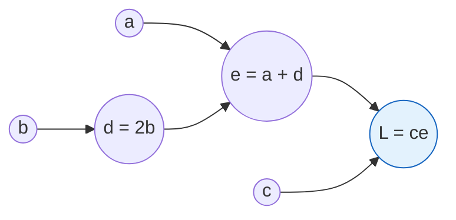

A feedforward neural network is a multilayer network of computational units in which the output of each layer is the input to the next and the connections form no cycles. Each unit applies a nonlinear activation function to a weighted sum of its inputs plus a bias. Chapter 7 of [SLP3](https://web.stanford.edu/~jurafsky/slp3/7.pdf) treats these networks as classifiers for NLP.

On the same [[ml/nlp/reading/classification|classification]] problems, the nonlinear hidden layers generalize the linear decision boundaries of [[ml/nlp/reading/multinomial-logistic-regression|multinomial logistic regression]], and the network learns representations of the input from data in place of hand-crafted features.

## Activation Functions

A single computational unit $z = w \cdot x + b$ is a linear function of the input $x$ with weights $w$ and bias $b$. The output $y$ is a non-linear function $f(z)$, where $f$ is the activation function (typically one of $\tanh$, $\text{ReLU}$, or $\sigma$).

$$
y = \sigma(w \cdot x + b) = \frac{1}{1 + e^{-(w \cdot x + b)}}
$$

SLP3 notes that $\sigma$ is rarely the preferred activation in practice, and that $\tanh$, a scaled version of $\sigma$ ranging from $-1$ to $1$, is similar and almost always works better.

$$
y = \tanh(w \cdot x + b) = \frac{e^{w \cdot x + b} - e^{-(w \cdot x + b)}}{e^{w \cdot x + b} + e^{-(w \cdot x + b)}}
$$

The simplest activation function is the Rectified Linear Unit (ReLU), which is $0$ for negative inputs and linear for positive inputs.

$$
y = \text{ReLU}(w \cdot x + b) = \max(0, w \cdot x + b)
$$

ReLU has a low computational cost, and it does not saturate for large positive inputs as $\sigma$ and $\tanh$ do. Saturation causes the vanishing gradient problem, in which gradients near $0$ leave the weights nearly unchanged during training.

## The XOR Problem

A single computational unit cannot solve XOR, because a single unit draws a linear decision boundary and XOR is not linearly separable. A two-layer network can solve it, since the hidden layer re-represents the input in a space where the problem becomes linearly separable.

$$
y = \begin{cases}
1 & \text{if } w \cdot x + b > 0 \\
0 & \text{otherwise}
\end{cases}
$$

Of the four inputs to XOR, $(x_1, x_2) = (0, 0)$ and $(1, 1)$ are in one class, while $(0, 1)$ and $(1, 0)$ are in the other, and no straight line separates the two classes.

## Feedforward Neural Networks

A feedforward NN is a multi-layer network where the output of each layer is the input to the next layer, with no cycles. Such networks are sometimes called multilayer perceptrons (MLPs), although that term technically applies only to networks whose units use a step function as the activation.

The network has three types of nodes.

### Input units

The vector of input units is $x$, with one node for each feature of the input.

### Hidden layers

A network has one or more layers of hidden units, each with a non-linear activation function. In a fully connected layer, each node is connected to all nodes in the previous layer, so each hidden unit sums over all input values.

For a given hidden layer, the weights $w$ and biases $b$ of its computational units are combined into a weight matrix $W$ and bias vector $b$. Each element $W_{ji}$ of the weight matrix is the weight from the $i$th input unit $x_i$ to the $j$th hidden unit $h_j$.

The output of a hidden layer with activation function $f$ is:

$$
h = f(W \cdot x + b)
$$

#### Dimensionality

The input layer is layer $0$, and $n_0$ is the number of input units, so the input is a column vector $x \in \mathbb{R}^{n_0}$ with dimension $n_0 \times 1$.

The first hidden layer $h^{(1)}$ has $n_1$ hidden units, so $W \in \mathbb{R}^{n_1 \times n_0}$ and $b \in \mathbb{R}^{n_1}$.

$$
h_j = f\left(\sum_{i=1}^{n_0} W_{ji} x_i + b_j\right)
$$

### Output units

The output layer is the final layer of the network. Its output $y$, with $\dim(y) = n_{\text{output}}$, is an estimate of the probability distribution over classes.

#### Normalization

The softmax function normalizes the output of the network into a probability distribution:

$$
y = \text{softmax}(W \cdot h + b)
$$

$$
\text{softmax}(z)_i = \frac{e^{z_i}}{\sum_{j=1}^n e^{z_j}}
$$

### Comparison with MLR

A feedforward network differs from MLR in three respects:

- It has many layers, and a deep network resembles a stack of MLR classifiers.
- Its intermediate layers have non-linear activation functions. Without them the network would be a linear classifier, since a composition of linear functions is linear.
- In place of selected features, its earlier layers build a representation of the input that is useful to the final layer.

### Details/Notation

- $*^{[l]}$ denotes a quantity associated with the $l$th layer, e.g. $W^{[l]}$ is the weight matrix for the $l$th layer. These indices are 1-indexed.
- $n_l$ is the number of units in layer $l$.
- $g(.)$ is the activation function, which tends to be $\tanh$ or ReLU for hidden layers, and softmax for the output layer.
- $a^{[l]}$ is the output from layer $l$
- $z^{[l]}$ is the input to the activation function in layer $l$, e.g. $z^{[l]} = W^{[l]} \cdot a^{[l-1]} + b^{[l]}$
- $x = a^{[0]}$ is the input vector

#### Example: 2-layer NN

$$
\begin{aligned}
z^{[1]} &= W^{[1]} \cdot a^{[0]} + b^{[1]} \\
a^{[1]} &= g^{[1]}(z^{[1]}) \\
z^{[2]} &= W^{[2]} \cdot a^{[1]} + b^{[2]} \\
a^{[2]} &= g^{[2]}(z^{[2]}) \\
\hat{y} &= a^{[2]}
\end{aligned}
$$

### Feedforward Computation

For $l = 1, \ldots, L$:

$$
z^{[l]} = W^{[l]} \cdot a^{[l-1]} + b^{[l]}, \qquad a^{[l]} = g^{[l]}(z^{[l]})
$$

then return $\hat{y} = a^{[L]}$.

```python
def feedforward(x):
  a = x
  for l in range(1, L):
    z = W[l] @ a + b[l]
    a = g[l](z)
  return a
```

### Replacing the Bias

Often the bias term is folded into the weight matrix by appending a constant $1$ to the input vector.

With $a^{[0]}_0 = 1$, we can write $z^{[l]} = W^{[l]} \cdot a^{[l-1]}$, where the column of $W$ that multiplies the constant plays the role of $b$:

$$
h_j = f\left(\sum_{i=0}^{n_0} W_{ji} x_i\right)
$$

## FF networks for NLP: Classification

In place of manually designed features, the input can be represented with word embeddings such as word2vec or GloVe. Using embeddings computed in advance in this way is a form of pretraining. A sentence can be represented by the sum or the average of the embeddings of its words.

To classify many examples at once, the inputs are packed into a single matrix $X$ where each row $i$ is an input vector $x^{(i)}$. If each input has $d$ features, then $X \in \mathbb{R}^{m \times d}$ where $m$ is the number of examples.

$W \in \mathbb{R}^{d_h \times d}$ is the weight matrix for the hidden layer, $b \in \mathbb{R}^{d_h}$ is the bias vector, and $U$ is the output layer weight matrix. $Y \in \mathbb{R}^{m \times n_{\text{output}}}$ is the output matrix.

$$
\begin{aligned}
H &= f(X W^T + b) \\
Z &= H U^T\\
\hat{Y} &= \text{softmax}(Z)
\end{aligned}
$$

## Training Neural Nets

Training learns the parameters $W^{[i]}$ and $b^{[i]}$ for each layer $i$ that make $\hat{y}$ as close as possible to the true $y$.

### Loss Function

The loss is the cross-entropy loss, as for MLR.

For binary classification:

$$
L_{\text{CE}}(\hat{y}, y) = - \log p(y | x) = - \left [ y \log \hat{y} + (1 - y) \log (1 - \hat{y}) \right ]
$$

For multi-class classification with a one-hot true label $y$, the sum collapses to the log probability of the correct class $c$:

$$
L_{\text{CE}}(\hat{y}, y) = - \sum_{i=1}^n y_i \log \hat{y}_i = - \log \hat{y}_c
$$

Written in terms of the logit $z_c$ for the correct class:

$$
L_{\text{CE}}(\hat{y}, y) = -\log \frac{\exp(z_{c})}{\sum_{i=1}^K \exp(z_i)}
$$

### Backpropagation

Backpropagation computes the gradient of the loss with respect to each weight by applying the chain rule backward through the network. Each node in a computation graph takes an **upstream** gradient and computes its **local** gradient, multiplying the two to get the **downstream** gradient. A node may have multiple local gradients, one for each incoming edge.

#### Example

For the function $L(a, b, c) = c(a + 2b)$, the computation graph has nodes $a, b, c$ for the inputs, and $d = 2b, e = a + d, L = ce$ for the intermediate computations.



$$
\begin{aligned}
\frac{\partial L}{\partial c} &= e = a + 2b \\
\frac{\partial L}{\partial a} &= \frac{\partial L}{\partial e} \cdot \frac{\partial e}{\partial a} = c \\
\frac{\partial L}{\partial b} &= \frac{\partial L}{\partial e} \cdot \frac{\partial e}{\partial d} \cdot \frac{\partial d}{\partial b} = 2c
\end{aligned}
$$

### Learning details

The optimization problem for a neural network is non-convex, and training relies on the following practices:

- Initialize weights and biases to small random values instead of all zeros
- Normalize input values to $\mu = 0, \sigma = 1$
- Dropout: randomly (with probability $p$) set some hidden units to 0, then renormalize other inputs to prevent overfitting
- Hyperparameters: learning rate, mini-batch size, number of hidden units, number of layers, choice of activation function, etc.

## Related notes

- [[ml/deep-learning/neural-networks-from-scratch|Neural Networks from Scratch]]
- [[ml/deep-learning/neural-networks-from-scratch|Neural Networks from Scratch and the MNIST experiment]]
- [[ml/deep-learning/recurrent-neural-networks|Recurrent Neural Networks]]
- [[ml/deep-learning/neural-networks-from-scratch|Manual Gradients and Autodiff]]

## Sources

- [Jurafsky & Martin, Speech and Language Processing (3rd ed. draft), Neural Networks chapter](https://web.stanford.edu/~jurafsky/slp3/7.pdf)
