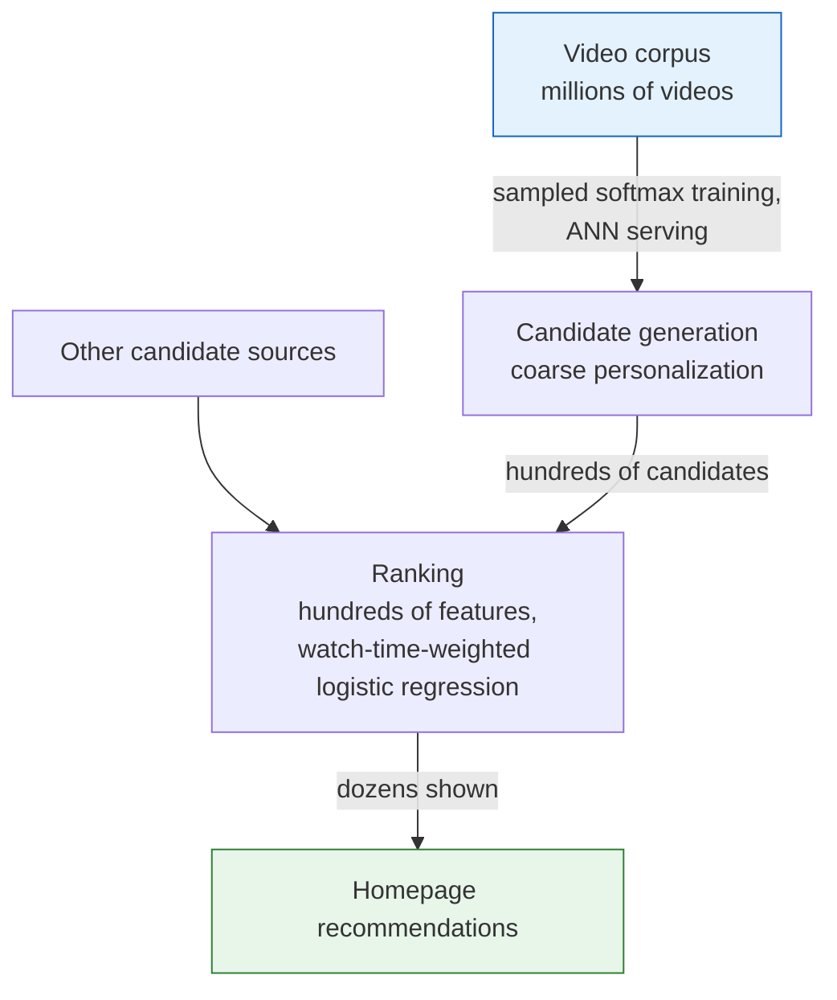

[Covington, Adams, and Sargin (2016)](https://research.google.com/pubs/archive/45530.pdf) describe the two-stage deep neural network system that YouTube used to generate homepage recommendations. Candidate generation reduces millions of videos to hundreds through a sampled-softmax model served with approximate nearest-neighbor search. A separate neural ranker then orders those candidates using hundreds of features and a watch-time-weighted objective.

The paper is a case study of the production system as of 2016, and YouTube's current architecture may differ from it.

| Stage | Input scale | Model and objective | Serving output |
| --- | ---: | --- | --- |
| Candidate generation | Millions of videos | Feed-forward network trained to predict a future watch with sampled softmax | Hundreds of candidates retrieved by approximate nearest-neighbor search |
| Ranking | Hundreds of candidates | Feed-forward network with rich user-video features and watch-time-weighted logistic loss | A few dozen ordered recommendations |

## Citation

- [Deep Neural Networks for YouTube Recommendations (Covington, Adams, and Sargin, RecSys 2016)](https://research.google.com/pubs/archive/45530.pdf)

## The Setup

YouTube's corpus contains millions of videos, and recommendations must be produced within a tight latency budget. The paper frames recommendation as two distinct problems:

1. **Candidate generation** reduces the corpus from millions of videos to a few hundred.
2. **Ranking** scores those candidates with a richer feature set and orders them for display.

Many later recommender systems adopt the same division. Scoring the full catalog with the most accurate model would exceed the latency budget, so a model of lower computational cost selects the candidates to which the more expensive model is applied.

> [!quote] Why ranking gets richer features
> "During ranking, we have access to many more features describing the video and the user's relationship to the video because only a few hundred videos are being scored rather than the millions scored in candidate generation."
> — [Covington, Adams, and Sargin (2016)](https://research.google.com/pubs/archive/45530.pdf), section 4

## Candidate Generation

The candidate generator is trained as a multiclass classification problem over the video catalog. Given a user context, the model predicts the next video the user will watch. At serving time, the softmax itself is not used directly. Instead, the trained model produces embeddings and an approximate nearest-neighbor lookup returns the top candidates.

The reason is computational. Scoring all of millions of items would exceed the serving latency budget, so the model is trained with sampled softmax and served through nearest-neighbor search in dot-product space.

### Candidate Model Architecture

The candidate model is a feed-forward network built around learned ID embeddings.

- video watches are represented as a variable-length bag of watched video IDs
- searches are represented as a variable-length bag of unigram and bigram query tokens
- each sparse ID space gets an embedding table
- multivalent histories are averaged into fixed-width dense vectors before entering the MLP
- demographic and device features are concatenated as additional dense inputs

The paper's main experiment uses:

- a vocabulary of **1M videos**
- a vocabulary of **1M search tokens**
- **256-dimensional** embeddings
- a maximum bag size of **50 recent watches** and **50 recent searches**
- a softmax over the same **1M** video classes, with output dimension **256**

The hidden layers follow a tower pattern where width shrinks with depth:

- depth 0: linear projection to the 256-dimensional softmax space
- depth 1: `256 ReLU`
- depth 2: `512 ReLU -> 256 ReLU`
- depth 3: `1024 ReLU -> 512 ReLU -> 256 ReLU`
- depth 4: `2048 ReLU -> 1024 ReLU -> 512 ReLU -> 256 ReLU`

The model is a bag-of-IDs encoder followed by an MLP, trained end to end. Because of the averaging step, the model is insensitive to the order of videos within the watch-history bag, and it represents coarse preferences more accurately than local sequential structure.

### Training and Serving Path

The training and serving procedures are part of the architecture.

- The model is trained with **sampled softmax** with **several thousand sampled negatives** per example.
- The authors report **more than 100x speedup** relative to a full softmax over the catalog.
- At serving time, calibrated softmax probabilities are not computed, and candidates are retrieved by **approximate nearest-neighbor search in dot-product space**.

The model is therefore trained as an extreme multiclass classifier and deployed as an embedding retriever.

The user side is built from several signals:

- watched video IDs
- search tokens
- demographics and geography
- coarse context

Those sparse features are embedded and averaged into fixed-width vectors before passing through a feed-forward network. As a consequence, the input to the network is an unordered bag of interactions and carries no information about their order.

## Why the Surrogate Task Matters

The paper gives particular attention to the construction of training labels.

Homepage recommendation has no natural labels, since the only observations are what users watched after seeing a page that an earlier policy generated. The authors therefore choose a surrogate objective, the prediction of a future watch, and transfer that objective to homepage recommendation.

They also observe that giving the model too much information can lead it to fit the surrogate task in a way that does not transfer. If the current search query or page structure reveals the label too directly, the classifier learns artifacts of the interface instead of user preference. In the paper's example with search traffic, reproducing the user's last search page improves the surrogate metric but performs poorly as a homepage recommender.

The supervised target that is easiest to fit offline is therefore not necessarily the one that transfers best to online performance.

## Freshness and Example Age

The candidate model includes **example age**, roughly the gap between the training-window endpoint and the interaction time:

$$
\text{example age} = t_{\max} - t_N
$$

The feature corrects a bias toward older videos that the model otherwise exhibits. Without it, the model predicts approximately the average popularity over the training window, which underrepresents recently uploaded items whose popularity is still changing. Time-dependent popularity is part of the signal that the model must represent, and not noise around it.

## Ranking for Watch Time

The ranking model is a separate deep network with a much richer feature set. The paper reports that in practice it uses **hundreds of features**, including:

- impression video ID
- watched video IDs
- time since last watch
- counts of prior impressions
- normalized continuous features

### Ranking Model Architecture

The ranking network follows the same general design as candidate generation, with a larger feature set, which the latency budget permits because the ranker scores only a few hundred candidates instead of millions.

- categorical features are split into **univalent** features such as the impression video ID and **multivalent** features such as the bag of recently watched videos
- each ID space gets its own learned embedding table
- embedding dimension grows roughly with the **logarithm of vocabulary size**
- multivalent categorical features are **averaged** before entering the network
- features that share the same ID space also **share embeddings**

Under this design, a single global video-ID embedding table is reused across several features, such as:

- the impression video ID
- the last watched video ID
- a seed video ID from an upstream candidate source

The embeddings are shared, but the resulting feature channels are still fed separately so the upper layers can learn different roles for the same underlying ID space.

Continuous features are transformed as follows:

- each continuous feature is normalized to approximately uniform mass on $[0,1)$ using its empirical cumulative distribution
- the model receives $\tilde{x}^2$ and $\sqrt{\tilde{x}}$ in addition to $\tilde{x}$

The paper reports a **0.2%** loss increase when those powers are removed from the best ranking model.

For hidden layers, the best configuration in Table 1 is:

- `1024 ReLU -> 512 ReLU -> 256 ReLU`

The output layer is trained with logistic loss, then exponentiated at inference to produce odds that approximate expected watch time.

The prediction target is expected watch time and not click probability. Positive examples are weighted by watch time and negative examples receive unit weight, so the logistic regression becomes a watch-time-sensitive classifier whose learned odds approximate expected watch time closely enough to optimize the product metric more effectively than CTR prediction alone.

CTR can be inflated by short, low-value clicks, and a recommender that optimizes CTR directly tends to promote videos that attract clicks without sustained viewing.

> [!quote] The paper's argument against CTR
> "Ranking by click-through rate often promotes deceptive videos that the user does not complete ('clickbait') whereas watch time better captures engagement."
> — [Covington, Adams, and Sargin (2016)](https://research.google.com/pubs/archive/45530.pdf), section 4

## Experimental Results

In the ranking experiments, hidden layers reduce the loss substantially. On the paper's next-day holdout metric, the no-hidden-layer baseline has **41.6%** weighted per-user loss, while the best three-layer stack in Table 1 reaches **34.6%**. Weighting positive and negative examples equally increases the loss by **4.1%** in the authors' comparison.

The candidate-generation experiments show a similar pattern. The depth-zero model, which the authors describe as effectively a linear factorization scheme, performs similarly to earlier matrix-factorization systems. Adding search features, example age and deeper ReLU stacks raises holdout MAP substantially. The authors conclude that depth allows the model to use heterogeneous features by learning interactions between them, beyond adding capacity in general.

Two inferences follow:

- depth helps because the feature interactions are not close to linear
- watch-time weighting helps because the business objective is not simple CTR

## Design Lessons

- Retrieval and ranking are separate stages from the start of the design.
- The choice of training label is a systems decision as well as a statistical one.
- Freshness features are added explicitly when the catalog changes quickly.
- When clicks are a poor proxy for value, the ranker optimizes a downstream value signal such as watch time.
- For a very large catalog, the serving path is kept simple. The model can be trained with a softmax and served through ANN search when that is what the latency budget allows.

## Related Notes

- [[ml/recommender-systems/retrieval-and-ranking|Retrieval and Ranking]]
- [[ml/recommender-systems/two-tower-retrieval|Two-Tower Retrieval]]
- [[ml/recommender-systems/wide-and-deep|Wide and Deep]]
- [[ml/recommender-systems/predicting-clicks-on-ads-at-facebook|Practical Lessons from Predicting Clicks on Ads at Facebook]]

## Sources

- [Covington, Adams, and Sargin (2016), Deep Neural Networks for YouTube Recommendations](https://research.google.com/pubs/archive/45530.pdf)
