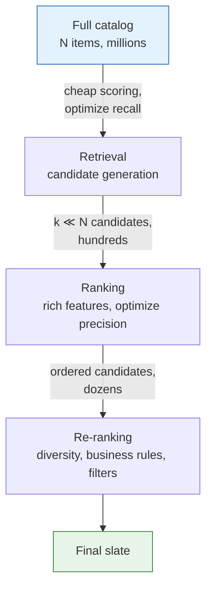

A retrieval-and-ranking pipeline is a cascade of models in which a retrieval stage with low per-item cost selects $k \ll N$ candidates from a catalog of $N$ items, and a ranking stage with higher per-item cost orders them. A re-ranking stage may then apply diversity, business and policy constraints.

Large recommender systems use this structure because scoring the full catalog with the most accurate model would exceed the latency budget of a request.

## Why the Pipeline Splits

Suppose the catalog has $N$ items and the most accurate ranker costs $c_r$ to score one item. Full scoring costs

$$
N c_r
$$

per request. If a first stage of low cost reduces the catalog to $k \ll N$ candidates, the expensive stage costs

$$
k c_r
$$

This reduction in cost per request is the reason for the split.

The retrieval stage spends little computation per item and is designed to retain relevant candidates. The ranking stage spends much more computation per item and is designed to order those candidates accurately.

## Retrieval Is a Recall Problem

Retrieval requires no calibrated score. Its objective is to avoid discarding items that the ranker would have scored highly.

Common candidate sources include:

- recent popularity
- item-item or user-item collaborative signals
- content similarity
- follow graph or creator graph heuristics
- two-tower embedding retrieval with ANN
- rule-based pools such as new items or inventory-constrained buckets

Production systems usually take the union of candidates from several sources, because each source has a different failure mode:

- popularity misses niche intent
- collaborative filtering performs poorly under cold start
- content similarity misses cross-topic transitions
- ANN retrieval inherits the gaps in coverage of its embedding space

## Cold Start and Side-Information Bootstrapping

Most of the retrieval sources above depend on interaction history that a new item or a new user does not yet have. Popularity signals require past exposure, and collaborative signals require past co-occurrence. A new item has neither, and a system that relies only on interaction data never retrieves it.

Schein, Popescul, Ungar, and Pennock address the problem by incorporating side information into the same latent-variable model used for warm items, instead of adding a separate cold-start path. Their two-way aspect model shares latent classes between a person/movie interaction matrix and item content (such as cast or genre), so a new movie can be placed into the latent space by its content alone, then scored against every user's latent preferences as if it had interaction history. The mechanism generalizes beyond that model. Any retrieval or ranking component that learns an embedding space can place a cold item in that space by encoding its content features, without waiting for behavioral signal to accumulate.

Two consequences follow for pipeline design:

- retrieval should keep a dedicated content-similarity or metadata-based source, so that new items can enter the candidate set independently of the collaborative sources
- ranking features for a cold item should be designed for missing history instead of silently defaulting to zero or to the population mean, since a mean-imputed quality score for a new item is indistinguishable from the score of an item of average quality

User cold start is the symmetric problem. A new user has no history on which collaborative retrieval can operate, so early sessions typically rely on registration-time signals (stated interests, device, referral source) until enough interactions accumulate for behavioral retrieval to be useful.

## Ranking Is a Precision Problem

Ranking runs once the candidate set is small enough to justify richer features, which often include:

- detailed user history
- contextual features
- item freshness
- quality or trust signals
- business constraints
- calibrated historical statistics

The objective may be click probability, conversion, watch time, revenue, or some weighted combination. The score must be adequate for the downstream decision rule, which in some systems requires calibrated probabilities and in others only a correct order at the top of the list.

## Model Requirements of Retrieval and Ranking

One architecture rarely suits both stages.

Retrieval requires models with:

- decomposable scoring
- precomputable item representations
- low-cost ANN serving

Ranking benefits from models with:

- rich cross features
- calibration
- constraint handling
- interpretability for debugging and business logic

Systems therefore often pair a two-tower retriever with a feature-rich ranker.

## Candidate Blending and Source-Budget Allocation

Retrieval commonly returns too many candidates from some sources and too few from others, and candidate blending controls the mix.

A retriever often reserves part of its candidate budget for:

- head items
- fresh items
- long-tail exploration
- follow-graph items
- advertiser or supplier obligations

A common implementation caps the number of the final $k$ candidates that each source may contribute, for example at most 40% from popularity, at least 10% reserved for items younger than some age threshold, and a fixed floor for any source tied to a business obligation such as a paid placement or a supplier commitment. Without an explicit cap, the source with the least expensive and highest-precision scoring function displaces the others, because a step that takes the union and truncates by score favors the source whose scores are highest on that common scale, which need not be the source the ranker most needs.

The exploration-exploitation tradeoff described in [[ml/recommender-systems/bias-and-marketplace-effects|Bias, Marketplace Effects, and Counterfactual Evaluation]] also appears here. The long-tail exploration budget is the retrieval-stage mechanism that keeps $\pi_0(a\mid x) > 0$ for actions that a purely exploitative retriever would never select, which is a precondition for later counterfactual evaluation of a change that favors those items.

Without explicit management of source blending, the candidate set tends to concentrate in a narrow region of the catalog.

## Calibration versus Rank-Order Quality

A ranker can order candidates accurately and still be badly miscalibrated, and the two failures have different symptoms. Rank-order quality (measured by a metric such as NDCG or AUC) concerns only whether higher-relevance items score above lower-relevance ones. Calibration concerns whether the predicted score is correct in absolute terms, for example whether impressions with a predicted 5% click probability are clicked 5% of the time.

He et al. define calibration for ad click prediction as the ratio of the average predicted CTR to the average empirical CTR, with 1.0 indicating perfect calibration. Calibration matters because many downstream systems use the score as a probability as well as an order. An ad auction multiplies predicted CTR by bid to rank ads and to set the price the winner pays. A budget pacer divides a spend target by predicted CTR to decide how aggressively to bid. A content quality gate might filter out anything below a fixed predicted-engagement threshold. All three fail if the score is well ordered but systematically inflated or deflated, although a pure ranking metric such as NDCG would show no change.

Three consequences follow for pipeline design:

- retrieval needs only rank-order quality, since it discards items and prices nothing
- ranking needs calibration whenever its output feeds an auction, a budget system, or a hard threshold, and needs it in addition to rank-order quality
- calibration typically needs periodic recalibration (such as a monotonic recalibration curve fit on held-out data) because background rates drift with seasonality, inventory mix, and the model's own retraining cadence, while rank-order quality is comparatively stable to those drifts

## Post-Ranking Reranking for Diversity, Policy, and Supply Constraints

After the main score is computed, systems often apply further steps:

- duplicate suppression
- diversity heuristics
- business rules
- supplier exposure constraints
- hard filters for policy or safety

Carbonell and Goldstein's Maximal Marginal Relevance (MMR) formalizes diversity reranking. It selects items one at a time, at each step picking the candidate that maximizes

$$
\mathrm{MMR} = \arg\max_{D_i \in R \setminus S} \Bigl[ \lambda \cdot \mathrm{Sim}_1(D_i, Q) - (1-\lambda) \max_{D_j \in S} \mathrm{Sim}_2(D_i, D_j) \Bigr]
$$

where $R$ is the ranked candidate set, $S$ is what has already been selected for the slate, $\mathrm{Sim}_1$ measures relevance to the query or user profile, and $\mathrm{Sim}_2$ measures similarity between two candidates. At $\lambda = 1$ this reduces to the plain ranked list. At $\lambda = 0$ it greedily maximizes diversity and ignores relevance. Recommenders typically use $\lambda$ between roughly 0.5 and 0.8, so that reranking preserves most of the ranker's ordering while preventing near-duplicates from occupying the top five slots of the slate.

Supplier exposure constraints and policy filters are composed with MMR-style reranking. A typical pipeline first removes hard-filtered items (policy violations, out-of-stock inventory), then applies exposure floors or caps as constraints on the items eligible for each slot, and then runs diversity reranking over the remainder. Applying the steps in the wrong order, for example diversifying before applying hard filters, spends reranking computation on items that are later removed.

The layering reflects that recommendation is allocation under constraints as well as prediction.

## Failure Modes at the Boundary

> [!warning] The boundary hides failures
> A ranker can order only the candidates that retrieval supplies. If recall drops or the candidate mix concentrates on popular items, end-to-end metrics degrade while the dashboards of each stage show no fault.

Many undetected failures occur at the boundary between retrieval and ranking.

- Retrieval recall is low, so relevant items never reach the ranker.
- The retrieval embedding space concentrates around popular items.
- The ranker optimizes a metric that the retriever did not preserve.
- The candidate mix is too homogeneous, so downstream ranking cannot restore diversity.
- Logged training data reflects old retrieval decisions, so both stages reinforce the same bias.

When a recommender's output becomes stale without an evident cause, the problem often lies at this boundary and not in the final ranker.

### A Concrete Failure Case

Suppose a two-tower retriever is trained purely on click logs and the ranker is trained on the same logs to predict conversion given a click. Six months after launch, an operations team runs a promotion that increases one category's exposure for two weeks. Clicks on that category rise sharply, and the next retriever refresh, trained on logs that include the promotion period, moves the item and user embeddings for that category closer together in the shared embedding space, since nothing in the training data distinguishes clicks caused by the promotion from clicks caused by preference.

After the promotion ends, the retriever continues to over-retrieve that category, because the shift in the embeddings persists beyond the event that caused it. The ranker receives more candidates from that category and learns from the resulting impressions that the category performs adequately, since it competes mostly against other candidates the retriever selected. End-to-end CTR stays flat or rises slightly, because the ranker orders the candidates it receives reasonably well. Category-level recall against a held-out relevance judgment, or a source-coverage metric tracked at the retrieval stage, would have shown the concentration immediately. End-to-end CTR does not, because it is computed only over the items that were retrieved.

## What to Measure

Each stage has its own metrics, and each metric should have an owner and an alert threshold in addition to a dashboard:

| Stage | Metric | What it catches | Blind to |
|---|---|---|---|
| Retrieval | candidate recall against held-out relevant items | items the ranker never gets a chance to see | how well those items get ordered |
| Retrieval | source coverage (share of final slate by candidate source) | one source silently crowding out the others | quality within a source |
| Retrieval | tail coverage (share of slate outside the head-popularity band) | popularity collapse | whether tail items were actually good matches |
| Retrieval | ANN latency and recall@k tradeoff | approximate search degrading below its target operating point | anything about ranking quality |
| Ranking | calibration (predicted vs. empirical rate) | scores that are well-ordered but wrong in an absolute sense | rank-order quality itself |
| Ranking | top-k engagement, watch time, conversion | whether the final ordering serves the actual objective | upstream candidate quality |
| Ranking | business metrics (revenue, supplier exposure balance) | allocation failures invisible to engagement metrics alone | user-side relevance |

A system that measures only end-to-end CTR cannot determine which stage degraded, as in [the failure case above](#a-concrete-failure-case).

## Related Notes

- [[ml/recommender-systems/two-tower-retrieval|Two-Tower Retrieval]]
- [[ml/recommender-systems/wide-and-deep|Wide and Deep]]
- [[ml/recommender-systems/bias-and-marketplace-effects|Bias, Marketplace Effects, and Counterfactual Evaluation]]
- [[ml/recommender-systems/two-tower-retrieval|Two-Tower Retrieval and the MovieLens 100K experiment]]
- [[ml/nlp/reading/information-retrieval|Indexing and Information Retrieval]]

## Sources

- [Covington, Adams, and Sargin (2016), Deep Neural Networks for YouTube Recommendations](https://research.google.com/pubs/archive/45530.pdf)
- [Cheng et al. (2016), Wide & Deep Learning for Recommender Systems](https://arxiv.org/pdf/1606.07792)
- [Schein, Popescul, Ungar, and Pennock (2002), Methods and Metrics for Cold-Start Recommendations](http://dpennock.com/papers/schein-sigir-2002-cold-start.pdf)
- [Carbonell and Goldstein (1998), The Use of MMR, Diversity-Based Reranking for Reordering Documents and Producing Summaries](https://www.cs.cmu.edu/~jgc/publication/MMR_DiversityBased_Reranking_SIGIR_1998.pdf)
- [He et al. (2014), Practical Lessons from Predicting Clicks on Ads at Facebook](https://quinonero.net/Publications/predicting-clicks-facebook.pdf)
