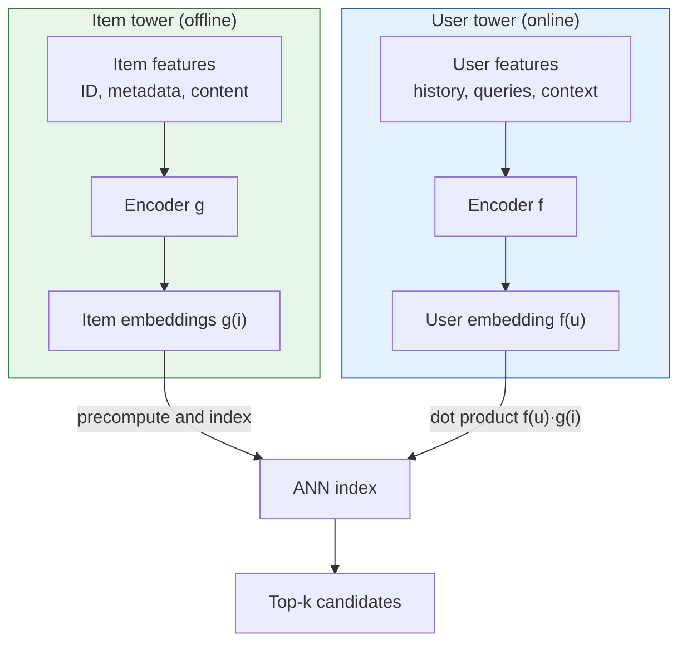

Two-tower retrieval is a candidate-generation architecture with two encoders. One tower maps the user or query to an embedding, the other maps each item to an embedding in the same space, and the retrieval score is a similarity between the two embeddings, typically their dot product.

The score depends on the user and the item only through embeddings computed separately, so it cannot represent interactions between user features and item features. In return, the item embeddings can be computed offline and indexed for approximate nearest-neighbor (ANN) search, and the cost of serving a request grows sublinearly with the size of the catalog. Large recommendation systems use the architecture as their first stage for this reason.

## The Basic Form

Let $f(u)$ be the user embedding and $g(i)$ the item embedding. Retrieval uses

$$
s(u,i) = f(u)^\top g(i)
$$

or a nearby similarity such as cosine similarity.

At training time, both towers are learned jointly from historical interactions. At serving time, item embeddings are precomputed and indexed, and each request requires three steps:

1. build the user embedding
2. query an ANN index
3. return the top $k$ items

A search over the full catalog is thereby replaced by a sublinear nearest-neighbor search.

## Decomposition and Serving Cost

The score decomposes into a user encoder and an item encoder that are evaluated independently. Because the item tower runs offline, the online cost of retrieval consists of one user-tower evaluation and one ANN lookup, with negligible additional computation.

The architecture forgoes cross-feature interactions between user and item, and in exchange retrieval over the full catalog becomes feasible within a serving budget.

If the item tower read user features at scoring time, or the user tower read item features for every candidate, the item embeddings could no longer be precomputed and indexed, and the decomposition would provide no reduction in serving cost.

## Training

Training is commonly described in two formulations, which optimize closely related objectives.

### Softmax View

The YouTube paper frames candidate generation as multiclass classification over the video vocabulary. The model predicts which item the user will consume next, and is trained with sampled softmax because a softmax over the full catalog is too expensive to compute.

### Contrastive View

The same setup can be read as contrastive learning. Given a positive pair $(u,i^+)$ and sampled negatives $\{i^-\}$, training increases the positive item's dot product relative to those of the negatives.

In both formulations the model learns an embedding space in which relevant items lie near the user vector.

## Feature Design

The user tower typically takes as input:

- recent interactions
- search queries
- demographics or locale
- device and temporal context

The item tower typically takes as input:

- item ID
- metadata
- text
- image or audio features
- creator or taxonomy information

Context that depends jointly on the user and the item can enter the score only by breaking the tower decomposition. A model whose score is not a function of separately computed embeddings cannot be served from a precomputed ANN index, and its retrieval cost grows with the number of candidates scored.

## What It Gives Up

Two-tower models cannot express arbitrary user-item feature crosses at retrieval time. All information about the pair passes through the embedding dimension and the similarity function, which limit what the score can represent. As a consequence:

- memorized exception rules are difficult to represent
- the scores are typically poorly calibrated
- business constraints are awkward to encode directly
- exposure balancing and multi-objective tradeoffs are usually deferred to later stages

For these reasons, large systems use a separate and more expressive model for final ranking.

## Hard Negatives Matter

A weak negative sampler teaches the model only coarse separation. The embeddings learn to separate a watched item from random catalog items, but not to separate one plausible item from another.

Training with harder negatives addresses this. Common sources of hard negatives are:

- in-batch negatives
- co-exposed but skipped items
- items retrieved by a previous model and rejected downstream
- semantically close items

> [!warning] Very hard negatives become false negatives
> Items that are semantically close to the positive, or co-exposed and skipped, are often items the user would have liked if they had noticed them. Training against them as negatives pushes apart pairs that should stay close.

Very hard negatives can, however, be false negatives, and training against them pushes apart items the user would have liked had they seen them.

## How It Fits the Pipeline

Two-tower retrieval does not determine the final order of results, and its objective is recall. An effective retrieval stage returns most of the items the ranker would place highly while remaining within the latency budget.

The stage is evaluated accordingly. Absolute calibration has little effect on its output, and the relevant measures are candidate recall, diversity of candidate sources and coverage of the tail of the catalog.

## Executable Experiment

The companion notebook turns MovieLens 100K ratings into implicit positives, trains user and item towers with sampled negatives, and evaluates retrieval with Recall at $K$. It also inspects nearest items in the learned embedding space.

[Run the MovieLens two-tower experiment](/ml/recommender-systems/movielens-100k-two-tower-retrieval.ipynb)

## When Not to Use It

A two-tower model is poorly suited to applications that require slate-level reasoning or precise feature interactions. If the catalog is small enough to score directly with a richer model, or if every decision depends on inventory, auction dynamics or complex constraints, the accuracy lost to the tower decomposition may outweigh its reduction in serving cost.

## Related Notes

- [[ml/recommender-systems/retrieval-and-ranking|Retrieval and Ranking]]
- [[ml/recommender-systems/deep-neural-networks-for-youtube-recommendations|Deep Neural Networks for YouTube Recommendations]]
- [[ml/recommender-systems/wide-and-deep|Wide and Deep]]

## Sources

- [Covington, Adams, and Sargin (2016), Deep Neural Networks for YouTube Recommendations](https://research.google.com/pubs/archive/45530.pdf)
- [Huang et al. (2013), Learning Deep Structured Semantic Models for Web Search using Clickthrough Data](https://dl.acm.org/doi/10.1145/2505515.2505665)
