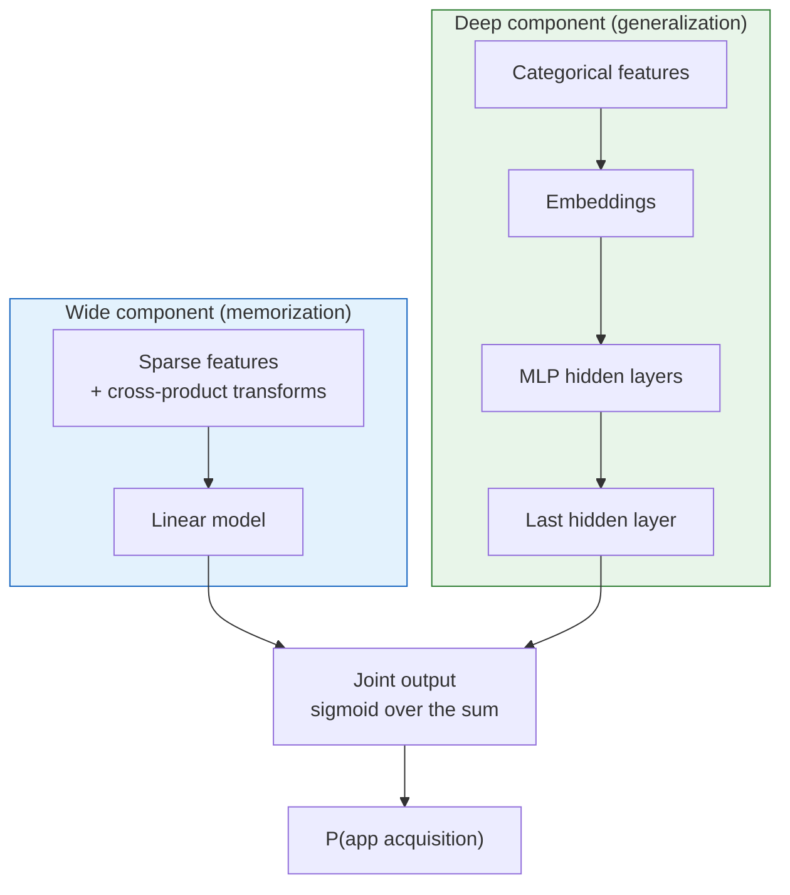

Wide & Deep ([Cheng et al., 2016](https://arxiv.org/pdf/1606.07792)) is a recommendation model that jointly trains a linear model over sparse raw and crossed features (the wide component) and a feed-forward network over feature embeddings (the deep component), and sums their outputs before a single sigmoid.

The architecture reflects a property of sparse interaction logs. A model trained on them must memorize rare but valuable feature crosses, and it must also generalize to feature combinations that do not occur in training. The wide component provides the first and the deep component the second.

## The Tension

A linear model over cross features is suited to memorization. If "installed Netflix" and "shown Pandora" is a historically useful combination, the model can assign weight to exactly that conjunction.

A deep embedding model is suited to generalization. If a user has interacted with many video apps but not this exact music app, embeddings may still place the new app in a compatible region of representation space.

Each component has a limitation when used alone.

- A wide-only model captures only the interactions encoded by the crosses the feature engineer has specified.
- A deep-only model can over-generalize, particularly when the user-item interaction matrix is sparse and high-rank, with many niche preferences and exception rules.

## Architecture

The paper combines the two components in one model:

$$
\hat{y} = \sigma\left(w_{\text{wide}}^\top x_{\text{wide}} + w_{\text{deep}}^\top a^{(L)} + b\right)
$$

where:

- $x_{\text{wide}}$ contains sparse raw and crossed features
- $a^{(L)}$ is the last hidden representation of the deep tower
- both parts are trained jointly

The output unit thus draws on memorized conjunctions from the wide component and on distributed representations from the deep component.

## Memorization Versus Generalization

The paper defines the two effects as follows.

- **Memorization** means learning frequent co-occurrences from the observed data.
- **Generalization** means inferring useful behavior on feature combinations that were rare or unseen in training.

The distinction applies to recommender models generally. A model change that improves results only on frequent head traffic has most likely improved memorization, and a change that surfaces relevant but less obvious items has most likely improved generalization.

## Why Deep-Only Models Can Fail

Dense embeddings produce nonzero similarity for almost every user-item pair. In a sparse recommender problem this is incorrect for pairs that have no relationship, which should receive a score near zero.

> [!warning] Over-generalization in deep-only models
> Embedding geometry is smooth by construction, so a deep-only model produces recommendations for nearly every query, including queries for which no similar item is relevant. The wide component holds sharp exception rules that the embedding space would otherwise smooth over.

The wide component therefore stores exception rules that the smooth geometry of the embedding space would otherwise average away.

## What the Paper Found

The production setting is Google Play recommendations. The paper reports:

- over **1 billion** active users
- over **1 million** apps
- **+3.9%** relative gain in app acquisitions against the production control
- **+1%** relative gain over the deep-only model

The paper also reports serving performance. The authors report scoring **over 10 million apps per second** at peak traffic, with client-side latency reduced from **31 ms** to **14 ms** through multithreading and smaller batches.

A ranking model in a system of this size must meet throughput and latency requirements in addition to its quality targets.

## Where Wide and Deep Fits

The architecture is suited to the ranking stage rather than to retrieval, for three reasons.

- It can use richer impression-time features.
- It does not need the tower factorization required for ANN retrieval.
- It accepts tabular, sparse and dense features in one model.

It applies more computation per candidate to the much smaller set that remains after retrieval has pruned the catalog at low cost per item.

## What Replaced It, and What Did Not

Later recommenders often replace it with more elaborate architectures:

- deeper MLPs
- DCN-style cross layers
- mixture-of-experts blocks
- attention over history

These architectures address the same underlying tradeoff between memorizing sharp exceptions and generalizing beyond the logged data.

## Related Notes

- [[ml/recommender-systems/retrieval-and-ranking|Retrieval and Ranking]]
- [[ml/recommender-systems/two-tower-retrieval|Two-Tower Retrieval]]
- [[ml/recommender-systems/deep-neural-networks-for-youtube-recommendations|Deep Neural Networks for YouTube Recommendations]]

## Sources

- [Cheng et al. (2016), Wide & Deep Learning for Recommender Systems](https://arxiv.org/pdf/1606.07792)
