Batching in LLM serving executes the forward passes of several requests as one set of matrix multiplications, so that each weight read from memory is applied to many tokens. Batching strategies differ in when a request joins or leaves the batch and in whether prefill and decode share an iteration or a machine.

Batch size sets the operating point between the latency and throughput models in [[ml/serving-systems/performance-modeling|Performance Modeling]], and it is limited by the per-request KV-cache costs in [[ml/serving-systems/memory-management|Memory Management]].

The material began as notes for CSE 599K "LLM Serving Systems" at the University of Washington, Spring 2025, taught by Prof. Baris Kasikci with TA Kan Zhu. The specific latencies and capacity numbers come from lecture slides. I have not reproduced them, and the slides do not give the full measurement setup, so the numbers are illustrative.

## Core idea

An H100 requires a GEMM batch size of about 295 before it becomes compute bound (see the critical intensity derivation in [[ml/serving-systems/performance-modeling|Performance Modeling]]), so a serving system that decodes one request at a time leaves almost all of its FLOPs unused. Batching recovers that throughput at the cost of added latency, and batching strategies differ in how much latency they add and to which phase.

## User experience metrics

The latency side of the tradeoff is measured with the following quantities:

- Time to First Token (TTFT): time from request submission to the first generated token. TTFT = queuing time + prefill time.
- Time Per Output Token (TPOT, also called ITL or inter-token latency): gap between consecutive output tokens. Reported as an average or as a maximum.
- End-to-end time: queue + prefill + full decode.
- Normalized latency: end-to-end time divided by output token count.

Service level objectives combine these. An end-to-end deadline is the least restrictive target, since the system can redistribute time freely between prefill and decode. TTFT plus average TPOT is more restrictive. TTFT plus maximum TPOT is the most restrictive, because a single slow decode step violates it. When the SLO is deadline shaped, the server can deliberately delay token output to smooth generation, releasing buffered tokens at a steady rate that still meets the deadline.

## Batching strategies

### Simple batching

Simple batching forms a batch, runs prefill for all of its requests, then decodes them in lockstep until the last request finishes. Throughput is the lowest of the four strategies because the batch completes only when its longest decode does, and the slots of finished requests remain idle until then. TTFT and TPOT are short, and the implementation is simple.

### Continuous batching (Orca)

[Orca](https://www.usenix.org/conference/osdi22/presentation/yu) admits new requests at token granularity, assigning each decode slot to a waiting request as soon as the slot is freed. Requests do not wait for the longest request in the batch, so throughput rises, the GEMM batch size stabilizes, and queuing time drops. The disadvantage is interference between the phases. Prefills run inside the same iteration as decodes, so a large arriving prompt stalls every concurrent decode, and prefill itself waits on decode work.

The timelines below assume two decode slots, with R1 and R2 arriving at $t=0$ and R3 at $t=2$. Simple batching holds R1's finished slot idle and R3 in the queue until the whole batch drains, while continuous batching assigns the slot to R3 as soon as R1 finishes.

```mermaid
gantt
    dateFormat X
    axisFormat %s
    section Simple batching
    R1 decode      :done, 0, 4
    R1 slot idle   :crit, 4, 8
    R2 decode      :active, 0, 8
    R3 queued      :crit, 2, 8
    R3 decode      :8, 12
    section Continuous batching
    R1 decode      :done, 0, 4
    R2 decode      :active, 0, 8
    R3 queued      :crit, 2, 4
    R3 decode      :4, 8
```

The steady-state GEMM batch size follows from counting tokens. A request with prefill length $p$ and decode length $d$ remains in the batch for $d + 1$ iterations (one iteration processes all $p$ prompt tokens, then $d$ iterations produce one token each) and contributes $p + d$ token computations over that lifetime. With $B$ requests in flight the average tokens per iteration is

$$\text{GEMM batch size} = \frac{p+d}{d+1}B = B + \frac{p-1}{d+1}B \approx \left(1 + \frac{p}{d}\right)B \text{ for large } d$$

Longer prompts increase the GEMM batch size, and longer decodes reduce it toward $B$. In an example from lecture, $B = 512$ with $p/d = 2$ gives a GEMM batch of about $512 \times 3 = 1536$.

### Chunked prefill

Continuous batching still produces generation stalls because prefill sizes vary. Chunked prefill (introduced by [Sarathi](https://arxiv.org/abs/2308.16369)) fixes a token budget per iteration and fills it with all the pending decodes plus a fixed-size chunk of whatever prefill is in progress. The GEMM batch size becomes constant, decode latency becomes bounded, and throughput is the highest of the four strategies. TTFT increases, since a prompt now takes several iterations to prefill, and the scheduler must manage chunk state.

### Prefill-decode disaggregation

Prefill-decode disaggregation runs prefill and decode on separate clusters ([DistServe](https://arxiv.org/abs/2401.09383) is the reference design). The prefill server processes the prompt and sends the KV cache to a decode server, which generates the tokens. Both TTFT and TPOT can be short because neither phase interferes with the other, and in the limit a machine can be dedicated to each request. Throughput is lower, since the decode cluster runs memory bound at modest batch sizes, and the KV transfer adds latency. A lecture figure gives about 160 ms to move the KV cache for a 16K-token prompt. Chunked prefill combined with layer-wise transfer hides most of that latency by streaming KV pages while later chunks are still computing; only the last layer of the last chunk has to move after prefill finishes.

## What limits batch size

### SLO constraints

For disaggregated serving, the prefill batch is limited by TTFT and the decode batch by TPOT. The decode constraint is $B \cdot \text{attn} + \text{GEMM}(B) + C < \text{TPOT}$, where $\text{attn}$ is the per-request attention (KV read) cost, $\text{GEMM}(B)$ is the dense compute for batch size $B$, and $C$ is fixed overhead.

For chunked prefill with dense token budget $B_{dense}$, the fraction $\frac{d}{p+d}$ of the budget is decode tokens, so

$$\text{Cycle time} = \text{GEMM}(B_{dense}) + \frac{d}{p+d}B_{dense} \cdot \text{attn}$$

with the constraints that cycle time stays under TPOT and $\frac{p+d}{B_{dense}} \times \text{cycle time}$ (the iterations needed to fully prefill one request, times cycle time) stays under TTFT.

### KV cache capacity

An 8B model on an H100 leaves room for roughly 512K tokens of KV cache (derivation in [[ml/serving-systems/memory-management|Memory Management]]). A request holds its $p$ prefill tokens for its entire decode and its decode allocation grows linearly from 0 to $d$, so on average it occupies $p + \frac{d}{2}$ token slots. With capacity $C$ tokens:

$$B = \frac{C}{p + \frac{1}{2}d}$$

When lengths vary, longer requests occupy the cache for more iterations, which weights the average toward them:

$$B = \frac{d_{avg}\,C}{(pd)_{avg} + \frac{1}{2}(d^2)_{avg}}$$

In the lecture example, inputs have 1K tokens, output length is uniform on 0 to 4K, and $C = 512K$. Then $d_{avg} = 2K$, $(pd)_{avg} = 2M$, $(d^2)_{avg} = \frac{(4K)^2}{3} \approx 5.33M$, giving $B \approx \frac{2K \times 512K}{2M + 2.67M} \approx 220$.

The decode length $d$ is unknown at admission time, so the cache fills gradually and can be exhausted mid-decode.

### Handling memory pressure

Mitigations fall into two families. Prediction-based control uses a small encoder model to predict output length, stops admitting prefills when the predicted KV footprint would exceed capacity, and (for disaggregated setups) parks requests in a decode pending queue. When the system still runs out, it evicts. Offloading a victim's KV cache to CPU memory is faster than recomputing it, by roughly 12x in the lecture's A100 estimate (see the eviction analysis in [[ml/serving-systems/memory-management|Memory Management]]), with least-recently-used requests evicted first.

## Comparison

| Method              | Throughput | TTFT    | TPOT             | Infra complexity |
| ------------------- | ---------- | ------- | ---------------- | ---------------- |
| Simple              | Lowest     | Short   | Short            | Low              |
| Continuous batching | High       | Longer  | Long, unstable   | Low              |
| Chunked prefill     | Highest    | Longest | Long, controlled | Medium           |
| PD disaggregation   | Low        | Short   | Short            | High             |

> [!tip] Matching strategy to SLO shape
> The table also serves as a guide to choosing a strategy by SLO. A deadline-shaped SLO tolerates chunked prefill's long TTFT, which makes its higher throughput available. TTFT plus average TPOT favors continuous batching, which keeps queuing short and lets occasional slow iterations average out. Under TTFT plus maximum TPOT, prefill interference violates the SLO, and this is the case that justifies the additional hardware of PD disaggregation.

## Edge cases and open issues

Meeting a 95th-percentile SLO target sometimes requires policies with undesirable side effects, such as dropping requests with very long inputs or outputs, indefinitely delaying requests predicted to violate their SLO, or prioritizing requests with strict SLOs over lenient ones. Fairness conflicts with maximizing SLO attainment. Every request should make progress, users should get comparable throughput shares, and a graded "badness" measure of SLO violation is more useful for scheduling than a binary attain-or-violate flag. Output length remains the central uncertainty. Long generations occupy the KV cache, create memory pressure, and cause batch size oscillations, so length prediction accuracy directly affects how close a scheduler gets to the formulas above.

## Related notes

- [[systems/scheduling/5-ml-and-serving/request-scheduling-for-llm-serving|request scheduling for LLM serving]]
- [[ml/serving-systems/performance-modeling|Performance Modeling]]
- [[ml/serving-systems/memory-management|Memory Management]]
- [[ml/serving-systems/speculative-decoding|Speculative Decoding]]
