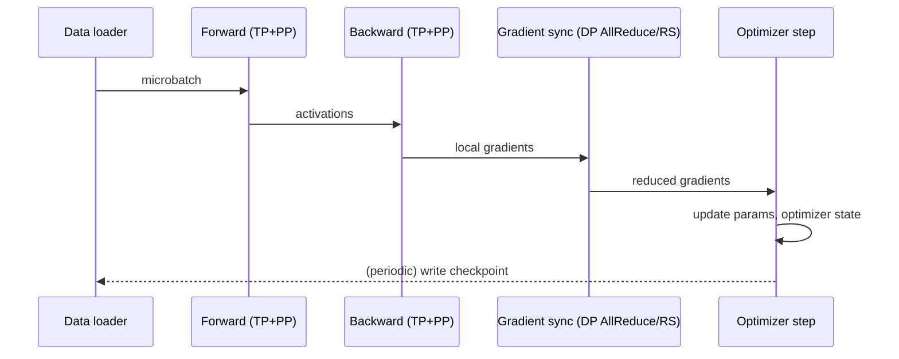
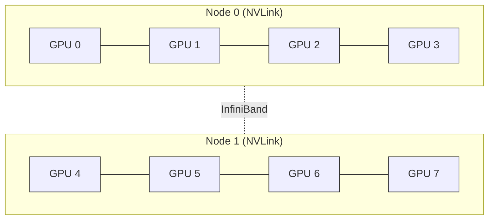

Distributed training of a large language model partitions the computation and state of synchronous stochastic gradient descent across the GPUs of a cluster, by combining data, tensor, pipeline, sequence and expert parallelism with sharding of parameters, gradients and optimizer state.

Each training step is a forward and backward pass followed by a gradient collective and an optimizer update. A training system determines which part of the model state each GPU holds and which collectives keep that state consistent. The mechanisms of the individual [[ml/serving-systems/parallelism|parallelism strategies]] are derived in [[ml/serving-systems/parallelism|Parallelism]], and the older runtime abstractions from which these systems developed are described in [[ml/serving-systems/distributed-ml-runtimes|Distributed ML Runtimes]].

## One synchronous training step

Data-parallel replica $r$ holds a full (possibly sharded) copy of the model. A step consists, in order, of a forward pass on a local microbatch, a backward pass producing local gradients, a gradient-synchronizing collective across replicas (AllReduce, or ReduceScatter for sharded optimizer state), an optimizer update, and periodic checkpointing of parameters and optimizer state. If the model does not fit on one device, tensor and pipeline parallelism subdivide the forward/backward pass itself, and the gradient-sync collective runs only across the data-parallel dimension, not across tensor or pipeline ranks (those exchange activations and layer-boundary gradients instead, per [[ml/serving-systems/parallelism|Parallelism]]).

## Choosing a parallelism strategy

The choice can be made as a sequence of questions, taken in the order in which the constraints typically become binding. The first is whether one GPU holds the parameters, gradients and optimizer state. If it does not, the state is sharded with ZeRO/FSDP or tensor parallelism before anything else. If the model still does not fit after its parameters are sharded, pipeline parallelism is added across nodes, since it moves only activations across the slower inter-node link. If sequence length drives activation memory past the budget even with activation checkpointing, sequence parallelism is added (detailed in [[ml/serving-systems/parallelism|Parallelism]]). An MoE model adds expert parallelism, covered in [[ml/serving-systems/mixture-of-experts|Mixture of Experts]]. Once the model fits, throughput is scaled with data parallelism, the simplest axis to add because it requires no change to the model's internal structure.

## Memory budget: a 13B model worked example

For a dense transformer with $\Psi$ parameters trained with mixed-precision Adam, each GPU needs (see [[ml/serving-systems/parallelism|Parallelism, ZeRO and FSDP]] for the derivation): $2\Psi$ bytes FP16 parameters, $2\Psi$ bytes FP16 gradients, and $12\Psi$ bytes of FP32 optimizer state (master weights, momentum, variance), for $16\Psi$ bytes total before any sharding.

For $\Psi = 13 \times 10^9$: $16 \times 13\text{B} \approx 208$ GB, more than two H100-80GB GPUs' worth of memory before a single activation is stored. Sharding this state across $N_d$ data-parallel workers with ZeRO stage 3 (or equivalently FSDP `FULL_SHARD`) brings it to $208\text{GB}/N_d$: at $N_d = 8$, about 26 GB per GPU, leaving room for activations and the temporarily unsharded parameters that FSDP all-gathers back before each layer's forward and backward ([FSDP docs](https://docs.pytorch.org/docs/stable/fsdp.html)). Activation memory on top of this follows the per-layer formula in [[ml/serving-systems/parallelism|Parallelism]]; at long sequence lengths it can exceed the sharded parameter memory, and it is a common reason to add tensor or sequence parallelism even when the parameters alone would fit.

## System designs compared

Each of the following systems occupies a different point in a design space defined by what state is replicated, what is communicated and what the programming model is.

**GPipe** ([Huang et al. 2018](https://arxiv.org/abs/1811.06965)) is model-agnostic pipeline parallelism. It partitions any sequential-layer network across accelerators, splits each batch into $m$ microbatches and pipelines them through the stages. It is a library-level abstraction that makes no assumption about layer internals, and for the same reason it provides no intra-layer parallelism, so a single layer must still fit on one device.

**Megatron-LM** ([Shoeybi et al. 2019](https://arxiv.org/abs/1909.08053)) instead parallelizes inside each transformer layer (tensor parallelism, detailed in [[ml/serving-systems/parallelism|Parallelism]]), implemented as a few inserted communication ops in PyTorch with no compiler changes. The original paper trained an 8.3B-parameter model on 512 GPUs at 76% scaling efficiency against a single-GPU baseline. Follow-up work ([Narayanan et al. 2021](https://arxiv.org/abs/2104.04473)) composed tensor, pipeline, and data parallelism (3D parallelism) and introduced the interleaved pipeline schedule, reaching 502 petaFLOP/s on a 1-trillion-parameter model across 3072 GPUs at 52% of peak per-GPU throughput.

**ZeRO / DeepSpeed** ([Rajbhandari et al. 2019](https://arxiv.org/abs/1910.02054)) addresses a different axis. It removes the redundancy in data-parallel *state* instead of splitting computation. Every data-parallel replica ordinarily holds identical parameters, gradients, and optimizer state; ZeRO shards each in turn (stages 1, 2, 3) across the data-parallel group and reconstructs the needed shard just-in-time via collectives, keeping the per-GPU communication volume the same order as plain data-parallel AllReduce. The paper reports training 100B+ parameter models with super-linear speedup on 400 GPUs at 15 petaflops, an 8x model-size and 10x throughput increase over the prior state of the art, and trained Turing-NLG (17B) as a direct result.

**PyTorch FSDP** ([Zhao et al. 2023](https://arxiv.org/abs/2304.11277)) is ZeRO stage 3 as a native PyTorch module wrapper rather than a separate library, co-designed with PyTorch's tensor and CUDA-caching-allocator internals. Mechanically, an FSDP unit all-gathers its full parameters immediately before use in the forward pass, runs the computation, then frees (reshards) them; the backward pass repeats the all-gather, computes gradients, then reduce-scatters them so each rank ends up owning only its shard of the reduced gradient. `ShardingStrategy` selects how much state stays sharded: `FULL_SHARD` shards parameters, gradients, and optimizer state (ZeRO-3 equivalent); `SHARD_GRAD_OP` shards gradients and optimizer state but keeps parameters unsharded across the forward pass (ZeRO-2 equivalent); `NO_SHARD` replicates everything (plain data parallel); `HYBRID_SHARD` does `FULL_SHARD` within a node and replicates across nodes, accepting smaller memory savings in exchange for confining the high-volume all-gather/reduce-scatter traffic to NVLink ([FSDP docs](https://docs.pytorch.org/docs/stable/fsdp.html)). `backward_prefetch=BACKWARD_PRE` issues the next layer's all-gather before the current layer's backward compute finishes, which is the mechanism by which communication overlaps with compute instead of preceding it serially. The paper reports FSDP matching DistributedDataParallel's throughput while supporting substantially larger models, with near-linear TFLOPS scaling.

| System | What it shards | Programming model | Communication pattern |
| --- | --- | --- | --- |
| GPipe | model layers (pipeline stages) | library wraps a sequential model | point-to-point activations between stages |
| Megatron-LM (TP) | weight matrices within a layer | inserted collective ops, no compiler | AllReduce per layer, intra-node |
| ZeRO / DeepSpeed | optimizer state, gradients, params (by stage) | training-loop library | AllGather/ReduceScatter over DP group |
| FSDP | same as ZeRO-3, native module wrapper | `nn.Module` wrapper, PyTorch-integrated | per-unit AllGather (fwd/bwd), ReduceScatter (bwd) |

Large training runs combine these designs. Tensor parallelism runs inside a node, pipeline parallelism across nodes, and ZeRO/FSDP-style sharding or plain data parallelism across replica groups, which is the 3D-parallelism pattern in [[ml/serving-systems/parallelism|Parallelism]].

## Communication cost and overlap

Pipeline bubbles, the four collectives (AllReduce, Broadcast, AllGather, ReduceScatter), and their per-strategy cost formulas are derived in [[ml/serving-systems/parallelism|Parallelism]], which also gives schedule diagrams and the sensitivity to inter- and intra-node bandwidth. Each of the systems above reduces the exposed cost of communication by overlap. It issues the next collective before the current computation finishes, so the GPU's compute units and its NICs are busy concurrently instead of in sequence. FSDP's `backward_prefetch` and `forward_prefetch` do this for parameter all-gathers; ZeRO overlaps its ReduceScatter with backward compute of earlier layers; Megatron's tensor-parallel AllReduce is small enough (confined to NVLink, one collective per layer) that it is usually compute-bound rather than the bottleneck once pipeline and data parallelism are configured correctly. The `limit_all_gathers` FSDP option deliberately reintroduces a small serialization point, a rate limiter that caps how many all-gathers can be in flight, reducing overlap slightly in exchange for bounded peak memory ([FSDP docs](https://docs.pytorch.org/docs/stable/fsdp.html)).

## Throughput metrics

- **Step time**: wall-clock seconds for one optimizer step across the whole cluster.
- **Tokens per second**: (batch size x sequence length) / step time, the throughput figure commonly reported as training speed.
- **Model FLOPs Utilization (MFU)**: observed tokens/sec times FLOPs-per-token (forward+backward, excluding recomputation), divided by the hardware's theoretical peak FLOPs/sec ([Chowdhery et al. 2022](https://arxiv.org/abs/2204.02311), Appendix B). Because the FLOP count depends only on model shape and the denominator only on published hardware peak, MFU is comparable across frameworks and clusters in a way raw tokens/sec is not.
- **Scaling efficiency**: throughput at $N$ GPUs divided by ($N$ times single-GPU throughput). It falls below 100% whenever communication or pipeline bubbles add time; Megatron-LM's 8.3B-parameter run scaled at 76% against its single-GPU baseline, and the composed 1T-parameter run at 52% of theoretical peak per GPU ([Narayanan et al. 2021](https://arxiv.org/abs/2104.04473)).
- **Goodput**: the fraction of wall-clock time spent making useful, checkpoint-preserved training progress, as opposed to time lost to startup, data-loading stalls or disruption recovery. The metric distinguishes GPUs that are busy from GPUs whose progress survives to a checkpoint.

As a worked example, consider a 13B model with FLOPs-per-token $\approx 6 \times 13 \times 10^9 = 7.8 \times 10^{10}$ (the $6N$ approximation from [[ml/deep-learning/modeling-architecture-and-data|Modeling, Architecture, and Data]]), running at 4,000 tokens/sec on 64 H100s with per-GPU peak FP16 dense throughput 1000 TFLOP/s (from [[ml/serving-systems/performance-modeling|Performance Modeling]]): observed FLOPs/sec $= 7.8 \times 10^{10} \times 4000 \approx 3.12 \times 10^{14}$, cluster peak $= 64 \times 10^{15} = 6.4 \times 10^{16}$, so $\text{MFU} \approx 0.5\%$. The value is deliberately unrealistic and illustrates the sensitivity of MFU to achieved tokens/sec. Well-configured production runs typically reach the 30-55% range reported in the papers above.

## Data loading, checkpointing, and fault tolerance

Data loading has to keep pace with the fastest stage or it becomes the bottleneck; sharded, prefetching data loaders that reshuffle per epoch avoid every replica reading the same disk region at once. Checkpoints need to capture parameters, optimizer state, and the data-loader's position so a restart resumes the exact token stream rather than reprocessing or skipping data; with sharded optimizer state (ZeRO/FSDP), a checkpoint format has to either gather full state before writing (expensive, blocking) or write each shard separately and reshard on load if the restart uses a different GPU count. Stragglers, one slow GPU in a synchronous data-parallel group, stall every other replica at the AllReduce barrier; a job that runs long enough at scale will hit a hardware failure, so with restart from the last checkpoint, the checkpoint interval trades wasted recomputation (longer intervals) against checkpoint I/O overhead (shorter intervals). See [[systems/scheduling/4-cluster-and-datacenter/stragglers-speculation-and-overload|Stragglers, Speculation, and Overload]] for the general scheduling treatment of this problem.

## A small cluster topology

Within a node, GPUs run tensor parallelism over NVLink (600 GB/s, per [[ml/serving-systems/parallelism|Parallelism]]); across nodes, InfiniBand (about 25 GB/s) carries pipeline-stage activations and data-parallel gradient collectives, both of which require far less bandwidth per unit of useful work than the intra-layer AllReduce of tensor parallelism.

## Downstream consequences of training choices

The parallelism strategy chosen at training time has consequences at deployment. A model trained with heavy tensor parallelism assumes the same NVLink-class topology at inference, or incurs a latency penalty when the same collectives run over slower links. A model overtrained for inference (fewer parameters trained on more tokens, per [[ml/deep-learning/modeling-architecture-and-data|Modeling, Architecture, and Data]]) places its additional cost in the one-time training run and adds nothing at serving, since inference parallelism decisions are largely independent of how the model was sharded during training. The checkpoint format determines which serving frameworks can load the model directly and which require a conversion step. None of these affects training correctness, and each is a portability cost incurred at deployment.

## Related notes

- [[ml/serving-systems/parallelism|Parallelism]]
- [[ml/serving-systems/distributed-ml-runtimes|Distributed ML Runtimes]]
- [[ml/serving-systems/mixture-of-experts|Mixture of Experts]]
- [[ml/deep-learning/modeling-architecture-and-data|Modeling, Architecture, and Data]]
- [[systems/scheduling/index|Scheduling]]
- [[systems/distributed-systems/index|Distributed Systems]]
