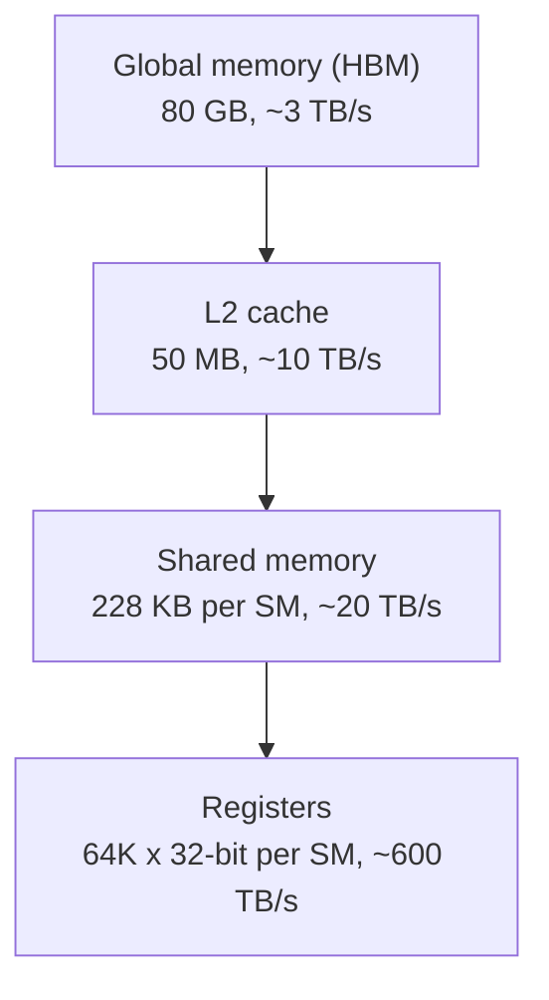

A GPU is a throughput-oriented processor built from many streaming multiprocessors (SMs), each of which executes groups of 32 threads (warps) in lockstep, backed by high-bandwidth memory and a partly software-managed on-chip memory hierarchy. NVIDIA GPUs are programmed directly in CUDA, through block-level compilers such as Triton, or through tensor libraries such as PyTorch that dispatch prebuilt kernels.

The hardware model and these interfaces underlie [[ml/serving-systems/optimizing-gpu-kernels|Optimizing GPU Kernels]], [[ml/serving-systems/triton|Triton]], and the bottleneck analysis in [[ml/serving-systems/performance-modeling|Performance Modeling]].

The material began as notes for CSE 599K "LLM Serving Systems" at the University of Washington, Spring 2025, taught by Prof. Baris Kasikci with TA Kan Zhu. Hardware figures are from lecture slides and vendor spec sheets. The market and cost figures are third-party estimates repeated in lecture, and I have not verified them independently.

## Why GPUs matter for serving

Training learns from existing data; inference applies the model to new data. Serving is the systems problem around inference, the design of a system that performs inference with high throughput and low latency while meeting diverse service level objectives. Demand is large (ChatGPT went from roughly 500M monthly visits in December 2022 to roughly 2000M in January 2024, per lecture slides), and the hardware is expensive. An NVIDIA H200 HGX server was quoted around $250,000 with power draw up to about 10kW. Reported 2024 H100 purchase estimates put Meta around 300K units and Google and Microsoft around 150K each. The figures are estimates, included to indicate that the cost of the hardware makes high utilization an economic requirement. Serving systems obtain high utilization mainly by batching user requests to raise throughput.

## CPU vs GPU

A GPU is a processor originally built for graphics rendering that now handles scientific computing and machine learning, shipped with a vendor software stack (CUDA for NVIDIA, ROCm for AMD). Its design differs from a CPU's as follows.

| Aspect       | CPU                                 | GPU                   |
| ------------ | ----------------------------------- | --------------------- |
| Design focus | Control logic (good with branching) | Computation/loading   |
| Performance  | Single thread performance           | Parallel processing   |
| Cores        | Few powerful cores                  | Many simpler cores    |
| Memory       | Large cache hierarchy               | High bandwidth memory |

Figures from lecture for one CPU and one GPU:

| Specification    | AMD EPYC 9555 (CPU)    | NVIDIA H200 (GPU) |
| ---------------- | ---------------------- | ----------------- |
| Cores/Threads    | 64 cores / 128 threads | 16,896 CUDA cores |
| Frequency        | 4.4 GHz                | 1.98 GHz          |
| TFLOPs           | ~10-20                 | 989 (dense FP16)  |
| Memory size      | Up to 6 TB             | 141 GB            |
| Memory bandwidth | 576 GB/s               | 4800 GB/s         |
| Memory latency   | ~70 ns                 | ~110 ns           |

CPU DRAM provides low-latency random access. GPU HBM provides about 8x the bandwidth and reaches it only with structured, batched access patterns.

## Hardware architecture

GPUs are deployed in clusters. NVLink connects GPUs within a node at up to 900 GB/s, while the node's link to the data center network runs at around 200 Gb/s, or 25 GB/s. That two-orders-of-magnitude gap between local memory bandwidth and network bandwidth shapes the parallelism strategies in [[ml/serving-systems/parallelism|Parallelism]].

The on-device memory hierarchy (H100-class figures from lecture):

- Global memory (HBM): 80 GB at ~3 TB/s
- L2 cache: 50 MB at ~10 TB/s
- Shared memory ("smem"): 228 KB per SM at ~20 TB/s
- Registers: 64K x 32-bit per SM at ~600 TB/s



> [!tip] Reading the hierarchy
> Each level down the diagram provides up to an order of magnitude more bandwidth and far less capacity. The kernel techniques in [[ml/serving-systems/optimizing-gpu-kernels|Optimizing GPU Kernels]] move data reuse toward the small, fast levels of the hierarchy.

Computation takes place in the streaming multiprocessors (SMs). Each SM contains CUDA cores for scalar work, tensor cores for small dense matrix multiplies, and the shared memory that serves as a program-managed scratchpad.

## Programming model

The execution hierarchy maps software concepts onto that hardware.

| Concept       | Definition                             | Runs on        | Communication via | Limits                            |
| ------------- | -------------------------------------- | -------------- | ----------------- | --------------------------------- |
| Thread        | Minimal unit that executes instructions | Function units | Local registers   | Up to 255 registers               |
| Warp          | Group of threads                       | SM partition   | Register file     | 32 threads                        |
| Thread block  | Group of warps                         | SM             | Shared memory     | Up to 32 warps (1024 threads)     |
| Kernel        | Function on GPU                        | GPU            | L2/global memory  | Up to $2^{31}-1$ blocks along x   |

Thirty-two threads form a warp, and the threads of a warp execute the same instruction at the same pace on different data. An SM has four warp schedulers, each issuing from one warp per cycle, and the schedulers switch among resident warps to hide memory latency. Blocks run independently and can only communicate through L2 or global memory, which is why block-level synchronization is generally unavailable inside a kernel.

## Three ways to program a GPU

### PyTorch

PyTorch is the highest-level interface. A program is written as tensor operations, and PyTorch dispatches prebuilt kernels for them.

```python
import torch

def add_tensors(a, b):
    return a + b

if __name__ == "__main__":
    num_elements = 10**9

    tensor1 = torch.rand(num_elements, device='cpu')
    tensor2 = torch.rand(num_elements, device='cpu')

    tensor1 = tensor1.to('cuda')
    tensor2 = tensor2.to('cuda')

    for i in range(10):
        result = add_tensors(tensor1, tensor2)

    result = result.cpu()
    print("Result of addition:", result)
```

### Triton

Triton is a compiler framework from OpenAI with a Python interface. Programs are written at the block level, and Triton manages threads within the block. It is used for fused or otherwise custom kernels that a composition of PyTorch ops cannot express efficiently. See [[ml/serving-systems/triton|Triton]] for a longer treatment.

```python
@triton.jit
def add_kernel(x_ptr, y_ptr, output_ptr, n_elements, BLOCK_SIZE: tl.constexpr):
    pid = tl.program_id(axis=0)
    block_start = pid * BLOCK_SIZE
    offsets = block_start + tl.arange(0, BLOCK_SIZE)
    mask = offsets < n_elements

    x = tl.load(x_ptr + offsets, mask=mask)
    y = tl.load(y_ptr + offsets, mask=mask)
    output = x + y

    tl.store(output_ptr + offsets, output, mask=mask)
```

### CUDA

CUDA programs the hardware directly. Its concepts map one-to-one onto the hardware, and it has the highest performance ceiling and the largest implementation burden of the three interfaces.

Memory management:

```cpp
// Memory allocation
cudaMalloc          // device memory allocation
cudaMallocHost      // pinned host memory allocation
cudaFree            // free memory

// Memory operations
cudaMemcpy          // synchronous copy
cudaMemcpyAsync     // asynchronous copy
cudaMemset          // synchronous set
cudaMemsetAsync     // asynchronous set
```

Kernel structure:

```cpp
// Kernel declaration
__global__ void kernel_name(args...)

// Device helper function
__device__ T helper_name(args...)

// Example addition kernel
__global__ void add(int *a, int *b, int *c, size_t num) {
    int block_start = blockIdx.x * blockDim.x;
    int thread_id = threadIdx.x;
    int index = block_start + thread_id;
    if (index < num) {
        c[index] = a[index] + b[index];
    }
}
```

Launch:

```cpp
// Define block and thread dimensions
dim3 block(x, y, z);
dim3 thread(x, y, z);

// Launch kernel
kernel_name<<<block, thread>>>(args);
```

Synchronization and errors:

```cpp
__syncthreads()           // Thread synchronization (device function)
cudaDeviceSynchronize()   // Device synchronization (host function)

// Error checking
cudaGetLastError()        // Get last error
cudaGetErrorString()      // Get error description
```

## Timing and profiling

PyTorch dispatches kernels asynchronously, so the CPU runs ahead of the GPU and wall-clock timing around a Python call measures dispatch, not execution. CUDA events give accurate GPU timing. For profiling, torch.profiler shows CPU-side activity well but processes traces slowly, Nsight Systems (nsys) records system-level traces, and Nsight Compute (ncu) profiles individual kernels in detail.

CUDA streams let independent kernels overlap when the scheduler allows. Events act as flags between kernels; `cudaStreamWaitEvent` synchronizes one stream on another's event.

## Newer hardware features

Features introduced by recent generations include unified memory addressing and NVLink (P100+), thread block clusters and the Tensor Memory Accelerator (H100+), NVLink SHARP in-network reduction (H100+), and FP4/FP6 precision (B100+). See the [CUDA programming guide](https://docs.nvidia.com/cuda/cuda-c-programming-guide/) for details on each.

## From host to HBM: the full datapath

The data a kernel uses crosses several physical links before any computation takes place. Host code allocates pinned or pageable memory and copies it across PCIe (or NVLink-C2C on Grace-Hopper/Grace-Blackwell superchips) into device HBM, after which the GPU's internal hierarchy moves it to the execution units.


PCIe Gen5 x16 tops out around 64 GB/s per direction, roughly two orders of magnitude below the ~3-8 TB/s of on-package HBM bandwidth quoted above. That gap is why host-device transfers are staged and overlapped with compute (via `cudaMemcpyAsync` and streams, see [[ml/serving-systems/memory-management|Memory Management]] for KV-cache-specific staging) rather than issued synchronously inside the hot path. An architectural treatment of the whole hierarchy, derived from RTL primitives rather than stated as a table, is given in [[hardware/gpu-architecture|GPU Architecture from First Principles]].

## Warp scheduling and why occupancy isn't the goal

Each SM partition's warp scheduler picks one ready warp per cycle to issue an instruction from. "Ready" means the warp isn't stalled on a memory request, a data dependency, or a `__syncthreads()` barrier. With enough resident warps, the scheduler has a ready warp to issue from while other warps wait on HBM. This is the mechanism of latency hiding, in which a memory-bound warp's stall of a few hundred cycles is hidden if 20 other warps are ready to issue.

Occupancy is the fraction of the SM's maximum resident warps actually scheduled. It is necessary but not sufficient for good performance for two reasons. First, occupancy measures whether the scheduler has warps to choose from, not whether those warps are doing useful work; a kernel can hit 100% occupancy while every warp is stalled on the same contended memory bank. Second, occupancy is a static launch-configuration property, while achieved bandwidth and achieved FLOPs depend on the actual instruction mix, memory access pattern, and register pressure at runtime. A kernel tuned for lower occupancy but larger per-thread tiles (more registers, more reuse from shared memory) often outperforms a high-occupancy kernel with poor data reuse, which is the resource tradeoff worked out quantitatively in [[hardware/gpu-architecture|GPU Architecture from First Principles]].

## CUDA cores, Tensor Cores, copy engines, and SFUs

An SM contains several distinct types of execution unit, and work mapped to the wrong one runs below the throughput the SM could deliver.

- **CUDA cores**: scalar FP32/FP64/INT32 ALUs, one operation per thread per cycle. They are the default target for work other than dense matrix multiplies.
- **Tensor Cores**: fixed-function units that compute small matrix-multiply-accumulate tiles (e.g., a warp operating on 16x8x16-shaped fragments) per instruction rather than per thread. All GEMM- and attention-heavy LLM serving work routes through these; see [[ml/serving-systems/optimizing-gpu-kernels|Optimizing GPU Kernels]] for the GEMM case study.
- **Load/store units and copy engines**: dedicated hardware for moving data (global/shared memory transactions, and for `cudaMemcpyAsync`, independent DMA copy engines that run concurrently with compute, which is what makes compute/copy overlap across streams possible).
- **Special function units (SFUs)**: low-precision, low-latency approximations of transcendentals (`exp`, `rsqrt`, `sin`), used by softmax, layer norm, and activation functions. They give up some numerical accuracy for throughput far higher than that of the same function evaluated on CUDA cores.

The unit in which a kernel spends its time determines its bottleneck. A kernel that spends its time in Tensor Cores is compute bound on matrix throughput, one that spends it in SFUs is bound by a different and much smaller unit, and one bound on load/store units is bandwidth bound regardless of how idle the CUDA cores and Tensor Cores are.

## Numeric format throughput tradeoffs

A data type determines storage size and also the Tensor Core path (or its configuration) that executes the arithmetic, and the paths differ in peak throughput. Representative H100 dense Tensor Core peaks (Hopper architecture page, NVIDIA H100 datasheet):

| Format | Relative peak dense TFLOPs (H100, indicative) | Typical use |
| --- | --- | --- |
| FP32 | ~67 (non-tensor) | Reference/accumulation, rarely the hot path |
| TF32 | ~500 (tensor) | Drop-in training/inference speedup with FP32-like range |
| FP16 / BF16 | ~1000 (tensor) | Standard training and inference compute dtype |
| FP8 | ~2000 (tensor) | Hopper-generation inference and increasingly training |
| INT8 | ~2000 (tensor, TOPS) | Quantized inference |

Halving the bit width roughly doubles peak Tensor Core throughput, because more low-precision MACs fit in the same silicon and power budget. Quantization (BF16 to FP8 to INT8) therefore raises compute throughput in addition to reducing memory footprint. The [[ml/serving-systems/performance-modeling|roofline model]] limits the gain, since a kernel already memory bound at FP16 does not speed up in proportion to peak throughput when switched to FP8, its bottleneck being memory bandwidth.

## Hopper vs. Blackwell: what changes for the programmer

Both target the same CUDA programming model; the [Blackwell Tuning Guide](https://docs.nvidia.com/cuda/archive/12.8.1/blackwell-tuning-guide/index.html) states explicitly that "applications that follow the best practices for [Ampere and Hopper] should typically see speedups on the Blackwell GPUs without any code changes." The differences relevant to further tuning are listed below.

| Aspect | Hopper (compute capability 9.0) | Blackwell (compute capability 10.0 / 12.0) |
| --- | --- | --- |
| Max resident warps/SM | 64 | 64 (cc 10.0), 48 (cc 12.0) |
| Register file | 64K x 32-bit per SM | 64K x 32-bit per SM |
| Max registers/thread | 255 | 255 |
| Shared memory/SM | Up to 228 KB | Up to 228 KB (cc 10.0), 128 KB (cc 12.0) |
| Thread block clusters | Introduced; portable size up to 8 | Supported; B200 allows nonportable size 16 via opt-in |
| L2 cache | 50 MB (H100) | Up to 126 MB (GB200) |
| HBM | HBM3, ~3.35 TB/s (H100 SXM) | HBM3/HBM3e, up to 180 GB capacity (B200) |
| NVLink | 4th generation | 5th generation, higher per-GPU bandwidth |

Source: [Blackwell Tuning Guide](https://docs.nvidia.com/cuda/archive/12.8.1/blackwell-tuning-guide/index.html) and [Hopper Architecture](https://www.nvidia.com/en-us/data-center/technologies/hopper-architecture/) pages.

On PTX/cubin compatibility: a cubin compiled for one compute capability runs unmodified only on that same major/minor-or-higher revision, but PTX is forward-compatible and JIT-compiles to any newer architecture, per the [Blackwell Compatibility Guide](https://docs.nvidia.com/cuda/inline-ptx-assembly/blackwell-compatibility-guide/index.html). For example, an application built with CUDA Toolkit 12.8 that embeds PTX (not just Hopper-native cubin) runs on Blackwell without a rebuild; one that embeds only `sm_90` cubin needs recompiling with a `compute_100`/`sm_100` target to get a native Blackwell binary, or it falls back to JIT-compiling embedded PTX at load time (verifiable by forcing `CUDA_FORCE_PTX_JIT=1`). Architecture-conditional PTX using `sm_90a`/`compute_90a` (Hopper-specific features like warp-group matrix instructions) is explicitly not forward-compatible to Blackwell, so kernels using those features need a Blackwell-native rebuild rather than only a newer driver.

Several programmer-visible features carry over. The Tensor Memory Accelerator (TMA) and async transaction barriers introduced on Hopper (see [[ml/serving-systems/optimizing-gpu-kernels|Optimizing GPU Kernels]]) remain available and are the documented tuning surface on Blackwell as well, and thread block clusters and distributed shared memory work the same way on both, with Blackwell's B200 adding the larger nonportable cluster size as its main structural change.

## Launch-cost hierarchy

Every level of the execution hierarchy has an associated overhead, and matching kernel and launch granularity to the amount of work avoids incurring fixed costs repeatedly.

| Level | Approximate overhead character | What it costs |
| --- | --- | --- |
| Thread | Effectively free | Register allocation only; threads are the parallelism unit, not a schedulable cost |
| Warp | Sub-cycle to a few cycles | Issue slot in the scheduler; divergence multiplies this |
| Block | Tens of cycles | Shared memory allocation, barrier setup, scheduling onto an SM |
| Kernel launch | ~microseconds (CPU-side dispatch + device-side setup) | Fixed launch latency, independent of grid size; this is why decode-phase kernels (small batches, memory bound) are launch-overhead-sensitive while prefill-phase kernels (large batches, compute bound) can amortize it |
| Stream | Effectively free once created | Enables overlap; cost is in synchronization (`cudaStreamWaitEvent`), not the stream itself |
| Device (process) | Milliseconds | Context creation, one-time cost per process |

For this reason kernel fusion matters more for decode (many small, launch-overhead-bound kernels per token) than for prefill (few large, compute-bound kernels per request); see [[ml/serving-systems/optimizing-gpu-kernels|Optimizing GPU Kernels]] for fused-kernel patterns and [[ml/serving-systems/batching|Batching]] for how batch size shifts a kernel across this boundary.

## Peak FLOPs vs. bandwidth vs. arithmetic intensity

Advertised peak FLOPs are an upper bound on achieved throughput. A kernel falls short of peak for three independent reasons.

1. **Arithmetic intensity below the ridge point**: the [[ml/serving-systems/performance-modeling|roofline model]] shows H100 FP16 critical intensity is about 295 FLOPs/byte (H100 SXM); anything below that is memory bound and cannot reach compute peak regardless of how well-tuned the kernel is.
2. **Occupancy or launch configuration**: too few warps to hide memory latency, or a grid too small to fill all SMs, leaves compute units idle even for compute-bound work.
3. **Non-ideal instruction mix**: register spills, bank conflicts, uncoalesced accesses, and warp divergence all reduce achieved throughput below the ideal-case peak the vendor spec sheet assumes.

| Workload | Typical arithmetic intensity | Roofline region on H100 |
| --- | --- | --- |
| Elementwise ops (add, activation) | ~0.1-1 FLOPs/byte | Deeply memory bound |
| Decode-phase attention (batch small) | Low, KV-cache-bandwidth-bound | Memory bound |
| Prefill-phase attention / large-batch GEMM | Scales with batch/sequence dimension | Compute bound past a batch threshold |
| Well-tiled GEMM ($M, N, K$ large) | $O(M)$ or better, per [[ml/serving-systems/performance-modeling|Performance Modeling]] | Compute bound |

A GPU's peak TFLOPs figure is therefore uninformative for a serving workload unless the regime of that workload (memory or compute bound) is also stated, and [[ml/serving-systems/performance-modeling|Performance Modeling for LLM Serving Systems]] accordingly bases its analysis on the roofline model rather than on the spec sheet.

## Related notes

- [[ml/serving-systems/optimizing-gpu-kernels|Optimizing GPU Kernels]]
- [[ml/serving-systems/triton|Triton]]
- [[ml/serving-systems/performance-modeling|Performance Modeling]]
- [[ml/serving-systems/how-to-write-a-fast-kernel|How to write a fast kernel]]
- [[hardware/gpu-architecture|GPU Architecture from First Principles]]
- [[ml/serving-systems/gpu-interconnects|GPU Interconnects and Collective Communication]]
- [[hardware/computer-architecture/simd-vectors-gpus-accelerators|From SIMD to SIMT: Vectors, GPUs, and Accelerators]]
