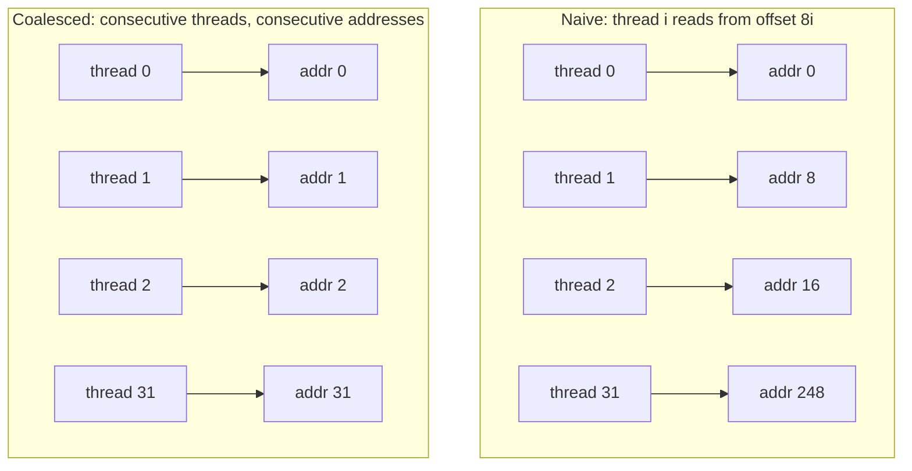

A CUDA kernel is a function executed on the GPU by a grid of thread blocks, in which each thread uses its block and thread indices to compute its part of the output. Matrix transpose is a kernel whose performance depends almost entirely on the pattern of its global memory accesses, which makes it a suitable first example.

The kernel applies the architecture concepts from [[ml/serving-systems/gpu-basics|GPU Architecture and Programming]]. The naive version and the principle of coalesced access are the first steps of an optimization sequence for the same kernel whose later steps (shared memory tiling, bank conflict padding, measured timings) are given in [[ml/serving-systems/optimizing-gpu-kernels|Optimizing GPU Kernels]].

## Baseline: transpose in PyTorch

`a.t()` changes only the tensor's stride metadata, and the data is moved by `.contiguous()`. Timing needs CUDA events because kernel launches are asynchronous.

```python
import torch

num_rows = num_cols = 8192
a = torch.randn(num_rows, num_cols)

res = a.t().contiguous()

start = torch.cuda.Event(enable_timing=True)
end = torch.cuda.Event(enable_timing=True)

start.record()

for i in range(100):
    res = a.t().contiguous()

end.record()
torch.cuda.synchronize()

elapsed_time = start.elapsed_time(end)
time_per_iter = elapsed_time / 100

print(f"Elapsed time: {elapsed_time} ms")
print(f"Time per iteration: {time_per_iter} ms")
```

## A first CUDA attempt

A straightforward partitioning assigns one block to each row. A row of 8192 floats has more elements than a block can have threads (at most 1024), so each thread takes a contiguous slice of columns:

```cpp
#include <torch/extension.h>
#include <stdio.h>

__global__ void transpose(float* input, float* output, int num_rows, int num_cols) {
    int row = blockIdx.x;
    int col_start = threadIdx.x * (num_cols / blockDim.x);
    int col_end = col_start + (num_cols / blockDim.x);

    for (int col = col_start; col < col_end; ++col) {
        if (col < num_cols) {
            output[col * num_rows + row] = input[row * num_cols + col];
        }
    }
}
```

This version runs slowly. Adjacent threads read addresses that are `num_cols / blockDim.x` elements apart and write addresses that are entire columns apart, so neither the loads nor the stores coalesce.

## Coalesced memory access

Inside one warp, if the 32 threads access contiguous addresses, the hardware batches the accesses into one or a few memory transactions. Global memory approaches its rated bandwidth only when accesses are batched in this way.

In the naive kernel above, each thread owns a slice of $8192 / 1024 = 8$ columns, so on any given loop iteration the warp's 32 loads land 8 elements apart and every load becomes its own transaction. Assigning consecutive elements to consecutive threads lets the hardware fold the same 32 loads into a few transactions:



> [!tip] Spotting uncoalesced access
> Coalescing depends on the addresses one warp accesses in a single instruction, not on the addresses one thread accesses over its whole loop. Each thread here reads contiguous columns over time, and the access pattern is still uncoalesced, because at any instant the warp's addresses are strided. If adjacent threads' addresses differ by more than one element, the loads split into separate transactions.

Getting both the reads and the writes of a transpose to coalesce requires staging tiles in shared memory, and this step is treated in [[ml/serving-systems/optimizing-gpu-kernels|Optimizing GPU Kernels]].

## Related notes

- [[ml/serving-systems/optimizing-gpu-kernels|Optimizing GPU Kernels]]
- [[ml/serving-systems/gpu-basics|GPU Architecture and Programming]]
