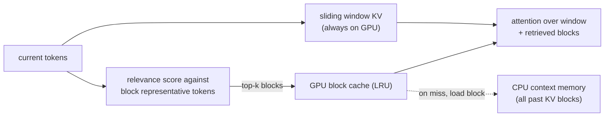

InfLLM (Xiao et al., 2024) extends LLMs pre-trained on short contexts to very long sequences without additional training. It combines sliding window attention with a block-level external context memory, from which each attention step retrieves the most relevant blocks. The paper treats the design of that memory, the reasons it requires no training, and its limitations.

InfLLM's external context store addresses the long-context KV-cache pressure discussed in [[ml/serving-systems/memory-management|Memory Management in LLM Serving Systems]].

## Citation

- [InfLLM: Training-Free Long-Context Extrapolation for LLMs with an Efficient Context Memory](https://arxiv.org/abs/2402.04617) (Xiao et al., 2024). A copy of the paper is stored at [papers/inf-llm.pdf](./papers/inf-llm.pdf), and the reference implementation is at [thunlp/InfLLM](https://github.com/thunlp/InfLLM).

## Problem

LLMs are pre-trained on sequences capped at a few thousand tokens, which limits their usefulness for agents, streaming inputs, and other workloads that need much longer contexts. A common remedy is continual pre-training on longer sequences, which requires substantial compute and can degrade short-context performance. The paper asks whether an LLM trained on short sequences can process sequences far beyond its training window with no additional training and no architecture change.

## Main idea

InfLLM retains sliding window attention for the local context and adds an external context memory for all tokens that fall outside the window. Distant key-value vectors are grouped into blocks, and for each attention step the model retrieves only the few most relevant blocks and attends over them alongside the local window. The design rests on the paper's claim that LLMs can already reason over distant context and lack only a mechanism that selects its relevant parts, so that attention is not diluted over irrelevant tokens.

## Mechanism

The method has three components.

- Block-level memory. Past KV vectors are organized into fixed-size blocks, and only the most semantically significant tokens within each block represent it during relevance scoring. This keeps lookup cost well below that of scoring every past token.
- Dynamic offloading. Most memory blocks are stored in CPU memory. Frequently accessed blocks are cached on GPU with an LRU policy, which allows sequences of up to 1M tokens to run on modest GPU resources.
- Training-free retrieval. The retrieval scores reuse the model's existing attention representations, so the method applies to any off-the-shelf LLM.

Per attention step, the current tokens attend over the local window plus whichever memory blocks score as relevant:

> [!tip] Relation to KV offloading
> The block cache is the offloading pattern from [[ml/serving-systems/memory-management|Memory Management]] applied at attention time. The full KV history is stored in CPU memory, which costs less per byte, an LRU cache keeps frequently accessed blocks on GPU, and relevance scoring determines which blocks are made resident. InfLLM adds the use of retrieval to bound how much of that history any single attention step reads.

## Evidence

The paper evaluates on long-context benchmarks against both training-free baselines and models continually trained on long sequences. The paper reports the following results.

- Base models pre-trained on 8K or 32K contexts match or exceed continually trained long-context models on question answering, summarization, and retrieval tasks.
- Retrieval accuracy is maintained up to 1,024K-token sequences.
- GPU memory use and inference time drop substantially compared to full attention or continually trained long-context models, making single-GPU long-context inference practical.
- On context retrieval tasks it outperforms retrieval-augmented generation setups without training a retriever.

## Assumptions and limits

The reduction in GPU memory is offset by host memory use, since storing the full KV history in host memory becomes demanding at extreme lengths. Inference speed has room for improvement, since block retrieval adds work at each step. The method also inherits the weaknesses of the base model. InfLLM's retrieval is built on the base model's own representations, so a base model that filters noise or represents context poorly yields weaker retrieval, which is visible on some tasks with weaker base models.

## Open questions

How much would lightweight training of the block segmentation and representative-token selection improve retrieval relevance? It is also open whether the method composes with KV compression techniques (such as those in [[ml/serving-systems/sparsity-and-pruning|Sparsity and Pruning]]) to reduce the memory footprint and the retrieval cost together.

## Related notes

- [[ml/serving-systems/memory-management|Memory Management in LLM Serving Systems]]
- [[ml/serving-systems/sparsity-and-pruning|Sparsity and Pruning]]
- [[systems/research/sparsity-notes|Faster Causal Self Attention]]
- [[ml/nlp/prompting|Prompting Language Models]]
