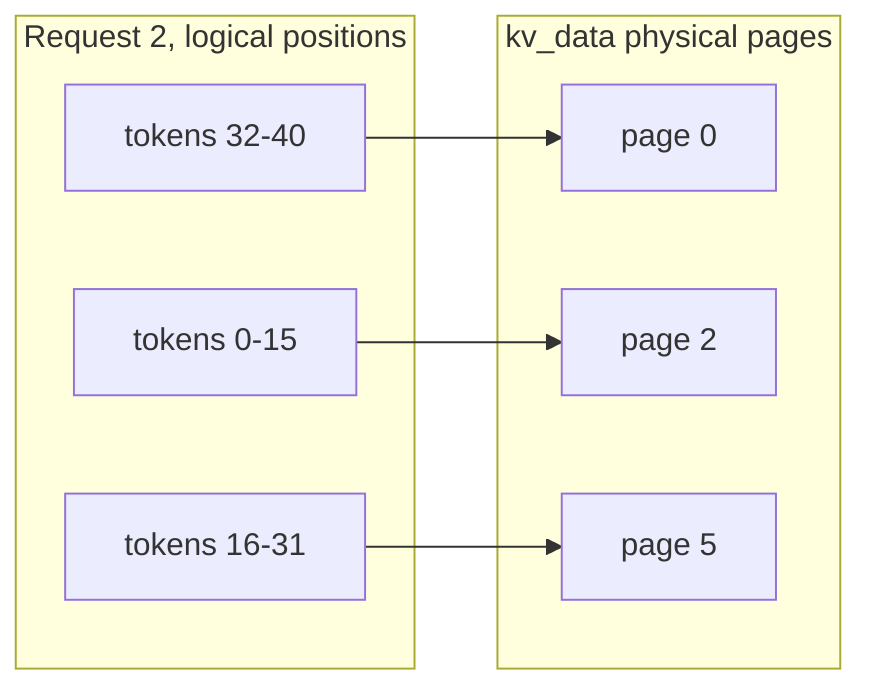

The KV cache of a transformer serving system stores the key and value vectors computed for every previous token of each active request, so that decoding a new token requires attention over stored vectors instead of recomputation of the prefix. Memory management in LLM serving determines how the cache is sized, allocated, shared between requests and evicted.

The KV cache is the part of GPU memory that grows with load. Weights are fixed once the model is loaded, while every running request adds one key and one value vector per layer per KV head for each token it holds, so the memory left after the weights determines how many requests fit in a batch ([[ml/serving-systems/batching|Batching]]). An allocator that reserves more than a request stores lowers that number. FlashAttention, covered at the end, addresses a separate memory cost, the attention score matrix, which it never materializes. [[ml/serving-systems/inf-llm|InfLLM]] explores an external-memory approach for very long contexts.

The material began as notes for CSE 599K "LLM Serving Systems" at the University of Washington, Spring 2025, taught by Prof. Baris Kasikci with TA Kan Zhu. The allocator comparison in [Replaying a production trace](#replaying-a-production-trace) is my own measurement.

## KV cache sizing

Per token, the KV cache stores one key vector and one value vector per layer per KV head:

$$\text{KV bytes per token} = \underbrace{2}_{K \text{ and } V} \times \text{num\_kv\_heads} \times \text{head\_dim} \times \text{num\_layers} \times \text{dtype bytes}$$

Llama-3-8B has a model dimension of 4096, 32 layers, 32 query heads and 8 KV heads, so head_dim is 128 ([architecture arguments in `llama-models`](https://github.com/meta-llama/llama-models/blob/main/models/sku_list.py)), and it was trained on sequences of 8,192 tokens ([model card](https://github.com/meta-llama/llama3/blob/main/MODEL_CARD.md)). In BF16 its KV cache costs

$$2 \times 8 \times 128 \times 32 \times 2 = 131{,}072 \text{ bytes} = 128 \text{ KiB per token.}$$

The same arguments give 8,030,261,248 parameters (an FFN width of 14,336 and an untied output head over 128,256 tokens), which occupy 16.06 GB in BF16. An [H100 SXM](https://www.nvidia.com/en-us/data-center/h100/) has 80 GB of HBM3. Reserving 56 GiB (60.13 GB) for the KV cache leaves 3.8 GB for activations, the CUDA context and library workspaces. The budget then holds $56 \times 2^{30} / 2^{17} = 458{,}752$ token slots, or 1 GiB per 8,192 tokens. The [trace replays](#replaying-a-production-trace) use this budget.

A request with $p$ prompt tokens and $d$ output tokens holds $p$ slots after prefill and $p + d$ slots at its last decode step. Its allocation grows linearly between the two, so on average it holds $p + d/2$ slots. For the lecture's example of 1,024 input and 1,024 output tokens that is 1,536 slots, or 192 MiB, and a budget filled exactly with such requests holds $458{,}752 / 1{,}536 \approx 298$ of them. Dense BF16 matmul on an H100 SXM runs at 989 TFLOPS (NVIDIA lists 1,979 with 2:4 sparsity) against 3.35 TB/s of HBM bandwidth, a ridge point of about 295 FLOPs per byte. A decode GEMM with BF16 weights does two FLOPs per two-byte weight for each request in the batch, so it becomes compute bound at a batch of about 295 ([[ml/serving-systems/performance-modeling|Performance Modeling]] derives the ridge point from the rounded values 1000 TFLOPS and 3 TB/s, which give 333). With perfect packing, the KV budget barely holds the batch at which decode becomes compute bound, and [the allocators](#the-allocation-problem) differ in how far they fall short of perfect packing.

## A unified memory budget

The general accounting has four terms:

$$\text{GPU memory} = \text{Weights} + \text{Activations} + \text{KV cache} + \text{Framework overhead}$$

Weights are fixed once a model and dtype are chosen: $2P$ bytes in FP16 or BF16 for $P$ parameters, half that in INT8, a quarter in INT4. Activations during serving are transient, one forward pass's worth of intermediate tensors, and their peak scales with the number of tokens processed in one step (a long prefill, or a large batch of decodes), not with the number of tokens cached. In training, activations are kept for the backward pass and dominate memory instead (see [[ml/serving-systems/parallelism|Parallelism]], where activation checkpointing and tensor plus sequence parallelism exist for that reason). Framework overhead covers the CUDA context, cuBLAS and cuDNN workspaces and NCCL buffers, and it is omitted when a deployment is sized against a GPU's advertised capacity.

vLLM sizes the KV cache by this subtraction ([v0.6.0 `worker.py`](https://github.com/vllm-project/vllm/blob/v0.6.0/vllm/worker/worker.py)): it profiles the peak memory of a forward pass at the largest configured batch, takes `gpu_memory_utilization` (default 0.90) of the GPU's total memory, and gives what remains after that peak, weights included, to KV blocks. Every byte spent on overhead or on a larger prefill step comes out of the KV cache, and so out of the batch size. The same tradeoff appears in training with [[ml/serving-systems/parallelism|tensor and pipeline parallelism]], where fixed costs replicated on each device reduce the memory left for the term that scales with load.

## MHA, MQA, and GQA: KV-cache comparison

The KV-cache formula has a $\text{num\_kv\_heads}$ term that is independent of the number of query heads. Multi-head attention (MHA) sets $\text{num\_kv\_heads} = \text{num\_query\_heads}$, so every query head reads its own K/V projection. [Multi-query attention](https://arxiv.org/abs/1911.02150) (MQA, Shazeer 2019) sets $\text{num\_kv\_heads} = 1$, so that all query heads share one K/V head, which shrinks the cache by a factor equal to the head count at some loss of model quality. [Grouped-query attention (GQA)](https://arxiv.org/abs/2305.13245) interpolates between the two. Query heads are split into $G$ groups, each group sharing one K/V head, so $\text{num\_kv\_heads} = G$. MHA is $G = \text{num\_query\_heads}$, MQA is $G = 1$.

GQA can be adopted without pretraining a new model. Ainslie et al. convert an MHA checkpoint by mean-pooling the key and value projection matrices of the heads in each group into one head, then continue training for 5% of the original pretraining steps. Llama 2 70B, all Llama 3 models and Mistral 7B were instead pretrained with GQA.

Holding head_dim = 128, 32 layers, BF16 and 32 query heads fixed, the per-token KV-cache cost scales linearly with $\text{num\_kv\_heads}$:

| Attention | num_kv_heads | KV per token | Relative to MHA |
| --------- | -----------: | -----------: | --------------: |
| MHA       | 32           | 512 KiB      | 1               |
| GQA-8     | 8            | 128 KiB      | 1/4             |
| GQA-4     | 4            | 64 KiB       | 1/8             |
| MQA       | 1            | 16 KiB       | 1/32            |

Llama-3-8B is GQA-8, a 4x reduction in KV-cache bytes, and in the KV bytes read per decode step, relative to MHA at the same query-head count. An MHA version of the same model would fit $458{,}752 / (4 \times 1{,}536) \approx 74$ requests of 1,024 input and 1,024 output tokens in the 56 GiB budget instead of 298.

## The allocation problem

A request's output length is unknown when it is admitted, so the allocator must decide how much memory to give it before knowing how much it will need. Kwon et al. ([PagedAttention, SOSP 2023](https://arxiv.org/abs/2309.06180), §3) divide the memory that a contiguous allocator holds but has not filled into three kinds:

- **reserved** slots, which the request will fill with tokens it has not generated yet, held for its whole lifetime;
- **internal fragmentation**, slots past the request's final length, which are never filled and are known to be waste only when the request finishes;
- **external fragmentation**, free memory between allocations that is too fragmented to hold the next request.

### Method 1: reserve the maximum length

Reserving the model's maximum sequence length makes every allocation the same size, so a request never needs more memory and the allocator has no external fragmentation. For Llama-3-8B that is 8,192 tokens, or 1 GiB, per request, so the 56 GiB budget admits exactly 56 requests whatever their lengths. The used fraction of the budget is then the mean length of the running requests divided by 8,192. On the Azure code trace, whose requests average 2,048 prompt and 28 output tokens, the running requests hold 2,162 tokens on average, 26.4% of the budget stores KV, and 72.8% is internal fragmentation.

<KvAlloc kind="max" trace="code" src="/ml/serving-systems/memory-management/slices.json" caption="Opens on reserve-max and the first 1,000 requests of the Azure code trace, replayed with a saturated queue, Llama-3-8B (128 KiB of KV per token) and a 56 GiB KV budget. Each row of the map is 4 GiB of physical KV memory at the selected iteration. Under reserve-max, 56 requests run and most of each 1 GiB region stays unfilled." />

### Method 2: grow by doubling

A contiguous region can instead start at the smallest power of two that holds the prompt and double when it fills, as `std::vector` does. Before a region fills, the slots past the current length are reserved; when the request finishes before the region fills, the remainder is internal fragmentation. A region that ends between half and completely full wastes less than half of itself, and on the two traces 24% to 25% of the budget is internal fragmentation under this scheme. Doubling also needs a free block twice the size, so growth copies the KV and can fail. With a binary buddy allocator (Knowlton 1965), block sizes are powers of two, a region grows in place when its buddy is free, and the measured external fragmentation is 7.1% (code) and 7.4% (conversation) of the budget. A failed growth requires preempting a request, and on the conversation trace this happens 4.3 times per request on average.

### Method 3: PagedAttention

[PagedAttention](https://arxiv.org/abs/2309.06180) applies the technique of [[systems/operating-systems/lecture-notes/paging|virtual memory with paging]] to the KV cache. KV storage is divided into fixed-size blocks, and each request's logical token positions map to physical blocks through a per-request block table, so a request's blocks need not be contiguous. Any free block can serve any request, which removes external fragmentation, and a request allocates a new block only when its last one fills, so the waste per request is at most one partly filled block. vLLM's default block holds 16 tokens ([v0.6.0 `EngineArgs`](https://github.com/vllm-project/vllm/blob/v0.6.0/vllm/engine/arg_utils.py)). For Llama-3-8B one block holds $16 \times 2 \times 8 \times 128 \times 2 = 64$ KiB per layer and 2 MiB over all 32 layers. Kwon et al. (§7.2) found that block sizes 16 to 128 performed best on ShareGPT, while on Alpaca, whose sequences are shorter, blocks larger than 32 degraded performance; they chose 16 as large enough for efficient GPU kernels and small enough to keep internal fragmentation low.

When no block is free, vLLM preempts whole requests, newest first, and either swaps their blocks to CPU memory or discards them and recomputes the prefix when the request is rescheduled (§4.5). Admission keeps 1% of blocks free as a watermark ([`block_manager_v1.py`](https://github.com/vllm-project/vllm/blob/v0.6.0/vllm/core/block_manager_v1.py)).

<KvAlloc kind="paged" trace="conv" block={16} src="/ml/serving-systems/memory-management/slices.json" caption="Opens on 16-token pages and the first 1,000 requests of the Azure conversation trace. Blocks fill the budget up to the 1% watermark, and the partly filled last block of each request is too small to see at this scale." />

### Block tables

vLLM keeps one block table per request, a list of physical block numbers in logical order, and passes the tables of a batch to the attention kernel as one 2D tensor of shape (batch size, maximum blocks per sequence), padded. [FlashInfer](https://docs.flashinfer.ai/tutorials/kv_layout.html) stores the same mapping for a batch in compressed sparse row (CSR) form:

```text
kv_indptr:        [0, 2, 3, 6, 10]                  # num_requests + 1 prefix sums
kv_page_indices:  [1, 4, 8, 2, 5, 0, 6, 10, 15, 17] # every request's pages, concatenated
kv_last_page_len: [16, 3, 9, 1]                     # valid tokens in each last page
kv_data:          (max_num_pages, 2, page_size, num_kv_heads, head_dim)
```

Request $i$ owns pages `kv_page_indices[kv_indptr[i]:kv_indptr[i+1]]`, and its KV length is `page_size * (number of pages - 1) + kv_last_page_len[i]`. The second axis of `kv_data` separates keys from values.

> [!example] Walking the table
> Request 2 owns `kv_page_indices[kv_indptr[2]:kv_indptr[3]] = kv_page_indices[3:6]`, which names physical pages 2, 5 and 0. With 16-token pages and a last-page length of 9, its tokens 0-15 sit in page 2, tokens 16-31 in page 5 and tokens 32-40 in page 0, for 41 tokens. Logical order and physical placement are independent:



## Replaying a production trace

The [Azure LLM inference trace 2023](https://github.com/Azure/AzurePublicDataset/blob/master/AzureLLMInferenceDataset2023.md), released with [Splitwise](https://www.microsoft.com/en-us/research/publication/splitwise-efficient-generative-llm-inference-using-phase-splitting/) (Patel et al., ISCA 2024), records the prompt and output token counts of production requests to two Azure LLM services over about an hour each: a coding service (8,819 requests, mean prompt 2,048 tokens, mean output 28, median output 13) and a conversation service (19,366 requests, mean prompt 1,155, mean output 211, median output 129). I replayed each trace's five full 10-minute windows through the three allocators, with Llama-3-8B, the 56 GiB budget, a saturated first-come-first-served queue and vLLM's preemption policy. The table gives the mean over the five windows and, in brackets, the lowest and highest window.

| Trace | Allocator | Concurrent requests | KV in use | Reserved | Internal frag. | External frag. |
| --- | --- | ---: | ---: | ---: | ---: | ---: |
| Code | Reserve max (8,192) | 56.0 [56.0, 56.0] | 26.4% [25.4, 28.2] | 0.8% | 72.8% | 0 |
| Code | Doubling, buddy | 146.0 [144.3, 148.3] | 67.5% [65.4, 69.1] | 1.3% | 23.9% | 7.1% [5.6, 9.4] |
| Code | Paged, 16 tokens | 214.6 [207.3, 227.1] | 98.3% [98.2, 98.4] | 0.3% | 0.1% | 0 |
| Conversation | Reserve max (8,192) | 56.0 [56.0, 56.0] | 15.0% [13.9, 15.7] | 2.0% | 83.0% | 0 |
| Conversation | Doubling, buddy | 218.0 [200.7, 242.0] | 58.1% [56.6, 59.7] | 7.4% | 24.8% | 7.4% [5.6, 10.0] |
| Conversation | Paged, 16 tokens | 369.4 [349.7, 400.4] | 98.2% [98.2, 98.3] | 0.6% | 0.0% | 0 |

Paged allocation runs 3.8 times as many concurrent requests as reserve-max on the code trace and 6.6 times as many on the conversation trace, and 1.47 and 1.69 times as many as doubling. The remaining 1.2% to 1.4% of the budget under paging is free memory, mostly the 1% admission watermark. The block size has little effect on these traces, whose requests are hundreds to thousands of tokens long. On the conversation trace, 8-, 16- and 32-token blocks give 370.6, 369.4 and 367.1 concurrent requests, because the partly filled last block averages half a block per request against a mean live length of about 1,220 tokens.

The concurrency numbers measure the batch the allocator permits, which is an upper bound on what a server runs. vLLM also caps the batch at `max_num_seqs` (256 by default in v0.6.0), which would bind on the conversation trace under paging, and a real server's batch also depends on the arrival rate, which a saturated replay ignores.

> [!note]- Deep dive: preemption under doubling
> A doubling region that fills needs a free block of twice its size at that moment. When admission has filled memory up to the head of the queue, such a block often does not exist, and the scheduler must preempt a request to make room. Preempted requests return to the head of the queue and are readmitted at the next iteration, so the cycle repeats. On the conversation trace with no admission headroom, doubling preempts 4.3 requests per completed request on average (0.4 to 8.3 across windows) and recomputes 22.8 prompt tokens per generated token. Keeping a fraction of the budget free at admission trades concurrency for fewer preemptions:
>
> | Headroom | Concurrent requests | Preemptions per request | Recomputed tokens per generated token | External frag. |
> | ---: | ---: | ---: | ---: | ---: |
> | 0 | 218.0 [200.7, 242.0] | 4.28 | 22.8 | 7.4% |
> | 5% | 220.9 [205.7, 244.0] | 1.81 | 10.0 | 4.0% |
> | 10% | 214.5 [199.5, 234.9] | 0.48 | 2.8 | 1.4% |
> | 20% | 192.3 [180.3, 208.9] | 0.006 | 0.04 | 0 |
>
> On the code trace, whose outputs are short, preemptions stay below 0.015 per request at any headroom, but growth copies 1.2 tokens of KV per generated token: a 1,500-token prompt placed in a 2,048-slot region moves to a 4,096-slot region if its output crosses the boundary. Paged allocation copies nothing and preempts 0.003 requests per request on the conversation trace.

### Comparison with the vLLM paper

Kwon et al. report the breakdown for their own implementations of Orca, all with a buddy allocator, in their Figure 2: token states fill 20.4% of KV memory for Orca (Max), 26.8% for Orca (Pow2) and 38.2% for Orca (Oracle), against 96.3% for vLLM. Their experiments ran OPT models on A100s with the ShareGPT and Alpaca datasets (ShareGPT averages 161 input and 338 output tokens) and a maximum sequence length of 2,048.

- **Reserve max.** Orca (Max)'s 20.4% at 2,048 tokens and the 26.4% and 15.0% measured here at 8,192 follow the same relation, the mean live length divided by the reserved length. A longer context window lowers utilization in proportion unless prompts grow with it. Orca (Max) shows 8.9% "external fragmentation and others", a category the paper does not define further; with every region the same size, the replay here has none.
- **Doubling against Orca (Pow2).** Orca (Pow2) is given the true output length and reserves the next power of two of it at admission, so its reservation share is large (17.9%) and it never grows. The doubling allocator here knows only the prompt, reserves little (0.8% to 7.4%) and incurs copies and preemptions instead. Orca (Pow2)'s 41.6% external fragmentation and others is far above the 7.1% to 7.4% measured here; the paper does not say what the "others" include, so the two figures are not directly comparable.
- **Paged.** vLLM's 96.3% against 98.2% here is consistent with the shorter sequences of ShareGPT. A half-filled 16-token block is about 8 slots per request, which is 0.7% of a 1,220-token request but about 2% of a ShareGPT request of a few hundred tokens, and both setups keep vLLM's 1% watermark free.

> [!note]- How this was measured
> - **Code:** [`kvsim.py`](memory-management/kvsim.py) is the simulator, and [`measure.py`](memory-management/measure.py) downloads the traces, checks their SHA-256, cuts the windows and writes [`results.json`](memory-management/results.json) (every number above) and [`slices.json`](memory-management/slices.json), the first 1,000 requests of each trace's first window, which the figure replays. Run `python3 content/ml/serving-systems/memory-management/measure.py` from `notes/`; it takes about 15 seconds. The figure's TypeScript allocators are a separate implementation, and the figure's unit test checks that they reproduce every field of `kvsim.py`'s output on both slices for all five configurations.
> - **Data:** `AzureLLMInferenceTrace_code.csv` and `AzureLLMInferenceTrace_conv.csv` from the [Azure Public Dataset](https://github.com/Azure/AzurePublicDataset/blob/master/AzureLLMInferenceDataset2023.md) (CC-BY), timestamps 2023-11-16 18:15 to 19:14. Windows are 10 minutes long from each trace's first request; the partial last window is dropped, leaving five per trace with 609 to 2,146 code requests and 2,867 to 4,123 conversation requests. One conversation request whose prompt plus output exceeds Llama-3-8B's 8,192-token context is removed from every allocator's input.
> - **Model of a step:** one iteration is one decode step. Every running request, oldest first, appends one token's KV; if the allocator cannot provide it, the newest running request is preempted (its memory freed and the request returned to the head of the queue with its prompt plus generated tokens, to be recomputed), as in vLLM v0.6.0's recompute policy. Requests that reach prompt plus output tokens then finish, and if nothing was preempted the queue is admitted in order until its head does not fit. Prefill writes the whole prompt in the admitting iteration, with no limit on prefill tokens per step. Averages are over the iterations in which requests wait, which in a saturated replay is every iteration until the queue empties.
> - **Allocators:** reserve-max allocates 8,192 slots per request. Doubling allocates $\max(16, 2^{\lceil \log_2 p \rceil})$ slots and doubles, in place if the buddy is free and otherwise by allocating, copying and freeing. Both use a binary buddy allocator over 16,384-slot roots that takes the lowest-address block of the smallest fitting size. Paged allocation uses 8-, 16- or 32-slot blocks and vLLM's 1% admission watermark. External fragmentation counts the free memory at an iteration where it is at least the head request's need but no free block is large enough.
> - **Limits:** only memory is modeled. Iteration time, arrival times, chunked prefill, `max_num_seqs`, swapping, prefix caching and the attention kernel's cost of noncontiguous blocks are not.
> - **Environment:** Python 3.13.18, standard library only, on a shared 4-core Intel Xeon cloud VM at 2.1 GHz with no GPU, which other jobs used at the same time. The simulation is deterministic, so the load does not change its results.

## Prefix sharing

Requests frequently share a prefix: the same system prompt across users, or the accumulated history in a multi-round conversation.

```text
1. "You are a helpful assistant. User: Hello, Assistant: Hi!"
2. "You are a helpful assistant. User: Hello, Assistant: Hi!, User: Solve this problem..."
3. "You are a helpful assistant. User: What can you do?"
```

With paged storage, requests that share a prefix can point their block tables at the same physical blocks, with reference counts and copy-on-write when a shared block must be modified (Kwon et al., §4.4). Storing a length-$p$ prefix once instead of $n$ times reduces its prefill compute and KV storage from $n \times p$ to $p$ tokens. A cached prefix occupies memory even when no running request uses it, so the cache needs an eviction policy. [SGLang](https://arxiv.org/abs/2312.07104) keeps cached prefixes in a radix tree over token sequences (RadixAttention), matches each new request against it without the application marking what is shared, reference-counts the nodes that running requests use, and evicts the least recently used leaf first. It reports up to 6.4x higher throughput than other systems on its benchmarks, which combine prefix reuse with its other optimizations. The lecture quoted a 2-32x speedup range for prefix sharing without a benchmark setup, so that range is not repeated here.

## Eviction: recompute or offload?

When GPU memory cannot hold every cached prefix, an evicted entry can later be rebuilt in two ways: recompute it from the tokens, or reload it from CPU memory over PCIe. Recomputing $p$ tokens through a model with $P_{model}$ parameters costs about

$$T_{recompute} = \frac{2pP_{model}}{\text{Compute}}$$

counting only the weight matmuls. Loading the same KV entries over PCIe costs

$$T_{load} = \frac{2 \times \text{dtype} \times \frac{D_{model}}{GQA} \times L \times p}{\text{PCIe}_{BW}}$$

where $\frac{D_{model}}{GQA}$ is the KV width after grouped-query sharing and $L$ is the layer count. The ratio is

$$\frac{T_{recompute}}{T_{load}} = \frac{\text{PCIe}_{BW} \times P_{model}}{\text{dtype} \times \frac{D_{model}}{GQA} \times L \times \text{Compute}}$$

For Llama-3-8B on an [A100](https://www.nvidia.com/en-us/data-center/a100/) (PCIe Gen4 at 64 GB/s for both directions together, so 32 GB/s each way; 312 TFLOPS dense BF16; KV width 1,024; 32 layers):

$$\frac{32 \times 10^9 \times 8.03 \times 10^9}{2 \times 1024 \times 32 \times 312 \times 10^{12}} \approx 12.6$$

At peak PCIe bandwidth and peak FLOPs, loading is about 12.6 times faster than recomputation. Both rates are optimistic: a prefill does not run at peak FLOPs, and copying many small KV blocks does not reach peak PCIe bandwidth. Kwon et al. (§7.3) measured that small blocks make swapping slow, because each block is a separate small transfer, and found the two methods comparable end to end for block sizes 16 to 64. vLLM v0.6.0 recomputes by default for requests with a single sequence ([`scheduler.py`](https://github.com/vllm-project/vllm/blob/v0.6.0/vllm/core/scheduler.py)).

## FlashAttention

A conventional attention implementation materializes the $\text{seqlen} \times \text{seqlen}$ score matrix in GPU global memory (HBM), so memory grows quadratically with sequence length and most of the kernel's time goes to reading and writing that matrix. [FlashAttention](https://arxiv.org/abs/2205.14135) computes exact attention without materializing it.

The difficulty lies in the softmax, which normalizes over a full row. The numerically stable form subtracts the row max before exponentiating:

$$sm(x_i) = \frac{e^{x_i - c}}{\sum_{j=1}^d e^{x_j - c}}, \quad c = \max_j x_j$$

Subtracting $c$ prevents overflow and leaves the result unchanged, since the factor $e^{-c}$ cancels between numerator and denominator. The row max and the normalizing sum can be maintained incrementally. FlashAttention tiles Q, K and V into blocks that fit in on-chip shared memory, computes attention one block pair at a time, keeps a running max and sum for every query row, and rescales the previously accumulated output whenever a new block raises the running max. The score matrix never reaches HBM. In the original algorithm the outer loop runs over K/V blocks and the inner loop over Q blocks, so each output block and its statistics are read from and written back to HBM once per K/V block. The paper bounds the HBM traffic at $O(N^2 d^2 / M)$ for sequence length $N$, head dimension $d$ and on-chip memory size $M$, against $\Theta(Nd + N^2)$ for standard attention.

Causal masking is applied inside the kernel: masked positions receive $-\infty$ before the softmax and contribute $e^{-\infty} = 0$ to the running sum, and blocks that are entirely masked are skipped. Grouped-query attention needs no extra memory either, because the kernel indexes several query heads into the same K/V head instead of copying it (FlashAttention-2 paper, §3.1).

## FlashAttention-2

The original FlashAttention kernel reached only 25-40% of an A100's theoretical FLOPs/s, and [FlashAttention-2](https://arxiv.org/abs/2307.08691) attributes the gap to work partitioning: too many non-matmul FLOPs, too little parallelism at small batch sizes, and data exchanged between warps through shared memory. It changes three things without changing the memory complexity:

- **Fewer non-matmul FLOPs.** The running output is kept unscaled and divided by the softmax denominator once, at the end of the loop, instead of after every block, and only the log-sum-exp $m + \log \ell$ is stored for the backward pass, instead of both $m$ and $\ell$.
- **Parallelism over the sequence.** The loops are swapped, with the outer loop over Q blocks, and each Q block is assigned to its own thread block, in addition to the parallelism over batch and heads. The backward pass parallelizes over K/V blocks. This raises GPU occupancy when sequences are long and the batch or the head count is small, as in long-context training and prefill.
- **Work within a thread block.** FlashAttention-1 split K and V across the four warps ("split-K"), so the warps had to write partial results to shared memory, synchronize and sum them. FlashAttention-2 splits Q across warps and lets every warp read all of K and V, so in the forward pass each warp finishes its slice of the output with no communication between warps.

The result is about a 2x speedup over FlashAttention-1, 50-73% of the A100's theoretical peak, and end-to-end GPT-style training at up to 225 TFLOPs/s per A100 (72% model FLOPs utilization). FlashAttention-2 leaves KV-cache sizing and paging unchanged; it is an attention kernel that composes with paged, GQA-shaped KV caches.

Parallelism over the query sequence does not help decoding, where each request has one query token. [Flash-Decoding](https://crfm.stanford.edu/2023/10/12/flashdecoding.html) (Dao, Haziza, Massa and Sizov, 2023) adds parallelism over the KV sequence instead: it splits the keys and values into chunks, computes attention over each chunk in parallel while recording a log-sum-exp per row, and combines the partial outputs in a second kernel, weighting each by its log-sum-exp. Its authors state that at batch size 1, FlashAttention's decode uses less than 1% of an A100, and report up to 8x faster end-to-end decoding for CodeLlama-34B at sequence lengths up to 64K.

## Long-context optimization

By the sizing formula the KV cache grows linearly with sequence length, so a 128K-token request needs 128 times the KV bytes of a 1K-token one: 16 GiB for Llama-3.1-8B, which has Llama-3-8B's KV shape, or more than a quarter of the 56 GiB budget. The following strategies are layered on top of GQA and paging.

- **Reducing the per-token cost.** GQA and MQA (above) reduce the coefficient directly. Storing the KV cache itself in 8 bits (FP8 or INT8) halves it relative to BF16 and 4-bit formats quarter it, at some loss of attention precision; this is separate from weight quantization ([[ml/serving-systems/quantization|Quantization]]).
- **Sharing more of the cost.** Prefix sharing (above) stores a long common context, such as retrieved documents reused across queries, once for all requests that use it.
- **Keeping part of the cache off the GPU.** [[ml/serving-systems/inf-llm|InfLLM]] treats distant context as external memory and retrieves only the KV blocks relevant to the current query.
- **Bounding the budget explicitly.** Systems cap the context length they admit, evict or offload old entries (with the recompute-versus-load tradeoff above), or accept a smaller batch and lower throughput once requests are long enough that the KV budget no longer holds the batch at which decode becomes compute bound.

> [!note]- Potentially interesting ideas
> - The saturated replay measures the batch an allocator permits. Replaying the trace's real arrival times would also need a model of iteration time, and would show how often each allocator's limit is reached at the trace's actual load; the [Splitwise](https://www.microsoft.com/en-us/research/publication/splitwise-efficient-generative-llm-inference-using-phase-splitting/) paper's simulator models iteration time and could supply it.
> - Under doubling, a fixed admission headroom between 5% and 10% gave the most concurrency with few preemptions on the conversation trace, and the trade-off differs between the two traces. Whether a headroom that adapts to the recent preemption rate would close much of the gap to paging was not tested.

## Related notes

- [[ml/serving-systems/batching|Batching]]
- [[ml/serving-systems/performance-modeling|Performance Modeling]]
- [[systems/scheduling/5-ml-and-serving/request-scheduling-for-llm-serving|Request Scheduling for LLM Serving]], for admission and preemption in vLLM
- [[systems/operating-systems/lecture-notes/paging|Virtual Memory and Paging]], the mechanism PagedAttention borrows
- [[ml/serving-systems/inf-llm|InfLLM]]
- [[ml/serving-systems/transformers|Transformer Architecture]]
- [[systems/research/sparsity-notes|Faster Causal Self Attention]]
- [[ml/serving-systems/quantization|Quantization]]
