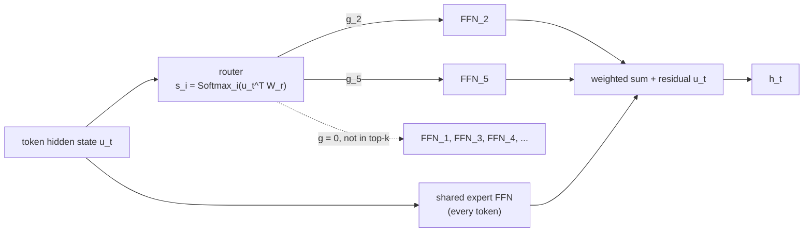
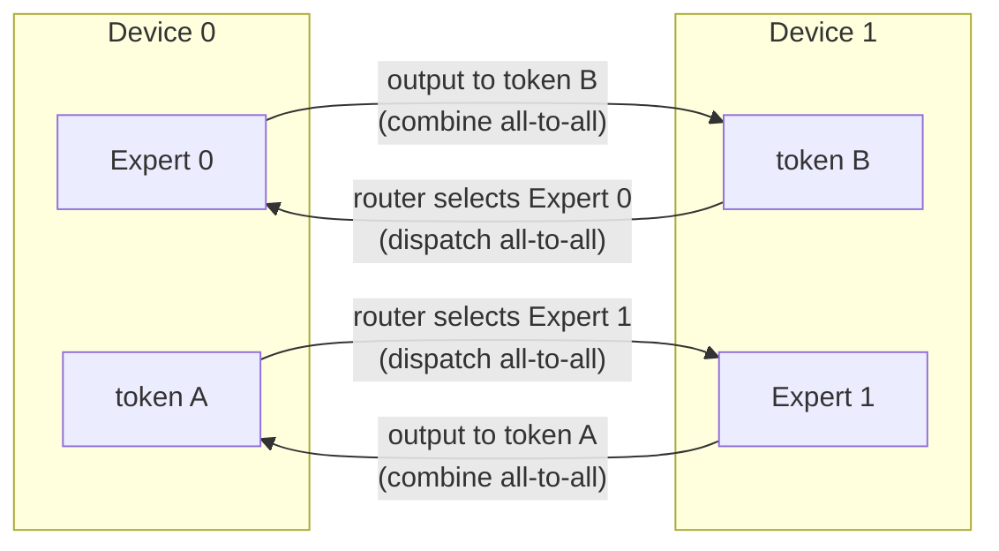

A mixture-of-experts (MoE) layer replaces the feed-forward network (FFN) of a transformer block with $N$ expert FFNs and a learned router. For each token the router computes a score per expert, the token is processed by the $k$ highest-scoring experts ($k \ll N$), and the layer's output is the score-weighted sum of those experts' outputs. Parameter count grows with $N$; the floating-point work per token grows with $k$.

In plain terms, the model holds many FFNs but runs only a few of them for any given token, and a small linear layer decides which. A model with 671B parameters such as [DeepSeek-V3](https://arxiv.org/abs/2412.19437) performs the per-token arithmetic of a 37B-parameter dense model, while every one of its parameters must still be stored somewhere and the router's choices must be executed efficiently across devices. Those two consequences, memory that does not shrink with sparsity and data-dependent load, account for most of the systems work on MoE and connect it to [[ml/serving-systems/parallelism|parallel execution]], [[ml/serving-systems/batching|batching]] and the cost model in [[ml/serving-systems/performance-modeling|Performance Modeling]].

The material began as notes for CSE 599K "LLM Serving Systems" at the University of Washington, Spring 2025, taught by Prof. Baris Kasikci with TA Kan Zhu. Speedups and quality comparisons are quoted from the cited papers. The router load measurements under [Router load in a released model](#router-load-in-a-released-model) are my own, on Google's released Switch Transformer checkpoints.

## Routing

For token $t$ with hidden state $u_t$ entering an MoE layer, a top-$k$ token-choice layer computes

$$s_{i,t} = \text{Softmax}_i\left(u_t^\top W_r\right),$$

$$g_{i,t} = \begin{cases} s_{i,t} & s_{i,t} \in \text{TopK}(\{s_{j,t}\}_{j=1}^{N}, k) \\ 0 & \text{otherwise} \end{cases},$$

$$h_t = u_t + \sum_{i=1}^{N} g_{i,t}\,\text{FFN}_i(u_t),$$

where $W_r \in \mathbb{R}^{d \times N}$ is the router weight matrix. Models differ in the details.

- **Score function.** [Switch Transformers](https://arxiv.org/abs/2101.03961), [DeepSeekMoE](https://arxiv.org/abs/2401.06066) and [OLMoE](https://arxiv.org/abs/2409.02060) take a softmax over all experts and keep the top $k$. [Mixtral](https://arxiv.org/abs/2401.04088) and gpt-oss take a softmax over the top-$k$ logits only, so the selected gates sum to 1. DeepSeek-V3 computes a sigmoid affinity per expert and normalizes the selected affinities to sum to 1.
- **Shared experts.** DeepSeekMoE, Qwen1.5-MoE, DeepSeek-V3, Llama 4 and Kimi K2 add one or more experts that process every token, so $h_t$ also contains $\sum_{j} \text{FFN}^{\text{shared}}_j(u_t)$. The [DeepSeekMoE paper](https://arxiv.org/abs/2401.06066) motivates them as a place for common knowledge that the routed experts would otherwise each learn. Qwen3 removed them ("Unlike Qwen2.5-MoE, the Qwen3-MoE design excludes shared experts", [Qwen3 report](https://arxiv.org/abs/2505.09388)).
- **Granularity.** Fine-grained designs split each expert into smaller ones and raise $k$ to keep compute constant. DeepSeekMoE 16B uses experts a quarter of the size of a standard FFN and selects 6 of 64.
- **Placement in the network.** Switch-Base and GShard replace every other FFN. Mixtral replaces every FFN, and DeepSeek-V3 every FFN after the first three layers. Llama 4 Maverick alternates dense and MoE layers. Mixtures of attention heads also exist ([JetMoE](https://arxiv.org/abs/2404.07413) uses one alongside MoE FFNs), but none of the models in the table below use them.

In top-2 routing with one shared expert, a token sent to experts 2 and 5 takes the paths below.



The alternative to token choice is **expert choice** routing ([Zhou et al. 2022](https://arxiv.org/abs/2202.09368)). Each expert selects the $nc/N$ tokens with the highest scores for it, where $n$ is the number of tokens in the batch and $c$ a capacity factor. Every expert then receives the same number of tokens without an auxiliary loss, while a token may be processed by zero, one or several experts. The paper reports more than 2x faster training convergence than Switch (top-1) and GShard (top-2) routing. Expert choice needs the whole batch before any token's experts are known, which conflicts with autoregressive decoding, where a step contains one token per sequence.

### Configurations of released models

| Model | Total / active params | Routed experts | Selected per token | Shared experts | Router | Load balancing |
| --- | --- | --- | --- | --- | --- | --- |
| [Switch-C](https://arxiv.org/abs/2101.03961) (2021) | 1.6T / not stated | 2048 | 1 | 0 | softmax | auxiliary loss, $\alpha = 10^{-2}$ |
| [Mixtral 8x7B](https://arxiv.org/abs/2401.04088) (2024) | 47B / 13B | 8 | 2 | 0 | softmax over top-2 | not described |
| [DeepSeekMoE 16B](https://arxiv.org/abs/2401.06066) (2024) | 16.4B / 2.8B | 64 | 6 | 2 | softmax | expert-level loss, $\alpha_1 = 0.001$ |
| [Qwen1.5-MoE-A2.7B](https://qwenlm.github.io/blog/qwen-moe/) (2024) | 14.3B / 2.7B | 60 | 4 | 4 | not stated | not stated |
| [DBRX](https://www.databricks.com/blog/introducing-dbrx-new-state-art-open-llm) (2024) | 132B / 36B | 16 | 4 | 0 | not stated | not stated |
| [DeepSeek-V2](https://arxiv.org/abs/2405.04434) (2024) | 236B / 21B | 160 | 6 | 2 | softmax | expert, device and communication losses |
| [OLMoE-1B-7B](https://arxiv.org/abs/2409.02060) (2024) | 6.9B / 1.3B | 64 | 8 | 0 | softmax | auxiliary loss 0.01, router z-loss 0.001 |
| [DeepSeek-V3](https://arxiv.org/abs/2412.19437) (2024) | 671B / 37B | 256 | 8 | 1 | sigmoid | bias adjustment plus sequence-wise loss, $\alpha = 10^{-4}$ |
| [Qwen3-235B-A22B](https://arxiv.org/abs/2505.09388) (2025) | 235B / 22B | 128 | 8 | 0 | not stated | global-batch balancing loss |
| [Llama 4 Maverick](https://ai.meta.com/blog/llama-4-multimodal-intelligence/) (2025) | 400B / 17B | 128 | 1 | 1 | sigmoid | not stated |
| [gpt-oss-120b](https://openai.com/index/introducing-gpt-oss/) (2025) | 116.8B / 5.1B | 128 | 4 | 0 | softmax over top-4 | not stated |
| [Kimi K2](https://github.com/MoonshotAI/Kimi-K2) (2025) | 1T / 32B | 384 | 8 | 1 | sigmoid | bias adjustment (per the released config) |

GPT-4 is widely reported to be an MoE model; OpenAI has not published its architecture.

## Evidence for sparse models

Three results are cited most often for the architecture.

- [Switch Transformers](https://arxiv.org/abs/2101.03961) reports "up to 7x increases in pre-training speed with the same computational resources" for models built from T5-Base and T5-Large.
- [DeepSpeed-MoE](https://arxiv.org/abs/2201.05596) reports up to a 5x reduction in training cost for autoregressive language models relative to a dense model of equal quality.
- [Mixtral 8x7B](https://arxiv.org/abs/2401.04088) "outperforms or matches Llama 2 70B and GPT-3.5 across all evaluated benchmarks" with 13B active parameters, about one fifth of Llama 2 70B's per-token parameter count.

These comparisons hold active parameters or training FLOPs fixed. At a fixed memory footprint, which is the binding constraint in many serving deployments, the comparison is less favorable, since Mixtral's 47B parameters occupy as much memory as a 47B dense model.

## Training: load balancing

The top-$k$ selection is discrete. Gradients reach the router only through the gate values $g_{i,t}$ of the selected experts, so an expert that is never selected receives no gradient, and its router column receives no signal to select it. An expert that receives more tokens is updated more, fits those tokens better and is selected more often. Without a counterweight, routing concentrates on a few experts, the others stay near initialization, and the devices hosting the popular experts set the duration of every step. [Shazeer et al. (2017)](https://arxiv.org/abs/1701.06538) observed this and added noise to the router logits plus two balancing losses ("importance" and "load"). Later models use the losses below.

### The Switch auxiliary loss

For a batch $\mathcal{B}$ of $T$ tokens, [Switch Transformers](https://arxiv.org/abs/2101.03961) (Eq. 4) adds

$$\mathcal{L}_{\text{aux}} = \alpha \cdot N \cdot \sum_{i=1}^{N} f_i P_i,$$

$$f_i = \frac{1}{T}\sum_{x \in \mathcal{B}} \mathbf{1}\{\operatorname{argmax} p(x) = i\}, \qquad P_i = \frac{1}{T}\sum_{x \in \mathcal{B}} p_i(x),$$

with $\alpha = 10^{-2}$. $f_i$ is the fraction of tokens dispatched to expert $i$ and is not differentiable; $P_i$ is the fraction of router probability assigned to expert $i$ and is. The gradient with respect to $P_i$ is $\alpha N f_i$, so the loss lowers router probability most for the experts that received the most tokens. Under uniform routing $f_i = P_i = 1/N$ and $N \sum_i f_i P_i = 1$. A **router z-loss**, a penalty on the squared log-sum-exp of the router logits, was introduced in [ST-MoE](https://arxiv.org/abs/2202.08906) to keep the logits small for numerical stability; OLMoE uses it with weight 0.001.

### DeepSeek's balancing losses

The DeepSeek models changed this objective three times.

- **DeepSeekMoE 16B** uses an expert-level loss of the Switch form with a small factor ($\alpha_1 = 0.001$), no device-level loss, and drops no tokens.
- **DeepSeek-V2** (§2.2.3) uses an expert-level loss ($\alpha_1 = 0.003$), a device-level loss ($\alpha_2 = 0.05$) and a communication balance loss with $\alpha_3 = 0.02$, $\mathcal{L}_{\text{CommBal}} = \alpha_3 \sum_{i=1}^{D} f''_i P''_i$. Here $f''_i = \frac{D}{MT}\sum_{t=1}^{T} \mathbf{1}(\text{token } t \text{ is sent to device } i)$ and $P''_i = \sum_{j \in \mathcal{E}_i} P_j$, where $\mathcal{E}_i$ is the set of experts on device $i$ and $D = 8$ is the number of devices. **Device-limited routing** first selects the $M = 3$ devices whose experts have the highest affinity and then the top-$k$ experts among them, so a token's activations reach at most 3 of the 8 devices. V2 also drops tokens during training. Each device processes at most its average share (a capacity factor of 1.0 per device), the lowest-affinity tokens beyond that are dropped, and the tokens of about 10% of training sequences are never dropped. Nothing is dropped at evaluation.
- **DeepSeek-V3** (§2.1.2) replaces most of the loss with a per-expert bias $b_i$ used only for selection. Token $t$ goes to the experts whose $s_{i,t} + b_i$ are among the top $k$, while the gate value uses the unbiased $s_{i,t}$. After each training step, $b_i$ decreases by $\gamma$ for overloaded experts and increases by $\gamma$ for underloaded ones, with $\gamma = 0.001$ for the first 14.3T tokens and 0 for the last 500B. V3 keeps a complementary sequence-wise balance loss with $\alpha = 10^{-4}$, which the report calls "an extremely small value", so it is not loss-free in the strict sense. Routing is node-limited ($M = 4$ nodes), and no tokens are dropped in training or inference.

[Qwen3](https://arxiv.org/abs/2505.09388) computes the balancing loss over the global batch rather than per micro-batch. A single sequence may then be routed unevenly as long as the global batch is balanced, and the report states that this encourages expert specialization.

### Capacity factor and token dropping

A fixed-shape implementation allocates a buffer per expert before the routing is known. With $T$ tokens per group, $N$ experts and top-$k$ routing, the expected load per expert is $kT/N$, and the **capacity factor** $c$ sets the buffer size ([Switch Eq. 3](https://arxiv.org/abs/2101.03961)):

$$\text{capacity} = c \cdot \frac{kT}{N}.$$

Tokens routed to an expert whose buffer is full are **dropped** from that expert. Their expert contribution is zero, and they continue through the residual connection (and any shared expert). [GShard](https://arxiv.org/abs/2006.16668) introduced the mechanism, with tokens divided into local groups, because its compiler-generated program required statically shaped tensors. Switch Transformers evaluated $c \in \{1.0, 1.25, 2.0\}$ and states that dropped tokens are "typically < 1%" of the total in its training runs. The released Switch-Base configuration ([flaxformer `switch_base.gin`](https://github.com/google/flaxformer/blob/main/flaxformer/t5x/configs/moe/models/switch_base.gin)) uses $c = 1.25$ in training, $c = 2.0$ in evaluation, groups of 8192 tokens, $\alpha = 0.01$ and no router z-loss.

Raising $c$ lowers the drop rate and raises the padding, since every expert computes over its full buffer whether or not tokens fill it. **Dropless** execution removes the tradeoff. [MegaBlocks](https://arxiv.org/abs/2211.15841) expresses the expert computation as block-sparse matrix products whose shape follows the actual number of tokens per expert. It reports end-to-end training speedups of up to 40% over MoEs trained with Tutel and 2.4x over dense models trained with Megatron-LM. Mixtral's vLLM integration uses MegaBlocks kernels, and OLMoE and DeepSeek-V3 train without dropping.

## Router load in a released model

Balance during training is enforced on the training distribution, in the training input format, averaged over large groups. A serving system sees other text in other batch sizes. The following measurement takes Google's released Switch-Base checkpoints with 8 and 64 experts (T5X `switch_classic`, top-1 routing, a switch layer in every other encoder block), runs the encoder on four kinds of real text and records which expert the router selects for every token. The texts are 8,192 tokens each of prose from the Go blog, Go source code, Shakespeare, and math-heavy Markdown from this site. The forward pass reproduces the released model. On span-corruption inputs built from Go blog text it predicts the masked tokens with a mean negative log-likelihood of 2.13 nats (8 experts) and 2.03 nats (64 experts) and top-1 accuracy of 56% and 55%, while a variant with the wrong attention scaling scores 7.5 nats. Routing was recorded without a capacity limit, so the choices are those the router makes when every token reaches its expert.

The busiest expert's share relative to the fair share $1/N$ ("max/mean") summarizes imbalance. For the 8-expert model on all four texts combined (32,768 tokens), max/mean ranges from 1.19 to 2.09 across the six switch layers, and the Switch balance term $N \sum_i f_i P_i$ from 1.03 to 1.22, where 1.0 is perfect balance. Individual kinds of text are more concentrated. In block 12, one expert receives 36.2% of Go code tokens (2.89 times its share), and prose reaches 2.80 times in block 10. The 64-expert model is more imbalanced on the same text, with max/mean 3.17 to 5.42 on the combined text and 10.3 on math Markdown in block 4.

Part of that imbalance comes from the input format. Switch-Base was pre-trained on span-corrupted C4, in which 15% of the tokens are replaced by sentinel tokens. The same prose windows, span-corrupted in the same way, give max/mean 1.09 to 1.33 in the 8-expert model, against 1.18 to 2.80 as plain text, and 1.82 to 2.90 in the 64-expert model, against 2.68 to 4.82. The largest differences occur in the deeper layers (block 10 of the 8-expert model: 1.09 corrupted, 2.80 plain).

The drop rate depends on that imbalance and on the batch size. With $B$ tokens drawn independently from the combined text, a capacity factor of 1.25 drops between 0% and 10.8% of tokens at $B = 4096$ in the 8-expert model, depending on the layer, where Switch reports under 1% on its training data. At $c = 2.0$, the evaluation setting, drops fall to 0% to 1.8% for $B \ge 256$. In the 64-expert model at $B = 4096$, $c = 1.25$ drops 15% to 37% and $c = 2.0$ still drops 5.7% to 17.6%.

Small batches add a second source of overflow that exists even under perfectly uniform routing. With 8 experts, 16 tokens and $c = 1.25$, each expert holds $\lceil 2.5 \rceil = 3$ tokens, and a uniform router drops 9.2% of tokens in expectation; the measured routing drops 9.8% to 14.8%. With 64 experts and 16 tokens, the capacity is one token per expert for any $c \le 4$, and a uniform router drops 10.9%. Batches made of whole sequences, as in prefill, are more concentrated than batches of independent tokens, as in decode. In block 12 of the 8-expert model with $B = 256$ and $c = 1.25$, independent tokens from the combined text drop 9.7% and whole sequences 13.3%.

<RouterLoad base="/ml/serving-systems/mixture-of-experts/" />

The measurements bear on three serving decisions. A fixed capacity tuned on training data does not transfer to traffic in another format or domain: the 64-expert model at its own evaluation setting drops 5.7% or more of the combined text in every switch layer. Decode batches, which contain one token per request, are small relative to $N$, so per-step load is dominated by sampling variance and fixed per-expert buffers are mostly padding; this is one reason inference systems use dropless grouped GEMMs (see [Batching expert computation](#batching-expert-computation)). Popular experts differ by kind of text, so a deployment serving a narrow workload (only code, for instance) has a different set of busy experts than the aggregate, which is the premise of the replication and placement methods under [Serving MoE models](#serving-moe-models).

> [!note]- How this was measured
> **Model.** Google's released Switch Transformer checkpoints `gs://t5-data/pretrained_models/t5x/moe/switch_classic/base/e8/checkpoint_500100` and `.../e64/checkpoint_550000` (public GCS, T5X format), read with `tensorstore` (zarr). The architecture follows [flaxformer `switch_base.gin`](https://github.com/google/flaxformer/blob/main/flaxformer/t5x/configs/moe/models/switch_base.gin): 12 encoder blocks, $d = 768$, expert FFN width 3072 with ReLU, switch layers in blocks 2, 4, ..., 12 (indices 1, 3, ..., 11 in the checkpoint), relative position buckets shared across layers, no $1/\sqrt{d_h}$ attention scaling, and a tied output embedding scaled by $1/\sqrt{d}$. The implementation is [switch.py](/ml/serving-systems/mixture-of-experts/switch.py), in NumPy float32.
>
> **Validation.** [validate.py](/ml/serving-systems/mixture-of-experts/validate.py) takes 100-token windows from 40 Go blog posts, applies T5 span corruption (15% noise, mean span 3, [validate_lib.py](/ml/serving-systems/mixture-of-experts/validate_lib.py)) and runs the decoder with teacher forcing. Content-token NLL is 2.125 nats with top-1 accuracy 56.5% (8 experts) and 2.031 nats with 55.2% (64 experts, expert weights held in float16 to fit the encoder and decoder in memory). With $1/\sqrt{d_h}$ attention scaling added, NLL is 7.5 nats.
>
> **Text.** [collect.py](/ml/serving-systems/mixture-of-experts/collect.py) reads Go blog posts and Go source files from the `golang/website` repository, Karpathy's `tinyshakespeare`, and Markdown files under this site's `math/` section with more than 40 `$` characters. Each source is cut into 255-token windows (T5 SentencePiece vocabulary) plus EOS, and 32 windows per source are drawn with a fixed seed (8,192 tokens per source). Prose cleaning reuses `prep_text.py` from [[ml/serving-systems/quantization|Quantization]].
>
> **Statistics.** [analyze.py](/ml/serving-systems/mixture-of-experts/analyze.py) writes [results.json](/ml/serving-systems/mixture-of-experts/results.json). Independent-token drop rates are exact expectations under sampling with replacement, $\mathbb{E}\sum_i (n_i - C)^+ / B$ with $n_i \sim \text{Binomial}(B, f_i)$ and $C = \lceil cB/N \rceil$. Whole-sequence drop rates are Monte Carlo means over 2,000 batches (one contiguous span for $B < 256$, distinct whole windows otherwise). Max/mean intervals are bootstrap 95% intervals over windows (300 resamples); for the combined text in the 8-expert model they span about 0.1 to 0.3. The span-corruption control is [control.py](/ml/serving-systems/mixture-of-experts/control.py), with output in [control.txt](/ml/serving-systems/mixture-of-experts/control.txt). The figure's data come from [export_figure.py](/ml/serving-systems/mixture-of-experts/export_figure.py), and [figure_check.py](/ml/serving-systems/mixture-of-experts/figure_check.py) is the independent reference its tests compare against; it also produced the whole-sequence comparison above.
>
> **Limits.** Routing was recorded with every token reaching its expert. In a capacity-limited forward pass, a dropped token's hidden state in later layers differs, which changes later routing. Only the encoder was measured. The texts differ from C4 in format (no sentinels) and, for code, Shakespeare and math, in domain, so the measurements describe the released model on this text, not on its training distribution.
>
> **Machine.** 4-core Intel Xeon VM at 2.3 GHz, 15 GB RAM, no GPU. Python 3.13, NumPy 2.5, SciPy 1.18, tensorstore 0.1.86, sentencepiece 0.2.3.

## The DeepSeek lineage

| | DeepSeekMoE 16B | DeepSeek-V2 | DeepSeek-V3 |
| --- | --- | --- | --- |
| Parameters, total / active | 16.4B / 2.8B | 236B / 21B | 671B / 37B |
| Routed + shared experts | 64 + 2 | 160 + 2 | 256 + 1 |
| Routed experts per token | 6 | 6 | 8 |
| Score | softmax | softmax | sigmoid, normalized over the selected |
| Routing limit | none | at most 3 devices | at most 4 nodes |
| Balancing | expert-level loss | expert, device and communication losses | bias adjustment plus sequence-wise loss ($10^{-4}$) |
| Token dropping in training | none | device-level, capacity 1.0 per device | none |

The successive designs move balancing out of the loss and into the routing rule, and move the communication constraint from a soft penalty to a hard limit on the number of devices or nodes a token may reach. DeepSeek-V2 was trained with its routed experts spread across 8 devices, so a limit of 3 bounds the all-to-all fan-out. V3 spreads its routed experts over 64 GPUs in 8 nodes, and the 4-node limit bounds cross-node InfiniBand traffic.

## Upcycling

**Sparse upcycling** ([Komatsuzaki et al. 2022](https://arxiv.org/abs/2212.05055)) initializes an MoE from a dense checkpoint. Each expert in a new MoE layer starts as a copy of the dense model's MLP, the router is newly initialized, and training continues. The paper reports that upcycled T5 and ViT models outperform their dense counterparts on SuperGLUE and ImageNet using about 50% of the original dense pre-training cost. [Qwen1.5-MoE-A2.7B](https://qwenlm.github.io/blog/qwen-moe/) was upcycled from Qwen-1.8B into 60 routed experts (4 selected) plus 4 shared experts. Qwen reports that it matches 7B models such as Mistral 7B and Qwen1.5-7B, with a 75% lower training cost than Qwen1.5-7B and 1.74x faster inference.

## Expert parallelism and all-to-all

**Expert parallelism** (EP) places different experts on different devices. A token's activation is computed on the device where the token lives, sent to the device holding its selected expert, and the expert's output is sent back. Each MoE layer therefore performs two all-to-all collectives per forward pass, **dispatch** before the experts and **combine** after them.



In an all-to-all, device $j$ sends its $i$-th block of data to device $i$, so the data are transposed across devices:

```text
GPU0: [A0, A1, A2, A3]  ->  GPU0: [A0, B0, C0, D0]
GPU1: [B0, B1, B2, B3]  ->  GPU1: [A1, B1, C1, D1]
GPU2: [C0, C1, C2, C3]  ->  GPU2: [A2, B2, C2, D2]
GPU3: [D0, D1, D2, D3]  ->  GPU3: [A3, B3, C3, D3]
```

With $P$ devices and uniform routing, a fraction $(P-1)/P$ of routed token copies leave their device. The all-to-all is a synchronization point: the slowest device, which under imbalanced routing is the one holding the most popular expert, determines when every device can proceed. [Lina](https://www.usenix.org/conference/atc23/presentation/li-jiamin) (USENIX ATC 2023) measured all-to-all at 34.1% of training step time on average. It also found that when all-to-all runs concurrently with the data-parallel gradient AllReduce, the median slowdown of the all-to-all exceeds 1.83x and the worst case is 4.14x. Lina splits AllReduce tensors into small chunks, gives all-to-all priority on the network and pipelines expert computation with communication. It reports training step times up to 1.73x shorter than DeepSpeed and 1.63x lower 95th-percentile inference time.

The three parallelism axes shard different state. For an MoE layer with $N$ experts, model dimension $d$ and $T$ tokens per device with top-$k$ routing:

| Strategy | What it shards | Communication per MoE layer | Grows with |
| --- | --- | --- | --- |
| Expert parallelism | experts across devices | dispatch and combine all-to-alls of about $kTd$ activation elements per device | tokens and $k$, not $N$ |
| Tensor parallelism | each expert's weight matrices | an AllReduce of activations per expert GEMM pair, as for a dense FFN (see [[ml/serving-systems/parallelism\|Parallelism]]) | tensor-parallel width |
| Data parallelism | nothing; every replica holds all experts | an AllReduce of every expert's gradients each training step | total parameters, so $N$ |

Expert parallelism is the axis whose communication volume is independent of the number of experts. Adding experts increases the gradient volume of data parallelism and the weight volume each device must hold, while the expert-parallel all-to-all moves the same $kTd$ activations. Production systems combine the axes. [DeepSeek-V3](https://arxiv.org/abs/2412.19437) uses tensor and sequence parallelism for attention, expert parallelism for the routed experts, and data parallelism for the remaining state.

## Batching expert computation

On one device, running each expert's tokens as a separate small GEMM leaves the hardware underused when each expert receives few tokens. The **grouped GEMM** pattern computes all experts in one kernel launch. The tokens are permuted so that each expert's tokens are contiguous, a single grouped GEMM processes all experts' variable-size blocks, and the outputs are permuted back and scaled by the gate values. The permutation indices come from a prefix sum over the expert-selection mask: build the $T \times N$ binary mask, transpose and flatten it so that tokens are ordered by expert, take a cumulative sum to assign each (token, expert) pair its output row, and reshape. A prefix sum parallelizes well on a GPU. The block sizes follow the actual routing, as in MegaBlocks, so no tokens are dropped and no capacity buffer is padded.

The [measured decode-sized batches](#router-load-in-a-released-model) show why this matters at inference time. With 64 experts and 16 tokens per step, at most 16 experts receive any tokens, and most of those receive one, while a fixed-capacity layer computes 64 buffers. Expert computation in decode is therefore limited by reading expert weights from memory rather than by arithmetic, which is the regime analyzed in [[ml/serving-systems/performance-modeling|Performance Modeling]].

## Serving MoE models

Parameters that add no per-token arithmetic still occupy memory. Mixtral 8x7B has 46.7B parameters. Each layer's 8 experts hold $3 \times 4096 \times 14336 \approx 176\text{M}$ parameters each, 45.1B over 32 layers (90.2 GB in FP16), and everything else (attention, embeddings, norms, routers) is 1.6B (3.2 GB). One expert of one layer is 352 MB in FP16, while the activation of one token at that layer is $4096 \times 2$ bytes, or 8 KB. The model exceeds the memory of a single 80 GB GPU, and the approaches below trade memory against transfer and compute.

1. **Weight offloading.** Some experts stay in CPU memory and are copied to the GPU when selected (Mixtral-Offloading, DeepSpeed-MII and the FlexGen line of work). [Fiddler](https://arxiv.org/abs/2402.07033)'s first version measured about 50 ms to copy one Mixtral expert (over 300 MB) from CPU to GPU memory, about 10 times the expert's GPU compute time. The ICLR 2025 version gives the transfer as 2 to 5 times the compute time.
2. **CPU execution of cold experts.** Fiddler moves activations to the weights instead of weights to the GPU. An expert resident in CPU memory is computed on the CPU, and only the activation crosses PCIe. Experts selected most often in a profiling run are placed on the GPU. The ICLR version reports speedups over the best baseline (llama.cpp) of 1.26x for single-batch generation, 1.30x for long prefill and 11.57x for beam search. The order-of-magnitude speedups in the first version (8.2x to 10.1x over Mixtral-Offloading, 19.4x to 22.5x over DeepSpeed-MII) were measured against different baselines.
3. **Popularity-aware placement and replication.** Expert popularity at inference is not uniform, as the [Switch-Base measurements](#router-load-in-a-released-model) show for a modest shift in input format or domain. Placing popular experts on faster memory or replicating them across devices reduces the load on the busiest device. [DeepSeek-V3](https://arxiv.org/abs/2412.19437)'s deployment does this explicitly.

DeepSeek-V3 serves prefill and decode on separate deployments (§3.4).

- **Prefill** runs on units of 4 nodes (32 GPUs). Attention uses 4-way tensor parallelism with sequence parallelism and 8-way data parallelism, and the MoE layers use 32-way expert parallelism. Each GPU hosts 8 routed experts plus 1 of 32 **redundant experts**, duplicates of high-load experts chosen from online load statistics and re-chosen periodically ("e.g., every 10 minutes"). Two micro-batches run concurrently, so that the attention and expert computation of one overlap the dispatch and combine of the other.
- **Decode** runs on units of 40 nodes (320 GPUs). Attention uses TP4 with sequence parallelism and DP80, and the MoE layers use EP320, so each GPU hosts one expert, and 64 GPUs host the redundant and shared experts. The report describes overlapping two decode micro-batches as under exploration.

## Lineage: from sparsely gated MoE to dropless routing

[Shazeer et al. (2017)](https://arxiv.org/abs/1701.06538) introduced the sparsely gated MoE layer between stacked LSTM layers, with models of up to 137B parameters, and reported "greater than 1000x improvements in model capacity with only minor losses in computational efficiency on modern GPU clusters". The paper already identified the central systems problem: routing is data-dependent, so the work sent to each device is known only at run time, and each expert's batch shrinks as the number of experts grows.

[GShard](https://arxiv.org/abs/2006.16668) (Lepikhin et al. 2020) applied MoE to the Transformer with top-2 gating (the second expert dispatched with probability proportional to its gate value), expert capacity with dropping of overflow tokens, local token groups and an auxiliary loss. Its sharding annotations let the XLA compiler partition the model and insert the cross-device communication, and it trained a 600B-parameter multilingual translation model on 2048 TPU v3 cores in 4 days.

[Switch Transformers](https://arxiv.org/abs/2101.03961) (Fedus et al. 2021) reduced routing to top-1, which halves the expert computation and the dispatch volume relative to top-2, scaled to 1.6T parameters with 2048 experts, and gave the auxiliary loss and capacity factor the forms used under [Training: load balancing](#training-load-balancing). [MegaBlocks](https://arxiv.org/abs/2211.15841) (Gale et al. 2022) removed the capacity constraint at the kernel level with block-sparse computation, and current open models (Mixtral, OLMoE, DeepSeek-V3) run without dropping tokens.

## Comparing designs

| Design | Routing | Balancing | Capacity handling | Systems technique |
| --- | --- | --- | --- | --- |
| GShard | top-2, second expert sampled | auxiliary loss | fixed expert capacity per group, overflow dropped | compiler sharding annotations (XLA) |
| Switch Transformer | top-1 | auxiliary loss, $\alpha = 10^{-2}$ | capacity factor 1.0 to 2.0, overflow dropped | top-1 halves dispatch volume relative to top-2 |
| MegaBlocks | top-$k$ of the base model | inherited from the base model | dropless | block-sparse GEMM kernels |
| Mixtral | top-2 of 8, softmax over top-2 | not described | dropless at inference (MegaBlocks kernels) | 8 large experts in every layer |
| DeepSeek-V3 | top-8 of 256 plus 1 shared, sigmoid | bias adjustment plus sequence-wise loss | no dropping | node-limited routing, redundant experts, separate prefill and decode deployments |

## Related notes

- [[ml/serving-systems/parallelism|Parallelism]]
- [[ml/serving-systems/performance-modeling|Performance Modeling]]
- [[ml/serving-systems/batching|Batching]]
- [[ml/serving-systems/distributed-training|Distributed Training of Large Language Models]]
- [[ml/serving-systems/quantization|Quantization]], which uses the same T5 family of checkpoints
