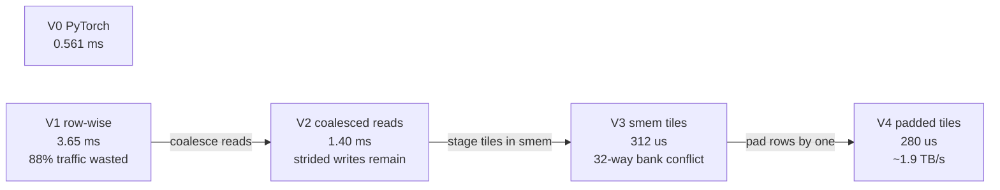

GPU kernel optimization restructures a kernel's memory accesses and control flow so that its achieved throughput approaches the peak of the resource that bounds it, either memory bandwidth or arithmetic throughput.

The four techniques treated here are coalesced global access, shared-memory staging, bank-conflict avoidance and divergence control. They are applied to matrix transpose, parallel reduction and GEMM. The hardware model is described in [[ml/serving-systems/gpu-basics|GPU Architecture and Programming]], and [[ml/serving-systems/performance-modeling|Performance Modeling]] and the compact [[ml/serving-systems/roofline-reference|Roofline reference]] determine which resource limits a given kernel.

The material began as notes for CSE 599K "LLM Serving Systems" at the University of Washington, Spring 2025, taught by Prof. Baris Kasikci with TA Kan Zhu. The transpose timings come from the course demo (an 8192x8192 FP32 transpose). The slides do not record the GPU or driver, so the absolute numbers are indicative and the relative improvements are the meaningful comparison.

## The memory hierarchy

The performance of a memory-bound kernel is determined largely by the level of the memory hierarchy it accesses and by its access pattern. The H100-class figures given in lecture are:

- Global memory: 80 GB at ~3 TB/s
- L2 cache: 50 MB at ~10 TB/s
- Shared memory / L1: 228 KB per SM at ~20 TB/s
- Registers: 64K x 32-bit per SM at ~600 TB/s

Bandwidth rises at each level, from about 3 TB/s in global memory to about 600 TB/s in registers. Each of the four techniques either moves accesses to a faster level of the hierarchy or lets a level deliver its rated bandwidth:

1. Coalesced global loading
2. Shared memory as a staging buffer
3. Bank conflict avoidance
4. Branch divergence minimization

> [!tip] Identify the bound before optimizing
> Placing the kernel on the roofline (the arithmetic intensity check in [[ml/serving-systems/performance-modeling|Performance Modeling]]) identifies its bound. The first three techniques reduce memory traffic or raise achieved bandwidth, so they improve only memory-bound kernels. A transpose performs no arithmetic, so its runtime is determined entirely by memory bandwidth, which makes it a convenient case study for these techniques.

## Case study 1: matrix transpose

The transpose is a pure data-movement kernel, so it isolates the effect of the memory techniques. It reads in row-major order and writes in column-major order, so unless the access pattern is restructured, one of the two sides is uncoalesced. Total traffic for 8192x8192 FP32 is $8192^2 \times 4 \times 2 \approx 537$ MB per pass, which converts each timing into an achieved bandwidth.

### V0: PyTorch baseline

`x.t()` only swaps the strides, and `.contiguous()` performs the data movement. The measured time is 0.561 ms, about 956 GB/s, roughly a third of peak global-memory bandwidth.

### V1: row-wise partitioning

The kernel assigns one block per row, and each thread handles a slice of columns (the naive kernel written out in [[ml/serving-systems/how-to-write-a-fast-kernel|How to write a fast kernel]]). The measured time is 3.65 ms, slower than the PyTorch baseline. The profiler attributes the time to uncoalesced global accesses, with 117,440,512 excess sectors, 88% of total traffic.

### V2: coalesced reads

Inside one warp, accesses to contiguous addresses coalesce into one or a few memory transactions. Reassigning threads so consecutive threads read consecutive addresses brings the time to 1.40 ms. The writes to the output are still strided by a full column, so 58,720,256 excess sectors remain (78% of total).

### V3: tiles through shared memory

Both sides of a transpose cannot be coalesced against global memory at once, so the kernel stages tiles in shared memory. It reads a tile row-wise (coalesced), transposes it inside shared memory, and writes it out row-wise in the transposed layout (also coalesced). Discontinuous access costs far less in shared memory than in global memory. The measured time is 312 us. The profiler now reports a 33-way bank conflict across 524,288 shared loads.

Shared memory can be allocated statically or dynamically:

```cpp
// static, up to 48 KB
__shared__ float f_array[10];

// dynamic, up to 228 KB (needs cudaFuncSetAttribute above 48 KB)
extern __shared__ int shared_mem[];
my_kernel<<<grid, block, shared_mem_size_in_bytes>>>(...);
```

### V4: padding away bank conflicts

Shared memory is divided into 32 banks, with consecutive 4-byte words striped across banks round-robin. When multiple threads in a warp hit different addresses in the same bank, the accesses serialize. A transposed tile column maps every element to the same bank when the tile width is a multiple of 32, which produces the 32-way conflict observed in V3. Padding each tile row by one element shifts consecutive rows to different bank offsets and breaks the pattern. The measured time is 280 us, about 1.9 TB/s, a 13x improvement over V1.

The diagram shows the full progression and the profiler finding that motivated each step.



## Branch divergence

Threads in a warp execute the same instruction stream. When a warp hits a branch where some threads take the `if` side and others the `else` side, the hardware runs both paths and masks out the inactive threads, so a divergent warp executes every path that any of its threads takes. Algorithms are therefore structured so that all threads of a warp take the same branch where possible.

## Case study 2: parallel reduction

A reduction combines the elements of an array with an associative operation (sum, max, min). The sequential form is

```text
for element in array:
    temp = op(temp, element)
```

The parallel version is a tree that reduces 8 elements to 4 partial results, then to 2 and to 1, in $\log n$ steps. Each implementation in the following sequence removes one inefficiency of the previous one:

1. Interleaved addressing: thread $i$ works when $i \bmod 2^N = 0$, with stride $2^{N-1}$. Every other thread in a warp is idle, which causes severe branch divergence.
2. Better access patterns: reindex so active threads are contiguous, which improves coalescing but keeps some divergence.
3. Sequential addressing: start with a large stride and halve it (stride 8, 4, 2, 1). Active threads stay contiguous and bank conflicts disappear.
4. Load two elements per thread: each thread does a first add during the load, halving the block count for the same data.
5. Load even more elements per thread: raises memory utilization per thread, but fewer blocks means fewer SMs have work, so occupancy eventually drops. Throughput therefore peaks at an intermediate number of elements per thread.

## Case study 3: GEMM

For $C = AB$ with $A$ of size $M \times K$ and $B$ of size $K \times N$, each output element consumes a row and a column, $2K$ elements. A naive computation performs $2MNK$ element loads, while the unique data is only $MK + NK$ elements. The difference is the reuse available to caching.

Tiling loads blocks of $A$ ($T_M \times K$ strips) and $B$ ($K \times T_N$ strips) through shared memory and reuses them across a $T_M \times T_N$ output tile. Total loads become

$$L = \frac{T_M + T_N}{T_M \cdot T_N} \cdot MNK$$

so doubling tile dimensions roughly halves memory traffic, until shared memory and register capacity cap the tile size.

GEMM implementations on current GPUs apply this tiling hierarchically. A thread block owns a large output tile, each warp owns a medium tile, and tensor cores execute the innermost small GEMMs (shapes like 16x8x16). A tensor core is a hardware unit that a full warp drives collectively, supporting several data types at different rates; the lecture quotes up to 256x throughput over FP32 CUDA cores for the fastest types. Whether a given matmul can saturate them is determined by its position on the roofline, treated in [[ml/serving-systems/performance-modeling|Performance Modeling]].

## Libraries to reach for first

A hand-written kernel is needed only for an operation or fusion that existing libraries do not provide. The main libraries are:

- cuBLAS: NVIDIA's closed-source GEMM library, the default choice for dense matmul.
- CUTLASS: open-source template GEMM library, used when a custom epilogue or data type is required.
- FlashInfer: attention kernels for serving (fused softmax, discontinuous GEMV).
- CUB: warp-, block-, and device-level primitives (reductions, scans, sorts).
- RAFT: vector search, clustering, top-k.

## Calling a custom kernel from Python

Pybind11 plus the torch extension machinery wraps a CUDA kernel for PyTorch:

```cpp
#include <pybind11/pybind11.h>
#include <torch/torch.h>
#include <torch/extension.h>
#include <cuda_runtime.h>

__global__ void add_kernel(int *a, int *b, int *c, size_t num) {
    int block_start = blockIdx.x * blockDim.x;
    int thread_id = threadIdx.x;
    int index = block_start + thread_id;
    if (index < num) {
        c[index] = a[index] + b[index];
    }
}

torch::Tensor add(torch::Tensor a, torch::Tensor b) {
    auto num = a.size(0);
    auto c = torch::empty_like(a);

    int threads_per_block = 256;
    int blocks_per_grid = (num + threads_per_block - 1) / threads_per_block;

    add_kernel<<<blocks_per_grid, threads_per_block>>>(
        a.data_ptr<int>(), b.data_ptr<int>(), c.data_ptr<int>(), num);
    cudaDeviceSynchronize();
    return c;
}

PYBIND11_MODULE(my_addition, m) {
    m.def("add", &add, "Add two tensors");
}
```

## Case study 4: Tensor Core GEMM

The tiled GEMM in case study 3 assigns its innermost tiles to Tensor Cores. A Tensor Core instruction computes a small, fixed-shape matrix-multiply-accumulate (e.g., an `m16n8k16` fragment per warp on Ampere/Hopper-generation instructions) rather than one scalar FMA per thread, so the tiling hierarchy from case study 3 has an additional level between the warp tile and the single element:

- **Thread-block tile**: the output region one block computes, sized to fit its share of shared memory (see the resource tradeoff in [[hardware/gpu-architecture|GPU Architecture from First Principles]]).
- **Warp tile**: a sub-region of the block tile that one warp accumulates, iterating over Tensor Core instructions.
- **Instruction tile**: the fixed shape a single Tensor Core instruction consumes (operands from registers, loaded via shared memory).

**Layouts**: Tensor Core instructions require operands in specific fragment layouts (row-major vs. column-major, and a specific thread-to-element mapping within the warp), which is why GEMM kernels stage data through shared memory with an explicit layout transform rather than reading global memory directly into Tensor Core registers.

**Accumulation precision**: even at FP16/BF16/FP8 input precision, Tensor Core accumulation typically happens in FP32, which controls numerical error independent of the storage dtype. An "FP8 GEMM" therefore has FP8 inputs and possibly FP8 outputs, while the accumulator inside the Tensor Core instruction is wider.

**Epilogue fusion**: the accumulated tile sits in registers after the last Tensor Core instruction; fusing bias-add, activation, or a scale/dequantize step into the epilogue (before writing back to global memory) avoids a second kernel launch and a second round trip through the memory hierarchy for the same tile. CUTLASS is designed around this form of fusion (see [Libraries to reach for first](#libraries-to-reach-for-first)).

**CUDA cores vs. Tensor Cores in one kernel**: a fused GEMM kernel typically still uses CUDA cores for index arithmetic, predication, and the epilogue's elementwise math, while the matrix-multiply itself routes through Tensor Cores; profiling such a kernel means separating Tensor Core utilization from CUDA core (SM) utilization, since a kernel can be Tensor-Core-bound while CUDA cores sit mostly idle, or vice versa if the epilogue is heavy relative to the matmul.

## FlashAttention as a memory-hierarchy problem

[[ml/serving-systems/memory-management|Memory Management in LLM Serving Systems]] covers the FlashAttention algorithm itself (online softmax, tiling Q/K/V into shared memory, never materializing the full score matrix). From the kernel-optimization perspective, FlashAttention is IO-aware in the same sense that the transpose of case study 1 is bandwidth-aware. It is a tiling strategy chosen to minimize traffic between HBM and the fast on-chip tiers ([[hardware/gpu-architecture|registers, shared memory, L2]]) rather than to minimize FLOPs. The [FlashAttention paper](https://arxiv.org/abs/2205.14135) reports its HBM access count as $O(N^2 d^2 M^{-1})$ against standard attention's $O(Nd + N^2)$, where $M$ is SRAM size. The reduction in data movement is of the same kind as in the shared-memory-staged transpose (case study 1) and the tiled GEMM (case study 3), applied to an operator whose naive implementation is memory bound because of a materialized intermediate rather than weight or activation traffic.

## Hopper-specific patterns: TMA, async barriers, warp-group MMA

Hopper (compute capability 9.0) added hardware support for the producer/consumer pipeline that earlier kernels implemented in software with double buffering:

- **Tensor Memory Accelerator (TMA)**: a dedicated async copy engine that moves a full tile between global and shared memory in one instruction, issued by a single thread, freeing the rest of the warp from address-generation and copy-loop overhead. This replaces the per-thread `cp.async` copy loop used on Ampere-generation kernels.
- **Async transaction barriers**: a barrier type that tracks the byte count of an in-flight TMA transfer and signals completion when that many bytes have arrived, so consumer warps can wait on data readiness without polling or a full `__syncthreads()`.
- **Warp-group matrix multiply-accumulate (`wgmma`)**: a Hopper instruction where a group of four warps cooperatively executes one larger matrix-multiply instruction, amortizing instruction issue and register traffic over a bigger tile than a single warp's `mma` instruction can address.
- **Producer/consumer (warp-specialized) pipelines**: rather than every warp doing load-then-compute, Hopper kernels commonly dedicate some warps purely to issuing TMA loads (producers) while other warps consume tiles via `wgmma` (consumers), overlapping the next tile's load with the current tile's compute by construction instead of relying on instruction-level scheduling to overlap them.

These primitives implement in hardware the asynchronous-copy, double-buffering and warp-specialization patterns that kernel authors previously wrote by hand. The common pattern is to **issue the next tile's load before consuming the current tile, and to gate the consumer on data readiness with a barrier instead of a full block-wide synchronization.** The cost is register and shared-memory pressure. Warp specialization and deeper pipelines both consume more of the finite per-SM budget worked out quantitatively in [[hardware/gpu-architecture|GPU Architecture from First Principles]], so pipeline depth trades against occupancy and tile size.

## Blackwell-specific notes

The [Blackwell Tuning Guide](https://docs.nvidia.com/cuda/archive/12.8.1/blackwell-tuning-guide/index.html) states that Hopper-era best practices carry over without code changes, and documents these Blackwell-specific tuning surfaces on top of that baseline:

- **Thread block clusters**: supported on Blackwell as on Hopper, with B200 additionally allowing a nonportable cluster size of 16 (versus the portable maximum of 8) by opting in via `cudaFuncAttributeNonPortableClusterSizeAllowed`. Larger clusters give a kernel more distributed shared memory to work with across SMs at the cost of reduced maximum active blocks GPU-wide.
- **Occupancy computation for cluster-based kernels**: the guide recommends computing occupancy with `cudaOccupancyMaxActiveClusters` rather than the older per-block occupancy calculators, since cluster-based launches change how blocks pack onto SMs.
- **L2 capacity growth**: up to 126 MB on GB200 versus 50 MB on H100, which increases the reuse distance over which tiles that spill out of shared memory remain resident in L2. This matters for kernels tuned around L2 persistence (`cudaFuncSetAttribute` with `cudaAccessPropertyPersisting`).
- **Shared memory carveout is unchanged in mechanism**: `cudaFuncAttributePreferredSharedMemoryCarveout` still controls the L1/shared split at runtime, same as Hopper and Ampere, so kernels tuned for a specific carveout percentage on Hopper require the same tuning pass, through the same API, on Blackwell.

## Separate vs. fused kernels

Fusion trades kernel-launch and intermediate-memory-traffic overhead against flexibility and compile-time specialization. The fusions that recur in LLM serving are:

| Pattern | Separate kernels | Fused kernel |
| --- | --- | --- |
| Norm + activation | Write normalized tensor to HBM, read it back for activation | Compute norm and activation on the same tile in registers/shared memory, one HBM round trip |
| Projection + activation | GEMM writes output, activation kernel reads it back | GEMM epilogue applies activation before writeback (the epilogue fusion above) |
| Attention (QKV proj, scores, softmax, output proj) | Multiple kernels, full score matrix touches HBM | FlashAttention-style single kernel, no materialized score matrix |
| Quantization + GEMM | Quantize kernel writes low-precision tensor, GEMM reads it | Fused quantize-and-matmul, or GEMM epilogue that quantizes on the way out |

The benefit grows with the degree to which the individual ops are memory bound. Two memory-bound elementwise kernels run back to back read and write the same data twice, so fusing them roughly halves their combined HBM traffic. Fusing a memory-bound op into the epilogue of a compute-bound GEMM adds little cost, since the GEMM is already Tensor-Core-bound and the epilogue op uses otherwise idle CUDA-core cycles. Fusing two compute-bound kernels yields little, since neither was limited by HBM traffic, as the [[ml/serving-systems/performance-modeling|roofline]] analysis predicts.

Launch overhead makes the benefit depend on the serving phase. Decode issues many small kernels per token (one attention step, one or two small GEMMs per layer, at batch sizes far below the compute-bound threshold worked out in [[ml/serving-systems/performance-modeling|Performance Modeling]]), so the fixed microsecond-scale launch cost from [[ml/serving-systems/gpu-basics|GPU Basics]]'s launch-cost hierarchy is a larger fraction of each kernel's runtime. Fusion, and CUDA graphs that amortize launch overhead further, are therefore disproportionately valuable for decode. Prefill's large, compute-bound kernels amortize the same fixed launch cost over far more work per launch, so fusion there is primarily about the HBM-traffic argument above rather than launch overhead.

## Triton vs. CUDA vs. CUTLASS on the same target

All three can express the tiled-GEMM pattern from case study 3. They differ in what they automate and what they expose:

- **CUDA**: full control over shared memory layout, TMA/barrier usage, warp specialization, and register allocation. CUDA has the highest performance ceiling and the largest implementation and maintenance cost, and it is the only option that exposes a new hardware feature as soon as the hardware is released.
- **CUTLASS**: a C++ template library built on CUDA that provides parameterized tile shapes, layouts, and epilogues (including the Hopper `wgmma`/TMA patterns above pre-wired) so a custom epilogue or dtype can be built by composing templates instead of writing the pipeline from scratch. It is intended for custom fusions that do not warrant a hand-written mainloop.
- **Triton**: a Python-embedded compiler where the programmer writes block-level logic (see [[ml/serving-systems/gpu-basics|GPU Basics]]'s Triton example) and the compiler handles shared memory allocation, some scheduling, and lowering to the target architecture's instructions, including Tensor Core usage where applicable. Iteration is faster, and performance is often close to CUDA and CUTLASS for GEMM- and attention-shaped kernels, at the cost of less control over the exact pipeline structure (warp specialization strategy, barrier placement) than hand-written CUDA or CUTLASS provide.

A practical order of preference is cuBLAS, CUTLASS or FlashInfer first ([Libraries to reach for first](#libraries-to-reach-for-first)), Triton when the fusion is custom but the access pattern is standard (tiled GEMM-like or attention-like), and raw CUDA only when a specific hardware feature or pipeline structure is not reachable through the higher-level tools.

## Benchmark protocol

The case-study timings are quoted from the original course demo and were not re-measured, and the FlashAttention HBM-access complexity is quoted from the paper. A kernel benchmark follows a protocol such as the following in place of a single wall-clock measurement:

1. **Warmup**: run the kernel several times before timing to let clocks reach steady state and caches/JIT (Triton's autotuner, CUDA's lazy module load) settle.
2. **Synchronize around the region timed**: use CUDA events (`cudaEventRecord`/`cudaEventElapsedTime`) around just the kernel launches being measured, not wall-clock time around asynchronous dispatch (see the timing pitfall in [[ml/serving-systems/gpu-basics|GPU Basics]]).
3. **Repeat and report variance**: run enough iterations to report a distribution (median and spread), not a single sample; GPU clocks, thermal state, and scheduler noise all introduce run-to-run variance.
4. **Record occupancy and achieved bandwidth/FLOPs** in addition to wall-clock time. Nsight Compute (`ncu`) reports achieved occupancy, achieved memory throughput as a percentage of peak, and achieved compute throughput as a percentage of peak. These determine whether a kernel is near its roofline ceiling or only fast relative to a weak baseline.
5. **Use profiler counters to attribute time.** Excess memory sectors (case study 1's coalescing metric), shared memory bank conflicts, warp divergence stalls, and Tensor Core utilization are all directly measurable in Nsight Compute rather than inferred from timing alone.
6. **Measure end-to-end impact as well as kernel time.** A kernel-level speedup that leaves the serving system's throughput and latency unchanged (because the kernel was not on the critical path, or because a fusion moved a launch-overhead cost elsewhere) does not improve serving, so results are validated against the request-level metrics from [[ml/serving-systems/performance-modeling|Performance Modeling]].

## Related notes

- [[ml/serving-systems/gpu-basics|GPU Architecture and Programming]]
- [[ml/serving-systems/how-to-write-a-fast-kernel|How to write a fast kernel]]
- [[ml/serving-systems/triton|Triton]]
- [[ml/serving-systems/performance-modeling|Performance Modeling]]
- [[ml/serving-systems/memory-management|Memory Management in LLM Serving Systems]]
- [[hardware/gpu-architecture|GPU Architecture from First Principles]]
- [[systems/operating-systems/benchmarks/reductions|Parallel Reductions Benchmarks]]
