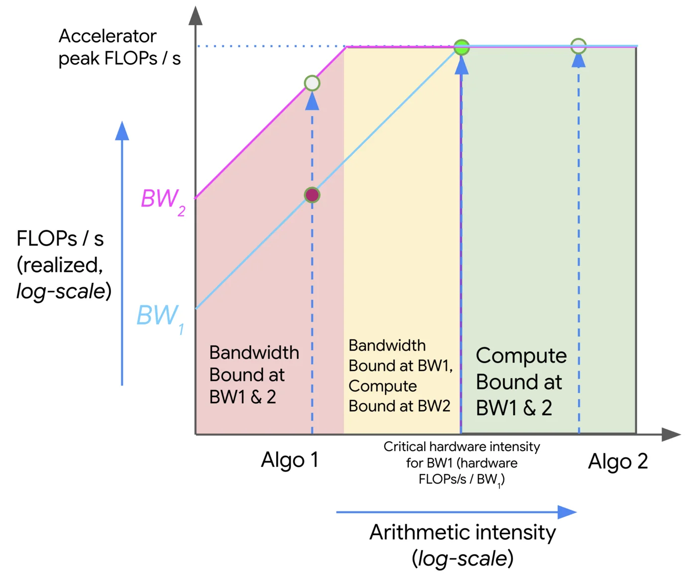

The roofline model bounds the execution time of a computation by the hardware's arithmetic throughput, its data-movement bandwidth and its memory capacity. The analysis is developed in [[ml/serving-systems/performance-modeling|Performance Modeling]] and applied in [[ml/serving-systems/optimizing-gpu-kernels|Optimizing GPU Kernels]].

> "When we run algorithms on hardware, we're bounded by three things: how fast it can do math (OPs/second), the bandwidth available for moving data around (bytes/second), and the total memory available to store data (bytes). These "roofline" constraints let us upper and lower bound the time of a given computation." - [How to Scale Your Model - All About Rooflines](https://jax-ml.github.io/scaling-book/roofline/)

## Arithmetic intensity

> Definition: the arithmetic intensity of an algorithm is given by the ratio of the total FLOPs it performs to the number of bytes it needs to communicate, either within a chip or between chips.

$$
\text{Arithmetic Intensity} = \frac{\text{Computation FLOPs}}{\text{Communication Bytes}}
$$

A workload attains high utilization when it is compute bound, meaning that the algorithm's intensity meets or exceeds the hardware's critical intensity. A memory-bound workload leaves part of the available compute unused.

### Example: dot product

$$
\text{Dot Product} = \sum_{i=1}^{n} a_i b_i
$$

For $a, b \in \mathbb{R}^n$ in a 2-byte dtype (float16), we load $2n$ elements ($4n$ bytes), write one ($2$ bytes), and perform $n$ multiplications plus $n-1$ additions:

$$
\text{Intensity (dot product)} = \frac{2n - 1}{4n + 2} \to \frac{1}{2} \text{ as } n \to \infty
$$

An H100 has a critical intensity of about 295 FLOPs per byte ([Roofline plot](#roofline-plot)), so the dot product is deeply memory bound and the GPU spends most of its time waiting on loads.

## Roofline plot

Roofline plots put arithmetic intensity on the x-axis and performance on the y-axis, both usually on a log scale. The plot has three parts:

- Roofline: the performance upper bound at each intensity, set by memory bandwidth on the left and peak compute on the right.
- Compute-bound: the flat region, where peak compute caps performance.
- Memory-bound: the slanted region, where bandwidth caps performance.

Within the memory-bound region, performance improves through better data movement (coalesced access, tiling, faster memory). Once compute is the bound, it improves through higher arithmetic throughput (multithreading, SIMD). NUMA effects complicate the memory side, since memory is "local" or "remote" relative to a core and poor placement adds communication overhead.

Writing $\text{OI}$ for operational intensity, a workload is compute bound when $\text{OI}(\text{algorithm}) > \text{OI}(\text{accelerator})$ and memory bound when the inequality flips. The balance point is the critical operational intensity, $\text{OI}(\text{algorithm}) = \text{OI}(\text{accelerator})$. For an H100 SXM at 989 dense FP16 TFLOPs and 3.35 TB/s, the critical intensity is about 295 FLOPs/byte, so the dot product's intensity of $\frac{1}{2}$ lies far into the memory-bound region.

## Matrix multiplication with FP16

For $A \in \mathbb{R}^{M \times N}$, $B \in \mathbb{R}^{N \times K}$, and $C = AB$: reads are $2MN + 2NK$ bytes, writes $2MK$ bytes, compute $2MNK$ FLOPs.

$$
\text{OI}(\text{matmul}) = \frac{2MNK}{2MN + 2NK + 2MK} \approx M \text{ if } N, K \gg M
$$

With $M$ as the batch dimension, matmul is therefore compute bound on the H100 once $M$ exceeds about 295.

## Key hardware specs for serving throughput

- $N_{\text{gpus}}$: number of GPUs
- $\text{MemBW}$: memory bandwidth (GB/s)
- $\text{NetBW}$: GPU interconnect bandwidth (GB/s)
- $\text{GPU}_{\text{mem}}$: GPU memory (GB)
- $\text{compute}$: GPU compute (TFLOPs)

## Key model specs for serving throughput

- $D_\text{model}$: hidden dimension size (`hidden_dim`)
- $L$: number of layers (`num_layers`)
- $P_\text{model}$: number of parameters
- $R_\text{GQA}$: group size of GQA (`group_size`)
- $S_\text{type}$: datatype size (`float16` = 2 bytes, `bfloat16` = 2 bytes, `int8` = 1 byte)
- $p$: average number of tokens to prefill
- $d$: average number of tokens to decode
- $p + d$: average number of tokens per user request
- $\frac{\text{Throughput}_\text{total}}{p + d}$: per-request throughput
- $d\frac{\text{Throughput}_\text{total}}{p + d}$: decoding throughput

## Execution time model

The model assumes optimal batching and enough demand to keep the hardware fully occupied.

For memory, each iteration streams nearly all of GPU memory (weights, activations, KV cache) once, so $t_\text{mem} = \frac{\text{GPU}_{\text{mem}}}{\text{MemBW}}$.

For compute, dense operations cost 2 FLOPs per parameter per batched token, so $t_{\text{compute}} = \frac{2 B_{\text{dense}} P_\text{model}}{\text{compute}}$.

For the network, the collectives that matter for a model sharded across GPUs are `AllGather` and `AllReduce`.

- `AllGather`: collect each GPU's output; roughly $N_{\text{gpus}} - 1$ network hops, with several per layer (4 in Llama 2).
- `AllReduce`: roughly twice the cost of an `AllGather`.

$$
\begin{align*}
N_{\text{gpus}} - 1 & \text{ hops} \\
4 & \text{ allgather per layer} \\
B_\text{dense} D_\text{model} & \text{ shape of the activations} \\
S_\text{type} & \text{ size of the datatype}\\
\end{align*}
$$

$$
T_\text{network} = \frac{4(N_{\text{gpus}} - 1) B_\text{dense} D_\text{model} S_\text{type}L}{\text{NetBW}}
$$

## Related notes

- [[ml/serving-systems/performance-modeling|Performance Modeling]]
- [[ml/serving-systems/optimizing-gpu-kernels|Optimizing GPU Kernels]]
- [[hardware/computer-architecture/simd-vectors-gpus-accelerators|From SIMD to SIMT: Vectors, GPUs, and Accelerators]]
