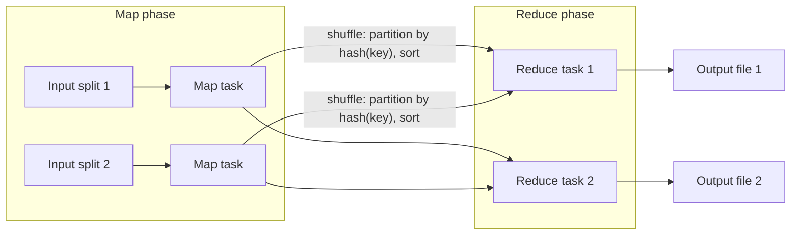

Chapter 10 of [Designing Data-Intensive Applications](https://dataintensive.net/), by Martin Kleppmann, treats batch processing, from Unix pipelines to MapReduce on distributed filesystems, together with the join strategies used in MapReduce and the outputs of batch workflows.

## Three kinds of systems

**Services** (online systems) handle requests from users or other services. Performance is measured in requests per second and response time.

**Batch processing** (offline systems) runs scheduled jobs that process accumulated data. Performance is measured in throughput.

**[[systems/performance/streaming|Stream processing]]** (near-real-time systems) sits between the two. A stream processor consumes a stream of events and computes aggregates as events arrive rather than on a schedule, and performance is measured in latency.

## Batch processing with Unix tools

The chapter's first example is log analysis. Applications append entries to a log file, and a job periodically turns the file into a report. A pipeline that finds the five most frequently requested URLs is:

```bash
cat /var/log/<application>/<logfile> |  # read the log file
    awk '{print $<url_idx>}' |          # extract the URL field
    sort |                              # sort the URLs
    uniq -c |                           # count occurrences of each URL
    sort -r -n |                        # sort numerically, descending
    head -n 5                           # take the top 5
```

The equivalent Python program is:

```python
from collections import Counter

with open('/var/log/<application>/<logfile>') as f:
    urls = [line.split()[url_idx] for line in f]
    for url, count in Counter(urls).most_common(5):
        print(url, count)
```

The Python version keeps its counts in an in-memory hash table. The Unix pipeline sorts instead, and `sort` spills to disk and merges, so the pipeline handles datasets larger than memory. MapReduce applies the same sort-based approach across many machines.

## MapReduce and distributed filesystems

**[[ml/recommender-systems/intro-mapreduce-spark|MapReduce]]** is a programming model for processing large amounts of data in bulk across many machines. A job runs a user-defined map function in parallel over many input records, then runs a user-defined reduce function over the map output grouped by key.

**Hadoop** is an open source implementation of MapReduce, and it ships with **HDFS** (Hadoop Distributed Filesystem). HDFS stores large files for streaming access, optimized for throughput over latency, and follows the design of the Google File System. It differs from an object store like Amazon S3 in that computation runs on the machines storing the data.

As a single-node MapReduce job, the URL-counting pipeline has four steps:

1. Read the input logs and break them into records (lines)
2. Map: extract the URL from each record and emit a key-value pair `(URL, _)`
3. Sort all key-value pairs by key
4. Reduce: count the occurrences of each URL

The multi-node version inserts a shuffle: map output is partitioned by hash of key, each partition is written to disk sorted by key, and one reduce task processes each partition. Chaining jobs so one job's output is the next job's input is called a workflow, managed either by convention over files or by a scheduler such as Airflow.



## Joins in MapReduce

### Reduce-side joins

A **sort-merge join** joins two sorted streams of records on a shared key. In MapReduce, mappers over both datasets emit records keyed by the join key, the shuffle brings all records for a key to the same reducer, and the reducer combines them.

```python
#pseudocode to join event and user data by user_id
#this is JUST PSEUDOCODE, not actual MapReduce code

#user: { user_id, name, date_of_birth, ... }
map_user_data(user):
    emit_intermediate(user.user_id, user.date_of_birth)

#event: { user_id, event_type, ... }
map_events(event):
    emit_intermediate(event.user_id, event.event_type)

#join: { user_id, date_of_birth, event_type, ... }
reduce_join(user_id, values):
    user = values[0]
    event = values[1]
    payload = { dob: user.date_of_birth, event: event.event_type }
    emit(user_id, payload)
```

**Group-by** uses the same machinery without a second dataset: map emits the grouping key, reduce aggregates each group.

```python
#pseudocode to group events by user_id
#this is JUST PSEUDOCODE, not actual MapReduce code

#event: { user_id, event_type, ... }
map_events(event):
    emit_intermediate(event.user_id, event.event_type)

#group: { user_id, [event_type, ...] }
reduce_group(user_id, values):
    emit(user_id, values)
```

Skew causes load imbalance among reducers. If one user has a disproportionate share of events, the reducer handling that user becomes the straggler that delays the whole job. Skew-handling join algorithms exist and are implemented in tools like Pig and Hive.

> [!warning] Hot keys make stragglers
> The shuffle sends **every** record for a key to a single reducer. One celebrity user's events can make that reducer run long after all others finish, and the job completes only when its slowest reducer completes.

### Map-side joins

The joins above run in the reducer. A **map-side join** performs the join in the mapper, which avoids the shuffle entirely, and applies when the inputs satisfy assumptions about their size or layout.

> [!tip] Map-side joins depend on input layout
> A map-side join omits the shuffle by relying on assumptions about its inputs (one dataset fits in memory, or both are partitioned and sorted the same way). Those assumptions become part of the job's contract with the process that produced the inputs.

A **broadcast hash join** joins a large dataset with a small one by loading the small dataset into an in-memory hash table on every mapper. Pig calls this a replicated join, Hive a MapJoin. A small dataset that does not fit in memory can sit in a disk index instead, where frequently accessed entries remain in the page cache.

```python
#pseudocode to join event and user data by user_id
#this is JUST PSEUDOCODE, not actual MapReduce code

#user: { user_id, name, date_of_birth, ... }
users = load_users()

#event: { user_id, event_type, ... }
map_events(event):
    user = users[event.user_id]
    payload = { dob: user.date_of_birth, event: event.event_type }
    emit(user_id, payload)
```

A **partitioned hash join** applies the same idea when both datasets are partitioned the same way, for example by the last digit of the user id. Each mapper then only loads the one partition of the small dataset matching its input partition, roughly a tenth of it in the ten-partition case. Hive calls these bucketed map joins.

```python
#pseudocode to join event and user data by user_id
#this is JUST PSEUDOCODE, not actual MapReduce code

#user: { user_id, name, date_of_birth, ... }
users_partition = load_users_with(ENV.partition_key)

#event: { user_id, event_type, ... }
map_events(event):
    user = users_partition[event.user_id]
    payload = { dob: user.date_of_birth, event: event.event_type }
    emit(user_id, payload)
```

## Output of batch workflows

**Search indexes** were the original application of MapReduce at Google. Building an index over a large document collection takes four steps:

1. Extract the text from each document
2. Tokenize the text into words
3. Remove common words (stop words)
4. Build an index from words to documents

The documents are partitioned by id, an index is built for each partition in parallel, and the partial indexes are merged.

```python
#pseudocode to build a search index
#this is JUST PSEUDOCODE, not actual MapReduce code

#document: { id, text, ... }
map_document(document):
    for word in tokenize(document.text):
        if word not in stop_words:
            emit_intermediate(word, document.id)

#index: { word, [document_id, ...] }
reduce_index(word, values):
    emit(word, values)
```

**Recommendation systems** suggest items to users based on past behavior. The recommendations need to be queryable in real time with low latency, while the heavy computation runs in batches so that it adds no load to the serving database. Instead of querying the database directly, the batch job works on an immutable copy of the data extracted into the distributed filesystem, transforms it there, and loads the results into a serving store, following the extract-transform-load (ETL) pattern.

```python
#pseudocode to build a recommendation index
#running on a machine that doesn't handle user requests

#load a partition of the data into memory (without relying on db client)
inmem_store_partition = load_data_from_db(ENV.partition_key)

#process data of this partition
index = build_index_with_map_reduce(inmem_store_partition)

#write the partition's index to the filesystem
write_partition_index_to_fs(ENV.partition_key, index)
```

```python
#pseudocode to query a recommendation index

def query(user_id):
    result = offload_query_to_partition(user_id)
    return result
```

## Sources

- [Designing Data-Intensive Applications](https://dataintensive.net/), Martin Kleppmann, chapter 10

## Related notes

- [[systems/databases/foundations/ch3-storage-and-retrieval|storage and retrieval]]
- [[systems/distributed-systems/google-file-system|distributed file systems]]
- [[ml/recommender-systems/intro-mapreduce-spark|Distributed Computing for Data Mining]]
- [[systems/performance/streaming|Streaming Data]]
- [[reference/slides/system-design-interviews|System Design Interviews]]
