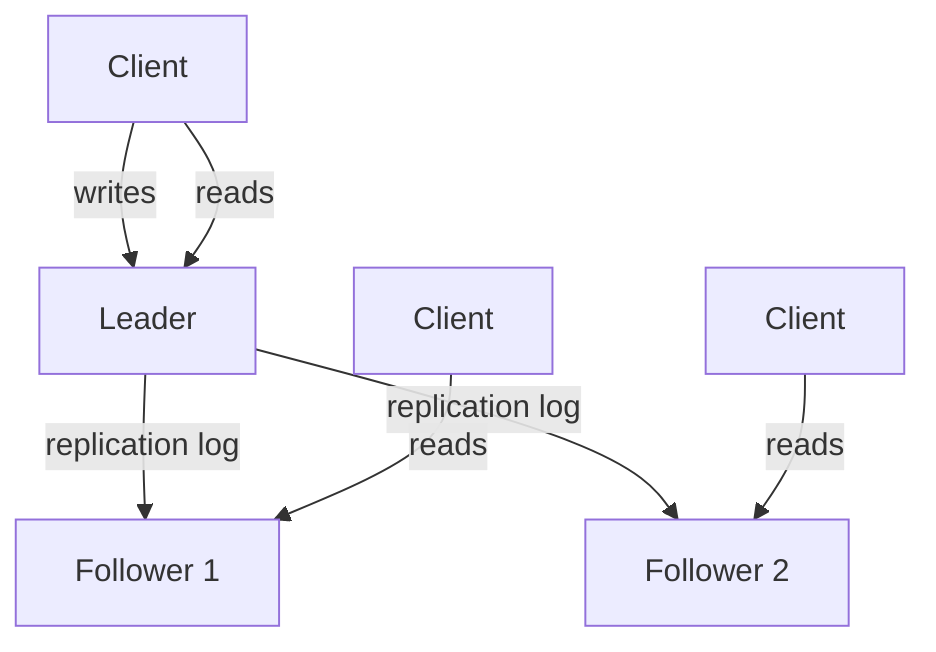
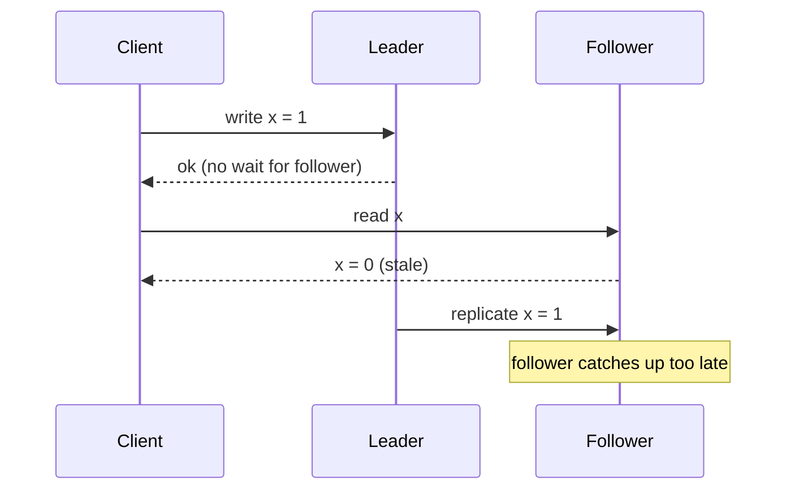
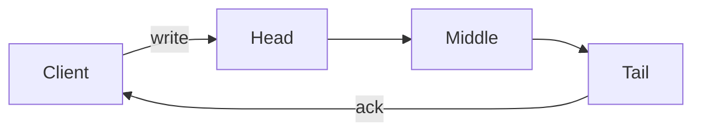

Replication maintains a copy of the same data on several machines connected by a network. Chapter 5 of [Designing Data-Intensive Applications](https://dataintensive.net/) by Martin Kleppmann treats replication chiefly in its leader-based form, including synchronous and asynchronous propagation, failover, and the implementation of replication logs.

## Why replicate

Replication serves three purposes:

- **High availability.** If one machine goes down, the data can still be served from others.
- **Latency.** Replicas in different locations let users read from the machine closest to them.
- **Read scalability.** Splitting read load across machines raises the read throughput the system can handle.

Kleppmann divides replicated data systems into three families: single-leader, multi-leader, and leaderless replication. In each of them the principal difficulty is keeping the replicas consistent with one another when the data changes.

## Leaders and followers

Leader-based replication (historically called master-slave, also active/passive) designates one node as the leader and the rest as followers. The leader handles all writes and propagates the changes to the followers, which serve reads. If the leader fails, a follower is promoted.

Many relational databases use this configuration, as do some non-relational databases and non-database systems like the distributed message brokers Kafka and RabbitMQ.

## Synchronous versus asynchronous replication

With **synchronous replication**, the leader waits for the follower's acknowledgment before confirming the write to the client, so the follower is guaranteed to have an up-to-date copy. The cost is reduced availability. If the follower is slow or unavailable, the leader cannot confirm the write, and writes block. With several synchronous followers the effect compounds, since a delay at any one of them blocks all writes.

Kleppmann notes that enabling synchronous replication in a database usually means, in practice, **semi-synchronous replication**, in which one follower is synchronous and the others are asynchronous. If the synchronous follower becomes unavailable, an asynchronous one is made synchronous. This guarantees at least two up-to-date copies of the data without allowing a single unavailable follower to block writes indefinitely.

Leader-based replication is often configured as fully **asynchronous**, so that the leader confirms writes without waiting for any follower. The leader continues to accept writes when followers are unavailable, but followers can fall arbitrarily far behind, a delay called **replication lag**. Durability is also weaker. If the leader fails and an out-of-date follower is promoted, writes that were confirmed but never replicated are lost.

Replication lag is visible to clients. A client that writes to the leader and then reads from a lagging follower can fail to see its own write:

> [!warning] Asynchronous means confirmed is not durable
> A write the leader confirmed exists on **one machine** until replication catches up. If a lagging follower is promoted after a leader crash, those confirmed writes are lost.

### Chain replication

Preventing that durability loss without giving up throughput is an active research area. [Chain replication](https://www.cs.cornell.edu/home/rvr/papers/OSDI04.pdf) is a variant of synchronous replication in which nodes form a chain: writes enter at the head, pass node to node down the chain, and are acknowledged from the tail once every node has them. Every acknowledged write therefore exists on all replicas. On a failure, a coordination service removes the failed node from the chain, after which writes resume.

## Setting up new followers

Copying the data files directly would capture different parts of the data at different points in time, since writes continue during the copy. A new follower is instead set up in four steps:

1. Take a consistent snapshot of the leader's database, ideally without locking writes.
2. Copy the snapshot to the new follower node.
3. The follower connects to the leader and requests all writes since the snapshot, identified by a position in the replication log (the log sequence number in Postgres, the binlog coordinates in MySQL).
4. The follower processes the backlog until it catches up.

## Handling node outages

The objective is for the system as a whole to continue operating when individual nodes fail, so that a single node can be rebooted without disruption.

### Follower failure: catch-up recovery

A recovering follower replays the log on its local disk, then requests from the leader every write it missed while it was down.

### Leader failure: failover

Leader failure is handled by failover, which consists of three steps:

1. Determine that the leader failed, passively via timeout or actively via heartbeats.
2. Choose a new leader, through an election or a designated controller node. The replica with the most up-to-date data is the preferred candidate, since promoting it loses the fewest writes.
3. Reconfigure the system so clients write to the new leader and followers replicate from it.

Failover is subject to several failure modes:

- With asynchronous replication, the new leader may lack writes the old leader confirmed. Some systems discard those writes, which sacrifices durability.
- Two nodes can both act as leader, a condition called **split brain**. If both accept writes, the conflicting data can be difficult or impossible to reconcile. Some systems detect this condition and shut down one of the nodes; a poorly designed mechanism can shut down both.
- The failure-detection timeout is a trade-off. A short timeout causes unnecessary failovers during load spikes, and a long one prolongs the outage before recovery begins.

> [!warning] Split brain
> An old leader that returns after failover may still act as leader. If both nodes accept writes, the divergent histories may be impossible to reconcile. For this reason some operations teams perform failover manually.

## Implementation of replication logs

### Statement-based replication

The leader logs every write request (each SQL statement, in a relational database) and ships the log to followers, which parse and execute each statement as if a client had issued it. The approach has three problems:

- Nondeterministic functions like `NOW()` and `RAND()` produce different values on each replica.
- Statements that depend on existing data, like auto-incrementing keys, must execute in exactly the same order, which constrains concurrency.
- Side effects such as triggers may behave differently per replica.

Workarounds exist, for example replacing nondeterministic calls with literal values when the statement is logged, but statement-based replication has largely been replaced by WAL shipping and logical logging. MySQL used it before 5.1 and still falls back to it for statements it can prove deterministic.

### Write-ahead log (WAL) shipping

The storage engine already appends every write to a WAL. The leader ships that same byte sequence to followers, which apply it to build identical data structures. Postgres and Oracle use this approach. The disadvantage is that replication becomes coupled to the storage engine. The WAL describes data at the level of disk blocks and bytes, so leader and followers must run the same database software, often the same version. That coupling can rule out zero-downtime upgrades. The upgrade pattern of upgrading followers first, failing over, then upgrading the old leader only works when the new version can still read and write the old log format.

### Logical (row-based) log replication

Logical log replication uses different formats for the storage engine's physical log and for the replication log. A logical log for a relational database is a sequence of records describing row-level changes:

- An inserted row logs all its column values.
- A deleted row logs enough to identify it, typically the primary key.
- An updated row logs its identity plus the new values.

A multi-row transaction logs one record per row plus a commit record; the MySQL binlog uses this approach in row-based mode. Logical logs decouple replication from storage engine internals, which allows leader and followers to run different versions and lets external systems consume the change stream, feeding data into Kafka, Elasticsearch, or a cache. Consuming a database's logical log this way is called change data capture.

## Sources

- [Designing Data-Intensive Applications](https://dataintensive.net/), Martin Kleppmann, chapter 5
- [Chain Replication for Supporting High Throughput and Availability](https://www.cs.cornell.edu/home/rvr/papers/OSDI04.pdf), van Renesse and Schneider, OSDI 2004

## Related notes

- [[systems/distributed-systems/consistency|consistency]]
- [[systems/distributed-systems/primary-backup|primary-backup replication]]
- [[systems/databases/foundations/ch4-encoding-and-evolution|encoding and evolution]]
