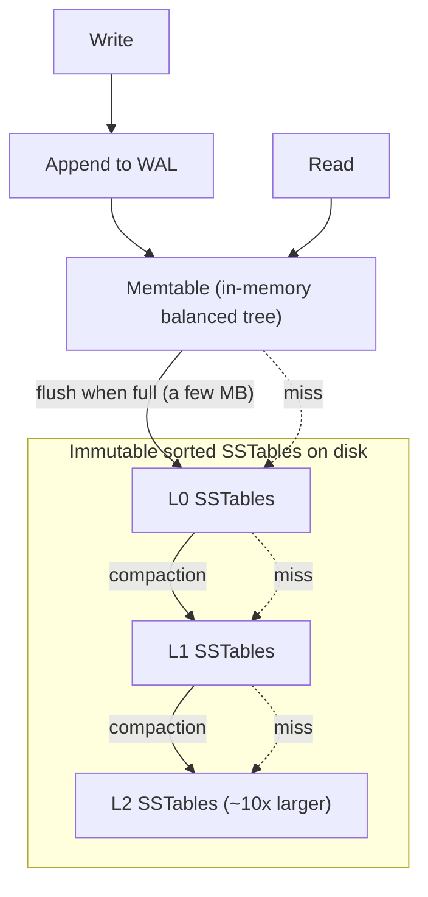

A storage engine is the component of a database that lays out data on disk or in memory and implements reads and writes against that layout. Chapter 3 of [Designing Data-Intensive Applications](https://dataintensive.net/) by Martin Kleppmann develops storage engines from an append-only log and contrasts the index structures of OLTP systems with the column-oriented layouts of analytic systems.

## A database as an append-only log

```bash
#!/bin/bash

#instant database
db_set () {
 echo "$1,$2" >> database
}
db_get () {
 grep "^$1," database | sed -e "s/^$1,//" | tail -n 1
}
```

The two functions store data in an append-only log, so a write is an $O(1)$ append and a read is an $O(n)$ scan. These costs already suit append-only workloads such as event sourcing. Reads are made faster by an index, an additional structure derived from the primary data. An index improves read performance at the cost of write performance, since every write must update the index as well as the primary data.

## Hash indexes

A hash index maps keys to byte offsets in the data file. Lookups by exact key are efficient, but range queries are not, since adjacent keys hash to unrelated buckets. In the design Kleppmann describes, the log stores key-value records in a binary format, and an in-memory hash table holds each key's offset. A delete appends a tombstone record, and periodic compaction rewrites segments without the deleted keys.

Crash recovery can proceed in several ways:

- Rereading the log from beginning to end rebuilds the hash table in memory. Recovery is slow but requires no extra storage.
- Periodic snapshots of the hash table on disk shorten recovery at the cost of extra storage.
- Checksums allow partially written records to be detected and discarded.

Concurrency control is simplified by a single writer thread and multiple reader threads, so that writes are serialized and reads proceed in parallel.

## SSTables and LSM-trees

A Sorted String Table (SSTable) stores key-value pairs sorted by key. Segments are organized by time: reads search from the most recent segment backwards, and a background process merges older segments. Because segments are sorted, merging works like mergesort, keeping only the most recent value for each key, and range queries are efficient. A sparse in-memory index of byte offsets suffices, since sorted order allows a scan to begin at the nearest indexed key.

A Log-Structured Merge Tree (LSM-tree) is the combination of an in-memory balanced tree with on-disk SSTables. LevelDB, and similarly Cassandra and HBase (both inspired by [[systems/distributed-systems/bigtable|Bigtable]]), use the following algorithm, given here in simplified form:

- A write is added to an in-memory balanced tree (the memtable).
- When the memtable exceeds some threshold, typically a few megabytes, it is written to disk as an SSTable file, and writes continue to a fresh memtable in the meantime.
- A read checks the memtable first, then the most recent on-disk segment, then progressively older segments.
- Segment files are merged and compacted periodically in the background.



Lucene, the index engine used by Elasticsearch and Solr, uses a similar scheme for its term dictionary. Words are the keys and the values are [[ml/nlp/reading/information-retrieval|posting lists]], the ids of documents containing each word. The term dictionary is stored in SSTable-like files that are merged periodically.

### Bloom filters

A Bloom filter is a bit array with $k$ hash functions that approximates set membership. Inserting a key sets $k$ bits, and a lookup reports "possibly present" only if all $k$ bits are set, so false positives occur and false negatives do not. The false-positive rate decreases as space increases: at $m$ bits for $n$ keys the optimal $k = (m/n)\ln 2$ gives a rate of $\approx 0.6185^{m/n}$, so 10 bits per key, a common setting, yields about 1%. An LSM read consults one filter per SSTable and skips any segment that cannot contain the key. The filters matter most for **missing** keys, for which a lookup without filters checks every level; [Bigtable](https://research.google/pubs/pub27898/) reports that Bloom filters drastically reduce disk seeks for this lookup pattern.

### Compaction policies

The compaction strategy determines how an LSM-tree's costs are divided among reads, writes and space:

- **Size-tiered** (Cassandra's default, HBase): segments of similar size are collected, and several are merged into one larger segment once enough accumulate. Each key is rewritten only $O(\log(\text{data}))$ times as it moves up size classes, so write amplification is low. A key may, however, exist in every tier at once, so reads check more segments and space amplification is high (a transient 2x during a large merge, and overlapping stale versions in between).
- **Leveled** (LevelDB, RocksDB default): levels $L_1, L_2, \ldots$ each hold non-overlapping SSTables covering the whole key range, with $L_{i+1}$ about 10x larger than $L_i$. A key occupies at most one SSTable per level, so reads touch few files and space overhead stays near 10%. Moving one SSTable from $L_i$ into $L_{i+1}$, however, rewrites ~10 overlapping SSTables there, so write amplification is roughly 10x per level crossed.

Size-tiered compaction therefore suits write-heavy workloads, and leveled compaction suits read-heavy or space-constrained ones. The choice is one instance of the trade-off among [read, write and space amplification](#read-write-and-space-amplification).

## B-trees vs. LSM-trees

B-trees favor read performance over write performance. A B-tree is an n-ary tree with sorted keys in every node, updated in place a page at a time. A high branching factor (hundreds of keys per 4-16 KB page) keeps the tree shallow, which minimizes disk seeks. Four levels of 4 KB pages with branching factor 500 address $500^4 \cdot 4\,\text{KB} = 256$ TB.

### Page splits and merges

The tree grows and shrinks a page at a time. An insertion into a full leaf **splits** it: a new page is allocated, the upper half of the keys moves there, and a separator key pointing at the new page is inserted into the parent. If the parent overflows in turn, the split propagates upward. A root split is the only operation that increases the tree's height, so the tree remains balanced without separate rebalancing passes. Deletion is the reverse operation. A page that falls below half full **merges** with a sibling (or borrows keys from it), and a separator is removed from the parent. Many production engines omit merges and only reuse emptied pages, accepting some fragmentation.

A split writes two leaf pages and a parent, and a crash between those writes leaves an orphaned page or a dangling pointer. This is one reason B-tree engines maintain a write-ahead log.

> [!warning] A split is a multi-page write
> Disks provide no atomic update of two leaves and a parent. A crash during a split corrupts the tree structure itself rather than a single record, so a B-tree engine depends on the [write-ahead logging](#write-ahead-logging-and-crash-recovery) rule.

LSM-trees favor write performance over read performance. Writes are sequential appends, and reads may touch several segments. Compaction can degrade read performance, especially at high percentiles of read latency, since it competes with foreground requests for disk bandwidth. At sufficiently high write throughput, disk space must also be monitored, because compaction can fall behind incoming writes and unmerged segments then accumulate.

## Write-ahead logging and crash recovery

Both engine families rely on the same durability rule. Before any in-place change to a data structure reaches disk, a record describing the change is appended to a log and flushed. The [PostgreSQL WAL docs](https://www.postgresql.org/docs/current/wal-intro.html) state the rule: "changes to data files ... must be written only after those changes have been logged." The rule has two consequences. A commit requires only a sequential log flush rather than a flush of every dirty page, which replaces scattered random writes with one sequential stream and lowers the cost of durability. Crashes also become recoverable. After a crash, the log is **replayed** forward from the last checkpoint, redoing changes that never reached the data files; because torn, half-written pages are restored from logged full-page images (or repaired via redo), a partially completed page split no longer leaves the tree corrupt.

A **checkpoint** bounds recovery time by flushing dirty pages and recording "the log before this point is fully applied," which allows old log segments to be recycled. The checkpoint settings balance write bursts against recovery time; frequent checkpoints shorten recovery but cause more repeated page writes.

A B-tree engine logs every page modification, including the structural ones from splits. An LSM engine needs the WAL only for the memtable, the one component held in volatile memory. SSTables are immutable once written, so recovery consists of replaying the WAL into a fresh memtable, and a memtable flush allows its log segment to be dropped. In this sense the LSM design is log-structured at two levels, in its WAL and in its SSTables.

## Read, Write and Space Amplification

> [!abstract] The amplification triangle
> No storage engine minimizes read, write, and space amplification at once. B-trees favor reads, LSM-trees favor writes, and within the LSM family the compaction policy (size-tiered vs. leveled) sets the balance among the three.

A storage engine can be characterized by three ratios: **read amplification** (disk work per logical read), **write amplification** (bytes written to disk per logical byte written), and **space amplification** (bytes on disk per live byte). No design minimizes all three. The [LSM-tree paper](https://www.cs.umb.edu/~poneil/lsmtree.pdf) argues that batching writes through memory and merging them sequentially improves write efficiency at some cost to reads.

The sources of amplification appear in the path of a single write through each engine.

**B-tree write path** for `put(k, v)`. The engine descends to the leaf (reads), appends the change to the WAL and flushes it, and modifies the page in the buffer pool. If the page is full it splits, dirtying two or three more pages and adding WAL records. The dirtied pages are eventually written back. Write amplification comes from the WAL copy and from writing a whole page for one changed row (a 100-byte row in a 4 KB page is 40x by itself), repeated for each split page. Read amplification is one page per level, reduced by caching the upper levels. Space amplification is modest and comes from half-empty pages and fragmentation.

**LSM write path** for the same put. The engine appends to the WAL and inserts into the memtable, and the foreground work ends there, which keeps write latency low. Later the memtable is flushed as an SSTable ($L_0$), and compaction rewrites the key once per level it descends. Write amplification is the WAL write, the flush, and one rewrite per level; with leveled compaction and ~10x fanout the total is typically 20-30x in practice, all of it sequential and in the background. Read amplification is the memtable, then the $L_0$ segments, then one SSTable per level, each requiring a Bloom-filter check and possibly a seek; a lookup for a missing key without filters incurs the maximum. Space amplification comes from stale versions and tombstones pending compaction.

B-trees incur random writes in the foreground and in exchange provide efficient point reads and predictable latency. LSM-trees incur background rewrite bandwidth and multi-segment reads and in exchange provide sequential-write throughput and better compression, since sorted runs compress well. The choice between them depends on the read/write mix, and within the LSM family the [compaction policy](#compaction-policies) adjusts the balance further.

## Secondary indexes

A secondary index is an index on something other than the primary key, so values are not necessarily unique. It can be built from a hash index, which does not support range queries efficiently, or from a B-tree or LSM-tree, which supports range queries at the cost of slower writes. As in full-text search, the value for each key can be a list of matching records, which is an inverted index.

### What lives inside the index

An index stores either a reference to the row or the row itself. A heap file holds the actual rows, and indexes point into it. Updates can happen in place when the new value fits in the old slot; otherwise the row moves and either the index or a forwarding pointer at the old location is updated, which adds a level of indirection to reads.

A clustered index stores row data directly in the index, which suits read-heavy workloads at the cost of space and slower updates. InnoDB, the MySQL storage engine, clusters the table on the primary key, and secondary indexes point at the primary key rather than a heap location. SQL Server allows one clustered index per table.

B-trees index one-dimensional keys efficiently but are inefficient for multi-dimensional queries. R-trees support multi-dimensional indexing at the cost of greater complexity. Fuzzy indexes handle approximate matches in full-text search: Lucene keeps an in-memory finite state automaton over the characters of each key, similar to a trie, which supports matching within a given edit distance.

## Keeping everything in memory

As the price of RAM falls, keeping an entire dataset in memory becomes feasible. In-memory databases offer low latency and high throughput, and Kleppmann argues that their principal advantage is avoiding the overhead of encoding data structures for disk rather than avoiding disk reads, since a disk-based engine with a large cache rarely touches disk on reads anyway. Crash recovery is the principal difficulty. A write-ahead log makes recovery possible but slows writes. Redis offers weak durability by writing to disk asynchronously. Some in-memory databases can exceed available RAM by evicting cold values to disk, cache-style.

## Transaction processing or analytics?

OLTP (online transaction processing) serves real-time stateful workloads that require low latency and high availability. An enterprise typically runs several OLTP systems side by side, with ACID transactions, concurrency control, and B-tree or LSM-tree indexes.

OLAP (online analytics processing) serves batch analysis over a read-only copy of the data, loaded and queried in bulk for business intelligence, reporting, and data mining. Availability matters less, and a single query may occupy a large share of the system's resources. Data warehouses are the systems built for OLAP, and they use different schemas and storage layouts from OLTP systems.

### Star and snowflake schemas

A star schema has a single fact table containing the events to be queried and multiple dimension tables holding the attributes by which queries filter and group. The fact table carries foreign keys into the dimension tables. A snowflake schema further normalizes the dimension tables into sub-tables, which saves space and complicates queries.

Warehouses reach petabytes in some cases, because facts are events retained over long periods. Fact tables are also wide, often hundreds of columns.

## Column-oriented storage

```sql
SELECT
 dim_date.weekday, dim_product.category,
 SUM(fact_sales.quantity) AS quantity_sold
FROM fact_sales
 JOIN dim_date ON fact_sales.date_key = dim_date.date_key
 JOIN dim_product ON fact_sales.product_sk = dim_product.product_sk
WHERE
 dim_date.year = 2013 AND
 dim_product.category IN ('Fresh fruit', 'Candy')
GROUP BY
 dim_date.weekday, dim_product.category;
```

Transactional databases store data in row-oriented layout, so answering this query loads entire rows even though it reads only a few columns. Column-oriented storage lays out each column contiguously, so a query reads only the columns it uses, which substantially reduces I/O on wide tables. Values within a column tend to be similar, so columns also compress well; the techniques Kleppmann describes are bitmap encoding combined with run-length encoding. Compressed columns additionally suit vectorized processing, where SIMD instructions operate on many values at once ([C++ SIMD example from UW CSE 333](https://courses.cs.washington.edu/courses/cse333/23au/lectures/27/code/cpp_simd_example.tar.gz)).

### Sort order in column storage

Rows can be kept ordered by a chosen sort key, with secondary sort keys breaking ties. Sorting enables fast range queries on the sort key, improves compression (long runs of duplicates run-length encode well), and gives sequential reads better locality. A store can also maintain the same data redundantly in several sort orders and select the most suitable one for each query, as C-Store did and Vertica, its commercial successor, does.

### Writing to column-oriented storage

These read optimizations make in-place writes slow. Column stores therefore adopt the LSM-tree approach, buffering writes in memory and periodically merging them into the compressed column files.

### Aggregation: data cubes and materialized views

A materialized view is a precomputed, stored query result, usually a join or aggregation. It speeds up the queries it covers and adds write overhead for its maintenance, which is acceptable in a read-heavy warehouse. A data cube extends the idea by precomputing aggregates along every combination of several dimensions, forming a multi-dimensional array of totals. Cubes are costly to maintain and offer no benefit to queries they do not cover. An alternative is to store raw data, identify slow queries by measurement, and precompute aggregates only for those queries.

## Sources

- [Designing Data-Intensive Applications](https://dataintensive.net/), Martin Kleppmann, chapter 3
- [O'Neil, Cheng, Gawlick, O'Neil (1996), The Log-Structured Merge-Tree](https://www.cs.umb.edu/~poneil/lsmtree.pdf)
- [PostgreSQL docs, Write-Ahead Logging](https://www.postgresql.org/docs/current/wal-intro.html)
- [Chang et al. (2006), Bigtable: A Distributed Storage System for Structured Data](https://research.google/pubs/pub27898/)

## Related notes

- [[systems/databases/foundations/ch2-data-models-and-query-languages|data models]]
- [[systems/databases/distributed-data/ch5-replication|replication]]
- [[systems/distributed-systems/bigtable|Bigtable, A Distributed Storage System for Structured Data]]
- [[ml/nlp/reading/information-retrieval|Indexing and Information Retrieval]]
