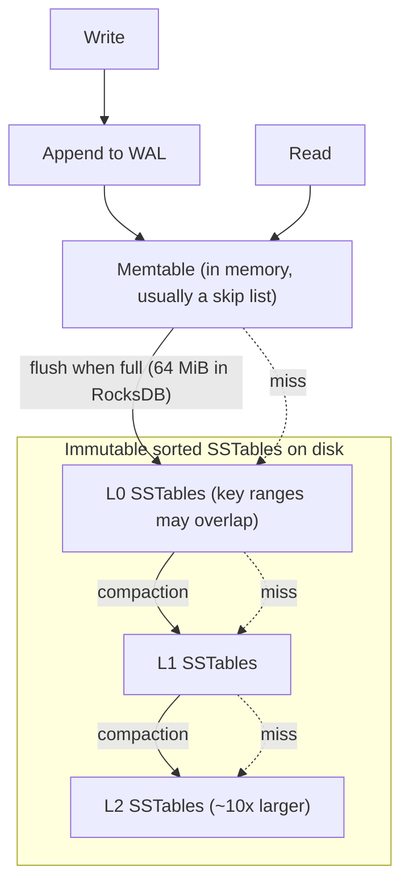

A storage engine is the component of a database that lays out records on disk and in memory and implements reads and writes against that layout. Two designs dominate on-disk key-value storage. An update-in-place **B-tree** keeps records sorted by key in fixed-size pages and overwrites a page whenever one of its records changes. A **log-structured merge-tree** (LSM-tree) buffers writes in memory, writes them out as immutable sorted files, and merges those files in the background.

Both maintain a sorted index on disk and differ in the I/O they perform to maintain it. A B-tree rewrites a whole page, and logs it, to change one record of perhaps a hundred bytes. An LSM-tree writes each record sequentially but rewrites it several more times as merges carry it into larger files, and a read may consult several files. Chapter 3 of [Designing Data-Intensive Applications](https://dataintensive.net/) (chapter 4, "Storage and Retrieval", in the 2026 second edition with Chris Riccomini) develops both from an append-only log and contrasts the indexes of transaction-processing systems with the column-oriented layouts of analytic systems. On one workload of 116-byte records, [SQLite and RocksDB](#measured-sqlite-and-rocksdb) differ in write amplification by a factor of 10 to 50.

## A database as an append-only log

```bash
#!/bin/bash

#instant database
db_set () {
 echo "$1,$2" >> database
}
db_get () {
 grep "^$1," database | sed -e "s/^$1,//" | tail -n 1
}
```

The two functions store data in an append-only log, so a write is an $O(1)$ append and a read is an $O(n)$ scan that returns the last value written for the key. Appending already suits workloads that are themselves logs, such as event sourcing. Reads are made faster by an **index**, an additional structure derived from the primary data. Every write must then update the index as well as the data, so an index lowers the cost of reads and raises the cost of writes.

## Hash indexes

A hash index maps each key to the byte offset of its latest record in the data file. It answers exact-key lookups with one seek and cannot answer range queries, since adjacent keys hash to unrelated buckets. [Bitcask](https://riak.com/assets/bitcask-intro.pdf), Riak's default storage engine and the design Kleppmann describes, keeps an in-memory hash table (the "keydir") from each key to the file, offset and size of its most recent value. Writes append to the one active data file, a delete appends a tombstone, and a background merge rewrites the older, immutable files keeping only live values.

The keydir must fit in memory and is lost in a crash. Reading every data file from start to end rebuilds it with no extra storage, but slowly. Bitcask therefore writes a **hint file** beside each merged data file, listing each key with the position and size of its value, so a restart reads the much smaller hint files instead. A checksum on every record lets recovery detect and discard one that a crash left half written. A single writer appends to the active file, so writes are serialized, while readers proceed in parallel against immutable files.

## SSTables and LSM-trees

A **Sorted String Table** (SSTable) stores key-value pairs sorted by key, with each key at most once per file. Sorting has three consequences. Several files merge in one sequential pass, as in mergesort, keeping the newest value of each key. A sparse in-memory index (one key per few kilobytes of file) suffices, because a lookup can scan forward from the nearest indexed key. And the records between two index entries can be compressed together as one block.

An LSM-tree, named by [O'Neil, Cheng, Gawlick and O'Neil (1996)](https://www.cs.umb.edu/~poneil/lsmtree.pdf), pairs an in-memory sorted structure with SSTables on disk. LevelDB, RocksDB, HBase and Cassandra all follow the scheme of [[systems/distributed-systems/bigtable|Bigtable]]:

- A write is appended to a write-ahead log and inserted into the **memtable**, an in-memory sorted structure. LevelDB, RocksDB, HBase and Cassandra all use a skip list by default; Cassandra 5.0 adds a trie-based memtable as an option.
- When the memtable passes a size threshold (64 MiB by default in RocksDB), it becomes immutable and is written out as an SSTable, while new writes go to a fresh memtable.
- A read checks the memtable, then the on-disk files from newest to oldest, and stops at the first version of the key it finds.
- Background compaction merges files, dropping overwritten values and, eventually, tombstones.



Lucene, the index library under Elasticsearch and OpenSearch, applies the same structure to full-text search. Terms are the keys, and the values are [[ml/nlp/reading/information-retrieval|posting lists]], the ids of the documents that contain each term. New documents accumulate in memory, are written out as immutable segments, and segments are merged in the background.

### Bloom filters

Without help, a lookup for a key that is absent, or that lives only in an old file, reads a block from every file whose key range could contain it. A **Bloom filter** per SSTable avoids most of those reads. It is an array of $m$ bits with $k$ hash functions: inserting a key sets $k$ bits, and a query reports "possibly present" only if all $k$ of its bits are set, so false positives occur and false negatives do not. For $n$ keys the false-positive rate is

$$
p \approx \left(1 - e^{-kn/m}\right)^k ,
$$

which is smallest at $k = (m/n)\ln 2$, where $p \approx 0.6185^{m/n}$. Ten bits per key gives $k \approx 7$ and $p \approx 0.82\%$. RocksDB's default filter confines each key's probes to one cache line and measures about 0.95% at 10 bits per key, and its Ribbon filter reaches the same rate in about 30% less memory for several times the construction CPU ([RocksDB wiki](https://github.com/facebook/rocksdb/wiki/RocksDB-Bloom-Filter)). Bigtable reports that with Bloom filters "most lookups for non-existent rows or columns do not need to touch disk". In the [measurements](#reads), a RocksDB lookup for an absent key in a 16M-record database read 59 bytes from storage on average, against 4,009 for a present key.

### Compaction policies

The compaction policy decides which files merge and when, and with it how an LSM-tree's costs divide among reads, writes and space. Let $T$ be the size ratio between adjacent levels.

- **Size-tiered** compaction collects files of similar size and merges $T$ of them into one file of the next size class once enough accumulate. A record is rewritten about once per size class, so write amplification is low. Up to $T$ overlapping files coexist in each class, though, so a lookup checks more files, stale versions take more space, and merging the largest class needs free space equal to its size while it runs. Cassandra's default is still SizeTieredCompactionStrategy in 5.0, with the newer UnifiedCompactionStrategy [recommended](https://cassandra.apache.org/doc/latest/cassandra/managing/operating/compaction/overview.html) for new tables. HBase's default ExploringCompactionPolicy picks sets of similarly sized files by a size ratio, which behaves like tiering.
- **Leveled** compaction (LevelDB, and RocksDB by default) keeps each level $L_1, L_2, \ldots$ as one sorted run of files with disjoint key ranges, each level about $T = 10$ times larger than the one above. A key appears at most once per level, so a point lookup reads at most one file per level. Moving one file from $L_i$ into $L_{i+1}$ rewrites the roughly $T$ files of $L_{i+1}$ that overlap it, so each level a record descends costs up to about $T$ in write amplification. Under RocksDB's dynamic level sizing (the default since 8.4) the last level holds about 90% of the data and space amplification stays near $1.11$ ([Dong et al., CIDR 2017](https://cidrdb.org/cidr2017/papers/p82-dong-cidr17.pdf)).

The RocksDB developers report that leveled compaction "usually exhibits write amplification between 10 and 30", and tiered compaction between 4 and 10 ([Dong et al., FAST 2021](https://www.usenix.org/conference/fast21/presentation/dong)). Tiering therefore suits write-heavy workloads and leveling suits read-heavy or space-constrained ones, and [Dostoevsky](https://doi.org/10.1145/3183713.3196927) (SIGMOD 2018) maps the designs in between, such as tiering in the upper levels and leveling at the last. A file whose key range overlaps nothing in the next level can be moved down by editing metadata alone, without rewriting it (a [trivial move](https://github.com/facebook/rocksdb/wiki/Compaction-Trivial-Move)); this is why loading keys in ascending order costs an LSM-tree little beyond the log and the flush.

Compaction runs in the background but competes with foreground requests for disk bandwidth, which shows up mostly in tail latency. If writes arrive faster than compaction can merge them, files accumulate in the upper levels, and engines then slow or stall writes until compaction catches up (RocksDB's [write stalls](https://github.com/facebook/rocksdb/wiki/Write-Stalls)).

## B-trees

A B-tree (in databases almost always a B+-tree, with records only in the leaves) is a balanced search tree whose nodes are fixed-size pages, typically 4 to 16 KiB: 4 KiB by default in SQLite and PostgreSQL's 8 KiB, 16 KiB in InnoDB. Interior pages hold sorted separator keys and pointers to child pages, and a lookup descends from the root to a leaf, reading one page per level. A high branching factor keeps the tree shallow. Four levels of 4 KiB pages with a branching factor of 500 address $500^4 \times 4\ \text{KiB} = 256\ \text{TB}$, and the few pages of the upper levels stay cached. Updates overwrite pages in place, so the file is the index, with no background reorganization.

How many keys an interior page holds depends on what it stores. In SQLite's [`WITHOUT ROWID`](https://sqlite.org/withoutrowid.html) tables, used in the measurements, the whole record is the key, and interior cells carry entire records rather than key prefixes. With 116-byte records each interior page held about 28 children, and a million records needed five levels: one root, 2, 39 and 1,120 interior pages, then 33,012 leaves.

### Page splits and merges

The tree grows and shrinks a page at a time. An insertion into a full leaf **splits** it: a new page is allocated, part of the records move to it, and a separator pointing at the new page goes into the parent. If the parent overflows in turn, the split propagates upward. A root split is the only operation that increases the height, so every leaf stays at the same depth without separate rebalancing passes.

Splitting a page in half leaves both halves half empty. Under random insertions, pages of a high-order B-tree end up about $\ln 2 \approx 69\%$ full on average ([Yao 1978](https://doi.org/10.1007/BF00289075)). SQLite does better by redistributing: its `balance_nonroot` spreads the cells of an overfull page and up to two siblings over as many pages as they need, "so that all pages have about the same amount of free space" ([`src/btree.c`](https://sqlite.org/src/file/src/btree.c)). In the 1M-record database above, the leaves were 88% full after random insertion.

Ascending keys are a common special case, since every insert lands in the rightmost leaf, and a half-and-half split would leave every page behind it half empty. InnoDB leaves pages about 15/16 full when it detects sequential inserts ([MySQL docs](https://dev.mysql.com/doc/refman/8.4/en/innodb-physical-structure.html)), and PostgreSQL packs the left half of a split rightmost leaf to its fillfactor, 90% by default. SQLite's `balance_quick` starts a new rightmost leaf holding only the new record, but only for rowid tables: a `WITHOUT ROWID` table is stored as an index B-tree, which always goes through `balance_nonroot`. The [ascending load](#measured-sqlite-and-rocksdb) of the `WITHOUT ROWID` table accordingly ended 1.22 times the live bytes, no denser than random insertion at 1.21.

In a toy-scale simulation of both designs (8 records per page) loading ascending keys, the B-tree starts a new leaf for each append past the right edge, as SQLite's rowid tables do, and leaves every page behind it full. The LSM-tree's flushed files never overlap the level below, so compaction moves them down without rewriting them.

<WritePaths workload="sequential" />

Deletion is the reverse. InnoDB [merges](https://dev.mysql.com/doc/refman/8.4/en/index-page-merge-threshold.html) a page with a neighbour once it falls below a threshold, 50% full by default. PostgreSQL's B-tree deletes a page only "when it's become completely empty of items" ([nbtree README](https://github.com/postgres/postgres/blob/master/src/backend/access/nbtree/README)), since moving items out of a partly full page could invalidate scans positioned on it. It frees space in a full leaf before splitting instead: by deduplicating equal keys (PostgreSQL 13) and by deleting index entries for dead row versions (bottom-up deletion, PostgreSQL 14).

> [!warning] A split is a multi-page write
> A split changes at least two leaves and their parent, and storage offers no atomic update of three pages. A crash between those writes leaves an orphaned page or a dangling pointer, which corrupts the tree's structure rather than one record. B-tree engines therefore depend on [write-ahead logging](#write-ahead-logging-and-crash-recovery).

## Write-ahead logging and crash recovery

Both designs rely on the same durability rule, which the [PostgreSQL documentation](https://www.postgresql.org/docs/current/wal-intro.html) states as: "changes to data files (where tables and indexes reside) must be written only after those changes have been logged, that is, after WAL records describing the changes have been flushed to permanent storage." A commit then needs one sequential log flush instead of a flush of every page it dirtied, and dirty pages can be written back later in any order. After a crash, recovery **replays** the log forward from the last checkpoint and redoes the changes that never reached the data files, half-finished splits included.

A page write can also be torn: a crash partway through writing an 8 KiB page can leave it part old and part new. PostgreSQL guards against this by logging a page's full image the [first time it is modified after each checkpoint](https://www.postgresql.org/docs/current/runtime-config-wal.html) (`full_page_writes`, on by default), and InnoDB by its doublewrite buffer. SQLite's WAL mode logs whole pages on every commit: each frame of the [WAL file](https://sqlite.org/fileformat2.html#the_write_ahead_log) is a 24-byte header followed by a complete page image. A **checkpoint**, which SQLite runs by default once the WAL holds [1000 pages](https://sqlite.org/wal.html), copies the newest image of each logged page back into the database file. Checkpoints bound recovery time and let the log be truncated or reused; checkpointing more often shortens recovery but writes frequently modified pages more times.

An LSM-tree needs its log only for the memtable, the one component held in volatile memory. SSTables are immutable once written and synced, so recovery replays the log into a fresh memtable, and a flush lets the corresponding log file be deleted. RocksDB's log is a sequence of 32 KiB blocks of records, each with a 7-byte header holding a checksum, length and type ([wiki](https://github.com/facebook/rocksdb/wiki/Write-Ahead-Log-File-Format)).

## Read, write and space amplification

The costs of a storage engine can be stated as three ratios ([Dong et al., CIDR 2017](https://cidrdb.org/cidr2017/papers/p82-dong-cidr17.pdf)):

- **write amplification**, bytes written to storage per byte of data the application writes;
- **read amplification**, bytes (or pages) read from storage per point lookup;
- **space amplification**, bytes stored per byte of live data.

No design minimizes all three. Each ratio follows from the path a write takes through the engine, here for records of $r$ bytes and pages of $P$ bytes.

**B-tree.** A write descends to its leaf, changes the page in the buffer pool, and logs the change; the page itself is written back later, whole. A transaction of $B$ random writes into a tree with $\Lambda$ leaves dirties $\Lambda(1 - e^{-B/\Lambda})$ distinct leaves in expectation, which is $B$ when $B \ll \Lambda$. When each dirtied page is logged whole and written back once, as in SQLite's WAL mode,

$$
W_{\text{B-tree}} \approx \frac{2P}{r} \cdot \frac{\Lambda\,(1 - e^{-B/\Lambda})}{B} .
$$

For 4 KiB pages and 116-byte records the first factor is $2P/r \approx 70.6$, or 70.8 counting SQLite's frame headers. A checkpoint writes back each distinct page among its 1000 logged frames once, which trims a little more. Larger transactions help only once $B$ approaches the number of leaves, since only then do writes in one transaction share pages, and the measured curve [follows the formula](#measured-sqlite-and-rocksdb). Engines that log row-level changes, such as InnoDB and PostgreSQL, write a small record per change instead (plus PostgreSQL's first-touch page images), and a page written back once per checkpoint absorbs every update it received meanwhile, so their write amplification depends on how many updates each page collects between checkpoints. Read amplification is one page per level below the cached ones. Space amplification is the reciprocal of the page fill factor, plus free pages.

**LSM-tree, leveled.** A write is appended to the log and inserted into the memtable, and the foreground work ends there. The record is written again when the memtable is flushed and once more each time compaction carries it down a level, and each such step rewrites up to about $T$ bytes of the level below per byte moved. With $L$ levels below $L_0$,

$$
W_{\text{LSM}} \approx \underbrace{1}_{\text{log}} + \underbrace{1}_{\text{flush}} + \sum_{i=1}^{L} c_i , \qquad c_i \lesssim T .
$$

RocksDB's [tuning guide](https://github.com/facebook/rocksdb/wiki/RocksDB-Tuning-Guide) works an example to $1 + 2 + 10 + 10 + 10 = 33$. The number of levels grows with the logarithm of the data size, about $\log_T(N/S_1)$ for $N$ bytes and a first level of $S_1$ bytes, so unlike a B-tree's, an LSM-tree's write amplification grows with the database. All of these writes are sequential and happen in the background. A point lookup checks the memtable, every $L_0$ file and one file per deeper level, but reads a data block only where the Bloom filter passes, so a present key costs about one block read plus the false-positive rate times the number of files checked. Space amplification comes from overwritten versions and tombstones that compaction has not yet removed.

The same simulation, fed random overwrites, shows where each design's write amplification comes from. A page holds 8 records, so the B-tree's $2P/r$ is 16 rather than 70; the shapes of the curves carry over to real engines, not their heights. Stepping through the "insert, then overwrite" workload one write per commit shows each B-tree overwrite logging a whole page, while the LSM-tree's writes arrive in bursts at flushes and merges. Raising the writes per commit lowers the B-tree's curve only once one commit's writes share pages.

<WritePaths workload="updates" />

## Measured: SQLite and RocksDB

SQLite 3.54.1 (a B-tree) and RocksDB 11.13.2 (a leveled LSM-tree) were built from source and driven by one C++ harness through the same sequence of operations. Keys are 16-byte strings and values are 100 incompressible random bytes, so each record is $r = 116$ bytes. A run loads $N$ distinct keys in random order, then overwrites randomly chosen existing keys (as many as $N$, at most 4 million), 1000 writes per transaction (SQLite) or write batch (RocksDB). Write amplification is the bytes the process passed to `write(2)` during a phase, including the deferred work that completes it (SQLite's final checkpoint, RocksDB's final flush and compactions), divided by the bytes of records written. Space amplification is the allocated size of the database's files divided by $N \cdot r$. Both engines keep a 32 MiB cache. Values are means over three seeds (one for SQLite at 16M), with standard deviations where they exceed 0.01.

| engine | records $N$ | load write amp. | update write amp. | space amp. after updates |
| --- | ---: | ---: | ---: | ---: |
| SQLite | 1M | 104.9 | 69.3 | 1.21 |
| SQLite | 4M | 114.0 | 70.4 | 1.21 |
| SQLite | 16M | 117.3 | 70.7 | 1.21 |
| RocksDB | 1M | 2.1 | 3.0 | 1.60 |
| RocksDB | 4M | 3.6 | 3.2 | 1.76 ± 0.01 |
| RocksDB | 16M | 5.4 ± 0.3 | 6.9 ± 0.4 | 1.21 ± 0.03 |
| RocksDB | 64M | 7.4 | 7.8 ± 1.1 | 1.14 |

SQLite's update write amplification stays at 70 at every size, as the [derivation](#read-write-and-space-amplification) predicts for transactions much smaller than the tree: each update logs one 4 KiB page frame and the checkpoint writes the page again. Loading costs more, 105 to 117, because splits and redistributions dirty sibling leaves and interior pages beyond the leaf that receives the record. RocksDB's write amplification grows with the size of the database. At 1M records (116 MB) the whole load still sat in three $L_0$ files, so only the log and the flush had been written; at 64M records (7.4 GB) the data occupied three levels below $L_0$ and the load wrote 7.4 bytes per byte. Its space amplification after the update phase is highest at the small sizes, because the update phase there ends with overwritten versions still in $L_0$ files that compaction has not merged. At the sizes measured, SQLite wrote 10 to 50 times as many bytes per record as RocksDB.

Larger transactions reduce SQLite's write amplification only once a transaction's writes share leaves. With 1M records the table has 33,012 leaves.

| writes per commit | 1 | 10 | 100 | 1,000 | 10,000 | 100,000 |
| --- | ---: | ---: | ---: | ---: | ---: | ---: |
| SQLite, passed to `write(2)` | 70.31 | 70.31 | 70.22 | 69.27 | 61.56 | 39.58 |
| SQLite, dirtied in the page cache | 70.35 | 70.35 | 70.26 | 69.30 | 61.23 | 22.78 |
| SQLite, model | 70.30 | 70.29 | 70.19 | 69.25 | 61.11 | 22.25 |
| RocksDB, measured | 2.17 | 2.03 | 2.01 | 2.01 | 2.01 | 2.01 |

The model is the formula above with SQLite's checkpoint added: a checkpoint runs after the commit that brings the WAL to 1000 frames and writes each distinct page among them once. It agrees with the measurement to within 0.05 up to 1,000 writes per commit. At 100,000 writes per commit a transaction dirties about 31,400 leaves, more than the 8,192 pages the cache holds, so SQLite [spills](https://sqlite.org/src/file/src/pager.c) dirty pages to the WAL before the commit and rewrites a page's frame in place when the page is modified again in the same transaction. The rewrites count in the bytes passed to `write(2)` but land on file pages that are already dirty in the operating system's page cache, so the bytes the kernel accounts as written to storage (`write_bytes`, which agreed with the bytes passed to `write(2)` to within 0.1% in every run of 1,000 or fewer writes per commit) match the model. RocksDB's cost per record does not depend on the batch size, apart from the WAL's per-batch header at one write per batch. These 200,000 updates fit in one memtable, so RocksDB's figure here is the log and the flush only.

Loading the keys in ascending order removes most of RocksDB's compaction work: with 4M records it wrote 2.03 bytes per byte, the log and the flush, since every flushed file was moved to the last level without being rewritten, and the database occupied 1.01 times the live bytes. SQLite's ascending load wrote 2.76 bytes per byte, one page image per filled page in the log and one in the checkpoint, and occupied 1.22 times the live bytes, as dense as random insertion and no denser, because `WITHOUT ROWID` tables do not use `balance_quick`.

### Reads

Each read pass opened the database in a new process, so the engine's 32 MiB cache started empty while the operating system's page cache held the files, and then looked up 200,000 random present keys followed by 200,000 absent keys. Bytes read are those requested with `read(2)` and `pread(2)`; latency is the mean over three passes.

| engine | records $N$ | bytes read per get, present | bytes read per get, absent | mean latency, present | mean latency, absent |
| --- | ---: | ---: | ---: | ---: | ---: |
| SQLite | 1M | 3,294 | 3,197 | 3.9 µs | 3.5 µs |
| SQLite | 4M | 5,343 | 5,303 | 4.2 µs | 3.9 µs |
| SQLite | 16M | 7,391 | 7,370 | 5.6 µs | 5.2 µs |
| RocksDB | 1M | 3,346 | 78 | 5.6 µs | 1.1 µs |
| RocksDB | 4M | 3,947 | 138 | 6.8 µs | 1.4 µs |
| RocksDB | 16M | 4,009 | 59 | 7.1 µs | 1.0 µs |

SQLite reads the same number of pages whether or not the key exists, since a lookup descends to a leaf either way. Its cost grows with the tree because the cache holds fewer of its levels: at 16M records the four interior levels occupy 18,597 pages (73 MiB), more than the cache, so a lookup missed in the cache on about 0.8 interior pages as well as the leaf, 1.8 pages in all. A RocksDB lookup of a present key read about one 4 KiB data block at every size, and a lookup of an absent key read a block in 1.5% to 3.4% of lookups, consistent with Bloom filters at 10 bits per key consulted in one to three files. With the files in the operating system's cache, RocksDB's present-key lookups took 1.3 to 1.6 times as long as SQLite's, and SQLite's absent-key lookups took 2.7 to 5.4 times as long as RocksDB's. After the page cache was dropped (one pass per size), mean latency at 16M records rose to 40 µs for SQLite and 42 µs for RocksDB on present keys, and to 27 µs and 1.4 µs on absent keys.

> [!note]- How this was measured
> The harness, build script, run scripts and raw results are in [ch3-storage-and-retrieval-experiments](https://github.com/elimelt/web/tree/main/notes/content/systems/databases/foundations/ch3-storage-and-retrieval-experiments). Everything ran on one cloud VM with 4 vCPUs (Intel Xeon at 2.10 GHz, KVM), 15 GiB of memory, Ubuntu 24.04 with Linux 6.18, and an ext4 file system on a virtual disk. SQLite 3.54.1 (from the amalgamation, with the `dbstat` table compiled in) and RocksDB 11.13.2 (a release static library) were built with GCC 13.3 at `-O2`.
>
> - **SQLite:** `page_size=4096`, `journal_mode=WAL`, `synchronous=NORMAL` (the WAL is synced at checkpoints, not at each commit), `mmap_size=0`, a 32 MiB page cache, and the table `kv(k BLOB PRIMARY KEY, v BLOB) WITHOUT ROWID`, written with `INSERT OR REPLACE`. Each write phase ends with `PRAGMA wal_checkpoint(TRUNCATE)`.
> - **RocksDB:** default options (leveled compaction with dynamic level sizes, a 64 MiB memtable, a 256 MiB first-level target and a size ratio of 10, the WAL written without a sync per batch) except compression off, a 32 MiB LRU block cache and a Bloom filter of 10 bits per key. Each write phase ends with `Flush` and `WaitForCompact`.
> - **Counting bytes:** write amplification is the change in `wchar` in `/proc/self/io` over a phase, which counts the bytes passed to `write(2)` and `pwrite(2)` by every thread of the process, RocksDB's flush and compaction threads included, divided by 116 bytes per record written. Space amplification is the sum of `st_blocks` over the database directory divided by $116N$. The B-tree's shape comes from `dbstat` (`tree_shape.py`).
> - **Runs:** `./build.sh`, then `run_scale.sh ./bench sqlite results/scale "1000000 4000000" "1 2 3"`, the same for 16M with seed 1, and `run_scale.sh ./bench rocksdb results/scale "1000000 4000000 16000000 64000000" "1 2 3"`. The batch sweep is `run_batch.sh ./bench ENGINE results/batch`, which preloads 1M records at 100,000 writes per commit and then applies 200,000 updates at each batch size, three seeds each. The ascending loads are `run_seq.sh ./bench ENGINE results/seq`. `summarize.py results` prints every table above (saved in `results/summary.txt`). The write runs took about an hour in all, with up to three benchmark processes running at once; that changes timings and, in RocksDB, when compactions run, but not the bytes SQLite writes.
> - **Reads:** each pass is a new process that opens the database written by `run_scale.sh` (seed 1) and looks up 200,000 random present keys, then 200,000 keys that were never written, timing each get with the monotonic clock. `run_reads.sh ./bench ENGINE results/reads "1000000 4000000 16000000"` runs one discarded pass to warm the page cache and three measured ones; with `COLD=1` it adds one pass after `echo 3 > /proc/sys/vm/drop_caches`, which warms the cache as it proceeds, so its mean mixes disk and memory reads. The read passes ran with no other benchmark on the machine.

## Beyond the two designs

Several designs sit between the two ends of the trade-off.

- **Bε-trees** ([Bender et al., 2015](https://www.usenix.org/publications/login/oct15/bender)) give each interior node a buffer of pending updates, pushed one level down in batches when it fills. Writes approach LSM-tree costs while reads keep a B-tree's single root-to-leaf path.
- **Key-value separation** ([WiscKey, FAST 2016](https://www.usenix.org/conference/fast16/technical-sessions/presentation/lu); RocksDB's [integrated BlobDB](https://rocksdb.org/blog/2021/05/26/integrated-blob-db.html)) keeps large values in a separate log and only keys and pointers in the LSM-tree, so compaction moves small entries instead of whole values. A lookup then costs a second read, and the value log needs its own garbage collection.
- **Monkey** ([SIGMOD 2017](https://doi.org/10.1145/3035918.3064054)) gives smaller levels more Bloom-filter bits per key than larger ones, which lowers the expected number of wasted reads for the same total memory.
- The **Bw-tree** ([ICDE 2013](https://www.microsoft.com/en-us/research/publication/the-bw-tree-a-b-tree-for-new-hardware/)) is a latch-free B-tree that records updates as deltas prepended to a page and writes pages to log-structured storage, pairing B-tree reads with sequential writes.

[Graefe's survey](https://doi.org/10.1561/1900000028) covers the B-tree techniques used in production engines, including logging, locking and bulk loading.

## Secondary indexes

A secondary index is an index on something other than the primary key, so its keys need not be unique. It is built from the same structures: a hash index, which does not support range queries, or a B-tree or LSM-tree, which does. The value for each key can be a list of matching row identifiers, which is an inverted index, as in full-text search.

### What lives inside the index

An index stores either a reference to the row or the row itself. With a **heap file**, rows sit in no particular order and every index points into the heap. An update that fits in the row's slot happens in place; otherwise the row moves, and either every index is updated or a forwarding pointer is left at the old location, which adds an indirection to reads.

A **clustered index** stores the rows themselves in the index's leaves. InnoDB clusters each table on its primary key, and each secondary index entry holds the primary-key columns, so a lookup through a secondary index descends a second tree ([MySQL docs](https://dev.mysql.com/doc/refman/8.4/en/innodb-index-types.html)). SQLite's `WITHOUT ROWID` tables are likewise a single B-tree keyed on the primary key, and SQL Server allows one clustered index per table. A covering index stores selected extra columns alongside the key, so some queries are answered from the index alone, at the cost of space and of updating the copies.

B-trees and LSM-trees order one-dimensional keys. Multi-dimensional queries, such as all points within a rectangle, need structures such as R-trees, or a space-filling curve that maps several dimensions to one key. For approximate matches in full-text search, Lucene stores its term index as a finite state transducer and answers a fuzzy query by intersecting it with a Levenshtein automaton, which accepts every string within a given edit distance of the query term.

## Keeping everything in memory

As RAM gets cheaper per byte, keeping a whole dataset in memory becomes feasible for more applications. Kleppmann argues that the main performance advantage of in-memory databases is avoiding the cost of encoding data structures in a form that can be written to disk, not avoiding disk reads, since a disk-based engine with a large enough cache serves reads from memory anyway. Durability comes from a log, periodic snapshots or replication. Redis, for example, writes periodic [snapshots](https://redis.io/docs/latest/operate/oss_and_stack/management/persistence/) by default, and with its append-only file enabled it fsyncs once per second by default, so a crash can lose about a second of acknowledged writes. Some in-memory engines hold more data than RAM by evicting the least recently used records to disk and loading them back on access, which resembles an operating system's paging at the granularity of records.

## Transaction processing or analytics?

OLTP (online transaction processing) workloads issue many small reads and writes, each touching a few records found by key, and need low latency. OLAP (online analytical processing) workloads scan many records, read a few columns of each and compute aggregates, in queries run by analysts or reports rather than end users. Data warehouses hold a read-mostly copy of the data from many OLTP systems, loaded in bulk by extract-transform-load (ETL) pipelines, and use storage layouts built for scans.

### Star and snowflake schemas

A star schema has a central fact table, each row of which records an event, and dimension tables holding the attributes by which queries filter and group (who, what, where, when). The fact table carries foreign keys into the dimension tables. A snowflake schema further normalizes the dimensions into sub-dimensions, which saves space and lengthens queries. Fact tables in large warehouses reach petabytes, because events are kept for years, and are often hundreds of columns wide.

## Column-oriented storage

```sql
SELECT
 dim_date.weekday, dim_product.category,
 SUM(fact_sales.quantity) AS quantity_sold
FROM fact_sales
 JOIN dim_date ON fact_sales.date_key = dim_date.date_key
 JOIN dim_product ON fact_sales.product_sk = dim_product.product_sk
WHERE
 dim_date.year = 2013 AND
 dim_product.category IN ('Fresh fruit', 'Candy')
GROUP BY
 dim_date.weekday, dim_product.category;
```

A row-oriented engine stores each row contiguously, so this query reads every column of every matching fact row even though it uses three. A column-oriented engine stores each column contiguously, all in the same row order, so the query reads only the columns it names; on a table hundreds of columns wide that cuts I/O by about two orders of magnitude. Values within a column repeat often, so columns compress well, and Kleppmann describes bitmap encoding (one bitmap per distinct value) with run-length encoding of the bitmaps. Compressed column chunks also suit vectorized execution, in which SIMD instructions apply one operation to many values at once ([C++ SIMD example from UW CSE 333](https://courses.cs.washington.edu/courses/cse333/23au/lectures/27/code/cpp_simd_example.tar.gz)).

### Sort order in column storage

Rows can be stored sorted by a chosen key, with further columns breaking ties. Sorting lets a range query on the sort key read one contiguous region and lengthens the runs that run-length encoding compresses. A store can also keep the same data redundantly in several sort orders and use whichever suits a query, as [C-Store](https://www.vldb.org/archives/website/2005/program/paper/thu/p553-stonebraker.pdf) (VLDB 2005) did with overlapping "projections" and Vertica, its commercial successor, does.

### Writing to column-oriented storage

Sorting and compression make in-place updates impractical, since inserting one row would rewrite every column file. Column stores therefore take the LSM-tree's approach: writes go to an in-memory, row-oriented store that is periodically merged into new compressed column files, and queries read both.

### Aggregation: data cubes and materialized views

A materialized view is a stored copy of a query's result, usually a join or aggregation, kept up to date as the underlying data changes. It speeds up the queries it answers and adds write work for its maintenance, which suits a read-mostly warehouse. A data cube precomputes an aggregate for every combination of values of several dimensions, forming a multi-dimensional array of totals. Cubes answer the queries they cover with a lookup and cannot answer queries that filter on attributes outside their dimensions, so warehouses usually keep the raw facts and add aggregates only for queries that measurement shows to be slow.

## Sources

- [Designing Data-Intensive Applications](https://dataintensive.net/), Martin Kleppmann, chapter 3 (chapter 4 of the second edition, with Chris Riccomini, 2026)
- [O'Neil, Cheng, Gawlick, O'Neil (1996), The Log-Structured Merge-Tree (LSM-Tree)](https://www.cs.umb.edu/~poneil/lsmtree.pdf), Acta Informatica 33
- [Chang et al. (2006), Bigtable: A Distributed Storage System for Structured Data](https://research.google/pubs/pub27898/), OSDI
- [Sheehy and Smith (2010), Bitcask: A Log-Structured Hash Table for Fast Key/Value Data](https://riak.com/assets/bitcask-intro.pdf)
- [Dong, Callaghan, Galanis, Borthakur, Savor, Stumm (2017), Optimizing Space Amplification in RocksDB](https://cidrdb.org/cidr2017/papers/p82-dong-cidr17.pdf), CIDR
- [Dong, Kryczka, Jin, Stumm (2021), Evolution of Development Priorities in Key-value Stores Serving Large-scale Applications: The RocksDB Experience](https://www.usenix.org/conference/fast21/presentation/dong), FAST
- [Yao (1978), On Random 2-3 Trees](https://doi.org/10.1007/BF00289075), Acta Informatica 9
- [Graefe (2011), Modern B-Tree Techniques](https://doi.org/10.1561/1900000028), Foundations and Trends in Databases 3(4)
- RocksDB wiki: [Leveled Compaction](https://github.com/facebook/rocksdb/wiki/Leveled-Compaction), [Bloom Filter](https://github.com/facebook/rocksdb/wiki/RocksDB-Bloom-Filter), [Compaction Trivial Move](https://github.com/facebook/rocksdb/wiki/Compaction-Trivial-Move), [Write-Ahead Log File Format](https://github.com/facebook/rocksdb/wiki/Write-Ahead-Log-File-Format), [Tuning Guide](https://github.com/facebook/rocksdb/wiki/RocksDB-Tuning-Guide)
- SQLite: [Write-Ahead Logging](https://sqlite.org/wal.html), [Database File Format](https://sqlite.org/fileformat2.html), [WITHOUT ROWID tables](https://sqlite.org/withoutrowid.html), [`src/btree.c`](https://sqlite.org/src/file/src/btree.c)
- PostgreSQL: [Write-Ahead Logging](https://www.postgresql.org/docs/current/wal-intro.html), [WAL configuration](https://www.postgresql.org/docs/current/runtime-config-wal.html), [nbtree README](https://github.com/postgres/postgres/blob/master/src/backend/access/nbtree/README)
- [Dayan, Athanassoulis, Idreos (2017), Monkey: Optimal Navigable Key-Value Store](https://doi.org/10.1145/3035918.3064054), SIGMOD; [Dayan and Idreos (2018), Dostoevsky](https://doi.org/10.1145/3183713.3196927), SIGMOD
- [Lu, Pillai, Arpaci-Dusseau, Arpaci-Dusseau (2016), WiscKey: Separating Keys from Values in SSD-conscious Storage](https://www.usenix.org/conference/fast16/technical-sessions/presentation/lu), FAST
- [Bender et al. (2015), An Introduction to Bε-trees and Write-Optimization](https://www.usenix.org/publications/login/oct15/bender), ;login: 40(5)

## Related notes

- [[systems/databases/foundations/ch2-data-models-and-query-languages|Data models and query languages]]
- [[systems/databases/foundations/ch4-encoding-and-evolution|Encoding and evolution]]
- [[systems/databases/distributed-data/ch5-replication|Replication]]
- [[systems/databases/mvcc-snapshot-isolation|MVCC and snapshot isolation]]
- [[systems/distributed-systems/bigtable|Bigtable, A Distributed Storage System for Structured Data]]
- [[ml/nlp/reading/information-retrieval|Indexing and Information Retrieval]]
