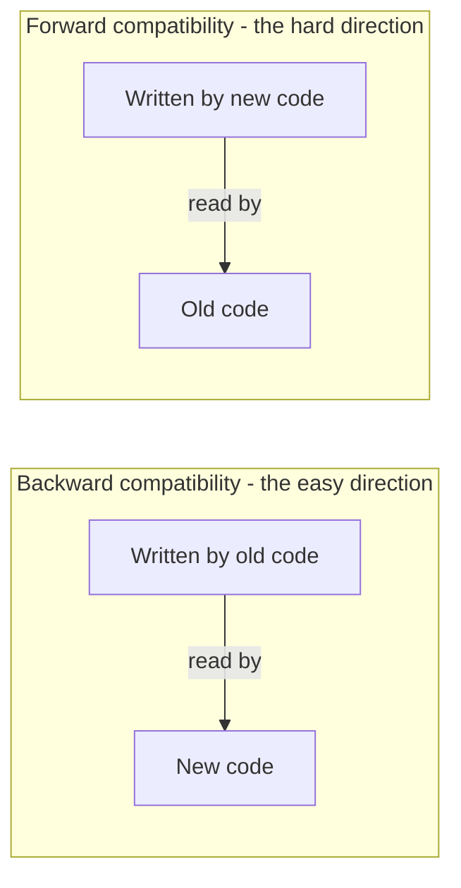

Chapter 4 of [Designing Data-Intensive Applications](https://dataintensive.net/) by Martin Kleppmann treats the compatibility of encoded data across changes to the code that writes and reads it, and the serialization formats and modes of dataflow that keep old and new versions interoperable.

## Vocabulary

**Evolvability** is the ease with which a system can be adapted as requirements change.

**Schema-on-read** means the schema is not enforced when data is written, only interpreted when it is read, so it can change over time. **Schema-on-write** means the schema is enforced at write time, usually by a database.

**Backward compatibility** means new code can read data written by old code. **Forward compatibility** means old code can read data written by new code, usually by ignoring fields it does not recognize. Backward compatibility is the easier of the two to achieve, since the new code is written with the old format available. Forward compatibility requires old code to ignore additions made after it was written.

## Formats for encoding data

Programs work with at least two representations of data: in-memory data structures (objects, arrays, hash maps) and encoded bytes stored on disk or sent over the network. **Serialization** (also called encoding or marshaling) translates the in-memory form into bytes that can be stored or transmitted and reconstructed later, possibly on a different machine. **Deserialization** (decoding, unmarshaling) is the reverse.

Language-specific formats such as Java serialization and Python's pickle are tied to one language and are often slow and space-inefficient, which makes them unsuitable for long-term storage or communication between services.

**JSON** and **XML** are language-independent and human readable. Both represent Unicode text directly but do not support binary strings; the base64 workaround increases data size by 33%. **CSV** is widely used and less expressive. It is not self-describing, so application code carries the burden of interpreting types.

**Binary encodings** are more compact than the textual formats and faster to encode and decode. They suit communication within an organization. For data that crosses organizational boundaries, a textual format has the advantage that every party can read it without shared tooling.

### Protocol Buffers, Thrift, and Avro

**Protocol Buffers** (protobuf) pairs a schema language with a binary encoding. The encoding is not self-describing; decoding requires the schema. Code generators produce classes that encode and decode records. Each field gets a numeric field tag in the schema, and the encoding refers to fields by tag rather than name, so fields can be reordered without breaking compatibility. Lists are expressed as repeated fields rather than a dedicated array type.

**Thrift** similarly consists of an interface definition language, a binary encoding, and code generation for many languages. It provides several protocols, including a binary protocol and a denser compact protocol. Field names never appear in the encoded bytes; field tags do. Unlike protobuf, it has dedicated list types, which can nest.

**Avro** originated in the Hadoop project as an alternative to protobuf and Thrift. It has two schema languages, an IDL for humans and a JSON form for machines. The encoding contains no tags or field identifiers at all, only lengths and values in sequence, which makes it the most compact of the three, and it uses variable-length integers for lengths. Decoding requires knowing the exact schema the data was written with, which leads to its writer/reader schema design.

The three formats share two properties:

- **Compact structure.** Data is a sequence of fields identified by schema information rather than repeated names.
- **Schema evolution.** New fields can be added if they get a fresh tag number and are optional or have a default value. Old code ignores unknown fields; new code fills defaults for missing ones. Fields can be removed or renamed only if their tag numbers are never reused.

> [!warning] Tag numbers cannot be reused
> In protobuf and Thrift, a removed field's tag number can **never be reused**. Old data encoded with that tag still exists, and that data would be read without error as the value of any new field given the same tag.

### Avro's writer and reader schemas

Avro decodes data by comparing two schemas: the writer schema the data was encoded with and the reader schema the consuming code expects. The two need not be identical, only compatible, under the following rules:

- A field in the writer schema that the reader schema lacks is ignored.
- A field the reader schema expects that the writer schema lacks is filled from the reader schema's default value.
- Either side can be the newer version. Compatibility holds as long as fields are only added or removed with default values.
- A field that should default to null must be declared as a union type including null.
- Renaming a field uses aliases, which keeps backward compatibility only, since old writers know nothing about the new name.

How the reader learns the writer schema depends on context. A Hadoop file with millions of records encoded identically stores the writer schema once at the top of the file. A database whose rows were written over years stores a schema version number per row plus a table of versions. Services can negotiate schemas at connection setup. A registry of schema versions is useful in each of these cases.

### Dynamically generated schemas

Consider dumping a relational database to disk in a binary format. The database schema has changed over time, so with protobuf or Thrift field tags would have to be assigned by hand for every historical version. Avro is designed for this case. An Avro schema is generated from the current database schema and regenerated whenever the database schema changes, and since the encoding has no tags, nothing needs to be maintained by hand. Avro also suits dynamically typed languages, in which a code generation step offers little benefit, whereas protobuf and Thrift are designed around static code generation.

## Modes of dataflow

In every mode, one process encodes and another decodes. The modes differ in who the two parties are and how far apart in time they run.

### Through databases

The writer encodes; every later reader decodes. Multiple processes running different code versions may access the same database at the same time, so both backward and forward compatibility are needed. A further difficulty is the preservation of unknown fields. Old code that reads a record, updates one field, and writes it back can drop fields added by newer code, without any error, unless the application handles this case. Data outlives the code that wrote it, so a value written at any time in the past may still need to be read.

> [!warning] Unknown fields in read-modify-write
> Forward compatibility at decode time is insufficient on its own. Old code that decodes a record, changes one field, and re-encodes it will **drop every field it did not recognize** unless unknown fields are explicitly carried through.

### Dumping to files and archival storage

Here the encoder is the process dumping the data and the decoder reads the file later. A dump is typically encoded with the latest schema in one pass, which allows it to use an analytics-friendly column-oriented format. Avro suits this mode of dataflow.

### Through services: REST and RPC

The client encodes requests; the server decodes them, and vice versa for responses. Servers are commonly updated before clients, and with public APIs the provider has no control over client versions at all, so both compatibility directions matter here too.

In a service-oriented architecture, different teams own different services, each exposing an API that encapsulates its internals. Web services appear in three contexts: internal services within an organization, public APIs, and partner APIs exposed to specific external organizations.

**REST** is a design philosophy that builds on HTTP: simple data formats, URLs to identify resources, and HTTP's own mechanisms for caching, authentication, and content negotiation. Kleppmann discusses SOAP mainly to recommend against it.

**RPC** frames a network request as a call to a function on a remote server, with the aim of location transparency. The abstraction is imperfect, since network requests can fail, time out, or execute twice, which local calls cannot, so systems built on RPC still have to handle those failure modes. Idempotent operations make transparent retries safe. REST does not present a network request as a local call and so avoids this mismatch. RPC frameworks also tend to couple client and server to specific languages, which is a disadvantage for public APIs, whose clients the provider does not control.

**gRPC** is an RPC framework using protobuf as its interface definition language over HTTP/2. It suits internal services better than public APIs. Newer RPC frameworks generally represent asynchronous responses with futures or promises, support streaming for long-lived exchanges, and sometimes include service discovery so clients can find servers without hardcoded addresses.

REST's principal practical advantage is its ecosystem, since servers, load balancers, proxies, caches, monitoring, and debugging tools all support HTTP, as do browsers.

For evolvability, a reasonable simplifying assumption is that all servers are updated before all clients, so requests need only backward compatibility and responses only forward compatibility. The provider of a public RPC-style API must nevertheless maintain compatibility indefinitely, and since no single standard for API versioning exists, versioning tends to be ad hoc.

### Through asynchronous message-passing

Message passing sits between RPC and databases. A producer sends a message to a named queue or topic on a message broker (Kafka, RabbitMQ, and similar), the broker stores it, and one or more consumers receive it. The sender does not wait for a response.

A broker provides four properties:

- **Durability.** The broker holds messages until they are consumed, so a broker or consumer restart loses no messages.
- **Decoupling.** Producers and consumers do not need to be online at the same time, and neither needs to know the other's address.
- **Fan-out.** A message can be delivered to multiple consumers.
- **Buffering.** Queues absorb bursts when consumers fall behind.

Communication is one-way by default, though request/response can be layered on top with reply queues. Brokers do not usually enforce a data format, so the choice of encoding remains with the application; the broker reads only routing metadata.

### Distributed actor frameworks

The actor model treats actors as the unit of concurrent computation. In response to a message, an actor can update local state, create more actors, and send more messages. Each actor is a state machine that communicates only by message passing. A distributed actor framework uses the same message-passing mechanism between machines as within one, so local and remote communication share code and semantics, and the mismatch between them is smaller than in RPC.

Rolling upgrades still require compatible message encodings across framework versions:

- **Akka** uses Java serialization by default and can be configured to use protobuf, which enables rolling upgrades.
- **Orleans** uses a custom encoding by default; upgrades historically required setting up a new cluster and migrating traffic.
- **Erlang/OTP** makes record schema changes difficult to deploy as rolling upgrades, though an experimental mapping to protobuf-style types exists.

## Sources

- [Designing Data-Intensive Applications](https://dataintensive.net/), Martin Kleppmann, chapter 4

## Related notes

- [[systems/databases/distributed-data/ch5-replication|replication]]
- [[systems/distributed-systems/RPC|RPC]]
- [[reference/slides/system-design-interviews|System Design Interviews]]
