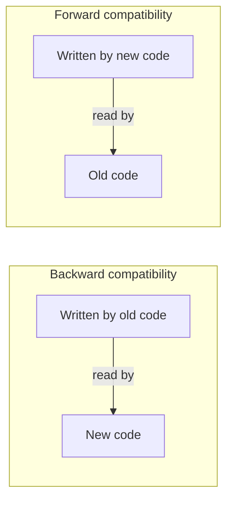

An **encoding** (serialization, marshalling) is a mapping from in-memory values to a sequence of bytes that can be stored or transmitted and later decoded, possibly by a different program on a different machine. A system is **evolvable** with respect to its data when the code that writes data and the code that reads it can change independently: bytes written under one version of a schema remain readable under another.

Programs hold data as objects, arrays and hash maps, with pointers that are meaningful only inside one process. Writing data to a file or a socket requires a self-contained byte representation, and because a database row or a queued message outlives the process that wrote it, the reader is in general running different code from the writer. The encoding, and the rules it imposes on schema changes, determine whether that difference is harmless, raises an error, or silently produces wrong values. The material follows chapter 4 of [Designing Data-Intensive Applications](https://dataintensive.net/) (chapter 5 in the [2026 second edition](https://www.oreilly.com/library/view/designing-data-intensive/9781098119058/)), with measurements on real records for the size, speed and compatibility claims.

## Compatibility

**Backward compatibility** means new code can read data written by old code. **Forward compatibility** means old code can read data written by new code. Backward compatibility is the easier direction, since the author of the new code has the old format available; forward compatibility requires old code to tolerate additions made after it was written, usually by ignoring fields it does not recognize.



Both directions are required whenever old and new code run at the same time: during a rolling upgrade of a service, when clients update later than servers, and whenever stored data is read by code newer than the code that wrote it. **Schema-on-write** systems (most relational databases) enforce a schema when data is stored; **schema-on-read** systems interpret bytes only when they are read, so the interpretation can change between write and read.

## Formats for encoding data

**Language-specific formats** such as Java serialization and Python's [`pickle`](https://docs.python.org/3/library/pickle.html) tie the data to one language and have weak or no versioning. Decoding them can instantiate arbitrary classes, so decoding untrusted input can execute arbitrary code, as the `pickle` documentation warns. They are unsuitable for storage or for communication between services.

**JSON, XML and CSV** are textual and language-independent. Their limitations are in types rather than syntax:

- JSON does not distinguish integers from floating-point numbers and does not bound their precision. [RFC 8259 §6](https://www.rfc-editor.org/rfc/rfc8259#section-6) states that only integers in $[-(2^{53}-1), 2^{53}-1]$ are interoperable, because many parsers decode numbers as IEEE 754 doubles. Identifiers above $2^{53}$ are therefore often sent as strings.
- Neither JSON nor XML has a byte-string type. Base64 encodes 3 bytes as 4 characters, a 33% increase; hex, which the [PyPI JSON API](https://docs.pypi.org/api/json/) uses for file digests, doubles the size.
- CSV has no types, and its quoting rules are described only by an informational RFC, [RFC 4180](https://www.rfc-editor.org/rfc/rfc4180), rather than a standard that producers must follow.

**MessagePack** is a binary encoding of the JSON data model with the addition of a binary type (`bin`, introduced when the [specification](https://github.com/msgpack/msgpack/blob/master/spec.md) split its raw type into `str` and `bin`). It removes the textual overhead (quotes, decimal digits, base64) but keeps one property of JSON: every record carries its field names.

**Protocol Buffers, Thrift and Avro** are schema-driven binary encodings. A schema, written in an interface definition language, describes the record; field names appear in the schema and not in the encoded bytes. The three differ in what the bytes contain to identify a field.

### Where field identity lives

<EncodingBytes />

[**Protocol Buffers**](https://protobuf.dev/programming-guides/encoding/) gives each field a number in the schema. Each encoded field begins with a key, the varint `(field_number << 3) | wire_type`, where the wire type states how to find the end of the value: 0 for a varint, 2 for a length-delimited value (strings, bytes, nested messages, packed repeated fields), 1 and 5 for fixed 64- and 32-bit values. Integers are base-128 varints; `int64` stores a negative number in ten bytes, and only `sint32` and `sint64` use zigzag encoding. In proto3, a scalar field holding its type's default (0, false, empty) is not written at all, which is why `yanked: false` costs zero bytes in the figure. Lists are repeated fields rather than a separate array type.

[**Thrift**](https://thrift.apache.org/) has a schema language of the same kind and several wire protocols. The binary protocol writes a one-byte type and a two-byte field number before every field. The [compact protocol](https://github.com/apache/thrift/blob/master/doc/specs/thrift-compact-protocol.md) packs the difference from the previous field number into the high four bits of one header byte and the type into the low four, uses zigzag varints for integers, and stores a boolean's value in the type nibble, so a boolean field costs one byte in total. Thrift has dedicated list, set and map types, which can nest.

[**Avro**](https://avro.apache.org/docs/1.12.0/specification/) writes no field identifiers at all. A record is the concatenation of its field values in schema order: integers as zigzag varints, strings as a length followed by UTF-8, a `fixed` as raw bytes, a union as the index of its branch followed by the value. Decoding is possible only with the exact schema the writer used, since nothing in the bytes says where one field ends and the next begins. That requirement is the basis of Avro's writer and reader schemas, described [below](#avros-writer-and-reader-schemas).

For a three-field example record (a user name, a favourite number and a list of interests), Kleppmann's [2012 comparison](https://martin.kleppmann.com/2012/12/05/schema-evolution-in-avro-protocol-buffers-thrift.html) gives 82 bytes for JSON without whitespace, 59 for Thrift's binary protocol, 34 for the compact protocol, 33 for Protocol Buffers and 32 for Avro. The real records measured below preserve that order but not the spread, because most of their bytes are payload.

### Measured size

The data set is 36,519 file records from the PyPI JSON API for twelve packages (numpy, pandas, requests, urllib3, setuptools, pip, cryptography, protobuf, grpcio, msgpack, fastavro, orjson). Each has five short strings, an optional `requires_python` string, two 64-bit integers (file size and upload time in microseconds), a boolean and a 32-byte SHA-256 digest. String payload averages 82.6 bytes per record and the digest is 32 bytes, so 114.6 bytes of every record are values that any encoding must store.

| Encoding | Mean bytes per record | Stream, gzip -6 | Stream, zstd -3 | gzip -6, digests zeroed | zstd -3, digests zeroed |
| --- | ---: | ---: | ---: | ---: | ---: |
| JSON (base64 digest) | 296.0 | 2.03 MB | 2.16 MB | 0.687 MB | 0.817 MB |
| MessagePack (map) | 235.6 | 1.90 MB | 1.86 MB | 0.642 MB | 0.638 MB |
| MessagePack (array, no names) | 139.6 | 1.86 MB | 1.87 MB | 0.599 MB | 0.593 MB |
| Thrift binary | 188.7 | 1.90 MB | 1.85 MB | 0.616 MB | 0.633 MB |
| Thrift compact | 143.7 | 1.88 MB | 1.85 MB | 0.611 MB | 0.583 MB |
| Protocol Buffers | 141.7 | 1.88 MB | 1.86 MB | 0.604 MB | 0.580 MB |
| Avro | 134.2 | 1.85 MB | 1.84 MB | 0.585 MB | 0.559 MB |

Uncompressed, JSON is 2.21 times the size of Avro, and the schema-driven encodings other than Thrift's binary protocol fall within 8% of each other (134 to 144 bytes). Most of JSON's excess is the ten field names, repeated in every record: MessagePack written as an array instead of a map, which drops the names and changes nothing else, shrinks from 235.6 to 139.6 bytes. Protobuf's 7.5 bytes over Avro are mostly the one-byte key in front of each field.

Compressing the stream of records removes most of the difference. Under gzip the JSON stream is 10% larger than Avro, and under zstd 18%. The SHA-256 digests are random bytes that no compressor can reduce, 1.17 MB in total, and they make up most of every compressed stream. With every digest replaced by zeros, the remaining difference is larger: JSON is 17% larger than Avro under gzip and 46% larger under zstd at level 3. Avro's [object container file](https://avro.apache.org/docs/1.12.0/specification/#object-container-files) with the deflate codec, which compresses blocks of records and stores the schema once in the header, holds all records in 1.91 MB.

### Measured speed

Encode and decode time depend on the implementation at least as much as on the format. The table gives microseconds per record for Python libraries, converting between a Python `dict` and bytes, as the median over five processes with the range of process medians in parentheses. Library versions are listed under *How this was measured*.

| Library (format) | Encode, µs per record | Decode, µs per record |
| --- | ---: | ---: |
| `json`, standard library (JSON) | 3.20 (3.16–3.32) | 3.07 (3.02–3.10) |
| `orjson` (JSON) | 1.99 (1.87–2.14) | 1.32 (1.30–1.50) |
| `msgpack` (MessagePack) | 0.76 (0.75–0.77) | 0.97 (0.95–1.01) |
| `protobuf` 7, upb backend, from and to `dict` | 0.99 (0.94–1.05) | 1.27 (1.24–1.31) |
| `protobuf`, message object only | 0.33 (0.31–0.38) | 0.73 (0.66–0.75) |
| `fastavro`, one record at a time | 3.43 (3.32–3.53) | 2.88 (2.86–2.99) |
| `fastavro`, object container file | 2.79 (2.75–2.90) | 2.49 (2.41–2.51) |
| `thriftpy2` (Thrift compact, pure Python) | 15.98 (15.85–17.25) | 11.50 (11.08–11.91) |

Avro, the most compact encoding, is also the slowest of the C-accelerated libraries measured, slower than the standard-library JSON encoder, while MessagePack, 76% larger than Avro, is the fastest. The ranking follows how much of each library runs in compiled code and how much Python-level work it does per field: `fastavro` walks the parsed schema for every record, and the `json` figures include about 0.54 µs per record of base64 encoding and dictionary copying for the digest. That binary encodings are faster than textual ones is therefore a property of particular implementations rather than of the formats. A format can reduce the work per byte, for instance by avoiding number parsing and escape handling, and how much of that reduction a library realizes is an engineering result.

## Schema evolution

### Field tags: Protocol Buffers and Thrift

Because the bytes identify fields by number, the schema can change in any way that keeps each number's meaning:

- **Adding a field** is compatible in both directions if it has a new number. Old code reading new data finds an unknown number, uses the wire type to skip the value, and continues; new code reading old data finds the field absent and uses the default. A new field cannot be required, or new code would reject old data.
- **Removing a field** is compatible only if the field was optional. Its number must never be used again, which proto3 enforces with [`reserved`](https://protobuf.dev/programming-guides/proto3/#reserved): old data with that number still exists, and a new field given the same number would read it without error.
- **Renaming a field** does not change the binary encoding, since names are not in it. It does change the [JSON and text formats](https://protobuf.dev/best-practices/dos-donts/), which represent fields by name, so data in those encodings written by old code fails to parse in new code.
- **Changing a type** is safe within a wire-compatible group. `int32`, `uint32`, `int64`, `uint64` and `bool` share the varint encoding, and [the language guide](https://protobuf.dev/programming-guides/proto3/#updating) specifies that a value too large for the reader's type has "the same effect as if you had cast the number to that type in C++", that is, it is truncated.

> [!warning] Unknown fields in read-modify-write
> Forward compatibility at decode time does not imply that data survives old code. Code that decodes a record, modifies one field and encodes it again drops every field it did not recognize unless the decoder retains them. Proto3 originally discarded unknown fields; [protobuf 3.5.0](https://github.com/protocolbuffers/protobuf/blob/v3.5.0/CHANGES.txt) (November 2017) restored their preservation for most language implementations, and the current Python implementation re-serializes them after the known fields.

### Avro's writer and reader schemas

Avro decoding takes two schemas, the **writer's schema** the data was encoded with and the **reader's schema** the application expects, and resolves differences between them by field name, as specified under [schema resolution](https://avro.apache.org/docs/1.12.0/specification/#schema-resolution):

- A field in the writer's schema but not the reader's is skipped.
- A field in the reader's schema but not the writer's takes the reader's default; if it has none, decoding fails.
- Fields are matched by name, so their order may differ between the two schemas.
- A reader's field may list `aliases`, older names under which the writer may have written it. Renaming with an alias is therefore backward compatible but not forward compatible, since an old reader does not know the new name.
- Types may be promoted: `int` to `long`, `float` or `double`; `long` to `float` or `double`; `string` and `bytes` to each other. Narrowing is an error.
- A field that may be null is declared as a union with `"null"`. Its default must match the first matching branch of the union under the 1.12 specification (the first branch, under 1.11), so a nullable field with a null default lists `"null"` first.

Compatibility in both directions therefore requires that only fields with defaults are added or removed.

How the reader obtains the writer's schema depends on the setting. An [object container file](https://avro.apache.org/docs/1.12.0/specification/#object-container-files), such as a Hadoop data file with millions of records, stores the schema once in its header. A single record stored on its own can use the [single-object encoding](https://avro.apache.org/docs/1.12.0/specification/#single-object-encoding), which prefixes the bytes `C3 01` and an 8-byte CRC-64-AVRO fingerprint of the writer's schema. Kafka deployments commonly use a schema registry: the [Confluent wire format](https://docs.confluent.io/platform/current/schema-registry/fundamentals/serdes-develop/index.html) prefixes each message with a zero byte and a 4-byte schema ID, and the registry rejects new schema versions that violate the configured [compatibility mode](https://docs.confluent.io/platform/current/schema-registry/fundamentals/schema-evolution.html) (`BACKWARD` by default; also `FORWARD`, `FULL` and transitive variants). A database can store a schema version number with each row, and two services can exchange schemas when a connection is set up.

The figure below decodes the same records when the reader's schema has deleted `requires_python`. With the writer's schema, resolution skips the field. Without it, the reader applies its own schema to bytes it did not write. For the numpy record, the union branch index of `requires_python` is read as `size` (1), the string's length as `upload_time` (6), its first character as `yanked` (true), and the 32-byte digest absorbs the rest of the string, the real size, upload time and `yanked` byte, and the first 14 bytes of the real digest; the last 18 bytes are left unread. Every value after the deleted field is wrong and nothing raises an error, because a varint, a boolean byte and a `fixed` accept almost any byte sequence. A protobuf reader in the same situation needs no writer's schema: the key of field 6 is unknown, and its wire type gives the length to skip.

<EncodingBytes preset="misread" />

### Measured compatibility

Each schema change below was applied to all 36,519 records, writing with one version and reading with the other. JSON and MessagePack carry no schema, so their reader is modelled as typical application code: a fixed list of field names, a default for fields that have one, an exception (`KeyError`) for a missing field without one, and extra keys ignored. "Wrong" means the reader returned values that differ from those written and raised no error. Every case in the table gave the same outcome for every record.

| Change (v2 relative to v1) | Direction | JSON, MessagePack map | Protobuf | Thrift compact | Avro, writer's schema given | Avro, writer's schema assumed |
| --- | --- | --- | --- | --- | --- | --- |
| Add field with default (appended) | new reads old | ok | ok | ok | ok | `EOFError` |
| | old reads new | ok | ok | ok | ok | ok (extra bytes ignored) |
| Remove optional field | new reads old | ok | ok | ok | ok | wrong |
| | old reads new | ok | ok | ok | ok | `IndexError` |
| Remove field without default | old reads new | `KeyError` | type default (`""`) | `None` | resolution error | `IndexError` |
| Rename field, same tag, Avro alias | new reads old | `KeyError` | ok | ok | ok | ok |
| | old reads new | `KeyError` | ok | ok | resolution error | ok |
| Narrow `int64` to `int32` | new reads old | ok | wrong (truncated) | field dropped (`None`) | resolution error | ok in fastavro |
| Reuse a removed tag for a new field | new reads old | ok | wrong | wrong | not applicable | not applicable |

The silent failures are of three kinds. Positional decoding with the wrong schema (Avro without the writer's schema, or MessagePack written as an array) misassigns every field after the change. When a field is inserted in the middle of an Avro record instead of appended, the misassignment usually ends in an error (36,512 of 36,519 records), but 7 records decoded completely into wrong values. Protobuf narrowing truncated every upload time, for example $1{,}389{,}223{,}059{,}968{,}124$ to $-1{,}291{,}792{,}260$, while Avro's resolution rejected the narrowing. Reusing field number 7 for a new `downloads` field made new code read each old record's file size as its download count, which is the failure `reserved` exists to prevent.

In the read-modify-write test, old code decoded a new record that carried an added `downloads` field, set `yanked`, and encoded the record again. `downloads` survived in all 36,519 records with protobuf and with JSON handled as a dictionary, and in none with Avro (the reader's schema projects the field away), with `thriftpy2`, or with JSON mapped onto a fixed set of fields.

### Dynamically generated schemas

Avro's lack of field numbers suits schemas generated from another source. A relational database dumped to Avro gets a schema generated from its current table definitions; when a column is added or removed, the dump's schema is regenerated, and readers resolve old and new schemas by field name. With protobuf or Thrift, the generator would have to assign field numbers and keep each column's number stable across every past version of the table, a mapping that has to be stored and maintained. Code generation, central to protobuf and Thrift, offers little to dynamically typed languages and to data-exploration tools, which can read an Avro container file with its embedded schema directly.

## Modes of dataflow

In every mode one process encodes and another decodes. The modes differ in who the two parties are and how far apart in time they run.

### Through databases

The writer encodes and every later reader decodes, possibly years later. Several processes running different versions may access the database at the same time during a rolling upgrade, so both compatibility directions are needed, along with preservation of unknown fields in read-modify-write cycles, as measured [above](#measured-compatibility). Rewriting all stored data into a new schema (a migration) is expensive on large data sets, so many relational databases support simple changes, such as adding a nullable column, without rewriting existing rows; the missing value is filled with the default when a row is read.

### Dumping to files and archival storage

A dump encodes a snapshot of the data with the latest schema in one pass, so it has no internal versioning problem, and it can use a column-oriented format such as [Parquet](https://parquet.apache.org/docs/file-format/) for analytics. An Avro container file is the row-oriented alternative, carrying its schema with the data.

### Through services: REST and RPC

The client encodes requests and the server decodes them, and the reverse for responses. Services are usually updated before their clients, so a reasonable assumption is that requests need backward compatibility and responses forward compatibility. A public API cannot force clients to upgrade, so it must remain compatible indefinitely, often by running several API versions side by side; no single convention for versioning exists, with the version carried in the URL path, in a header, or in a per-client setting on the server.

**REST** is an architectural style built on HTTP: resources identified by URLs, and HTTP's own mechanisms for caching, authentication and content negotiation. Interface descriptions such as [OpenAPI](https://spec.openapis.org/oas/latest.html) serve the role a schema serves for an RPC framework. **RPC** presents a network request as a call to a local function. The abstraction is imperfect: a request can be lost, time out without a response, or be executed twice when retried, and parameters must be encoded rather than passed by reference, so the caller has to handle failure modes a local call does not have. Making operations idempotent allows retries to be safe. RPC frameworks also tie client and server to code generated from a shared interface definition, which suits services within one organization better than public APIs.

[**gRPC**](https://grpc.io/docs/what-is-grpc/introduction/) uses Protocol Buffers as its interface definition language and HTTP/2 as transport, with streaming in both directions. REST's practical advantage over RPC frameworks is the size of its ecosystem: browsers, proxies, caches, load balancers and debugging tools all understand HTTP.

### Through asynchronous message passing

A producer sends a message to a named queue or topic on a message broker such as Kafka or RabbitMQ, the broker stores it, and one or more consumers receive it; the sender does not wait for a reply. Compared with RPC, a broker buffers messages when consumers are slow or unavailable, redelivers messages after a consumer crashes, decouples producers from consumers' network addresses, and can deliver one message to several consumers. Communication is one-way, though replies can be sent on a separate queue. The broker treats message bodies as opaque bytes, so the encoding is the application's choice; a schema registry, as [described above](#avros-writer-and-reader-schemas), is a common way to enforce compatibility rules on what producers write.

### Workflows and actor frameworks

The second edition of DDIA replaces the first edition's section on distributed actor frameworks with sections on **durable execution and workflows**, in which an engine records each step of a workflow so that a failed process can resume where it stopped, and on **event-driven architectures**. Durable execution adds a compatibility requirement of its own: a workflow started under one version of the code may resume under another, so its recorded history must remain readable by the new code.

In the actor model, the unit of concurrency is an actor with private state that communicates only by asynchronous messages. A distributed actor framework uses the same messaging between machines as within one, which makes the message encoding a compatibility concern during rolling upgrades:

- **Akka** used Java serialization by default until [Akka 2.6](https://discuss.akka.io/t/akka-2-6-0-final-released/5364) (November 2019) disabled it and recommended a Jackson-based serializer (JSON or CBOR) or protobuf. Akka moved to the Business Source License with version 2.7 in 2022; [Apache Pekko](https://github.com/apache/pekko) is a fork of Akka 2.6 under the Apache license.
- **Orleans** has a [version-tolerant serializer](https://learn.microsoft.com/dotnet/orleans/host/configuration-guide/serialization) in which serializable types carry `[GenerateSerializer]` and members carry numeric `[Id]` attributes, with rules similar to protobuf's: fields may be added or removed, IDs may not change, and among type changes only numeric widening is allowed.
- **Erlang/OTP** records are positional tuples, which makes changing a record's definition during a rolling upgrade difficult. [OTP 17](https://erlang.org/news/44) (2014) added maps, a key-value type that tolerates added and missing keys in the way a JSON object does.

> [!note]- How this was measured
> - Machine: KVM guest with 4 vCPUs on an Intel Xeon reported as family 6, model 173, 2.3 GHz; Linux 6.18. Timing processes were pinned to one vCPU with `taskset -c 2`.
> - Software: Python 3.13.18; `msgpack` 1.2.4 (C extension); `protobuf` 7.36.1 with the upb backend, classes generated by `grpcio-tools` 1.85.1; `fastavro` 1.13.1 (Cython); `orjson` 3.13.0; `thriftpy2` 0.7.1 (compact protocol in pure Python); `zstandard` 0.25.0.
> - Data: [`pypi_files.jsonl.gz`](encoding-bench/pypi_files.jsonl.gz), 36,519 file records fetched from the PyPI JSON API on 2026-11-17 and normalized by [`dataset.py`](encoding-bench/dataset.py). Upload times are microseconds since the epoch; `requires_python` is null for 10,106 records; 887 records are yanked.
> - Schemas: [`record_v1.proto`](encoding-bench/schemas/record_v1.proto), [`record_v1.avsc`](encoding-bench/schemas/record_v1.avsc), [`record_v1.thrift`](encoding-bench/schemas/record_v1.thrift). Codecs: [`formats.py`](encoding-bench/formats.py). JSON uses compact separators and base64 for the digest.
> - Size ([`bench_size.py`](encoding-bench/bench_size.py), [`size.json`](encoding-bench/size.json)): each record encoded on its own; streams are the records concatenated with 4-byte length prefixes, compressed whole. Sizes are deterministic.
> - Speed ([`bench_speed.py`](encoding-bench/bench_speed.py), [`run_speed.sh`](encoding-bench/run_speed.sh), [`speed.json`](encoding-bench/speed.json)): each repetition encodes or decodes all records in a list comprehension with the garbage collector disabled, after one discarded warm-up; seven repetitions per process, five fresh processes. The table reports the median over processes of each process's median, with the range of process medians. The full run takes about 95 s.
> - Compatibility ([`evolution.py`](encoding-bench/evolution.py), [`evolution.json`](encoding-bench/evolution.json)): every change applied to every record in both directions, with the outcome classified against the values written. "Writer's schema assumed" decodes Avro with the reader's schema alone.
> - The figure's TypeScript encoders and decoders are tested against bytes and decoded values from these libraries, written by [`make_figure_fixture.py`](encoding-bench/make_figure_fixture.py).
>
> ```bash
> cd encoding-bench
> python3 -m pip install -r requirements.txt
> python3 bench_size.py pypi_files.jsonl.gz > size.json
> sh run_speed.sh pypi_files.jsonl.gz > speed.json
> python3 evolution.py pypi_files.jsonl.gz > evolution.json
> python3 dataset.py fetch fresh.jsonl.gz   # optional: a new snapshot from PyPI
> ```

> [!note]- Potentially interesting ideas
> - The speed ranking above is specific to Python libraries. Repeating it with Java or Rust implementations of the same formats would separate what the formats allow from what particular libraries achieve; no such measurement was made here.
> - `fastavro`'s schemaless reader ignored bytes left over after the last field, which is why an appended field read without the writer's schema produced correct values. A reader that rejects leftover bytes would turn some silent misreads into errors; how many of the failures measured above such a check would catch was not tested.

## Sources

- [Designing Data-Intensive Applications](https://dataintensive.net/), Martin Kleppmann (2017), chapter 4; [second edition](https://www.oreilly.com/library/view/designing-data-intensive/9781098119058/), Kleppmann and Riccomini (2026), chapter 5
- [Schema evolution in Avro, Protocol Buffers and Thrift](https://martin.kleppmann.com/2012/12/05/schema-evolution-in-avro-protocol-buffers-thrift.html), Kleppmann (2012)
- [Protocol Buffers language guide (proto3)](https://protobuf.dev/programming-guides/proto3/), [encoding](https://protobuf.dev/programming-guides/encoding/) and [best practices](https://protobuf.dev/best-practices/dos-donts/)
- [Apache Avro 1.12.0 specification](https://avro.apache.org/docs/1.12.0/specification/)
- [Thrift compact protocol](https://github.com/apache/thrift/blob/master/doc/specs/thrift-compact-protocol.md), [MessagePack specification](https://github.com/msgpack/msgpack/blob/master/spec.md), [RFC 8259](https://www.rfc-editor.org/rfc/rfc8259)
- [Confluent Schema Registry wire format](https://docs.confluent.io/platform/current/schema-registry/fundamentals/serdes-develop/index.html) and [compatibility modes](https://docs.confluent.io/platform/current/schema-registry/fundamentals/schema-evolution.html)

## Related notes

- [[systems/databases/foundations/ch3-storage-and-retrieval|Storage and retrieval]], for the column-oriented formats used by dumps
- [[systems/databases/distributed-data/ch5-replication|Replication]], where rolling upgrades and replication logs require both compatibility directions
- [[systems/distributed-systems/RPC|RPC]]
- [[reference/slides/system-design-interviews|System Design Interviews]]
