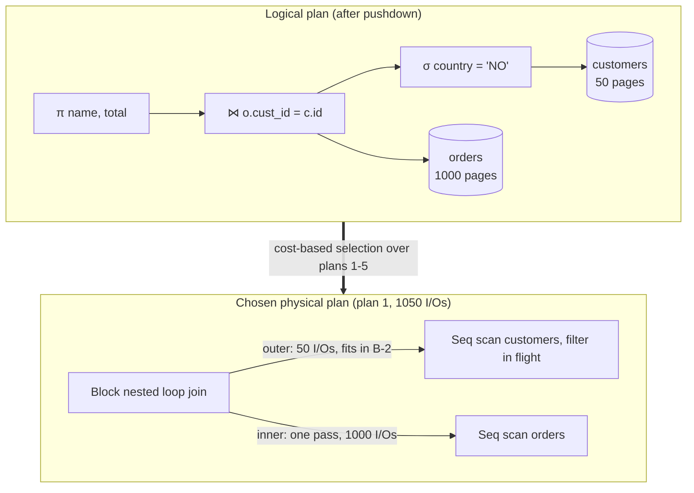

Query processing translates a declarative query into an executable plan and runs it. A cost-based optimizer enumerates logically equivalent plans, chooses a physical operator for each logical one, and selects the plan of lowest estimated cost. Of its components, the row-count estimates that feed both the cost model and the search are the least reliable ([Leis et al., 2015](https://www.vldb.org/pvldb/vol9/p204-leis.pdf)). Costs are given in page I/Os, the [CS186](https://cs186berkeley.net/notes/note10/) convention, with $[R]$ pages and $|R|$ tuples for relation $R$ and $B$ buffer pages. Storage-side context (heap files, indexes, clustering) is in [[systems/databases/foundations/ch3-storage-and-retrieval|Storage and Retrieval]].

## Logical plans, physical plans

A SQL query first becomes a **logical plan**: a relational-algebra tree of selections, projections, and joins. Algebraic rewrites at this level preserve the result and nearly always reduce cost. They include pushing selections below joins so that filters reduce input sizes early, pushing projections down to narrow tuples, and flattening subqueries. The **physical plan** then fixes which algorithm implements each operator (which join method, index scan versus sequential scan) and the join order. Logical rewrites are rule-driven; physical selection is cost-driven, and estimation errors affect the plan at this stage.

Execution engines then run the plan. In the **Volcano/iterator model**, every operator implements `open/next/close`, and each `next` call pulls one tuple through the tree. The model is simple and composable, but on modern CPUs the per-tuple virtual calls and cache misses dominate runtime. [Neumann (2011)](https://www.vldb.org/pvldb/vol4/p539-neumann.pdf) inverts the model. The plan is compiled to LLVM IR as tight loops organized around data pipelines, which keep tuples in registers until a pipeline breaker (hash table build, sort) forces materialization; compile times are milliseconds, and performance is "sometimes rivaling hand-written C++ code." Vectorized execution (batches of thousands of tuples per `next`) is the other widely adopted remedy. DuckDB and ClickHouse use vectorization, and HyPer and its descendants use compilation.

## Join algorithms and their costs

Joining $R \bowtie S$ with $R$ as outer:

| Algorithm | I/O cost | When it wins |
| --- | --- | --- |
| Naive nested loop | $[R] + \lvert R \rvert \cdot [S]$ | never; the strawman |
| Block nested loop | $[R] + \lceil [R]/(B-2) \rceil \cdot [S]$ | one input near memory-sized |
| Index nested loop | $[R] + \lvert R \rvert \cdot (\text{lookup cost})$ | selective join + index on inner |
| Sort-merge | $\text{sort}(R) + \text{sort}(S) + [R] + [S]$ | output must be sorted, or inputs already are |
| Grace hash | $\approx 3([R] + [S])$ (two-pass) | large inputs, equality join; the default |

Block nested loop reads the outer once and the inner once per memory-sized chunk of the outer, so the smaller relation should be the outer. Sort-merge incurs the external-sort cost ($2[R](1 + \lceil \log_{B-1}\lceil [R]/B \rceil \rceil)$ per input) then a single merge pass. Grace hash partitions both inputs by hash (write + read each page once) and joins matching partitions in memory; each page is read, written and read again, which gives the $3([R]+[S])$. Hash joins only handle equality predicates; sort-merge and nested loops handle inequalities.

## The System R optimizer

[Selinger et al. (1979)](https://dl.acm.org/doi/10.1145/582095.582099) set the template for cost-based optimization, which estimates the cost of alternative plans and selects the plan of lowest estimated cost, searching join orders with bottom-up dynamic programming. Pass 1 finds the best access path per table (sequential scan or each index, costed by selectivity). Pass $k$ finds the best plan for each $k$-table subset by extending each $(k-1)$-subset with one more table, considering only **left-deep** trees (the inner side is always a base table, so plans pipeline, and the search space is smaller than that of bushy trees, though still exponential in the number of tables). A subplan is retained if it has the lowest cost for its subset or if it produces an **interesting order** (sortedness on a join key, grouping, or ordering column), since a slightly costlier sorted subplan can yield a cheaper overall plan by eliminating the sort for a later sort-merge join or `ORDER BY`. Cross products are deferred. Cost is a weighted sum of I/O and CPU computed from estimated cardinalities, so the quality of the chosen plan depends on the accuracy of those estimates.

## Cardinality estimation

The optimizer needs the size of every intermediate result. Conventional estimators use per-column statistics (row counts, distinct values, histograms), selectivity $1/\text{distinct}(c)$ for equality, interpolation over histograms for ranges, and $1/\max(\text{distinct}(c_1), \text{distinct}(c_2))$ for joins. They also assume **independence**, under which the selectivity of `AND`ed predicates is the product of individual selectivities.

Columns in real data are often correlated, and multiplying incorrect selectivities compounds the error. [Leis et al. (2015)](https://www.vldb.org/pvldb/vol9/p204-leis.pdf) ran PostgreSQL and several commercial optimizers on the Join Order Benchmark (real IMDb data, 113 queries) and found errors growing roughly exponentially with join count: median q-error near 10 by three joins, underestimates of $10^2$-$10^4$ routine at five or more, in every system tested. Underestimates cause the more severe errors, since they lead the planner to choose nested-loop joins that expect ten rows and receive a million. Their second finding is that, with true cardinalities supplied, even a crude cost model picked good plans, so **cardinality quality dominates cost-model quality**. The practical mitigations are multi-column statistics (`CREATE STATISTICS` in PostgreSQL), avoidance of predicates the estimator cannot analyze (functions on columns), and, in newer systems, sampling or learned estimators.

> [!tip] Estimates dominate the cost model
> With true cardinalities injected into PostgreSQL, even a crude cost model picked good plans in Leis et al.'s experiments. By this result, better statistics improve plan quality more than tuning cost constants does.

## Worked example

Schema: `orders` (1,000 pages, 100,000 tuples), `customers` (50 pages, 5,000 tuples), $B = 102$ buffer pages, query:

```sql
SELECT c.name, o.total
FROM   orders o JOIN customers c ON o.cust_id = c.id
WHERE  c.country = 'NO';
```

Logical rewrite pushes `country = 'NO'` below the join. Suppose the statistics estimate 50 matching customers (1% selectivity). Candidate physical plans (costs from the formulas above, arithmetic checked in the repo venv):

1. **Block nested loop, filtered customers outer.** Read customers (50), filter in flight; 50 matching customers fit easily in $B - 2 = 100$ pages, so one pass over orders: $50 + 1 \cdot 1000 = 1050$ I/Os.
2. **Block nested loop, orders outer**: $1000 + \lceil 1000/100 \rceil \cdot 50 = 1500$ I/Os, 43% more than plan 1 with the same algorithm and the other relation as outer.
3. **Grace hash join**: $3(1000 + 50) = 3150$ I/Os, unnecessary here because one input fits in memory (the build side collapses to plan 1's shape in practice).
4. **Sort-merge**: sorting orders alone costs 4000 I/Os; total $\approx 5150$. The plan is preferable only if output order on `cust_id` were needed later.
5. **Index nested loop** with an index on `orders.cust_id`: 50 customers $\times$ (index descent + fetch of their orders). With ~20 orders per customer and an **unclustered** index, the plan performs up to $50 \cdot 20 = 1000$ scattered tuple fetches plus descents, which is at best comparable to plan 1. With a **clustered** index, the matching orders (about 1,000 tuples at 100 per page) occupy about 10 pages in total, one or two contiguous pages per customer, and this plan costs far less than plan 1. With the same query and the same index, physical layout alone changes the cost by roughly an order of magnitude.



At these estimates the planner selects plan 1. If `country` is correlated with a second pushed-down predicate (for example `region = 'Scandinavia'`), the independence assumption multiplies two 1% selectivities into 0.01% and predicts 0.5 customers. The planner may then switch to a naive per-customer index-probe strategy whose cost against the actual 50 customers far exceeds its estimate, a small instance of the failure mode Leis et al. measured.

## Feedback into storage design

Because plan choice depends on physical layout, index and layout decisions affect more than point lookups. A clustered index turns range and foreign-key access into sequential I/O and changes the join-method decision, as plan 5 shows. A covering index removes heap fetches entirely and makes index-only plans viable. Conversely, above a selectivity of a few percent, an unclustered index scan is slower than a sequential scan, since it performs one random fetch per tuple where the sequential scan makes one pass, so additional indexes do not help queries that touch a large fraction of a table. The planner consumes every storage decision described in [[systems/databases/foundations/ch3-storage-and-retrieval|Storage and Retrieval]]; when it selects a poor plan, `EXPLAIN ANALYZE`'s estimated-versus-actual row counts show whether the statistics or the physical design is responsible.

## Related notes

- [[systems/databases/foundations/ch3-storage-and-retrieval|Storage and Retrieval]]
- [[systems/databases/foundations/ch2-data-models-and-query-languages|Data Models and Query Languages]]
- [[systems/databases/transactions-serializability-isolation|Transactions, Serializability, and Isolation Levels]]

## Sources

- [CS186 Berkeley notes: Iterators and Joins, Query Optimization](https://cs186berkeley.net/notes/note10/)
- [Selinger et al. (1979), Access Path Selection in a Relational Database Management System](https://dl.acm.org/doi/10.1145/582095.582099)
- [Neumann (2011), Efficiently Compiling Efficient Query Plans for Modern Hardware](https://www.vldb.org/pvldb/vol4/p539-neumann.pdf)
- [Leis et al. (2015), How Good Are Query Optimizers, Really?](https://www.vldb.org/pvldb/vol9/p204-leis.pdf)
