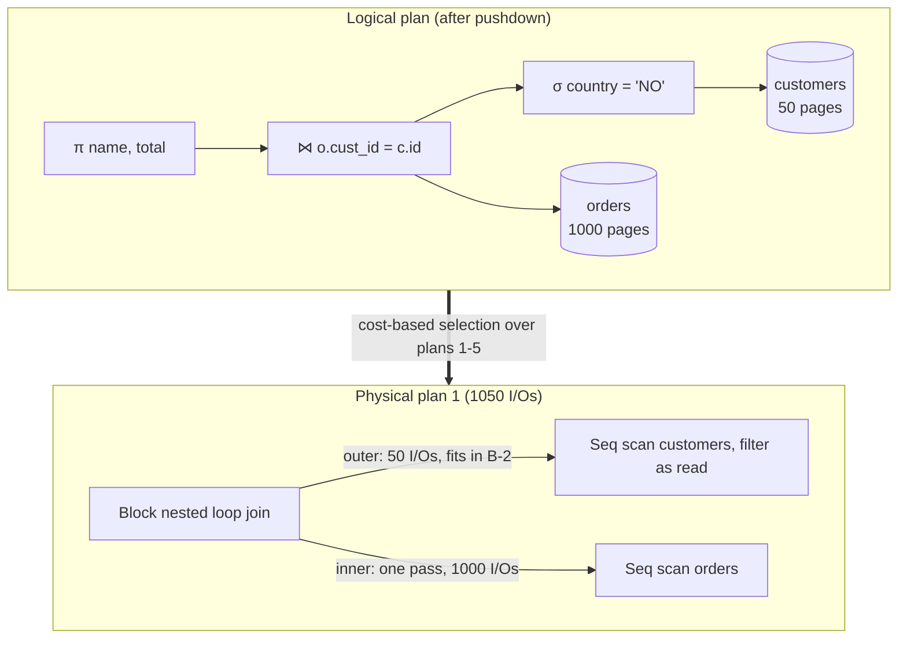

Query processing translates a declarative query into an executable plan and runs it. A cost-based optimizer enumerates logically equivalent plans, chooses a physical operator for each logical one, estimates the cost of each candidate from estimated row counts, and executes the candidate of lowest estimated cost. The optimizer therefore depends on two models: a cost model that converts row counts into time, and a cardinality estimator that predicts the row counts. [Leis et al. (2015)](https://www.vldb.org/pvldb/vol9/p204-leis.pdf) found the second to be the larger source of bad plans.

The textbook cost model counts page I/Os, following the [CS186 notes](https://cs186berkeley.net/notes/note9/): $[R]$ is the number of pages of relation $R$, $|R|$ its number of tuples, and $B$ the number of buffer pages. PostgreSQL's planner uses a weighted sum of page reads and per-tuple CPU work instead, with weights set by its [planner cost constants](https://www.postgresql.org/docs/16/runtime-config-query.html). Both models were checked against [measurements of the three join methods on PostgreSQL 16](#measured-in-postgresql-16): the choice between nested loop and hash join turns on a crossover in the number of outer rows, and on a server with its data in memory, both models place that crossover far below where it was measured. Storage-side context (heap files, indexes, clustering) is in [[systems/databases/foundations/ch3-storage-and-retrieval|Storage and Retrieval]].

## Logical plans, physical plans

A SQL query first becomes a **logical plan**: a relational-algebra tree of selections, projections, and joins. Algebraic rewrites at this level preserve the result and usually reduce cost. They include pushing selections below joins so that filters reduce input sizes early, pushing projections down to narrow tuples, and flattening subqueries. The **physical plan** then fixes the algorithm that implements each operator (which join method, index scan or sequential scan) and the join order. Logical rewrites are rule-driven; physical selection is cost-driven, and it is at this stage that estimation errors change the plan.

Execution engines then run the plan. In the **Volcano or iterator model** ([Graefe, 1994](https://doi.org/10.1109/69.273032)), every operator implements `open`, `next` and `close`, and each `next` call pulls one tuple through the tree. PostgreSQL executes plans this way. The model is simple and composable, but on modern CPUs the per-tuple function calls and the resulting branch and cache misses take a large share of the runtime. Two remedies are in wide use. **Vectorized execution** keeps the iterator interface but passes batches of values per call; [MonetDB/X100 (Boncz et al., 2005)](https://www.cidrdb.org/cidr2005/papers/P19.pdf) introduced it, and DuckDB and ClickHouse use it. **Compilation** generates code for the whole plan: [Neumann (2011)](https://www.vldb.org/pvldb/vol4/p539-neumann.pdf) compiles plans to LLVM IR as tight loops organized around pipelines, which keep a tuple in registers until a pipeline breaker (a hash table build, a sort) forces materialization. In the paper's evaluation, compiling each of five benchmark queries took 16 to 41 ms through LLVM, against 1.6 to 2.6 s for the same plans emitted as C++, and the paper reports that the generated code "frequently rivals the performance of handwritten C++ code." HyPer and its successor Umbra execute plans this way.

## Join algorithms and their costs

Joining $R \bowtie S$ with $R$ as the outer input, the CS186 cost formulas in page I/Os, excluding the cost of writing the output, are:

| Algorithm | I/O cost | Applies when |
| --- | --- | --- |
| Simple nested loop | $[R] + \lvert R \rvert \cdot [S]$ | any predicate; the baseline |
| Block nested loop | $[R] + \lceil [R]/(B-2) \rceil \cdot [S]$ | any predicate; one input near memory size |
| Index nested loop | $[R] + \lvert R \rvert \cdot (\text{cost of one index lookup})$ | an index on the inner join column; few outer rows |
| Sort-merge | $\text{sort}(R) + \text{sort}(S) + [R] + [S]$ | equality or range join; inputs already sorted, or output order needed |
| Hash (one pass) | $[R] + [S]$ | equality join; the build side fits in memory |
| Grace hash (two pass) | $3([R] + [S])$ | equality join; large inputs |

Block nested loop reads the outer once and the inner once per memory-sized chunk of the outer, so the smaller relation should be the outer. An index nested loop replaces the scan of the inner with one index descent per outer row plus a read of the heap pages that hold the matches, so its cost grows linearly with $|R|$ and does not depend on $[S]$. Sort-merge pays the external-sort cost, $2N(1 + \lceil \log_{B-1}\lceil N/B \rceil \rceil)$ for an $N$-page input, and then merges in one pass; an input that is already in join-key order, from an index or a clustered table, skips its sort. A hash join builds a hash table on the smaller input and probes it with each row of the other. When the build side does not fit, Grace hash partitions both inputs by hash (one read and one write of each page) and then joins matching partitions (a second read), for $3([R]+[S])$. Hash joins require an equality predicate; sort-merge also handles range predicates, and nested loops handle any predicate.

PostgreSQL implements three join nodes, [described in its docs](https://www.postgresql.org/docs/16/using-explain.html): Nested Loop, whose inner child runs once per outer row and is an index scan when an index on the join column exists; Hash Join, a hybrid hash join that spills to batches on disk only when the build side exceeds `work_mem` times `hash_mem_multiplier` (4 MB times 2 by default); and Merge Join, whose inputs come from sorts or from index scans in key order.

## Measured in PostgreSQL 16

The query below was run on a PostgreSQL 16 server with every join method forced in turn, on tables of three sizes and two physical layouts, with the number of customers that pass the filter, $k$, swept from 1 to all of them:

```sql
SELECT sum(o.total)
FROM   customers c JOIN orders o ON o.cust_id = c.id
WHERE  c.seg < k;          -- seg is a random permutation, so exactly k customers
```

Each customer has 10 orders, `orders` has a B-tree index on `cust_id`, and each size exists twice: once with orders in random physical order and once clustered by `cust_id`. The data stays in shared buffers throughout, so these are warm-cache, single-core numbers; [the method](#how-this-was-measured) is at the end.

<JoinCrossover preset="measured" />

The three methods have different shapes in $k$. The hash join builds its table on the $k$ filtered customers and probes it with a sequential scan of all of `orders`, so its time is nearly flat in $k$: 48 to 90 ms with 1M orders and 490 to 670 ms with 10M, for any $k$ up to 10,000. It stayed in memory in one batch until the build side reached 300,000 customers, where it split into 2 batches, and 8 at 1M customers. The index nested loop runs one index scan of `orders` per customer, so its time grows linearly in $k$. Each customer cost 6.8 µs (1M orders) to 7.4 µs (10M) with orders in random physical order, where the 10 matching orders sit on 10 different heap pages, and 1.6 to 1.7 µs with the table clustered by `cust_id`, where they share one page. The merge join needs `orders` in `cust_id` order and gets it from an index scan of the whole table, so it pays a full ordered pass even for one customer. Through the index, that pass reads the heap in random order on the unclustered table (0.3 to 0.6 s at 1M orders, 0.8 to 11 s at 10M) and sequentially on the clustered one (60 to 120 ms at 1M, 0.1 to 1.2 s at 10M). The merge stops as soon as the customers run out, so how much of `orders` it reads depends on the largest `id` among the kept customers, which is why its time varies so much at small $k$. It was never the fastest method except at the largest point, all 1M customers joined to 10M clustered orders, where it took 1.23 s against 1.74 s for the nested loop and 1.90 s for the hash join.

The crossover between nested loop and hash join is the $k$ at which $k$ index probes cost as much as one pass over `orders`. The table gives it, measured and as predicted by three cost models, interpolated on $\log k$ between the two measured points that bracket it:

| Orders | Physical order | Measured | PostgreSQL, default | PostgreSQL, `random_page_cost` 1.1 | Page-I/O model |
| --- | --- | --- | --- | --- | --- |
| 100,000 | random | 2,700 (27% of customers) | 66 | 1,800 | 45 |
| 100,000 | clustered | 5,600 (56%) | 380 | 1,900 | 177 |
| 1,000,000 | random | 15,700 (16%) | 670 | 14,800 | 419 |
| 1,000,000 | clustered | 45,000 (45%) | 3,600 | 15,100 | 1,344 |
| 10,000,000 | random | 212,000 (21%) | 6,200 | 229,000 | 4,160 |
| 10,000,000 | clustered | none: nested loop stays faster up to all 1M customers | 34,600 | 143,000 | 13,357 |

The textbook page-I/O model predicts this crossover from page counts alone. A probe reads one page per B-tree level (2 or 3 here, from `bt_metap`) plus the heap pages holding the customer's 10 orders: about 10 in random order and about 1.05 when clustered, at 184 orders per page. A one-pass hash join reads `orders` once, and both plans read `customers` once. With every page read costing the same, the crossover is $[\text{orders}] / (\text{pages per probe})$, which for 1M random-order orders is $5440 / 13 \approx 419$ customers. The model places the crossover 32 to 60 times too early at every size and in both layouts, and more than 75 times too early on the largest clustered table, where no crossover was measured. It charges an index probe's page reads at the same price as the page reads of a sequential scan. With the data in memory, the hash join's scan and probe of one page of `orders` and its 184 rows took about 9 µs (1M rows in about 50 ms), and one customer's index probe, which the model charges 13 pages, took about 7 µs. The model's ranking inverts the measured one at small $k$: by its count, probing for 1% of the customers of the 1M random-order table reads 2.4 times as many pages as a full scan, while measured, the probes were 8.8 times faster than the hash join at that $k$ (9.9 ms against 86.8 ms).

### The planner's choice

PostgreSQL does not use the textbook model. Its estimate charges `seq_page_cost` (1.0) per sequentially read page, `random_page_cost` (4.0) per randomly read page, and CPU terms per tuple, index entry and operator evaluation (0.01, 0.005 and 0.0025), and it discounts repeated index probes for pages it expects to find cached, using `effective_cache_size`. The planner picks the plan with the lowest total.

<JoinCrossover preset="cost" />

With default settings PostgreSQL's estimates cross 13 to 41 times too early: at 1M random-order orders the planner switches to a hash join at $k \approx 670$ customers, while the nested loop stays faster up to $k \approx 15{,}700$. Across the 66 measured points the planner picked the fastest method at 50. Of the other 16, the worst were a hash join taking 66.5 ms where the nested loop took 9.9 ms (6.7 times; 1M random-order orders, $k = 1{,}000$) and 625 ms against 166 ms (3.8 times; 10M orders, $k = 10{,}000$). In all 16 the planner chose a hash join where a nested loop or a merge join was faster; it never chose a nested loop where a hash join was faster. Medians of repeated runs of the same plan differed by up to about 30% between cases, so ratios below about 1.3 are within the noise of the measurement.

The default of 4 for `random_page_cost` already assumes that most random reads hit cache; the [docs](https://www.postgresql.org/docs/16/runtime-config-query.html) say that "the majority of random accesses to storage, such as indexed reads, are assumed to be in cache," and that decreasing it "might be appropriate" when the data is likely to be completely in cache. Lowering `random_page_cost` to 1.1, close to `seq_page_cost` as the docs suggest for a database entirely cached in RAM, moved the planner's crossover to within 10% of the measured one on the 1M and 10M random-order tables (14,800 against 15,700 at 1M orders; 1.5 times early at 100k) and raised its record to 62 of 66 points, with a worst case of 2.1 times (a hash join taking 1.29 s against 0.61 s for the nested loop, 10M clustered orders, $k = 300{,}000$). On clustered tables its crossover is still about 3 times too early, so the remaining misses are all on clustered data, where each probe touches fewer pages than the planner's correlation-based interpolation assumes. Neither model is wrong in its own setting: a random page read from a disk does cost far more than a sequential one, and `random_page_cost` exists to say how much more. On this server every page was already in shared buffers (no run read a single block from outside them), so the default of 4 described a cost that never occurred.

## The System R optimizer

[Selinger et al. (1979)](https://dl.acm.org/doi/10.1145/582095.582099) set the template for cost-based optimization: estimate the cost of alternative plans from statistics and choose the cheapest, searching join orders with bottom-up dynamic programming. Its cost was `PAGE FETCHES + W * (RSI CALLS)`, page I/O plus a weighted count of tuple-level calls, the same split between I/O and CPU that PostgreSQL's constants make. Pass 1 finds the cheapest access path per table (a sequential scan or each usable index, costed by selectivity). Pass $j$ finds the cheapest plan for each $j$-table subset by extending each $(j-1)$-table plan with one more table as the inner input. The inner is always a single base table, so the plans are **left-deep**, which lets rows pipeline and keeps the search space smaller than that of bushy trees, though it is still exponential in the number of tables. A subplan is retained if it is the cheapest for its subset or if it produces an **interesting order** (sortedness on a later join column, or on a `GROUP BY` or `ORDER BY` column), since a costlier sorted subplan can remove a later sort. Joins that require a Cartesian product are placed as late in the join order as possible.

Later work relaxed the left-deep restriction. With true cardinalities on the Join Order Benchmark, [Leis et al.](https://www.vldb.org/pvldb/vol9/p204-leis.pdf) (Section 6.2, Table 2) found left-deep plans at most 1.63 times slower than the best bushy plan with only primary-key indexes, and up to 4.5 times slower once foreign-key indexes were added. PostgreSQL considers bushy plans in a near-exhaustive dynamic-programming search below `geqo_threshold` (12 `FROM` items) and switches to a genetic search above it.

## Cardinality estimation

The optimizer needs the size of every intermediate result. Conventional estimators use per-column statistics (row counts, distinct values, most-common values, histograms): selectivity $1/\text{distinct}(c)$ for an equality, interpolation over a histogram for a range, and, in System R's form, $1/\max(\text{distinct}(c_1), \text{distinct}(c_2))$ for an equi-join. For a conjunction they assume **independence**: the selectivity of `AND`ed predicates is the product of the individual selectivities. [PostgreSQL's docs](https://www.postgresql.org/docs/16/planner-stats.html) state the assumption and its limit: "The planner normally assumes that multiple conditions are independent of each other, an assumption that does not hold when column values are correlated."

Columns in real data are often correlated, and each join multiplies in another estimated selectivity, so errors compound. [Leis et al. (2015)](https://www.vldb.org/pvldb/vol9/p204-leis.pdf) loaded the IMDb data set into PostgreSQL, HyPer and three commercial systems and ran the 113 queries of their Join Order Benchmark. In PostgreSQL, 16% of the estimates for one join were wrong by a factor of 10 or more, rising to 32% with two joins and 52% with three; across systems they "routinely observe misestimates by a factor of 1000 or more," errors grew exponentially with the number of joins, and all systems tended to underestimate. The underestimates did the damage: PostgreSQL's worst plans came from choosing a nested-loop join without an index lookup "because of a very low cardinality estimate," and disabling that join type (but not index nested loops) removed every timeout. With true cardinalities injected, a cost function that only counted tuples flowing through operators made queries 34% faster than PostgreSQL's built-in cost model, which led the authors to conclude that "cardinality estimation is much more crucial than the cost model."

An independence error that reaches the plan is easy to reproduce. In a 1M-row copy of `customers` with columns `country` (50 values), `region` (5 values, a function of `country`) and `continent` (2 values, a function of `region`), the predicate `country = 7 AND region = 0 AND NOT continent` matches the 20,000 customers of country 7. PostgreSQL multiplied the per-column selectivities, $0.02 \times 0.2 \times 0.6$, and estimated 2,427 rows, an underestimate by a factor of 8. After `CREATE STATISTICS ... (dependencies, mcv) ON country, region, continent` and `ANALYZE`, it estimated 20,667. The outcome for the join with 10M orders runs against the usual lesson:

| Statistics | `random_page_cost` | Estimated rows | Plan chosen | Time | Nested loop, forced | Hash join, forced |
| --- | --- | --- | --- | --- | --- | --- |
| per-column only | 4 | 2,427 | nested loop | 265 ms | 298 ms | 961 ms |
| with `CREATE STATISTICS` | 4 | 20,667 | hash join | 711 ms | 232 ms | 829 ms |
| with `CREATE STATISTICS` | 1.1 | 20,667 | nested loop | 224 ms | 227 ms | 784 ms |

The underestimate pushed the planner toward a nested loop, which happened to be correct, because the cost model's own bias against index probes had already moved the crossover far to the left of the measured one. Fixing the estimate made the plan 2.7 times slower; fixing the estimate and the cost constant together made it as fast as the best forced plan. Leis et al.'s conclusion concerns which error is larger on average across a benchmark; on a single query, one error can cancel another, and correcting either alone can make the plan worse.

The practical mitigations are multi-column statistics (`CREATE STATISTICS` with `dependencies`, `ndistinct` or `mcv`), avoiding predicates the estimator cannot analyze (functions applied to columns), and, in newer systems, estimates from sampling or learned models.

## Worked example

The textbook form of the same decision, in page I/Os. Schema: `orders` (1,000 pages, 100,000 tuples, 100 per page), `customers` (50 pages, 5,000 tuples), $B = 102$ buffer pages, and the query

```sql
SELECT c.name, o.total
FROM   orders o JOIN customers c ON o.cust_id = c.id
WHERE  c.country = 'NO';
```

The logical rewrite pushes `country = 'NO'` below the join. Suppose the statistics estimate 50 matching customers (1% selectivity), each with 20 orders. The candidate physical plans, from the formulas above:

1. **Block nested loop, filtered customers outer.** Read `customers` (50 I/Os) and filter as it is read; the 50 matching rows fit in $B - 2 = 100$ pages, so `orders` is scanned once: $50 + 1000 = 1050$ I/Os.
2. **Block nested loop, orders outer**: $1000 + \lceil 1000/100 \rceil \cdot 50 = 1500$ I/Os, 43% more than plan 1 with the same algorithm and the other relation as outer.
3. **Grace hash join**: $3(1000 + 50) = 3150$ I/Os. One input fits in memory, so a one-pass hash join applies instead, at $50 + 1000 = 1050$, the same as plan 1.
4. **Sort-merge**: sorting `orders` takes $2 \cdot 1000 \cdot (1 + \lceil \log_{101} 10 \rceil) = 4000$ I/Os and sorting `customers` 100, for a total of about $5150$. It pays off only if a later operator needs the output in `cust_id` order.
5. **Index nested loop** with a B-tree on `orders.cust_id`, assuming 3 page reads per index descent. With an **unclustered** index each customer's 20 orders lie on about 20 different pages: $50 + 50 \cdot (3 + 20) = 1200$ I/Os, slightly more than plan 1. With a **clustered** index they occupy one page, or two when the run crosses a page boundary (on average $1 + 19/100 = 1.19$): $50 + 50 \cdot (3 + 1.19) \approx 260$ I/Os, about 4 times less than plan 1 and 4.6 times less than the same plan on the unclustered index.

By this count the planner picks plan 1, or plan 5 if `orders` is clustered. The same choice measured above, with 1% of customers kept, came out differently: on 100,000 random-order orders at $k = 100$ of 10,000 customers, the index nested loop took 0.7 ms and the hash join 5.0 ms, so the unclustered index plan that the page count ranks below the full scan was 7 times faster. The page count is the right model for data that must be read from a disk; for data already in memory it overprices random access by more than an order of magnitude.



## Feedback into storage design

Because plan choice depends on physical layout, index and layout decisions affect more than point lookups. Clustering `orders` by `cust_id` cut the cost of each index probe from about 7 µs to 1.7 µs in the measurements above, moved the crossover to hash join from 16% to 45% of customers at 1M orders, and made the merge join, which reads the table in key order, the fastest plan when all 1M customers were joined to 10M orders. A covering index removes heap fetches entirely and makes index-only plans possible. The common rule that an unclustered index scan loses to a sequential scan above a selectivity of a few percent holds when random reads cost far more than sequential ones, as on a disk; with the data in memory, the measured unclustered probes stayed faster than a full scan up to 16 to 27% of customers. In either setting, `EXPLAIN ANALYZE` shows estimated and actual row counts side by side, which separates an estimation error from a costing error: in the correlated example above, the estimate was off by a factor of 8 before `CREATE STATISTICS`, while in the sweep the row estimates were close and the plans were wrong because of the cost constants.

## Related notes

- [[systems/databases/foundations/ch3-storage-and-retrieval|Storage and Retrieval]]
- [[systems/databases/foundations/ch2-data-models-and-query-languages|Data Models and Query Languages]]
- [[systems/databases/derived-data/ch10-batch-processing|Batch Processing]], for sort-merge and hash joins in MapReduce
- [[systems/databases/mvcc-snapshot-isolation|MVCC and Snapshot Isolation]], measured on the same kind of PostgreSQL 16 server
- [[systems/databases/transactions-serializability-isolation|Transactions, Serializability, and Isolation Levels]]

> [!note]- How this was measured
> **Server.** PostgreSQL 16.15 (Ubuntu build), in a cloud VM with 4 vCPUs (Intel Xeon at 2.30 GHz) and 15 GB of RAM. Non-default settings: `shared_buffers = 4GB`, so that every table fits, `max_parallel_workers_per_gather = 0`, so each join runs on one core and the three methods are compared without parallelism, and `jit = off`. `work_mem` (4 MB), `hash_mem_multiplier` (2), `effective_cache_size` (4 GB) and the planner cost constants stayed at their defaults.
>
> **Data.** [`setup.py`](join-experiments/setup.py) builds, for 100,000, 1,000,000 and 10,000,000 orders, a `customers` table with one tenth as many rows (primary key `id`, and `seg`, a random permutation of $0 \ldots n-1$ so that `seg < k` keeps exactly $k$ customers spread across the table) and two copies of `orders` (10 per customer): one in random physical order (`pg_stats` correlation of `cust_id` near 0) and one sorted by `cust_id` (correlation 1.0), each with a B-tree on `cust_id`, followed by `VACUUM ANALYZE`.
>
> **Runs.** [`sweep.py`](join-experiments/sweep.py) runs the query for $k = 1, 3, 10, 30, \ldots$ up to all customers, with each method forced by turning the other two `enable_*` settings off and once with the planner's free choice. Each case runs once as a warm-up and then 5 times (3 when every run exceeds 2 s) under `EXPLAIN (ANALYZE, BUFFERS, TIMING OFF, FORMAT JSON)`; `TIMING OFF` avoids per-node clock reads, which would inflate the nested loop's many short inner scans. The reported time is the median `Execution Time`, and the whiskers in the figure span the fastest and slowest run. No run read a block from outside shared buffers. A forced method would have been dropped for larger $k$ once a run exceeded 20 s; the slowest run took 11 s, so none was. [`planner_costs.py`](join-experiments/planner_costs.py) records each method's estimated cost with `EXPLAIN` alone at `random_page_cost` 4, 2, 1.1 and 1, and runs the planner's choice under each non-default value 3 times. [`correlated.py`](join-experiments/correlated.py) runs the correlated-predicate case. [`summarize.py`](join-experiments/summarize.py) reduces the raw output ([`results.json`](join-experiments/results.json), [`planner_costs.json`](join-experiments/planner_costs.json), [`correlated.json`](join-experiments/correlated.json)) to the figure's data and prints every number cited here ([`summary.txt`](join-experiments/summary.txt)).
>
> **Reproduce.** With a PostgreSQL 16 server configured as above, `pip install "psycopg[binary]"`, then `export JOIN_DSN="host=... port=... user=..."` and run `python3 setup.py`, `python3 sweep.py results.json`, `python3 planner_costs.py planner_costs.json`, `python3 correlated.py correlated.json` and `python3 summarize.py results.json planner_costs.json correlated.json join-summary.json`. The sweep took about 15 minutes, most of it in merge joins over the 10M-row random-order table.
>
> **Limits.** All runs are warm-cache and single-threaded on one VM, so the crossovers measure CPU and memory cost, not storage. Each join has one shape (a selective filter on the smaller table, a foreign key to the larger), and every customer has exactly 10 orders. The run-to-run spread of medians for the same plan was up to about 30%.

> [!note]- Potentially interesting ideas
> - Repeating the sweep with a cold cache (the operating system's page cache dropped and the server restarted before each run) would show whether the default `random_page_cost` of 4 places the crossover correctly for data on this VM's disk. The page-I/O model and PostgreSQL's default should both do better there, but by how much is unknown.
> - With `random_page_cost` at 1.1, PostgreSQL's crossover matched the measured one on random-order tables and stayed about 3 times too early on clustered ones. The planner interpolates between its random-order and sequential-order index-scan costs using the column's correlation; whether that interpolation, or the cost of a heap fetch in a clustered index scan, accounts for the gap was not tested.

## Sources

- [CS186 Berkeley notes: Iterators and Joins](https://cs186berkeley.net/notes/note9/)
- [Selinger et al. (1979), Access Path Selection in a Relational Database Management System](https://dl.acm.org/doi/10.1145/582095.582099)
- [Graefe (1994), Volcano, an Extensible and Parallel Query Evaluation System](https://doi.org/10.1109/69.273032)
- [Boncz, Zukowski, Nes (2005), MonetDB/X100: Hyper-Pipelining Query Execution](https://www.cidrdb.org/cidr2005/papers/P19.pdf)
- [Neumann (2011), Efficiently Compiling Efficient Query Plans for Modern Hardware](https://www.vldb.org/pvldb/vol4/p539-neumann.pdf)
- [Leis et al. (2015), How Good Are Query Optimizers, Really?](https://www.vldb.org/pvldb/vol9/p204-leis.pdf)
- [PostgreSQL 16 docs: Planner Cost Constants](https://www.postgresql.org/docs/16/runtime-config-query.html), [Using EXPLAIN](https://www.postgresql.org/docs/16/using-explain.html), [Extended Statistics](https://www.postgresql.org/docs/16/planner-stats.html)
