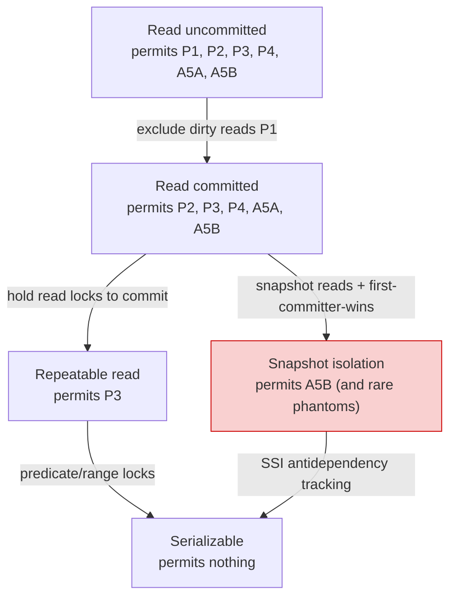

An isolation level specifies which interleavings of concurrent transactions a database permits. Serializability, the strongest level, requires every execution to be equivalent to some serial order of the transactions; conflict serializability makes that requirement checkable, and two-phase locking enforces it. Anomalies are given as concrete schedules, in the notation of the [Critique paper](https://arxiv.org/abs/cs/0701157): $r_1[x]$ means transaction 1 reads $x$, $w_1[x]$ writes it, $c_1$ commits, $a_1$ aborts. Multiversion concurrency control, the mechanism used by PostgreSQL, Oracle and InnoDB, is covered in [[systems/databases/mvcc-snapshot-isolation|MVCC and Snapshot Isolation]].

## ACID

A transaction groups reads and writes into a unit that commits or aborts atomically. The ACID properties are atomicity (all-or-nothing on abort or crash), consistency (application invariants preserved, a property of the application's transactions rather than one the database can supply), isolation (concurrent transactions do not interfere), and durability (committed data survives crashes). [Kleppmann](https://dataintensive.net/) observes that the terms are used loosely enough that "ACID" is closer to a marketing term than to a specification; the substantive differences between systems lie in what *isolation* means.

## Anomalies as schedules

Isolation levels are defined by which of these interleavings they exclude. Prose definitions are ambiguous, and that ambiguity is the subject of the Critique paper, so each anomaly is given as a schedule ([Berenson et al. 1995](https://arxiv.org/abs/cs/0701157), §3):

**P0, dirty write.** $w_1[x] \ldots w_2[x] \ldots (c_1 \text{ or } a_1)$. T2 overwrites uncommitted data. If T1 then aborts, the value to which $x$ should be restored is undefined. The Critique requires P0 to be excluded at every level, and implemented systems exclude it.

**P1, dirty read.** $w_1[x] \ldots r_2[x] \ldots (a_1, c_2)$. T2 read a value that never existed in any committed state. Example: T1 transfers 40 between two accounts; T2 reads one account before the transfer and one after, and observes a total that matches no committed state.

**P2, fuzzy (non-repeatable) read.** $r_1[x] \ldots w_2[x] \ldots c_2 \ldots r_1[x]$. T1 reads $x$ twice and gets different answers.

**P3, phantom.** $r_1[P] \ldots w_2[y \in P] \ldots c_2 \ldots r_1[P]$. T1 evaluates a predicate ("employees with salary > 100k"); T2 inserts a row matching it; T1 re-evaluates and sees a row that appeared mid-transaction. P3 differs from P2 in that the conflict is on a *predicate* rather than an existing item, so item-level locks cannot prevent it.

**P4, lost update.** $r_1[x] \ldots w_2[x] \ldots w_1[x] \ldots c_1$. Both transactions do read-modify-write on a counter starting at 100: T1 computes 100+10, T2 computes and commits 100+20, then T1 writes 110. T2's update is lost.

**A5A, read skew.** $r_1[x] \ldots w_2[x] \ldots w_2[y] \ldots c_2 \ldots r_1[y]$. T1 reads $x$ before T2's update and $y$ after it, and so observes a non-atomic view of two items related by an invariant (e.g., $x + y = 100$).

**A5B, write skew.** $r_1[x] \ldots r_2[y] \ldots w_1[y] \ldots w_2[x] \ldots (c_1, c_2)$. Each transaction reads a constraint involving both items and writes the *other* item. Neither writes what the other wrote, so no write-write conflict exists, yet the combined effect can violate an invariant that each transaction individually checked. This is the anomaly that snapshot isolation permits; the worked example is in [[systems/databases/mvcc-snapshot-isolation|MVCC and Snapshot Isolation]].

> [!example] Write skew, concretely
> Invariant: at least one of $x, y$ equals 1 (one doctor on call); initially $x = y = 1$. T1 reads $x + y = 2$ and writes $y = 0$; T2 reads $x + y = 2$ and writes $x = 0$. Both checks passed against their reads, the write sets are disjoint, both commit, and $x + y = 0$. Neither transaction alone violates the invariant; their interleaving does.

The paper distinguishes broad interpretations (P, the pattern *could* cause an anomaly) from strict ones (A, the anomaly occurred in the committed history), and shows that the English wording of the ANSI standard specifies only the strict readings, which are too weak. Locking implementations exclude the broad patterns.

## Isolation levels as exclusion sets

The ANSI SQL levels, defined by which phenomena they exclude ([Critique](https://arxiv.org/abs/cs/0701157), Table 4, using the corrected broad interpretations; P0 is excluded everywhere):

| Level | P1 dirty read | P2 fuzzy read | P3 phantom | P4 lost update | A5B write skew |
| --- | --- | --- | --- | --- | --- |
| Read uncommitted | possible | possible | possible | possible | possible |
| Read committed | excluded | possible | possible | possible | possible |
| Repeatable read | excluded | excluded | possible | excluded | excluded |
| Snapshot isolation | excluded | excluded | mostly excluded | excluded | **possible** |
| Serializable | excluded | excluded | excluded | excluded | excluded |

The Critique's central results are that the ANSI definitions, read strictly, are weak enough that a system could claim serializability while permitting anomalies, and that **snapshot isolation does not fit the ladder**. SI excludes everything read committed excludes and most phantoms, which repeatable read permits, yet it allows write skew, which repeatable read excludes, so it is neither above nor below repeatable read. Oracle has offered SI under the name "serializable" for decades.

## Serializability theory

A schedule (interleaving of committed transactions' operations) is **serializable** if it is equivalent to some serial execution. The tractable version is **conflict serializability**: two operations conflict if they are from different transactions, touch the same item, and at least one writes. A schedule is conflict serializable iff its precedence graph (nodes are transactions, with an edge $T_i \to T_j$ whenever an operation of $T_i$ conflicts with and precedes one of $T_j$) is acyclic ([Bernstein, Hadzilacos, Goodman](https://www.microsoft.com/en-us/research/people/philbe/book/), ch. 2). Acyclic means a topological order exists, and that order is the equivalent serial schedule. In the lost-update schedule, $r_1[x] w_2[x]$ gives $T_1 \to T_2$ and $w_2[x] w_1[x]$ gives $T_2 \to T_1$. The graph has a cycle, so the schedule is not conflict serializable, which is the formal statement of the lost update.

## Mechanisms

**Two-phase locking.** Each transaction acquires shared locks to read and exclusive locks to write, and once it releases any lock it may acquire no more (growing phase, then shrinking phase). By the 2PL theorem, any 2PL execution is conflict serializable, and the order of the transactions' lock points (the moment at which each holds all its locks) gives the equivalent serial order. Implementations use **strict 2PL**, holding all locks to commit, which additionally prevents cascading aborts, since no transaction reads or overwrites data whose writer might still roll back. Phantoms require more than item locks, because the conflict is with rows that do not exist yet; implementations lock index ranges (next-key locking in InnoDB) as a practical approximation of predicate locks.

**Optimistic concurrency control.** A transaction runs without locks against a private workspace and is validated at commit; if a concurrent committed transaction wrote anything it read, it aborts and retries. OCC outperforms locking when conflicts are rare, since aborts then cost less than lock overhead and blocking, and underperforms it under contention, where the work of aborted transactions accumulates.

**Serializable snapshot isolation.** SSI runs transactions under snapshot isolation, tracks read-write antidependencies at runtime, and aborts a transaction when the dangerous structure of two consecutive antidependencies appears (Cahill et al. 2008). PostgreSQL's SERIALIZABLE level has worked this way since 9.1; details are in [[systems/databases/mvcc-snapshot-isolation|MVCC and Snapshot Isolation]].

## Isolation levels in implemented systems

The names of the isolation levels that systems expose differ from the semantics they implement:

| System | Default | "Repeatable read" is | "Serializable" is |
| --- | --- | --- | --- |
| PostgreSQL | read committed | snapshot isolation | SSI (true serializability) |
| MySQL/InnoDB | repeatable read | MVCC snapshot reads + next-key locks | strict 2PL |
| Oracle | read committed | (not offered) | snapshot isolation |
| SQL Server | read committed (locking) | 2PL-based | strict 2PL + range locks |

Read committed, the default in three of the four systems, permits lost updates, read skew, and write skew, so a read-modify-write requires `SELECT ... FOR UPDATE`, an atomic update statement, or a stronger level. The names also depart from the ANSI semantics. Oracle's serializable is SI and permits write skew, and PostgreSQL's repeatable read is SI, which is stronger than ANSI repeatable read with respect to phantoms but does not detect write skew.

## Related notes

- [[systems/databases/mvcc-snapshot-isolation|MVCC and Snapshot Isolation]]
- [[systems/distributed-systems/consistency|Consistency]]
- [[systems/distributed-systems/non-blocking-two-phase-commit|Non-Blocking Two-Phase Commit]]
- [[systems/databases/foundations/ch3-storage-and-retrieval|Storage and Retrieval]]

## Sources

- [Berenson, Bernstein, Gray, Melton, O'Neil, O'Neil (1995), A Critique of ANSI SQL Isolation Levels](https://arxiv.org/abs/cs/0701157)
- [Kleppmann, Designing Data-Intensive Applications, ch. 7](https://dataintensive.net/)
- [Bernstein, Hadzilacos, Goodman (1987), Concurrency Control and Recovery in Database Systems](https://www.microsoft.com/en-us/research/people/philbe/book/)
- [Cahill, Röhm, Fekete (2008), Serializable Isolation for Snapshot Databases](https://dl.acm.org/doi/10.1145/1376616.1376690)
- [PostgreSQL docs, Transaction Isolation](https://www.postgresql.org/docs/current/transaction-iso.html)
- [MySQL 8.4 docs, InnoDB Transaction Isolation Levels](https://dev.mysql.com/doc/refman/8.4/en/innodb-transaction-isolation-levels.html)
