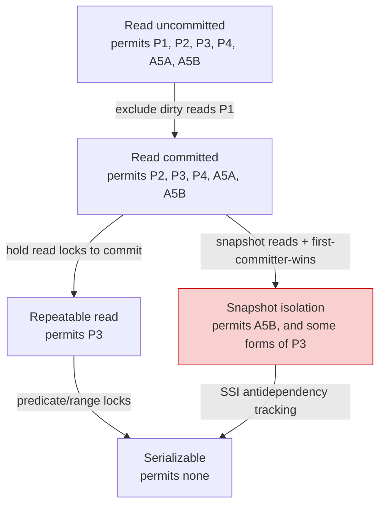

An isolation level specifies which interleavings of concurrent transactions a database permits. Serializability, the strongest level, requires every execution to be equivalent to some serial order of the transactions; conflict serializability makes that requirement checkable, and two-phase locking enforces it. The weaker levels are defined by the anomalies they exclude, each given as a concrete schedule in the notation of the [Critique of ANSI SQL Isolation Levels](https://arxiv.org/abs/cs/0701157): $r_1[x]$ means transaction 1 reads $x$, $w_1[x]$ writes it, $c_1$ commits, $a_1$ aborts.

A weaker level admits more interleavings, so transactions wait and abort less often, and the application becomes responsible for the invariants those interleavings can break. The names that database systems give their levels do not consistently match the ANSI definitions. Every anomaly schedule below was replayed on PostgreSQL 16 and MySQL 8.0 at all four levels, and lost update and write skew were measured under concurrent load; the results are under [Measured on PostgreSQL 16 and MySQL 8.0](#measured-on-postgresql-16-and-mysql-80). Multiversion concurrency control, the mechanism PostgreSQL, Oracle and InnoDB use for reads, is covered in [[systems/databases/mvcc-snapshot-isolation|MVCC and Snapshot Isolation]].

## ACID

A transaction groups reads and writes into a unit that commits or aborts atomically. The ACID properties are atomicity (all-or-nothing on abort or crash), consistency (application invariants preserved, a property of the application's transactions rather than one the database can supply), isolation (concurrent transactions do not interfere), and durability (committed data survives crashes). [Kleppmann](https://dataintensive.net/) observes that the terms are used loosely enough that "ACID" has become mostly a marketing term; the substantive differences between systems lie in what isolation means.

## Anomalies as schedules

Isolation levels are defined by which of these interleavings they exclude ([Berenson et al. 1995](https://arxiv.org/abs/cs/0701157), §3). The prose definitions in the ANSI standard are ambiguous, which is the subject of the Critique, so each anomaly is given as a schedule.

**P0, dirty write.** $w_1[x] \ldots\allowbreak w_2[x] \ldots\allowbreak (c_1 \text{ or } a_1)$. T2 overwrites data that T1 has not committed. If T1 then aborts, restoring $x$ to its value before T1 would also erase T2's write, so the correct value of $x$ is undefined. The Critique requires P0 to be excluded at every level, and PostgreSQL and MySQL both make T2 wait for T1 at every level.

**P1, dirty read.** $w_1[x] \ldots\allowbreak r_2[x] \ldots\allowbreak (c_1 \text{ or } a_1)$. T2 reads a value that may never be committed. If T1 moves 40 from $x$ to $y$ and T2 reads $x$ after the debit and $y$ before the credit, T2 observes a total that matches no committed state.

**P2, fuzzy (non-repeatable) read.** $r_1[x] \ldots\allowbreak w_2[x] \ldots\allowbreak (c_1 \text{ or } a_1)$. Another transaction changes an item that T1 has read before T1 finishes, so a second read by T1 can return a different value.

**P3, phantom.** $r_1[P] \ldots\allowbreak w_2[y \in P] \ldots\allowbreak (c_1 \text{ or } a_1)$. T1 evaluates a predicate (employees with salary above 100k), and T2 inserts, deletes or updates a row that satisfies it. P3 differs from P2 in that the conflict is on a predicate rather than an existing item, so locks on the items T1 read cannot prevent it.

**P4, lost update.** $r_1[x] \ldots\allowbreak w_2[x] \ldots\allowbreak w_1[x] \ldots\allowbreak c_1$. Both transactions read-modify-write a counter at 100: T1 computes 100 + 10, T2 computes and commits 100 + 20, then T1 writes 110 and T2's update is lost.

**A5A, read skew.** $r_1[x] \ldots\allowbreak w_2[x] \ldots\allowbreak w_2[y] \ldots\allowbreak c_2 \ldots\allowbreak r_1[y]$. T1 reads $x$ before T2's update and $y$ after it, and so observes a non-atomic view of two items related by an invariant such as $x + y = 100$.

**A5B, write skew.** $r_1[x] \ldots\allowbreak r_2[y] \ldots\allowbreak w_1[y] \ldots\allowbreak w_2[x] \ldots\allowbreak (c_1 \text{ and } c_2)$. Each transaction reads a constraint involving both items and writes the item the other one read. Neither writes what the other wrote, so there is no write-write conflict, yet the combined effect can violate an invariant that each transaction checked.

> [!example] Write skew, concretely
> Invariant: at least one of $x, y$ equals 1 (one doctor on call); initially $x = y = 1$. T1 reads $x + y = 2$ and writes $y = 0$; T2 reads $x + y = 2$ and writes $x = 0$. Both checks passed against their reads, the write sets are disjoint, both commit, and $x + y = 0$. Neither transaction alone violates the invariant; their interleaving does. The example is from [Cahill et al. (2008)](https://dl.acm.org/doi/10.1145/1376616.1376690) and [Kleppmann, chapter 7](https://dataintensive.net/).

The Critique distinguishes two readings of each phenomenon. The broad reading (P1, P2) is the pattern above, which could lead to an anomaly whatever happens next. The strict reading (A1, A2) requires the anomaly to have occurred in the committed history: A1 is $w_1[x] \ldots\allowbreak r_2[x] \ldots\allowbreak (a_1 \text{ and } c_2)$, a read of a value that was later rolled back, and A2 is $r_1[x] \ldots\allowbreak w_2[x] \ldots\allowbreak c_2 \ldots\allowbreak r_1[x] \ldots\allowbreak c_1$, a second read that returns a different value. The English wording of the ANSI standard supports only the strict readings, and the Critique shows that they are too weak. Its history H1, $r_1[x{=}50]\,\allowbreak w_1[x{=}10]\,\allowbreak r_2[x{=}10]\,\allowbreak r_2[y{=}50]\,\allowbreak c_2\,\allowbreak r_1[y{=}50]\,\allowbreak w_1[y{=}90]\,\allowbreak c_1$, is not serializable, since T2 sees a total of 60 in the middle of a transfer, but it contains no A1 (nothing aborts) and no A2. A level that excludes only A1 and A2 admits it; a level that excludes P1 does not. Locking implementations exclude the broad patterns, and the Critique's corrected definitions use them. H1 and its fuzzy-read counterpart H2 are presets in the [schedule checker](#check-a-schedule).

## Isolation levels as exclusion sets

The ANSI SQL levels, defined by which phenomena they exclude, with the Critique's broad interpretations ([Critique](https://arxiv.org/abs/cs/0701157), Table 4; P0 is excluded everywhere):

| Level | P1 dirty read | P2 fuzzy read | P3 phantom | P4 lost update | A5A read skew | A5B write skew |
| --- | --- | --- | --- | --- | --- | --- |
| Read uncommitted | possible | possible | possible | possible | possible | possible |
| Read committed | excluded | possible | possible | possible | possible | possible |
| Repeatable read | excluded | excluded | possible | excluded | excluded | excluded |
| Snapshot isolation | excluded | excluded | sometimes possible | excluded | excluded | **possible** |
| Serializable | excluded | excluded | excluded | excluded | excluded | excluded |

The Critique's central results are that the ANSI definitions, read strictly, are weak enough that a system could claim serializability while permitting anomalies, and that snapshot isolation does not fit the ladder. SI excludes everything that read committed excludes and some phantoms that repeatable read permits, yet it allows write skew, which locking repeatable read excludes, so it is neither above nor below repeatable read. Oracle's SERIALIZABLE level is snapshot isolation.

> [!info]- Definitions that do not assume locking
> The phenomena above are patterns over read and write operations, and the broad readings exclude any execution in which those operations interleave, which is how a locking scheduler behaves. A multiversion or optimistic system can permit such an interleaving and still produce a correct history, because a read may return an older version than the latest write. [Adya, Liskov and O'Neil (2000)](https://pmg.csail.mit.edu/papers/icde00.pdf) define the levels instead by cycles in a dependency graph over committed transactions, whose edges record which versions each transaction wrote and read. G0 is a cycle of write dependencies; G1 covers reading aborted or intermediate values and cycles of write and read dependencies; G2-item and G2 are cycles that include an anti-dependency (a transaction overwrote a version another had read), on items and on predicates. PL-2.99, Adya's repeatable read, excludes G0, G1 and G2-item, and PL-3, serializability, excludes all of them. Testing tools such as [Hermitage](https://github.com/ept/hermitage) and [Elle](https://arxiv.org/abs/2003.10554) classify observed histories in these terms, and the [Jepsen analysis of MySQL 8.0.34](https://jepsen.io/analyses/mysql-8.0.34) found that MySQL's REPEATABLE READ allows G2-item and lost update and so does not satisfy PL-2.99.

## Serializability theory

A schedule, an interleaving of committed transactions' operations, is **serializable** if it is equivalent to some serial execution. The tractable version is **conflict serializability**. Two operations conflict if they are from different transactions, touch the same item, and at least one writes. A schedule is conflict serializable if and only if its precedence graph is acyclic, where the nodes are transactions and there is an edge $T_i \to T_j$ whenever an operation of $T_i$ conflicts with and precedes one of $T_j$ ([Bernstein, Hadzilacos, Goodman](https://www.microsoft.com/en-us/research/people/philbe/book/), ch. 2). An acyclic graph has a topological order, and that order is the equivalent serial schedule. In the lost-update schedule, $r_1[x]\, w_2[x]$ gives $T_1 \to T_2$ and $w_2[x]\, w_1[x]$ gives $T_2 \to T_1$. The graph has a cycle, so the schedule is not conflict serializable, which is the formal statement of the lost update.

Conflict serializability is sufficient for serializability but not necessary. A schedule can be equivalent to a serial one in the values it reads and the state it leaves (view serializability) while its precedence graph has a cycle, for example when a write is overwritten before any transaction reads it. Deciding view serializability is NP-complete (Papadimitriou 1979; Bernstein et al., ch. 2), so schedulers and checkers use the conflict graph.

### Check a schedule

The figure computes, for a schedule of read, write, commit and abort steps, its precedence graph, which of the Critique's phenomena it contains, and which locking levels admit it. It also runs the schedule through several schedulers. Strict two-phase locking is a simulation. The PostgreSQL rows use the model from [[systems/databases/mvcc-snapshot-isolation|MVCC and Snapshot Isolation]], which was checked step by step against a PostgreSQL 16 server and reproduces the PostgreSQL recordings of these presets on every step. The MySQL rows replay recordings of the unedited presets on MySQL 8.0. Each row ends with the final state and whether some serial order of the committed transactions reads the same values and leaves the same state.

<ScheduleChecker preset="P4_lost_update" />

Interleavings to try in the figure:

- **Lost update.** PostgreSQL's read committed and every MySQL level below serializable end at 110. PostgreSQL's repeatable read fails T1's write; MySQL's serializable and the 2PL simulation deadlock and abort T1.
- **Write skew.** Every row except PostgreSQL serializable, MySQL serializable and 2PL ends with $x = y = 0$. Pick $w_1[x]$ and move it before $r_2[x]$: the cycle disappears and every scheduler produces a serializable result.
- **Critique H1.** The phenomena panel lists P1 but not A1, and the graph has a cycle. Only MySQL's read uncommitted row lets T2 read the uncommitted 10.
- **Dirty write.** Every scheduler makes $w_2[x]$ wait until T1 rolls back, so no implemented level admits P0.

The 2PL simulation and MySQL's SERIALIZABLE produce the same reads, waits, deadlock victims and final states on all eight presets, which the figure's tests check. InnoDB implements SERIALIZABLE by converting every plain `SELECT` to `SELECT ... FOR SHARE` when autocommit is off ([MySQL docs](https://dev.mysql.com/doc/refman/8.4/en/innodb-transaction-isolation-levels.html)), which makes it strict two-phase locking with shared and exclusive row locks.

## Mechanisms

**Two-phase locking.** Each transaction acquires shared locks to read and exclusive locks to write, and once it releases any lock it may acquire no more, so it has a growing phase followed by a shrinking phase ([Eswaran et al. 1976](https://dl.acm.org/doi/10.1145/360363.360369)). Every 2PL execution is conflict serializable, and the order of the transactions' lock points (the moment at which each holds all its locks) gives an equivalent serial order. Implementations use **strict 2PL**, holding all locks to commit, which also prevents cascading aborts, since no transaction reads or overwrites data whose writer might still roll back. Two transactions that each hold a shared lock on an item and then request an exclusive lock on it wait for each other, so a 2PL system needs deadlock detection or lock timeouts; the lost-update schedule is this case. Phantoms require more than item locks, because the conflict is with rows that do not exist yet. Eswaran et al. proposed predicate locks; implementations lock index ranges instead (next-key locking in InnoDB) as a practical approximation.

**Optimistic concurrency control.** A transaction runs without locks against a private workspace and is validated at commit; if a transaction that committed during its lifetime wrote anything it read, it aborts and retries ([Kung and Robinson 1981](https://dl.acm.org/doi/10.1145/319566.319567)). OCC outperforms locking when conflicts are rare, since aborts then cost less than lock overhead and blocking, and underperforms it under contention, where the work of aborted transactions accumulates.

**Serializable snapshot isolation.** SSI runs transactions under snapshot isolation, tracks read-write anti-dependencies at runtime, and aborts a transaction when two consecutive anti-dependencies between concurrent transactions appear ([Cahill et al. 2008](https://dl.acm.org/doi/10.1145/1376616.1376690)). PostgreSQL's SERIALIZABLE level has worked this way since 9.1; the details are in [[systems/databases/mvcc-snapshot-isolation|MVCC and Snapshot Isolation]].

## Isolation levels in implemented systems

The names of the levels that systems expose differ from the semantics they implement:

| System | Default | Read uncommitted is | Repeatable read is | Serializable is |
| --- | --- | --- | --- | --- |
| PostgreSQL | read committed | read committed | snapshot isolation | SSI |
| MySQL/InnoDB | repeatable read | dirty reads allowed | snapshot reads, writes to the newest version | strict 2PL |
| Oracle | read committed | not offered | not offered | snapshot isolation |
| SQL Server | read committed | dirty reads allowed | 2PL without range locks | strict 2PL with range locks |

PostgreSQL accepts all four level names but implements three; its READ UNCOMMITTED [behaves like READ COMMITTED](https://www.postgresql.org/docs/current/transaction-iso.html). Oracle offers read committed, serializable and a read-only mode, and its serializable fails a conflicting update with `ORA-08177` ([Oracle Database Concepts, ch. 10](https://docs.oracle.com/en/database/oracle/oracle-database/19/cncpt/data-concurrency-and-consistency.html)). SQL Server's read committed uses locks unless the database option `READ_COMMITTED_SNAPSHOT` is on, which is the default on Azure SQL Database but not on SQL Server; it also offers a SNAPSHOT level, enabled by `ALLOW_SNAPSHOT_ISOLATION`, that rolls back a transaction whose update conflicts with a concurrent one ([SET TRANSACTION ISOLATION LEVEL](https://learn.microsoft.com/en-us/sql/t-sql/statements/set-transaction-isolation-level-transact-sql)).

InnoDB's REPEATABLE READ fits no row of the ANSI table. Plain `SELECT`s read a snapshot taken at the transaction's first read, but `UPDATE`, `DELETE` and locking reads act on the newest committed row version, whatever the snapshot ([consistent nonlocking reads](https://dev.mysql.com/doc/refman/8.4/en/innodb-consistent-read.html)). A read-modify-write therefore loses updates at InnoDB's REPEATABLE READ as it does at read committed, which [Hermitage](https://github.com/ept/hermitage) and the [Jepsen analysis of MySQL 8.0.34](https://jepsen.io/analyses/mysql-8.0.34) both report and the measurements below reproduce. PostgreSQL's REPEATABLE READ fails the same write instead.

### Measured on PostgreSQL 16 and MySQL 8.0

Each schedule from [Anomalies as schedules](#anomalies-as-schedules) was replayed step by step on both servers at every level by [`anomalies.py`](isolation-experiments/anomalies.py), with one connection per transaction; the outcomes are in [`anomalies.json`](isolation-experiments/anomalies.json). "Waits" means that the step blocked on a lock until the other transaction finished.

| Schedule | PostgreSQL RU, RC | PostgreSQL RR | PostgreSQL SER |
| --- | --- | --- | --- |
| P0 dirty write | $w_2$ waits | $w_2$ waits | $w_2$ waits |
| P1 dirty read | reads committed 50 | reads committed 50 | reads committed 50 |
| P2 fuzzy read | second read 5 (occurs) | second read 50 | second read 50 |
| P3 phantom (insert) | count 2, then 3 (occurs) | count 2, then 2 | count 2, then 2 |
| P4 lost update | $x = 110$ (occurs) | $w_1$ fails, 40001 | $w_1$ fails, 40001 |
| A5A read skew | sees $x + y = 110$ (occurs) | sees 100 | sees 100 |
| A5B write skew | $x = y = 0$ (occurs) | $x = y = 0$ (occurs) | $c_2$ fails, 40001 |

| Schedule | MySQL RU | MySQL RC | MySQL RR | MySQL SER |
| --- | --- | --- | --- | --- |
| P0 dirty write | $w_2$ waits | $w_2$ waits | $w_2$ waits | $w_2$ waits |
| P1 dirty read | reads uncommitted 10 (occurs) | reads committed 50 | reads committed 50 | $r_2$ waits, reads 50 |
| P2 fuzzy read | second read 5 (occurs) | second read 5 (occurs) | second read 50 | $w_2$ waits for $c_1$ |
| P3 phantom (insert) | count 2, then 3 (occurs) | count 2, then 3 (occurs) | count 2, then 2 | insert waits for $c_1$ |
| P4 lost update | $x = 110$ (occurs) | $x = 110$ (occurs) | $x = 110$ (occurs) | deadlock, T1 aborted |
| A5A read skew | sees 110 (occurs) | sees 110 (occurs) | sees 100 | $w_2$ waits for $c_1$ |
| A5B write skew | $x = y = 0$ (occurs) | $x = y = 0$ (occurs) | $x = y = 0$ (occurs) | deadlock, T2 aborted |

PostgreSQL's three implemented levels exclude what the ANSI table says they exclude, with SI in place of repeatable read: the phantom does not appear at repeatable read because the second count reads the same snapshot, and write skew does. MySQL's READ UNCOMMITTED returns a value that is later rolled back. Its REPEATABLE READ excludes the fuzzy read, the phantom and read skew for plain reads but not the lost update, so it matches neither ANSI repeatable read, which excludes P4 by holding read locks, nor SI, which excludes P4 by failing the second writer. MySQL's SERIALIZABLE excludes every anomaly by blocking, and resolves the two schedules in which both transactions read before either writes by deadlock detection.

### Lost update under load

[`lost_update.py`](isolation-experiments/lost_update.py) runs 8 clients, each committing 500 increments of one counter row, and retries any transaction that fails with a serialization failure (40001) or, on MySQL, a deadlock (1213). Three increment patterns were run: a read-modify-write in which the client computes the new value (`SELECT v`, then `UPDATE` with the value read plus one), an atomic `UPDATE ... SET v = v + 1`, and the same read-modify-write with `SELECT ... FOR UPDATE`. Lost increments are the committed increments minus the final value. Each cell is the mean of three runs, with the range across runs in parentheses.

| PostgreSQL 16 | RU | RC | RR | SER |
| --- | --- | --- | --- | --- |
| Read-modify-write, lost | 85.6% (85.0–86.2) | 86.0% (85.5–86.2) | 0 | 0 |
| Read-modify-write, retries per commit | 0 | 0 | 4.05 (4.03–4.08) | 4.03 (4.03–4.04) |
| Read-modify-write, commits/s | 2529 (2278–2806) | 2457 (2263–2597) | 262 (254–272) | 263 (258–267) |
| Atomic `v = v + 1`, retries per commit | 0 | 0 | 3.00 (2.96–3.03) | 3.09 (2.94–3.33) |
| Atomic `v = v + 1`, commits/s | 2320 (2156–2455) | 2337 (2254–2407) | 500 (484–517) | 558 (479–673) |
| `FOR UPDATE`, retries per commit | 0 | 0 | 4.55 (4.51–4.59) | 4.50 (4.47–4.52) |
| `FOR UPDATE`, commits/s | 1749 (1689–1794) | 1832 (1723–1993) | 344 (321–372) | 340 (331–348) |

| MySQL 8.0 | RU | RC | RR | SER |
| --- | --- | --- | --- | --- |
| Read-modify-write, lost | 85.4% (85.4–85.5) | 87.5% (87.5–87.5) | 87.5% (87.5–87.5) | 0 |
| Read-modify-write, retries per commit | 0 | 0 | 0 | 6.29 (6.28–6.29) |
| Atomic `v = v + 1` and `FOR UPDATE`, lost and retries | 0 | 0 | 0 | 0 |

When 8 clients read the counter at nearly the same moment, one of each group of 8 increments survives, a loss of 7/8 = 87.5%, which MySQL's read committed and repeatable read show exactly. The atomic update and `FOR UPDATE` lose nothing at any level on either server: the atomic update reads and writes the row under its exclusive row lock, and `FOR UPDATE` takes that lock at the read. Neither needs a stronger level, and at PostgreSQL's read committed they run at 2337 and 1832 commits per second, against 262 for a read-modify-write at repeatable read.

The higher levels prevent the loss on PostgreSQL by failing the second writer, and every failure is a retry: at repeatable read each committed increment took four failed attempts on average. PostgreSQL also fails the atomic `UPDATE ... SET v = v + 1` at repeatable read and serializable when the row changed after the transaction's snapshot, so an increment that needs no retry at read committed needs a retry loop at the higher levels. MySQL's `UPDATE` reads the newest committed row at every level, which makes the atomic update safe without retries at every level and the client-side read-modify-write unsafe at every level below SERIALIZABLE. The throughput figures compare levels within one server; the two servers ran with different durability settings and are not compared with each other.

### Write skew under load

[`write_skew.py`](isolation-experiments/write_skew.py) runs the on-call check on PostgreSQL. Each trial takes a shift with two doctors, both on call, and starts two transactions together on a barrier. Each transaction counts the doctors on call for the shift and, if the count is at least 2, takes its own doctor off call; a transaction that fails with 40001 is retried from the start. Four pairs run trials at once, on shifts far apart in the index, for 1000 trials per run and three runs per cell. One variant sleeps 2 ms between the check and the write, standing in for an application round trip; another reads the rows with `SELECT ... FOR UPDATE`.

| PostgreSQL 16 | RU | RC | RR | SER |
| --- | --- | --- | --- | --- |
| Count then update, nobody left on call | 97.0% (96.5–97.8) | 97.2% (96.9–97.7) | 97.3% (97.0–97.7) | 0 |
| Same, with 2 ms between check and write | 100% | 100% | 100% (99.9–100) | 0 |
| Same, retries per trial | 0 | 0 | 0 | 1.04 (1.02–1.08); 1.07 with 2 ms |
| `FOR UPDATE` with 2 ms, nobody left on call | 0 | 0 | 0 | 0 |
| `FOR UPDATE` with 2 ms, retries per trial | 0 | 0 | 1.00 | 1.00 |

Two transactions started together overlap in nearly every trial, and the 2 ms gap makes the overlap certain, so at every level below serializable the invariant failed in 97 to 100% of trials. SERIALIZABLE left exactly one doctor on call in every trial. It retried about once per trial, since one of the two transactions in an overlapping pair fails; the remaining 4 to 7% are second failures. `SELECT ... FOR UPDATE` fixes the check at every level because both transactions lock the same two rows. At read committed the second transaction waits, then re-evaluates its `WHERE` clause against the committed rows and counts one doctor; at repeatable read it fails once, and its retry counts one. The lock works only because the rows that the check reads exist. When the check is over rows that do not exist yet, such as two bookings of one room that each verify that no booking overlaps, there is nothing to lock, and the remedies are SERIALIZABLE, a unique or exclusion constraint, or materializing the conflict as rows that can be locked ([Kleppmann, chapter 7](https://dataintensive.net/)).

> [!info]- Method, hardware and versions
> - **Machine.** 4 vCPU Intel Xeon at 2.10 GHz (cloud VM), 15 GB RAM, Ubuntu 24.04. Clients ran on the same machine over local connections, one Python thread per connection (Python 3.13, psycopg 3.3.9, PyMySQL 2.2.8).
> - **PostgreSQL 16.15**, default configuration except `shared_buffers = 512MB`; `fsync` and `synchronous_commit` on.
> - **MySQL 8.0.46** (InnoDB), default configuration: `innodb_flush_log_at_trx_commit = 1`, binary log on with `sync_binlog = 1`.
> - **Schedule replays** ([`anomalies.py`](isolation-experiments/anomalies.py)). Each step is sent to its transaction's connection; the driver waits up to 0.4 s for it and otherwise records it as blocked and issues the next step, with later steps of a blocked transaction queued behind it. Lock waits time out after 5 s. Each schedule ran once per server and level. The outcomes are deterministic except for which transaction InnoDB picks as a deadlock victim.
> - **Lost update** ([`lost_update.py`](isolation-experiments/lost_update.py), [`lost_update.json`](isolation-experiments/lost_update.json), [`lost_update_mysql.json`](isolation-experiments/lost_update_mysql.json)). The table is recreated before each run. A transaction is retried until it commits, so the commit count is fixed at 4000 per run and the number of retries varies.
> - **Write skew** ([`write_skew.py`](isolation-experiments/write_skew.py), [`write_skew.json`](isolation-experiments/write_skew.json)). The table holds 50,000 shifts so that the count reads through the index on `shift`; the plan is recorded in the JSON. A sequential scan would take a relation-level SIREAD lock under SERIALIZABLE, and every pair would then conflict with every other.
> - **Summaries.** [`summarize.py`](isolation-experiments/summarize.py) prints the tables above ([`summary.txt`](isolation-experiments/summary.txt)), and [`export_figure_data.py`](isolation-experiments/export_figure_data.py) writes the figure's MySQL recordings.

## Related notes

- [[systems/databases/mvcc-snapshot-isolation|MVCC and Snapshot Isolation]]: version storage, snapshots, SSI and its cost, measured on PostgreSQL 16.
- [[systems/distributed-systems/consistency|Consistency]]: linearizability and the non-transactional models that share names with isolation levels.
- [[systems/distributed-systems/two-phase-commit|Two-Phase Commit]] and [[systems/distributed-systems/non-blocking-two-phase-commit|Non-Blocking Two-Phase Commit]]: atomic commit across machines.
- [[systems/databases/foundations/ch3-storage-and-retrieval|Storage and Retrieval]]

## Sources

- [Berenson, Bernstein, Gray, Melton, O'Neil, O'Neil (1995), A Critique of ANSI SQL Isolation Levels](https://arxiv.org/abs/cs/0701157)
- [Eswaran, Gray, Lorie, Traiger (1976), The Notions of Consistency and Predicate Locks in a Database System](https://dl.acm.org/doi/10.1145/360363.360369)
- [Bernstein, Hadzilacos, Goodman (1987), Concurrency Control and Recovery in Database Systems](https://www.microsoft.com/en-us/research/people/philbe/book/)
- [Kung and Robinson (1981), On Optimistic Methods for Concurrency Control](https://dl.acm.org/doi/10.1145/319566.319567)
- [Adya, Liskov, O'Neil (2000), Generalized Isolation Level Definitions](https://pmg.csail.mit.edu/papers/icde00.pdf)
- [Cahill, Röhm, Fekete (2008), Serializable Isolation for Snapshot Databases](https://dl.acm.org/doi/10.1145/1376616.1376690)
- [Kleppmann, Hermitage: testing transaction isolation levels](https://github.com/ept/hermitage)
- [Kingsbury and Alvaro (2020), Elle: Inferring Isolation Anomalies from Experimental Observations](https://arxiv.org/abs/2003.10554)
- [Alvaro and Kingsbury (2023), Jepsen: MySQL 8.0.34](https://jepsen.io/analyses/mysql-8.0.34)
- [Kleppmann, Designing Data-Intensive Applications, ch. 7](https://dataintensive.net/)
- [PostgreSQL docs, Transaction Isolation](https://www.postgresql.org/docs/current/transaction-iso.html)
- [MySQL 8.4 docs, InnoDB Transaction Isolation Levels](https://dev.mysql.com/doc/refman/8.4/en/innodb-transaction-isolation-levels.html)
- [Oracle Database 19c Concepts, Data Concurrency and Consistency](https://docs.oracle.com/en/database/oracle/oracle-database/19/cncpt/data-concurrency-and-consistency.html)
- [Microsoft, SET TRANSACTION ISOLATION LEVEL](https://learn.microsoft.com/en-us/sql/t-sql/statements/set-transaction-isolation-level-transact-sql)
