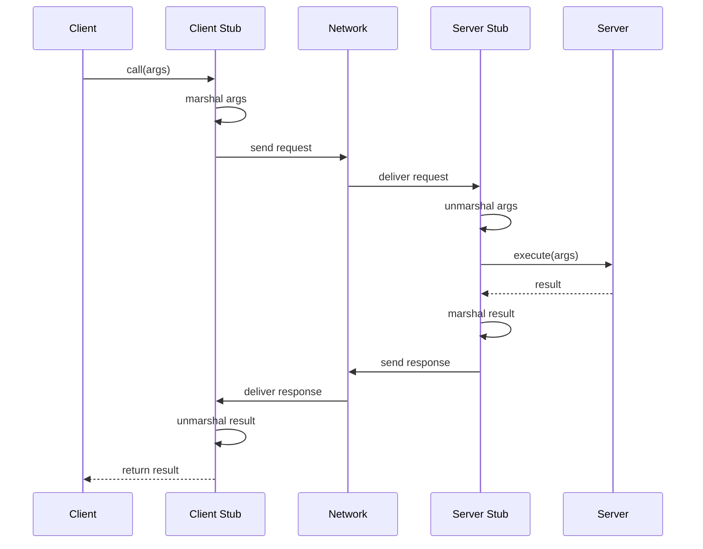
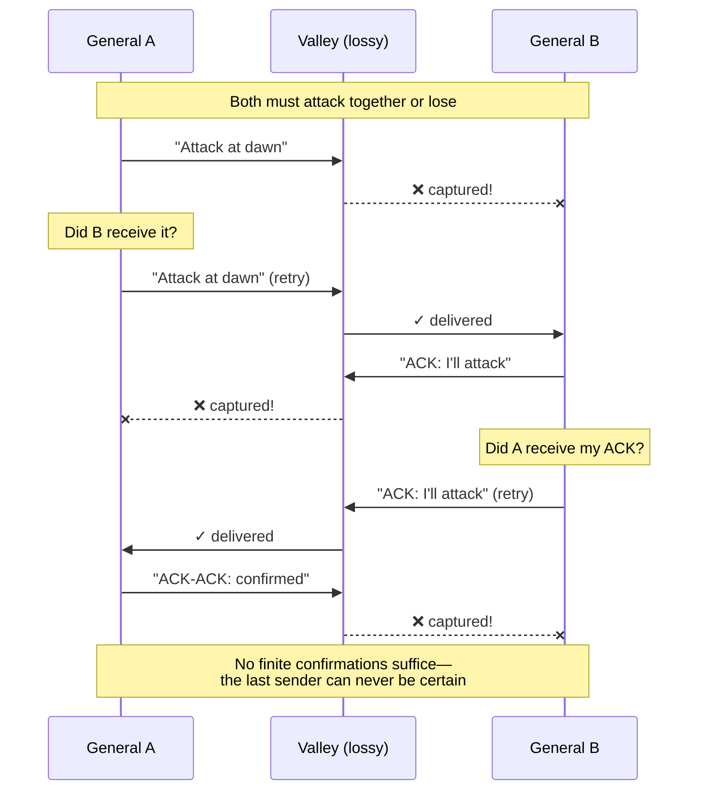

A remote procedure call (RPC) is a request from a client to execute a function on a server on a different machine. To the client, the request has the form of a local function call; to the server, it has the form of an invocation of a function it implements. Unlike a local call, an RPC can fail through the loss of a message or the crash of either machine, so its semantics are defined relative to a fault model.

## Local procedure call

- The caller invokes a function by name with args.
    - Arguments are passed in registers, and additional arguments are pushed onto the stack.
    - The return program counter (%rip) is pushed onto the stack.
    - Control jumps to the first instruction (entry point) of the callee.
- The callee executes the function and returns to the caller.
    - It reads params from registers and the stack.
    - It computes the function, possibly updating state.
    - It jumps back to the next instruction after the call.

The compiler defines the protocol for this call, and no message can be lost between caller and callee.

## Remote procedure call

- On the client, a stub implements a function that looks like a local call.
    - Parameters are *marshalled* into a message (arbitrary types).
    - The message is sent to the server (possibly in multiple packets).
    - The client waits for a response.
- On the server, the real function runs.
    - The server *unmarshals* (parses) the message.
    - It computes the function, possibly updating state.
    - It *marshals* the return value into a message (possibly multiple packets).
    - It sends the message back to the client.

Client and server stubs are usually auto-generated from a procedure spec, as with Google's [Protocol Buffers](https://protobuf.dev).

## RPC vs. local procedure call

### Binding

- The client needs a connection to the server.
- The server must implement the required function.
- The server needs to run a compatible version of the function.

### Service discovery

A discovery service keeps track of all available services, including versions, schemas, and locations, so clients can find a server to bind to.

### Interface description language (IDL)

An IDL such as protobuf generates the client and server serialization stubs automatically. Procedure arguments can be values or pointers, and they must be assembled into a single linear message in a transportable format. That format is not always a string; protobuf uses a binary encoding.

### Failures

- Packets can be lost, reordered, or duplicated.
- The client or server can crash at any time, before, during, or after the call.
- The server or network can be slow, and the client can time out.

TCP mitigates some network failures, but connections can still fail, and not every RPC system uses TCP.

## Fault model

- **Asynchronous fail-stop nodes**
    - A computer may be arbitrarily slow while still working.
    - Nodes fail only by stopping, never by transmitting garbage or forgetting state. This is a strong assumption. For arbitrarily behaving nodes, see *Byzantine fault tolerance*.
- **Network model**
    - Messages can be lost, delayed, reordered, or duplicated, and can be arbitrarily delayed while the network still works correctly.
    - Messages are not corrupted (no bit flips), which is also a strong assumption. Error detection and correction codes address networks in which it does not hold.
    - The network may partition nodes from each other, so nodes can end up in isolated groups with no connection between them.
    - Connectivity is symmetric and transitive: if A can talk to B, then B can talk to A, and if A can talk to B and B can talk to C, then A can talk to C.
- Clients make only one RPC request at a time, a very strong assumption.

## Naive RPC

- **Nodes**
    - Any number of stateless clients and servers.
    - Servers perform some computation when they receive a message, then reply.
- **Messages**
    - Client request and server response.
    - The client request contains the IP addresses of client and server, the procedure name, and the arguments.
    - The server response contains the IP addresses of client and server and the results of the procedure.

## Client timeout and retry

If a request or reply message is lost, the client waits indefinitely. A client timer with retransmission addresses this: the client resends the request if no response arrives in time. Retransmission in turn causes duplication and reordering at the server.

Unique request IDs handle the duplication. Each request and reply carries a message ID, a retransmission reuses the same ID, and the server ignores duplicates it has already processed.

### RPC semantics

> [!abstract]- RPC semantics at a glance
> | Semantic | Guarantee on success | Guarantee on failure | Requirements |
> |----------|---------------------|---------------------|--------------|
> | At-least-once | Executed ≥1 times | Unknown (0 or more) | Client retry |
> | At-most-once | Executed exactly once | Executed 0 or 1 times | Duplicate detection |
> | Exactly-once | Executed exactly once | Executed exactly once | Dedup + persistent state + unbounded retry |

- **At least once**
    - Client resends on timeout, server executes every copy of the request that arrives.
    - If the client gets a response, it knows the server executed the request at least once. Otherwise it doesn't know whether the server executed the request at all.
- **At most once**
    - The server executes only the first copy that arrives.
    - If the client gets a reply, it knows the server executed the request exactly once. Otherwise it doesn't know whether the server executed it, though it knows it ran at most once.
- **Exactly once**
    - The server executes the request exactly once.
    - Requires a unique request ID and a server that remembers the ID and the result of the request, along with unbounded retries.

#### At least once

The client makes a finite number of retries and then returns an error to the caller.

At-least-once semantics are correct only for **idempotent** operations, whose repeated execution has the same effect as a single execution. All read-only operations are idempotent. Many writes are not; incrementing a counter is not idempotent, while setting the counter to a value is.

> [!tip] Idempotent operations under at-least-once semantics
> Operations can be designed so that repeating them has no further effect: absolute values (`SET counter = 5`) in place of deltas (`INCREMENT counter`), client-generated unique IDs that allow the server to deduplicate, and state changes structured as "apply if not already applied." When idempotency holds, retries are safe and at-least-once semantics suffice.

TCP does not solve this problem, although it is reliable. Many RPC systems run over TCP, which guarantees in-order delivery with retransmission and duplicate detection, but TCP cannot provide exactly-once semantics. If the server crashes after processing the request and before sending the response, the client retransmits and the server executes the request again.

> [!warning] TCP does not provide exactly-once semantics
> TCP guarantees reliable, in-order delivery at the transport layer, but it operates below the application. If the server crashes *after* processing a request but *before* sending the response, the TCP connection breaks. The client retries, establishing a new connection, and the server, once recovered, executes the request a second time. The duplicate arises above the layer at which TCP operates.

**[[systems/research/end-to-end-arguments-in-sys-design|End to end principle]]**: functionality should be implemented where it can be completely handled, rather than partially handled at each layer. Handling retries at the RPC layer rather than relying on TCP is an instance of the principle.

Examples of idempotent workloads:

| Example | Explanation |
|---|---|
| DNS lookup | Queries are read-only, so they are idempotent |
| MapReduce | The Map phase is a pure function, so it is idempotent |
| NFS | If the client maintains the offset, reading or writing a block is idempotent |

With multiple clients, operations like `Put(k, v)` stop being safely retryable in the read-modify-write sense, since the value of `k` can change between the time one client reads it and the time it writes it back.

## Two generals problem

The two generals problem is a thought experiment that demonstrates the impossibility of guaranteed agreement over a lossy channel. Two generals coordinate an attack on a city. A valley separates them, and they communicate only by messenger. The city can capture the messenger, and the sender never learns whether the message arrived. The attack succeeds only if both generals attack together, so they must agree on a time.

After sending any message, the sender cannot know whether it was delivered. No finite number of confirmation round trips resolves this, because the last message sent could always have been the one that was lost. The same limit appears throughout distributed systems, for example in the commit problem that [[systems/distributed-systems/two-phase-commit|two-phase commit]] addresses.

## To look into

- Remote Direct Memory Access (RDMA)
- Network File System (NFS)

## Related notes

- [[systems/distributed-systems/two-phase-commit|two-phase commit]]
- [[systems/distributed-systems/primary-backup|primary backup]]
- [[systems/research/end-to-end-arguments-in-sys-design|End-to-End Arguments in System Design]]
