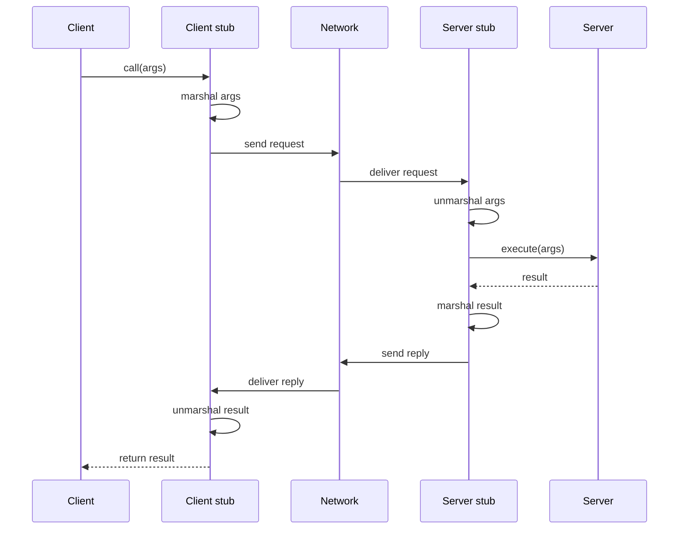
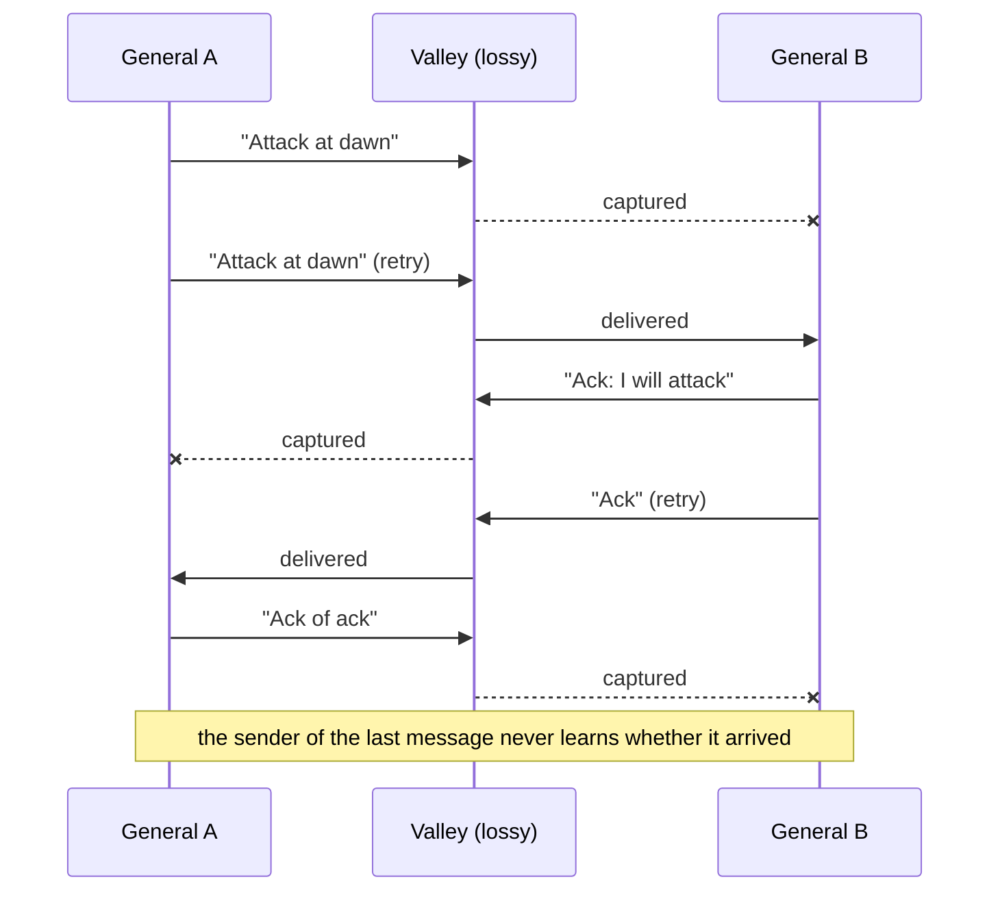

A remote procedure call (RPC) is, in [Nelson's (1981)](https://cs.nyu.edu/~apanda/classes/fa22/papers/nelson81remote.pdf) definition, "the synchronous language-level transfer of control between programs in disjoint address spaces whose primary communication medium is a narrow channel." The caller invokes a procedure by name with arguments and blocks until it returns; the procedure runs in another process, usually on another machine, and the arguments and results cross between the two as messages.

The call has the syntax of a local call but different failure behavior. A local call cannot lose its arguments, cannot run twice, and fails only if the whole program fails. A remote call can lose its request or its reply, can be executed more than once if the client retransmits, and can leave the client unable to tell whether the procedure ran at all. Which of these outcomes an RPC system permits is its *call semantics*, defined relative to a fault model. [Waldo, Wyant, Wollrath and Kendall (1994)](https://mirror.cs.odu.edu/kde/devel/smli_tr-94-29.pdf) name four differences between local and remote invocation, "latency, memory access, partial failure, and concurrency," and argue that an interface which hides them cannot be made correct; of the four, partial failure is "a central reality of distributed computing."

The idea predates the term. [RFC 707](https://www.rfc-editor.org/rfc/rfc707.html) (White, 1976) proposed modeling remote resources as collections of procedures reached through a procedure call protocol, so that remote resources would be "as easy to use as local ones." Nelson is generally credited with the term, and [Birrell and Nelson (1984)](https://www.cs.princeton.edu/courses/archive/fall11/cos518/papers/rpc.pdf) describe the implementation in Xerox's Cedar environment whose structure (stubs generated from an interface, a runtime that retransmits and suppresses duplicates) most later systems follow. Their median null call between two Dorados on a 2.94 Mb/s Ethernet took 1,097 µs.

## Local procedure call

On x86-64 Linux the [System V AMD64 ABI](https://student.cs.uwaterloo.ca/~cs350/F23/refs/amd64-abi.pdf) fixes the protocol between caller and callee:

- The caller places the first six integer or pointer arguments in `%rdi`, `%rsi`, `%rdx`, `%rcx`, `%r8` and `%r9` and the rest on the stack, then executes `call`, which pushes the return address and jumps to the callee's entry point ([Intel SDM, `CALL`](https://www.cs.ubbcluj.ro/~diana.sotropa/teaching/asc/practic/html/CALL.html)).
- The callee reads its arguments from registers and the stack, computes, possibly updating shared memory, leaves an integer result in `%rax`, and executes `ret`, which pops the return address.

Caller and callee share an address space, so an argument can be a pointer, and the transfer of control cannot be lost or repeated. The [[#Measured cost of a call|measurement below]] puts a call that copies a 16-byte argument into a fresh buffer at 16 ns.

## Anatomy of a remote call

The client calls a *stub*, a local procedure with the remote procedure's signature. The stub *marshals* the arguments into a message, sends it, and waits. On the server a stub *unmarshals* the arguments, calls the real procedure, marshals the result and sends it back; the client stub unmarshals the result and returns it to the caller.



**Interface description.** Stubs are generated from an interface written in an interface description language (IDL). Since the two address spaces are disjoint, a pointer argument has no meaning on the server, and arguments must be flattened into a self-contained byte sequence. [Protocol Buffers](https://protobuf.dev/programming-guides/encoding/) encode each field as a record of field number, wire type and payload, with integers as base-128 varints and variable-length fields prefixed by their length ("Tag-Length-Value"). JSON encodes the same data as text and encodes byte strings in base64. [gRPC](https://grpc.io/docs/what-is-grpc/introduction/) uses protobuf as its IDL and carries calls over [HTTP/2](https://github.com/grpc/grpc/blob/master/doc/PROTOCOL-HTTP2.md). The [[systems/databases/foundations/ch4-encoding-and-evolution#Through services: REST and RPC|encoding and evolution note]] covers how such schemas change without breaking old clients.

**Binding and discovery.** Before the first call the client must locate a server that implements the interface, at a compatible version, and connect to it. A discovery service (Grapevine in Birrell and Nelson's system; DNS, a service registry or a load balancer today) maps interface names to addresses.

## Measured cost of a call

The experiment times one call to a procedure that returns a copy of its byte-string argument, made five ways from Go on one machine: as a local function call, and as an RPC over loopback using a raw UDP datagram, a length-prefixed message on a persistent TCP connection, HTTP/1.1 with a JSON body on a kept-alive connection (`net/http`), and gRPC 1.83 (HTTP/2, protobuf) using the gRPC project's own interop `TestService`. One client issues calls one at a time. The two marshal rows time the four codec operations of one call (encode request, decode request, encode reply, decode reply) in a single process. Values are medians over three runs of each run's median, in µs, with the 99th percentile in parentheses.

| Call | 16-byte argument | 4 KiB argument |
| --- | ---: | ---: |
| Local function call | 0.016 (0.030) | 1.44 (2.00) |
| Protobuf marshal and unmarshal, in process | 0.90 (1.57) | 8.1 (10.9) |
| JSON marshal and unmarshal, in process | 1.16 (1.95) | 59.6 (75.0) |
| UDP request and reply, loopback | 37.4 (84.9) | 36.2 (80.1) |
| TCP request and reply, loopback | 38.8 (75.9) | 37.3 (94.2) |
| HTTP/1.1 + JSON, loopback | 112 (247) | 194 (429) |
| gRPC (HTTP/2 + protobuf), loopback | 132 (256) | 121 (285) |

With a 16-byte argument the cheapest remote call costs about 2,300 times a local one before any network is involved. Most of that is the kernel path: two system calls and a scheduler wakeup on each side of a loopback round trip on a 4-vCPU virtual machine. Marshalling takes under 2 µs at this size, so the 75 µs that HTTP adds over raw TCP and the 95 µs that gRPC adds are spent in request framing, header processing and the libraries' handoffs between goroutines. With a 4 KiB argument the codec matters: JSON's base64 encoding and decoding take 60 µs per call, which accounts for most of the increase of HTTP/JSON from 112 to 194 µs, while protobuf copies the bytes and the latency of gRPC does not grow. A call between machines adds the network round-trip time to every remote row.

> [!note]- Latency measurement record
> The code is in [rpc-experiments](https://github.com/elimelt/web/tree/main/notes/content/systems/distributed-systems/rpc-experiments) (`latency/main.go`, `run_latency.py`).
>
> - **Machine:** a 4-vCPU Intel Xeon cloud VM at 2.30 GHz (KVM), Linux 6.18, Go 1.25.0, `google.golang.org/grpc` v1.83.2, `google.golang.org/protobuf` v1.36.11. Client and server are separate processes on this machine; `GOMAXPROCS` is 4; no CPU pinning.
> - **Procedure:** `echo(body []byte) []byte` returns a fresh copy of its argument and is marked `//go:noinline`. Every transport invokes it on the server; the local row calls it directly.
> - **Transports:** UDP sends the body as one datagram on a connected socket. TCP frames it with a 4-byte length on one persistent connection. HTTP posts `{"body": "<base64>"}` to `/echo` on a kept-alive connection and decodes the JSON reply. gRPC calls `grpc.testing.TestService/UnaryCall` with the body in `SimpleRequest.payload`, over cleartext HTTP/2.
> - **Runs:** a fresh server process, then for each transport and size a fresh client process: 2,000 unmeasured calls, then 20,000 calls each timed with Go's monotonic clock. The local and marshal rows time batches (100,000 and 2,000 calls) and divide, 200 batches per run, because one local call is shorter than the resolution of a pair of clock reads. Three runs. The run medians ranged from 0.87 to 1.11 µs for protobuf at 16 bytes, 37.1 to 40.3 µs for UDP at 16 bytes, 29.2 to 36.7 µs for UDP at 4 KiB, and 128 to 139 µs for gRPC at 16 bytes; `latency-results.txt` gives every range.
>
> ```sh
> cd notes/content/systems/distributed-systems/rpc-experiments
> go build -o bin/latency ./latency && python3 run_latency.py
> ```

## Failures and the fault model

A remote call can fail in ways a local one cannot:

- A request or reply can be lost, delayed, duplicated or reordered.
- The client or the server can crash before, during or after the procedure runs.
- The server or the network can be slow enough that the client stops waiting.

The analysis of call semantics assumes the following model. Several of its assumptions are strong.

- **Asynchronous fail-stop nodes.** A node can be arbitrarily slow while still correct. A node fails only by stopping; it never sends incorrect messages. A node that restarts loses its volatile memory unless it wrote state to stable storage. Arbitrary failures are the subject of Byzantine fault tolerance.
- **Network.** Messages can be lost, delayed without bound, reordered or duplicated, but not corrupted; checksums detect corruption in practice. The network can partition the nodes into groups that cannot communicate. Connectivity is assumed symmetric and transitive within a partition (if A reaches B and B reaches C, then B reaches A and A reaches C), which real networks do not always provide.
- **One outstanding call per client.** Each client thread has at most one call in progress. Birrell and Nelson make the same restriction ("each activity has at most one outstanding remote call at any time"), and it keeps the server's duplicate-suppression state small.

TCP removes loss, duplication and reordering within one connection, but a connection can break, and a crash of either end loses whatever the application had not yet processed. The [[#TCP and the end-to-end argument|end-to-end argument]] explains why RPC systems handle retransmission and duplicates above the transport.

## Retransmission and call semantics

A client that sends one request and waits for the reply waits indefinitely if either message is lost. The client therefore sets a timer and resends the request if no reply arrives before it expires. Retransmission makes duplicate requests reach the server: if the request arrived and only the reply was lost, the retransmitted copy is a second request for the same call. Each request carries a call identifier, unique per call and reused by every retransmission of that call, so the server can recognize copies.

What the server does with a copy defines the semantics. [Spector (1982)](https://www.cs.tufts.edu/~nr/cs257/archive/alfred-spector/spector82cacm.pdf) distinguished *maybe* (performed zero or one times), *at-least-once* (one or more times) and two *only-once* variants, the second of which executes exactly once "regardless of failures." The names in current use:

| Semantics | Server behavior | If the client receives a reply | If the client reports an error | Requires |
| --- | --- | --- | --- | --- |
| At least once | executes every copy that arrives | executed one or more times | executed zero or more times | client retransmission |
| At most once | executes the first copy, answers later copies from a table of replies | executed exactly once | executed zero or one times | call identifiers and a reply table |
| Exactly once | as at most once, with the table on stable storage | executed exactly once | does not occur; the client retransmits until a reply arrives | a durable reply table and a server that eventually recovers |

Birrell and Nelson's runtime provides at-most-once: "if the call returns to the user then the procedure in the server has been invoked precisely once. Otherwise, an exception is reported to the user and the procedure will have been invoked either once or not at all," and "the user is not told which."

### Execution counts under message loss

Let each request be lost with probability $q$ and each reply with probability $r$, independently, and let the client send at most $n$ times, with a timeout longer than the round-trip time so that no reply arrives after its timer. Each send then has one of three outcomes:

$$
\Pr[\text{request lost}] = q, \qquad
\Pr[\text{executed, reply lost}] = (1-q)\,r, \qquad
\Pr[\text{executed, reply arrives}] = s = (1-q)(1-r).
$$

The client stops at the first send whose reply arrives, so

$$
\Pr[\text{reply}] = 1 - (1-s)^n, \qquad
\mathbb{E}[\text{sends}] = \frac{1-(1-s)^n}{s}.
$$

Under at-least-once every delivered request executes, so $\mathbb{E}[\text{executions}] = (1-q)\,\mathbb{E}[\text{sends}]$, and a duplicate requires a lost reply: with $r = 0$ no call executes twice however many requests are lost. Under at-most-once the call executes once if any copy arrives, which happens with probability $1 - q^n$. Under either semantics the client reports an error with probability $(1-s)^n$; of that, the call never ran with probability $q^n$ and ran with probability $(1-s)^n - q^n$, and the client cannot distinguish the two.

The figure computes the exact distribution of executions per call by dynamic programming over sends, samples one call from the same model for the space-time diagram, and overlays the Linux measurement where the setting was measured (4 sends).

<RetryLab />

The measurement runs a Go client and server that exchange UDP datagrams over loopback, with the kernel dropping packets: two `iptables` rules with the `statistic --mode random` match drop each request with probability $q$ and each reply with probability $r$. The procedure appends a record to a ledger file and returns the ledger's length, an operation that is not idempotent, and counting ledger records per call identifier after a run gives the number of executions of every call. Sixteen clients each keep one call outstanding, with a 20 ms timeout and at most 4 sends. Each setting ran 3 times with 4,800 calls; values are means over the runs, in percent of calls, with the model in parentheses.

| $q$ | $r$ | Server | Reply received | Executed twice or more | Error after executing |
| ---: | ---: | --- | ---: | ---: | ---: |
| 0 | 0 | at least once | 100 (100) | 0 (0) | 0 (0) |
| 0.2 | 0 | at least once | 99.78 (99.84) | 0 (0) | 0 (0) |
| 0 | 0.2 | at least once | 99.86 (99.84) | 20.10 (20.00) | 0.14 (0.16) |
| 0.1 | 0.1 | at least once | 99.82 (99.87) | 10.38 (9.96) | 0.17 (0.12) |
| 0.2 | 0.2 | at least once | 98.30 (98.32) | 19.31 (19.46) | 1.52 (1.52) |
| 0.2 | 0.2 | at most once | 98.23 (98.32) | 0 (0) | 1.60 (1.52) |
| 0.5 | 0.5 | at least once | 68.19 (68.36) | 34.34 (34.38) | 25.59 (25.39) |
| 0.5 | 0.5 | at most once | 68.05 (68.36) | 0 (0) | 25.53 (25.39) |

Every measured fraction is within 0.5 percentage points of the model, and the figure's test checks all 18 measured settings against it within four binomial standard errors. With no loss no call ran twice, so the 20 ms timeout produced no premature retransmissions. Request loss alone produced no duplicates, and reply loss alone at $r = 0.2$ made 20.1% of at-least-once calls run at least twice. At-most-once removed every duplicate and left the error outcome unchanged: at 50% loss in both directions about a quarter of all calls returned an error after the procedure had run, under both semantics.

> [!note]- Message-loss measurement record
> The code is in [rpc-experiments](https://github.com/elimelt/web/tree/main/notes/content/systems/distributed-systems/rpc-experiments) (`sem/main.go`, `run_sem.py`, `summarize_sem.py`).
>
> - **Machine:** as in the latency measurement (4 vCPUs, Linux 6.18, Go 1.25.0). The kernel has no `sch_netem`, so drops are made by `iptables -A INPUT -i lo -p udp --dport 47201 -m statistic --mode random --probability q -j DROP` for requests and the same rule with `--sport 47201` for replies. The rules' packet counters give the realized drop rates: averaged over the three runs of a setting they were within 0.005 of $q$ and $r$, and within 0.018 in any single run.
> - **Server:** one goroutine reads datagrams. A request is the 8-byte call identifier; the reply is the identifier and the 8-byte result. To execute, the server appends `"<id> <length>\n"` to the ledger with one `write(2)`. The at-most-once server keeps a map from call identifier to result and answers a copy from it without executing. The map is never pruned during a run.
> - **Client:** 16 goroutines, each with its own connected UDP socket and one outstanding call. A call sends, waits up to 20 ms for a reply carrying its identifier (discarding replies to earlier calls), and resends, at most 4 sends in total. The client prints the number of sends and whether a reply arrived for each call.
> - **Settings:** $q = r \in \{0, 0.01, 0.05, 0.1, 0.2, 0.3, 0.5\}$ and the asymmetric $(0.2, 0)$ and $(0, 0.2)$, each with both servers, 3 runs of 4,800 calls. `sem-results.txt` lists every setting beside the model, computed there by enumerating all $3^n$ outcome sequences, independently of the figure's dynamic program. The client runs of the loss and crash experiments took about 4 minutes in total.
>
> ```sh
> cd notes/content/systems/distributed-systems/rpc-experiments
> go build -o bin/sem ./sem
> sudo python3 run_sem.py          # needs root for iptables
> python3 summarize_sem.py         # writes sem-results.txt and the figure's data.ts
> ```

### At most once and server crashes

The reply table of an at-most-once server needs a bound and needs to survive crashes. Birrell and Nelson bound it with the one-outstanding-call restriction: a call identifier consists of a calling activity (machine and process) and a sequence number, the server "maintains a table giving the sequence number of the last call invoked by each calling activity," and a packet whose sequence number is not greater than the table's entry is a duplicate. A new call from an activity implies that its previous call completed, so one entry per client suffices. A server that keeps the table only in memory loses it in a crash, and a retransmission that reaches the restarted server executes again.

A second experiment measures this. Replies are lost with probability $r = 0.1$ and requests are not lost; the server process is killed with `SIGKILL` at intervals drawn uniformly from 20 to 60 ms and restarted at once, 95 to 108 times per run; the client retries without limit. Three servers were compared over 3 runs of 24,000 calls:

| Server | Calls executed twice or more |
| --- | ---: |
| At least once | 10.19% |
| At most once, reply table in memory | 5.38% |
| At most once, reply table rebuilt from the ledger at restart | 0 |

Under at-least-once about 10% of calls lose a reply and run again, as without crashes. With the table in memory, a duplicate needs a lost reply followed by a crash before the retransmission 20 ms later. With crash intervals uniform on 20 to 60 ms (mean 40 ms), the time from an arbitrary instant to the next crash is less than 20 ms with probability $20/40 = 0.5$, so the expected fraction is about $0.1 \times 0.5 = 0.05$, against 5.38% measured. The recovering server writes each ledger record, which contains the call identifier and its result, before it sends the reply, and reloads the table from the ledger when it starts; each of its 72,000 calls executed exactly once. Because the experiment kills only the process, the record survives in the page cache; surviving a machine crash would also require `fsync` before the reply.

### Exactly once

Exactly-once execution is at-most-once with a durable reply table, combined with a client that retransmits until a reply arrives (and that must itself survive its own crashes to keep retrying), so that the call eventually runs once. It holds only under the assumption that the server eventually recovers, and no protocol bounds how long the client waits. Production systems implement it under other names:

- [Stripe's idempotency keys](https://docs.stripe.com/api/idempotent_requests): for API v1, the server saves the status code and body of the first request made with a key, returns them to retries with the same key, and rejects a retry whose parameters differ. Keys can be removed once they are at least 24 hours old, and a key reused after that starts a new request, so exactly-once holds only within that window.
- [Kafka's idempotent producer (KIP-98)](https://cwiki.apache.org/confluence/display/KAFKA/KIP-98+-+Exactly+Once+Delivery+and+Transactional+Messaging): each producer has a producer ID and a sequence number per partition, and the broker rejects a write whose sequence number is not one greater than the last committed one from that producer, the same scheme as Birrell and Nelson's table.
- [gRPC retries (gRFC A6)](https://github.com/grpc/proposal/blob/master/A6-client-retries.md) are configured per method in the service configuration; gRPC provides no way to mark a method idempotent and leaves the choice of retryable status codes to the service owner. An RPC is *committed*, and no longer retried, once the client receives response headers. Without a retry policy gRPC retries only when the RPC never left the client, or reached the server's gRPC library but not the application ([retry guide](https://grpc.io/docs/guides/retry/)).

## Idempotence

An operation is idempotent if executing it twice has the same effect as executing it once. Retransmission under at-least-once semantics is safe for idempotent operations, which is why many systems use at-least-once and design their operations to be idempotent in place of maintaining a reply table. Read-only operations are idempotent. Setting a register to a value is idempotent; incrementing it is not. Operations can be made idempotent by sending absolute values instead of deltas, by having the client generate a unique identifier for each object it creates so that the server can recognize a repeated creation, and by conditioning a change on the state it expects ("apply if the version is 7").

Idempotence of each operation in isolation is not sufficient when other clients write concurrently. Suppose client A sends `Put(k, 1)`, the request is delayed in the network, A times out and resends, and the second copy executes and replies. Client B then executes `Put(k, 2)`. If A's first copy now arrives at an at-least-once server, it executes and sets `k` back to 1, an outcome that no serial order of A's single write and B's write produces. An at-most-once server discards the late copy; a versioned write ("set `k` to 1 if its version is 6") also rejects it.

| Example | Why retrying is safe or unsafe |
| --- | --- |
| DNS lookup | A query is read-only. |
| MapReduce task | When map and reduce are deterministic, a re-executed task produces the same output, and task outputs are committed atomically (reduce output by an atomic rename), so the output of a duplicate task is discarded ([Dean and Ghemawat, 2004](https://usenix.org/event/osdi04/tech/full_papers/dean/dean_html)). |
| NFS read or write | Each request names the file and an explicit offset, so a repeated request reads or writes the same bytes. |
| NFS remove, rename, mkdir | A retransmission of a request that already succeeded fails, because the file is already gone or already exists, and the client receives an error for an operation that succeeded. Servers keep a duplicate request cache of recent replies to such requests, first described by Juszczak (1989) and still present in Linux's NFS server ([Gardner, D'Angelo and Sears, 2009](https://www.kernel.org/doc/ols/2009/ols2009-pages-95-100.pdf)). |

## TCP and the end-to-end argument

Many RPC systems run over TCP, which retransmits lost segments and discards duplicate ones within a connection. TCP still cannot provide exactly-once execution of calls. If the server executes a request and crashes before the reply is sent, the connection breaks; the client reconnects and resends, and the restarted server, with no record of the first execution, executes it again. The duplicate is created above the transport, by the client's retransmission on a new connection, so only state kept by the RPC layer or the application can recognize it.

> [!warning] TCP does not provide exactly-once semantics
> TCP's sequence numbers identify bytes within one connection. A request retransmitted on a new connection after a crash is new data to TCP. Duplicate suppression requires an identifier that outlives the connection, which the RPC layer or the application must supply.

This is an instance of the [[systems/research/end-to-end-arguments-in-sys-design|end-to-end argument]]: a function such as duplicate suppression can be implemented completely only at the layer that can recognize a duplicate, and an implementation in a lower layer is at most a performance optimization.

## Two generals problem

When a call returns an error, the client cannot tell a lost request from a lost reply, and so cannot tell whether the procedure ran. No protocol over a lossy channel removes this uncertainty. Two generals on opposite sides of a valley must attack at the same time to win, and communicate only by messengers who can be captured. General A sends "attack at dawn"; A cannot know whether it arrived, so B acknowledges; B cannot know whether the acknowledgment arrived, so A acknowledges the acknowledgment, and so on.



Suppose some protocol guaranteed agreement after a finite exchange, and consider a shortest run in which both generals attack. The last message of that run may be lost, and its sender cannot observe whether it was, so the sender attacks in the run without that message too. The receiver must then also attack in that run, or the two disagree, so the run without its last message is also a run in which both attack, and it is shorter, a contradiction. [Akkoyunlu, Ekanadham and Huber (1975)](https://dsg.tuwien.ac.at/linksites/teaching/courses/AdvancedDistributedSystems/download/1975_Akkoyunlu,%20Ekanadham,%20Huber_Some%20constraints%20and%20tradeoffs%20in%20the%20design%20of%20network%20communications.pdf) gave this argument with two groups of gangsters; Gray (1978) stated it as the generals problem; and [Halpern and Moses (1990)](https://arxiv.org/pdf/cs/0006009) proved the general form, that "when communication is not guaranteed it is impossible to attain common knowledge," so that any correct protocol for coordinated attack "guarantees that neither party ever attacks." The same limit underlies the blocking of [[systems/distributed-systems/two-phase-commit|two-phase commit]] under partitions: a participant that has voted cannot learn the outcome until it hears from the coordinator.

## Related notes

- [[systems/distributed-systems/two-phase-commit|Two-phase commit]]
- [[systems/distributed-systems/primary-backup|Primary-backup replication]]
- [[systems/distributed-systems/failure-detectors-leases-leader-election|Failure detectors, leases and leader election]]
- [[systems/databases/foundations/ch4-encoding-and-evolution|Encoding and evolution (DDIA ch. 4)]]
- [[systems/networks/4-transport/TCP|TCP]]
- [[systems/research/end-to-end-arguments-in-sys-design|End-to-End Arguments in System Design]]
